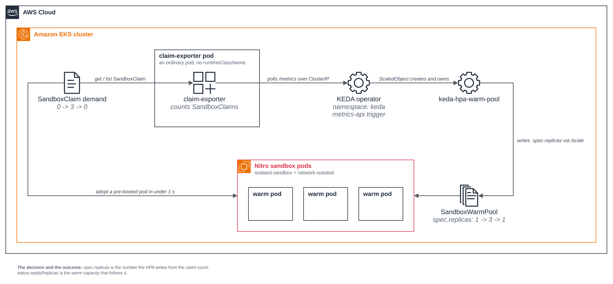

# Warm pool autoscaling with KEDA

Before you start, review the [prerequisites and shared setup](../../README.md#prerequisites)
on the home page, and run the [hello sandbox](../../getting-started/hello-sandbox/README.md)
sample first so you have a cluster with the runtime classes. This sample builds on
[warm pool](../../getting-started/warm-pool/README.md), whose `SandboxTemplate`,
`SandboxWarmPool` and `SandboxClaim` it uses and whose agent-sandbox install (step 1) it
needs. The commands below use files from this repository, so clone it if you have not
already, and run them from this sample's folder:

```bash
git clone https://github.com/aws-samples/sample-eks-nitro-sandbox.git
cd sample-eks-nitro-sandbox/examples/agent-sandbox/warm-pool-autoscaling-keda
```

It also needs [KEDA](https://keda.sh/) on the cluster, which Step 1 installs, and `helm`
on your machine to install it (3.x; the run below used the KEDA chart's own
`helm install`). Beyond the cluster there is no cost: the sample holds one warm pod at rest
and at most three under load, each reserving its memory request, and there is no model or
API call anywhere in it.

The warm pool sample keeps a fixed number of sandboxes booted. Fixed is the wrong shape for
demand that comes in bursts: too small and a burst pays the cold start it was meant to
avoid, too large and you hold pre-booted pods that nobody is asking for. This sample makes
the number follow the demand. A small in-cluster exporter counts `SandboxClaim` objects, a
KEDA `ScaledObject` reads that count over HTTP, and the Horizontal Pod Autoscaler KEDA
creates writes the pool's `spec.replicas`.

- **The pool follows demand both ways.** Claim demand goes from 0 to 3 and back to 0, and
  `spec.replicas` goes `1 -> 3 -> 1` with it. Both directions matter: the scale-up is what
  keeps the sub-second claim path available under load, and the scale-down is the whole cost
  argument.
- **What moves is the decision, not the outcome.** The page reads `spec.replicas`, the
  number the HPA writes, separately from `status.readyReplicas`, the capacity that happens
  to be ready. Only the first can tell autoscaling apart from a pool that had spare pods or
  one refilling itself after a claim.
- **The exporter stays an ordinary pod.** It is first-party code the cluster operator
  deployed, so it needs no sandbox, and keeping it out of one means it takes no sandbox
  capacity from the pool it measures. Its Role lets it `get` and `list` `SandboxClaim`
  objects in its own namespace and nothing else, and it is reached only over a ClusterIP
  Service.
- **The warm pods have no network.** They boot with
  `sandbox.amazonaws.com/network-isolated: "true"`, so there is no egress to restrict and
  the sample ships no network policy. `kubectl exec` still works, which is how the page
  reads the claimed pod.

*Figure 1: TODO: caption from the figure*



## Versions

| Component | Pin |
|---|---|
| agent-sandbox controller ([kubernetes-sigs/agent-sandbox](https://github.com/kubernetes-sigs/agent-sandbox)) | v1.0.6, as in [Warm pool](../../getting-started/warm-pool/README.md) |
| KEDA ([kedacore/keda](https://github.com/kedacore/keda)) | 2.21.0 |
| KEDA Helm chart ([kedacore/charts](https://github.com/kedacore/charts)) | 2.21.0 |

The chart version and the KEDA version are numbered separately, so they do not have to
match. For this release they do: `helm search repo kedacore/keda --versions` on the run
below showed chart 2.21.0 with app version 2.21.0, and the installed operator image was
`ghcr.io/kedacore/keda:2.21.0`. Check the pairing again when you move the pin.

Nothing else is pinned beyond the images in the manifests
(`public.ecr.aws/docker/library/busybox:1.36` for the warm pods and
`public.ecr.aws/docker/library/python:3.12-slim` for the exporter).

## Files

| File | What it is |
|---|---|
| [`deploy/warm-pool.yaml`](deploy/warm-pool.yaml) | The sample's own `SandboxTemplate` and `SandboxWarmPool`. The pool's `spec.replicas` is a floor that setup applies once; from then on KEDA owns it. |
| [`src/exporter.py`](src/exporter.py) | The claim-demand exporter: counts this namespace's `SandboxClaim` objects and serves the count at `/metrics`. |
| [`deploy/exporter.yaml`](deploy/exporter.yaml) | The exporter's `ServiceAccount`, `Role`, `RoleBinding`, `Deployment` and ClusterIP `Service`. |
| [`deploy/scaledobject.yaml`](deploy/scaledobject.yaml) | The KEDA `ScaledObject`: `scaleTargetRef` the pool, a `metrics-api` trigger on the exporter, and the bounds. |
| [`scripts/setup.sh`](scripts/setup.sh) | Check the shared installs, create the namespace, and apply the pool, the exporter and the `ScaledObject`. |
| [`scripts/demand.sh`](scripts/demand.sh) | Drive demand `0 -> 3 -> 0` and read the pool's decision at each stage. |
| [`scripts/control-no-autoscaler.sh`](scripts/control-no-autoscaler.sh) | The control: the same demand with the `ScaledObject` removed. |
| [`scripts/cleanup.sh`](scripts/cleanup.sh) | Delete everything the sample created, and leave KEDA alone. |
| [`scripts/common.sh`](scripts/common.sh) | The names, the pinned context, the readings and the guards the scripts share. |
| [`.env.example`](.env.example) | The local values the sample needs, with no secrets. |

The scripts read `.env` (copy it from `.env.example`). `NAMESPACE` defaults to
`warm-pool-autoscaling-keda` and reaches every object they apply, including the exporter
URL in the `ScaledObject`. Set `KUBE_CONTEXT` to the context of the cluster you ran Getting
started on, so a run never depends on the machine's current context. Set `KEDA_NAMESPACE`
if KEDA lives somewhere other than `keda` on your cluster.

**Step 1: Install KEDA, once per cluster.** KEDA is a shared install, like the
agent-sandbox controller: it adds its own CRDs and controllers in its own namespace and
changes nothing about workloads already on the cluster. Install it yourself at a pinned
version, because another workload may come to depend on the version that is there:

```bash
helm repo add kedacore https://kedacore.github.io/charts
helm repo update kedacore
helm install keda kedacore/keda --namespace keda --create-namespace \
  --version 2.21.0 --wait
```

```text
NAME: keda
LAST DEPLOYED: Sat Oct 24 20:20:16 2026
NAMESPACE: keda
STATUS: deployed
REVISION: 1
DESCRIPTION: Install complete
```

Abridged: the chart also prints a banner and a list of `kubectl` commands. Check the three
Deployments are up, and which version you got:

```bash
kubectl -n keda get deploy
kubectl -n keda get deploy keda-operator \
  -o jsonpath='keda-operator image: {.spec.template.spec.containers[0].image}{"\n"}'
```

```text
NAME                              READY   UP-TO-DATE   AVAILABLE   AGE
keda-admission-webhooks           1/1     1            1           33s
keda-operator                     1/1     1            1           33s
keda-operator-metrics-apiserver   1/1     1            1           33s

keda-operator image: ghcr.io/kedacore/keda:2.21.0
```

If KEDA is already on your cluster, leave it exactly as it is: do not `helm upgrade` it, and
do not change its values or its namespace for this sample. `setup.sh` only reads it. When it
is absent, setup creates nothing and stops with the command above:

```text
context: sandbox-demo (pinned)   namespace: warm-pool-autoscaling-keda
error: KEDA is not installed on this cluster (no scaledobjects.keda.sh CRD). This sample needs it, and it is a shared install, so install it yourself at the pinned version rather than having this script do it:
  helm repo add kedacore https://kedacore.github.io/charts
  helm repo update kedacore
  helm install keda kedacore/keda --namespace keda --create-namespace \
    --version 2.21.0 --wait
```

The `context:` line here and in the blocks below shows `sandbox-demo`, the shared default
cluster name from the home page; the runs that produced this output used a different context
name, changed here to the default.

**Step 2: The pool, and why its `spec.replicas` is not a setting.**
[`deploy/warm-pool.yaml`](deploy/warm-pool.yaml) is the sample's own `SandboxTemplate` and
`SandboxWarmPool`. The template is the warm pool sample's, with one difference: these pods
set no CPU or memory requests, because this sample is about how many warm pods the pool
holds rather than how big each one is. Here is the part that matters:

```yaml
apiVersion: extensions.agents.x-k8s.io/v1beta1
kind: SandboxTemplate
metadata:
  name: warm-pool-agent
spec:
  podTemplate:
    metadata:
      annotations:
        sandbox.amazonaws.com/network-isolated: "true"   # no network besides loopback
        karpenter.sh/do-not-disrupt: "true"              # keep the node under an idle warm pod
    spec:
      runtimeClassName: isolated-sandbox
      containers:
        - name: agent
          image: public.ecr.aws/docker/library/busybox:1.36
          imagePullPolicy: IfNotPresent
          command: ["sleep", "infinity"]
---
apiVersion: extensions.agents.x-k8s.io/v1beta1
kind: SandboxWarmPool
metadata:
  name: warm-pool
spec:
  replicas: 1                       # a floor, applied once; KEDA owns it from here on
  sandboxTemplateRef:
    name: warm-pool-agent
```

`replicas: 1` is applied once and then handed over. Read it as the floor the pool starts at,
not as the size of the pool at run time: from the moment the `ScaledObject` exists, the HPA
writes that field.

That works because the `SandboxWarmPool` CRD defines a `/scale` subresource, which is the
same thing that lets an HPA scale a Deployment. On the agent-sandbox v1.0.6 CRD its
`specReplicasPath` is `.spec.replicas`, its `statusReplicasPath` is `.status.replicas` and
its `labelSelectorPath` is `.status.selector`. `demand.sh` reads the subresource so you can
see the field the HPA writes:

```bash
kubectl get --raw \
  /apis/extensions.agents.x-k8s.io/v1beta1/namespaces/warm-pool-autoscaling-keda/sandboxwarmpools/warm-pool/scale
```

```text
{"kind":"Scale","apiVersion":"autoscaling/v1","metadata":{"name":"warm-pool","namespace":"warm-pool-autoscaling-keda","uid":"9c03af73-5283-48b7-a32b-94a289b6844a","resourceVersion":"54242017","creationTimestamp":"2026-10-24T20:35:03Z"},"spec":{"replicas":1},"status":{"replicas":1,"selector":"agents.x-k8s.io/warm-pool-sandbox=61035b05"}}
```

The pods pin their node with `karpenter.sh/do-not-disrupt: "true"`. A warm pod sits Ready
and idle by design, and nothing would reschedule it if voluntary disruption removed the node
under it; the pool would boot a replacement, but the warm count would dip for reasons that
have nothing to do with KEDA. The pods go away on scale-down, so this does not hold a node
open after the pool shrinks.

**Step 3: The demand signal.** KEDA's
[`metrics-api` scaler](https://keda.sh/docs/2.21/scalers/metrics-api/) scales on a value it
fetches from an HTTP endpoint. KEDA ships no scaler that counts an arbitrary custom
resource, so the sample adds the smallest thing that turns "how many `SandboxClaim` objects
are there" into such a value. [`src/exporter.py`](src/exporter.py) lists the claims in its
own namespace that carry the sample's label and serves the count as JSON:

```python
CLAIMS_URL = (
    "https://%s:%s/apis/extensions.agents.x-k8s.io/v1beta1"
    "/namespaces/%s/sandboxclaims?labelSelector=%s"
    % (API_HOST, API_PORT, NAMESPACE, urllib.parse.quote(SELECTOR))
)
```

That one list call is the only request the exporter makes to the cluster. On an API error it
serves the last count the API actually answered with rather than 0, so a transient blip
cannot look like demand falling away and make KEDA shrink the pool for no reason.

What it can reach is the whole of its `Role`, which is namespaced:

```yaml
apiVersion: rbac.authorization.k8s.io/v1
kind: Role
metadata:
  name: claim-exporter
rules:
  - apiGroups: ["extensions.agents.x-k8s.io"]
    resources: ["sandboxclaims"]
    verbs: ["get", "list"]
```

One rule, one resource, two read verbs. No `watch`, no `create`, no `patch`, no `delete`,
and no `ClusterRole`: a `Role` cannot grant anything outside the namespace it is created in,
so the exporter cannot read another namespace's claims even by accident. It runs as an
ordinary pod, with no `runtimeClassName`, as a non-root user with a read-only root file
system and no capabilities.

Who can reach it is a ClusterIP `Service` on port 8080, so it is reachable from inside the
cluster and from nowhere else. The sample creates no Ingress, LoadBalancer or NodePort. The
response is a count of the sample's own claims and carries no credential and no claim
contents, so the endpoint is unauthenticated, like any other in-cluster `/metrics`
endpoint. On a cluster where you have turned network policy enforcement on, you can narrow
it further with an ingress policy that admits only KEDA's namespace; this sample does not,
because enforcement is a cluster-wide setting and turning it on is the reader's decision,
not a sample's.

**Step 4: The ScaledObject.** [`deploy/scaledobject.yaml`](deploy/scaledobject.yaml) points
KEDA at the pool and at the exporter. `scaleTargetRef` names the `SandboxWarmPool` itself,
not a Deployment, which KEDA supports for
[any resource with a `/scale` subresource](https://keda.sh/docs/2.21/concepts/scaling-deployments/):

```yaml
apiVersion: keda.sh/v1alpha1
kind: ScaledObject
metadata:
  name: warm-pool
spec:
  scaleTargetRef:
    apiVersion: extensions.agents.x-k8s.io/v1beta1
    kind: SandboxWarmPool
    name: warm-pool
  minReplicaCount: 1
  maxReplicaCount: 3
  advanced:
    horizontalPodAutoscalerConfig:
      behavior:
        scaleUp:
          stabilizationWindowSeconds: 0
        scaleDown:
          stabilizationWindowSeconds: 0
          policies:
            - type: Pods
              value: 3
              periodSeconds: 15
  triggers:
    - type: metrics-api
      metricType: Value
      metadata:
        url: "http://claim-exporter.warm-pool-autoscaling-keda.svc.cluster.local:8080/metrics"
        valueLocation: "active_claims"
        targetValue: "1"
```

| Field | What it does |
|---|---|
| `scaleTargetRef` | The `SandboxWarmPool`. KEDA creates an HPA for it and the HPA writes the pool's `/scale` subresource, exactly as it would for a Deployment. |
| `metricType: Value` with `targetValue: "1"` | `desiredReplicas = ceil(active_claims / 1)`, clamped to the bounds. Not `AverageValue`: the metric is a count for the whole pool, not a per-pod rate, so it must not be divided by the replica count. |
| `minReplicaCount: 1` | The warm floor. At rest the pool still holds one pre-booted pod, so the first claim after a quiet spell is still adopted in under a second. |
| `maxReplicaCount: 3` | The bound on warm capacity. However much demand the exporter reports, the pool never holds more than this. |
| `behavior.scaleDown.stabilizationWindowSeconds: 0` | The HPA's default is 300 seconds, so with the default the pool would sit at its loaded size for five minutes after the last claim went and you could not see the scale-down at all. In production, set it to how long you are willing to pay to keep warm capacity nothing is asking for. |
| `behavior.scaleDown.policies` | One `Pods` policy for the whole range, so the pool comes back to the floor in one step. Without a policy the HPA applies its percentage-based default, which takes several periods. |

Size the bounds the way the warm pool sample says to size `replicas`: to your peak claim
rate, not your total session count. KEDA is what makes that size move with the rate you
actually see instead of being chosen once.

**Step 5: Set it up.** `setup.sh` checks the runtime class, the three agent-sandbox
extension CRDs and KEDA before it creates anything, so a missing prerequisite stops the run
with nothing left behind. It creates the namespace only when it is absent and labels it, so
the other scripts can tell the namespace is the sample's.

```bash
cp .env.example .env      # set KUBE_CONTEXT, and NAMESPACE if you want another name
./scripts/setup.sh
```

```text
context: sandbox-demo (pinned)   namespace: warm-pool-autoscaling-keda
reusing the KEDA install in namespace keda as it is (ghcr.io/kedacore/keda:2.21.0); this sample was built against KEDA 2.21.0

== 1/5 namespace warm-pool-autoscaling-keda ==
namespace/warm-pool-autoscaling-keda created
namespace/warm-pool-autoscaling-keda labeled
created namespace warm-pool-autoscaling-keda, labelled app.kubernetes.io/managed-by=warm-pool-autoscaling-keda

== 2/5 apply the SandboxTemplate and the SandboxWarmPool ==
sandboxtemplate.extensions.agents.x-k8s.io/warm-pool-agent created
sandboxwarmpool.extensions.agents.x-k8s.io/warm-pool created

== 3/5 apply the claim-demand exporter ==
configmap/claim-exporter-src created
serviceaccount/claim-exporter created
role.rbac.authorization.k8s.io/claim-exporter created
rolebinding.rbac.authorization.k8s.io/claim-exporter created
deployment.apps/claim-exporter created
service/claim-exporter created
Waiting for deployment "claim-exporter" rollout to finish: 0 of 1 updated replicas are available...
deployment "claim-exporter" successfully rolled out
  exporter is serving: 2026-10-24T20:35:12Z active_claims=0 selector=app.kubernetes.io/part-of=warm-pool-autoscaling-keda

== 4/5 apply the ScaledObject and wait for the HPA KEDA creates ==
scaledobject.keda.sh/warm-pool created
  hpa/keda-hpa-warm-pool targets SandboxWarmPool/warm-pool

== 5/5 wait for the pool to settle warm at the floor ==
NAME        READY   DESIRED   AGE
warm-pool   1       1         14s
NAME        SCALETARGETKIND                                      SCALETARGETNAME   MIN   MAX   READY   ACTIVE    FALLBACK   PAUSED   TRIGGERS      AUTHENTICATIONS   AGE
warm-pool   extensions.agents.x-k8s.io/v1beta1.SandboxWarmPool   warm-pool         1     3     True    Unknown   False      False    metrics-api                     4s
```

The exporter is already serving `active_claims=0`, the HPA KEDA created targets
`SandboxWarmPool/warm-pool`, and the `ScaledObject` row shows the bounds, `MIN 1` and
`MAX 3`. The pool is warm at the floor. The first sandboxed pod on a cold cluster waits for
Auto Mode to launch a sandbox-capable node, so a first run can take minutes; on this run the
node was already there and the pool was warm in 14 seconds.

**Step 6: Drive demand up and back down.** `demand.sh` is the sample. It reads the pool at
each stage, drives demand from 0 to 3 claims and back to 0, and asserts on `spec.replicas`
every time.

```bash
./scripts/demand.sh
```

```text
== 2/5 baseline: no demand, the pool holds the warm floor ==
  [reading] baseline   spec.replicas=1  status.readyReplicas=1  claims=0
  PASS  baseline: 0 claims and spec.replicas=1, the floor (minReplicaCount=1)

== 3/5 one claim adopts a pre-booted pod, and it is a sandbox ==
sandboxclaim.extensions.agents.x-k8s.io/demand-1 condition met
  claim demand-1 -> sandbox/warm-pool-mg64j   launch-type=warm
  pod created   2026-10-24T20:35:03Z
  claim created 2026-10-24T20:35:31Z
  so the pod had already been booted and Ready for 28s when the claim was created
  kubectl wait for the claim to report Ready, once the claim existed: 0.739s
  (apply and wait together, including both kubectl round trips: 1.987s)
  PASS  the claim adopted a pre-booted pod from the pool (sandbox label launch-type=warm), not a cold-created one
  PASS  the pod was created 28s before the claim existed, so it was adopted, not created for the claim
  PASS  the claim reported Ready 0.739s after it existed: under a second, where a cold start is about 5 to 6

== 4/5 drive demand UP to 3 claims ==
  claims now: 3
  exporter is serving: 2026-10-24T20:35:59Z active_claims=3 selector=app.kubernetes.io/part-of=warm-pool-autoscaling-keda
  [reading] under load spec.replicas=3  status.readyReplicas=1  claims=3
  PASS  under load KEDA raised spec.replicas from 1 to 3: the scale-up decision
  PASS  spec.replicas reached maxReplicaCount=3, matching 3 claims at targetValue 1
  hpa/keda-hpa-warm-pool: keda-hpa-warm-pool   SandboxWarmPool/warm-pool   3/1   1     3     1     49s

== 5/5 drive demand DOWN to 0 claims ==
  exporter is serving: 2026-10-24T20:36:17Z active_claims=0 selector=app.kubernetes.io/part-of=warm-pool-autoscaling-keda
  [reading] drained    spec.replicas=1  status.readyReplicas=1  claims=0
  PASS  with the demand gone KEDA lowered spec.replicas from 3 to 1: the scale-down decision
  PASS  spec.replicas came all the way back to the floor minReplicaCount=1: no idle warm capacity held

spec.replicas: baseline=1 -> under load=3 -> drained=1
claim demand:  0 -> 3 -> 0

12/12 checks passed: KEDA moves the pool's spec.replicas up and back down with SandboxClaim demand
```

Abridged: stage 1/5 and the sandbox readings are shown below. The trajectory is the result:
`spec.replicas` went `1 -> 3 -> 1` as the claims went `0 -> 3 -> 0`, and the exporter's own
log lines show the count KEDA read at each end of it.

**The under-load reading is the reason the page reads two fields.** At that moment
`spec.replicas` was 3 and `status.readyReplicas` was 1. The decision had already moved to 3;
the capacity had not caught up yet. Had the page read only the outcome it would have
concluded nothing had happened. Had it read only the outcome at a luckier moment it would
have been unable to tell the scale-up from the pool refilling a pod a claim had just taken,
which brings `readyReplicas` back up to `spec.replicas` without changing `spec.replicas` and
needs no autoscaler at all. `spec.replicas` is the field nothing but the HPA writes, which
is why every assertion is on it and `readyReplicas` is only ever printed beside it.

The HPA row says the same in its own terms: `3/1` is the metric against the target, three
claims against `targetValue: 1`, and `SandboxWarmPool/warm-pool` is what it is scaling.

**Step 7: The claimed pod is a sandbox.** The first claim adopted a pod the pool had booted
28 seconds earlier, which is what makes it sub-second: there was nothing to create. These
are the three signals that it ran in a sandbox of its own, each next to what the exporter
pod, an ordinary pod on the same cluster, shows instead:

```bash
POD=$(kubectl get sandboxclaim demand-1 -o jsonpath='{.status.sandbox.name}')
kubectl exec $POD -- uname -rv
kubectl exec $POD -- cat /proc/uptime
kubectl exec $POD -- ls /sys/block
kubectl exec $POD -- cat /sys/class/dmi/id/product_name
```

```text
  the claimed pod (warm-pool-mg64j), in a sandbox:
    uname -rv                        -> 6.18.51 #1 SMP PREEMPT_DYNAMIC Thu Oct  1 23:28:07 UTC 2026
    cat /proc/uptime                 -> 32.32 29.93
    ls /sys/block                    -> dm-0 vda vdb vdc
    cat /sys/class/dmi/id/product_name -> m8i.enclave
  the exporter pod (claim-exporter-ccd987dd5-sd6f4), an ordinary pod:
    uname -rv                        -> 6.18.51 #2 SMP PREEMPT_DYNAMIC Wed Oct  7 22:33:11 UTC 2026
    cat /proc/uptime                 -> 179596.70 1431998.03
    ls /sys/block                    -> dm-0 nvme0n1 nvme1n1 zram0
    cat /sys/class/dmi/id/product_name -> m8a.2xlarge
```

The kernel version string is the same, `6.18.51`, but the build is not: the guest runs
`#1`, built on 1 October, where the node runs `#2`, built on 7 October. That kernel belongs
to the pod alone. The uptime is the pod's, 32 seconds, matching a pod the pool had booted
half a minute earlier, where the ordinary pod reports its node's, about 50 hours. The block
devices are virtio `vd*` where the ordinary pod sees the instance's `nvme*`. And the product
name is the VM, `m8i.enclave`, where the ordinary pod reads the EC2 instance it shares with
the other pods on its node, an `m8a.2xlarge`.

## No network to restrict

The warm pods boot with `sandbox.amazonaws.com/network-isolated: "true"`, so there is no
egress to restrict and the sample ships no network policy. Only loopback has an address,
there is no default route, and a lookup fails:

```bash
kubectl exec $POD -- ip -4 -o addr show
kubectl exec $POD -- ip route show default
kubectl exec $POD -- wget -T 5 -O /dev/null https://aws.amazon.com
```

```text
  $ kubectl exec warm-pool-mg64j -- ip -4 -o addr show
    1: lo    inet 127.0.0.1/8 scope host lo\       valid_lft forever preferred_lft forever
  $ kubectl exec warm-pool-mg64j -- ip route show default      # prints nothing: no default route
  $ kubectl exec warm-pool-mg64j -- wget -T 5 -O /dev/null https://aws.amazon.com
    wget: bad address 'aws.amazon.com'
    command terminated with exit code 1
```

`ip route show default` prints nothing. `kubectl exec` keeps working because it uses the
guest's internal control channel, not the network, which is how every reading above was
taken. A pod that needs a network instead drops the annotation and ships an egress policy,
as the [network policy](../../isolation/network-policy/README.md) sample shows.

The exporter, being an ordinary pod, does have a network: it has to reach the Kubernetes API
to count claims. It is reached only over a ClusterIP Service, as Step 3 says.

## The control: the same demand, no autoscaler

`spec.replicas` moving is only evidence if something else could not have moved it.
`control-no-autoscaler.sh` removes the `ScaledObject`, confirms the HPA went with it, applies
the same three claims, and watches for at least as long as `demand.sh` gives the scale-up.

```bash
./scripts/control-no-autoscaler.sh
```

```text
== 1/4 settle at the floor, then remove the ScaledObject ==
  [reading] baseline   spec.replicas=1  status.readyReplicas=1  claims=0
scaledobject.keda.sh "warm-pool" deleted from warm-pool-autoscaling-keda namespace
  HPA whose scaleTargetRef names warm-pool: <none>
  PASS  the ScaledObject and the HPA it owned are both gone: nothing is autoscaling the pool now

== 2/4 apply the same demand: 3 claims ==
  claims now: 3
  exporter is serving: 2026-10-24T20:36:37Z active_claims=3 selector=app.kubernetes.io/part-of=warm-pool-autoscaling-keda
  (the demand signal is there; with no ScaledObject, nothing reads it)

== 3/4 watch for the same window demand.sh gives the scale-up (300s) ==
  [reading] under load spec.replicas=1  status.readyReplicas=1  claims=3
  PASS  with no autoscaler, spec.replicas stayed flat at 1 under the same 3 claims

== 4/4 put the sample back: claims deleted, ScaledObject re-applied ==
  scaledobject/warm-pool re-applied, claims deleted
  waiting for KEDA to take the pool back
  HPA whose scaleTargetRef names warm-pool: keda-hpa-warm-pool

2/2 checks passed: the pool stays flat under the same demand when KEDA's ScaledObject is absent
```

Side by side, that is the result:

| | `spec.replicas` at 0 claims | at 3 claims | back at 0 claims |
|---|---|---|---|
| With the `ScaledObject` (`demand.sh`) | 1 | **3** | 1 |
| With it removed (`control-no-autoscaler.sh`) | 1 | **1** | 1 |

Same pool, same template, same three claims, same exporter serving `active_claims=3`. The
only difference is whether KEDA was reading it. So the movement in the first row is KEDA's,
and not the pool having had spare capacity, not the pool refilling itself, and not anything
to do with the cluster adding nodes, which is a different axis and never writes
`SandboxWarmPool.spec.replicas`.

The control puts the `ScaledObject` back when it finishes, including on an interrupt, so it
cannot leave the sample without its autoscaler.

## Good to know

- **A claim's Ready condition cannot time the adoption.** The `SandboxClaim`'s Ready
  condition carries the `lastTransitionTime` of the `Sandbox` it adopted, and that Sandbox
  became Ready when the pool booted it, which is before the claim existed. On these runs
  that put the condition tens of seconds earlier than the claim's own
  `creationTimestamp`, so "Ready minus created" came out negative. Time the adoption the way
  Step 6 does instead: the pod's `creationTimestamp` against the claim's shows the pod
  predates the claim, and a client-side measurement around `kubectl wait` bounds how long
  the claim took to report Ready.
- **`spec.replicas` is not yours to set once KEDA owns it.** Editing the pool's
  `spec.replicas` by hand while the `ScaledObject` exists lasts until the HPA's next sync.
  Change `minReplicaCount` or `maxReplicaCount` on the `ScaledObject` instead.
- **A short scale-down window is a demo setting.** `stabilizationWindowSeconds: 0` is there
  so you can watch the scale-down. In production it decides how quickly you give up warm
  capacity you have already paid to boot, so set it from what a re-boot costs you, not from
  what reads well.
- **The exporter is a single replica and is not on the claim path.** If it stops, KEDA's
  trigger fails and the HPA holds the last replica count it wrote; claims keep being served
  from whatever the pool has. Nothing in the claim path goes through the exporter.
- **Each warm pod reserves its memory request up front.** A warm pool trades idle pods for
  the latency win, and autoscaling trades a slower response to a burst for not holding those
  pods when demand falls. `maxReplicaCount` is the bound on how much of that trade you are
  willing to make.
- **The load this sample generates is capped.** `MAX_CLAIMS` in
  [`scripts/common.sh`](scripts/common.sh) is 3, at or below `maxReplicaCount`, so a run on a
  shared cluster cannot ask for more warm capacity than the pool's own bound.

## Clean up

Set the variables again if you are in a new shell, then remove everything the sample
created. The order matters: the claims first because they hold warm pods, the `ScaledObject`
next so KEDA stops writing `spec.replicas` and removes its HPA, then the exporter, then the
pool before the template because the pool boots replacements.

```bash
cp .env.example .env    # if you have not already; set KUBE_CONTEXT and NAMESPACE
./scripts/cleanup.sh
```

```text
context: sandbox-demo (pinned)   namespace: warm-pool-autoscaling-keda

== 1/6 delete the demand claims ==
  sandboxclaim/demand-1 not present
  sandboxclaim/demand-2 not present
  sandboxclaim/demand-3 not present

== 2/6 delete the ScaledObject so KEDA stops scaling and removes its HPA ==
scaledobject.keda.sh "warm-pool" deleted from warm-pool-autoscaling-keda namespace
  no HPA targets warm-pool any more

== 3/6 delete the claim-demand exporter ==
service "claim-exporter" deleted from warm-pool-autoscaling-keda namespace
deployment.apps "claim-exporter" deleted from warm-pool-autoscaling-keda namespace
configmap "claim-exporter-src" deleted from warm-pool-autoscaling-keda namespace
rolebinding.rbac.authorization.k8s.io "claim-exporter" deleted from warm-pool-autoscaling-keda namespace
role.rbac.authorization.k8s.io "claim-exporter" deleted from warm-pool-autoscaling-keda namespace
serviceaccount "claim-exporter" deleted from warm-pool-autoscaling-keda namespace

== 4/6 delete the warm pool so it stops booting replacements ==
sandboxwarmpool.extensions.agents.x-k8s.io "warm-pool" deleted from warm-pool-autoscaling-keda namespace
  waiting for the pool's sandboxes to terminate
    the pool's sandboxes are gone

== 5/6 delete the SandboxTemplate ==
sandboxtemplate.extensions.agents.x-k8s.io "warm-pool-agent" deleted from warm-pool-autoscaling-keda namespace

== 6/6 delete namespace warm-pool-autoscaling-keda ==
namespace "warm-pool-autoscaling-keda" deleted
  namespace warm-pool-autoscaling-keda deleted

KEDA in namespace keda is left installed: it is a shared install and
another workload may rely on it. The page says how to remove it, and what to check
first.

clean up complete: the claims, the ScaledObject and its HPA, the exporter, the warm pool, the template and the namespace are gone.
```

The claims are reported absent here because `control-no-autoscaler.sh` had already deleted
them when it put the sample back. The clean up checks the namespace carries the sample's
label before it deletes anything inside it, deletes the claims by their exact names rather
than by a label selector, reads a failed lookup as a failure rather than as "gone", and
exits non-zero if it skipped something or could not confirm a delete, so an incomplete clean
up is never reported as done. It leaves the namespace in place when anything is
unconfirmed, rather than hiding what is left. The sample creates nothing outside the
cluster, so there is no AWS resource to remove.

**What stays.** Two shared installs, because another workload on the cluster may rely on
either:

- **KEDA.** Remove it only if nothing else uses it. Check first, across the whole cluster,
  and only then uninstall:

  ```bash
  kubectl get scaledobject,scaledjob,triggerauthentication -A
  kubectl get clustertriggerauthentication
  # all empty? then:
  helm uninstall keda --namespace keda
  kubectl delete namespace keda
  ```

  Anything listed there is another workload's, so leave KEDA where it is. Helm does not
  remove a chart's CRDs on uninstall, so `keda.sh` CRDs stay behind; remove them by hand only
  when you are certain nothing on the cluster uses KEDA.
- **The agent-sandbox controller**, shared with the warm pool sample and the other
  agent-sandbox samples. To remove it, follow the
  [warm pool clean up](../../getting-started/warm-pool/README.md#clean-up).

If this is the only sample you ran, follow the
[hello sandbox clean up](../../getting-started/hello-sandbox/README.md#clean-up) to remove
the namespace and the cluster.
