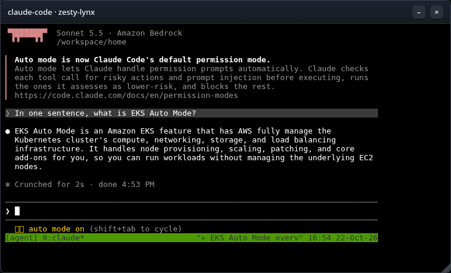
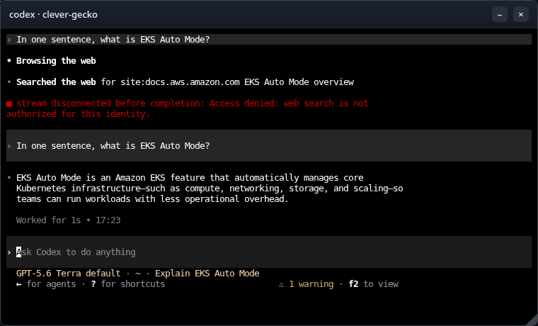
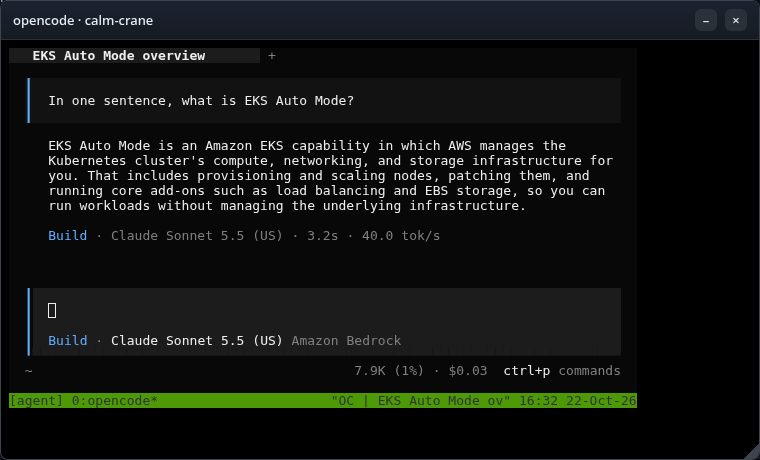
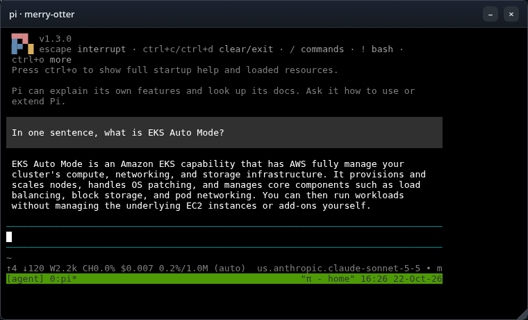
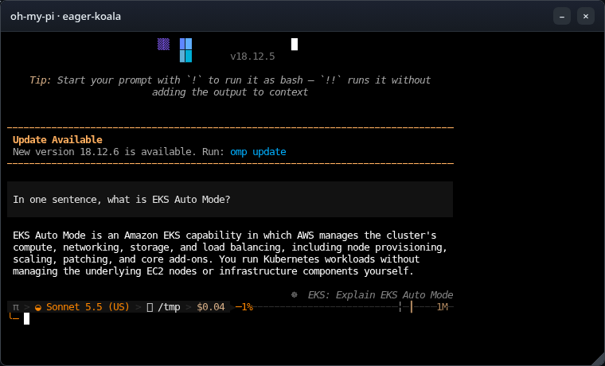

# Coding agents for developers

A developer opens a web app, picks a coding agent (Claude Code, Codex, Kiro CLI, OpenCode,
pi or oh-my-pi) and gets a live terminal running that agent a second or two later. Each
session runs in its own Nitro sandbox, claimed from a warm pool for that CLI, with its
workspace on [Amazon S3 Files](https://docs.aws.amazon.com/AmazonS3/latest/userguide/s3-files-mounting-eks.html)
so it survives the pod going away. A session's pod can open only its own folder, through a
short-lived credential scoped to that one folder: even as root inside the sandbox, it is
refused on any other session's folder. The web app is trusted first-party code and stays an
ordinary pod; it is reached only with `kubectl port-forward`.

Before you start, review the [prerequisites and shared setup](../../README.md#prerequisites)
on the home page, and run these samples first, which this one builds on:

- [Getting started > Coding agent](../../getting-started/coding-agent/README.md): Amazon
  Bedrock through EKS Pod Identity, turning on network policy enforcement, and an
  `ApplicationNetworkPolicy` with host names.
- [Getting started > Warm pool](../../getting-started/warm-pool/README.md): agent-sandbox,
  a `SandboxWarmPool`, and claims that adopt a pod that is already running.
- [AI agents > Claude Managed Agents](../../managed-agents/claude-managed-agents/README.md):
  an app outside the sandbox that claims sandboxes from a pool, and a `SandboxTemplate` with
  `networkPolicyManagement: Unmanaged`.

The commands below use files from this repository, so clone it if you have not already, and
run them from this sample's folder:

```bash
git clone https://github.com/aws-samples/sample-eks-nitro-sandbox.git
cd sample-eks-nitro-sandbox/examples/ai-agents/coding-agents-for-developers
```

For this sample you also need [Docker](https://docs.docker.com/get-docker/) to build the
images, the AWS CLI with the `aws s3files` commands, and `kubectl`. A run costs Amazon
Bedrock usage per token for the five CLIs that use it, and S3 and S3 Files storage for the
data each session keeps; the warm pools keep one pod per CLI running by default, each
reserving its full memory request. Kiro CLI usage counts against the developer's own Kiro
plan.

## Overview

- **Any coding agent, one platform.** Each CLI has its own image, `SandboxTemplate` and
  `SandboxWarmPool`, built on one shared base image. Adding a seventh takes one Dockerfile,
  one template, one pool and one line in the app's agent list.
- **A warm start with a folder of its own.** New agent and Restore both claim a pod that is
  already running, then mount that session's folder into it.
- **Per-session permissions.** The pod's own role cannot mount any folder. For each session
  the app hands the pod a short-lived credential that can mount only that session's access
  point. Even as root inside the sandbox, the pod is refused on any other session's folder.
- **Every session in its own sandbox.** Two terminals open side by side are two pods, each
  with its own kernel build, boot and virtio disks.
- **No model API key in the sandbox.** The five CLIs that use Amazon Bedrock reach it
  through EKS Pod Identity, with a role that may only invoke models. Kiro CLI uses the
  developer's own Kiro sign-in, done once in the terminal and kept in the session's folder.

*Figure 1: A developer picks a CLI in the web app; the app claims a warm Nitro sandbox pod
from that CLI's pool, mounts the session's S3 Files folder into the guest with a credential
scoped to that one access point, and drives a terminal over the Kubernetes exec API. The
pod reaches Amazon Bedrock through a Pod Identity role that may only invoke models; its
egress policy refuses everything else.*

![A developer, outside AWS, reaches the web app over the Kubernetes exec API through kubectl port-forward. Inside the AWS Cloud, an Amazon EKS cluster holds the web app, an ordinary trusted first-party pod that claims a pod and drives the terminal. The app claims a red Nitro sandbox pod (isolated-sandbox, one per session) from a dashed SandboxWarmPool per CLI, and mounts the session folder into it with a per-session credential. The sandbox pod runs tmux and the CLI with its workspace at /workspace. To the right, outside the cluster, it mounts its own S3 Files access point only (one per session), which syncs with an S3 bucket (one prefix per session), and it invokes models on Amazon Bedrock through a Pod Identity role that may only invoke models. Below, a red dashed arrow to the internet, AWS APIs and other pods is refused by the egress policy.](figures/architecture.png)

## Versions

This folder was built against these releases. Pin each to its latest when you build, and
the images record what they installed.

| Component | Version |
|---|---|
| agent-sandbox controller ([kubernetes-sigs/agent-sandbox](https://github.com/kubernetes-sigs/agent-sandbox)) | v1.0.6 |
| S3 Files mount helper ([amazon-efs-utils](https://github.com/aws/efs-utils)) | 3.3.4 |
| Claude Code ([`@anthropic-ai/claude-code`](https://www.npmjs.com/package/@anthropic-ai/claude-code)) | 2.1.306 |
| Codex CLI ([`@openai/codex`](https://www.npmjs.com/package/@openai/codex)) | 0.163.0 |
| Kiro CLI ([kiro.dev](https://kiro.dev/docs/cli/)) | 2.33.1 |
| OpenCode ([`@opencode/cli`](https://www.npmjs.com/package/@opencode/cli)) | 2.1.2 |
| pi ([`@earendil-works/pi-coding-agent`](https://www.npmjs.com/package/@earendil-works/pi-coding-agent)) | 1.3.0 |
| oh-my-pi ([`@oh-my-pi/pi-coding-agent`](https://github.com/can1357/oh-my-pi)) | 18.12.5 |
| xterm.js ([`@xterm/xterm`](https://www.npmjs.com/package/@xterm/xterm)) | 6.0.0 |

## Files

| File | What it is |
|---|---|
| [`app/`](app/) | The web app: the server ([`server/`](app/server/)) and the xterm.js UI ([`public/`](app/public/)), and its [`Dockerfile`](app/Dockerfile) |
| [`images/base/`](images/base/) | The shared base image: the S3 Files mount helper, tmux, git, and [`session-entrypoint.sh`](images/base/session-entrypoint.sh) |
| [`images/<cli>/`](images/) | One Dockerfile per CLI, each `FROM` the base |
| [`deploy/sandbox-template.yaml`](deploy/sandbox-template.yaml) | The per-CLI `SandboxTemplate` and `SandboxWarmPool` |
| [`deploy/egress-policy.yaml`](deploy/egress-policy.yaml) | The per-CLI egress policy |
| [`deploy/rbac.yaml`](deploy/rbac.yaml), [`deploy/app.yaml`](deploy/app.yaml) | The service accounts and RBAC, and the app Deployment and Service |
| [`iam/`](iam/) | The Bedrock, App and Mount role policies and trusts, and the per-session mount session policy |
| [`scripts/setup.sh`](scripts/setup.sh), [`scripts/clean.sh`](scripts/clean.sh) | Create everything and apply it; remove it |
| `.env.example` | The local values the sample needs; copy to `.env`, which git ignores |

## Quick start

With `.env` filled in (from `.env.example`) and the shared installs in place:

```bash
cp .env.example .env     # set CLUSTER_NAME and AWS_REGION
./scripts/setup.sh
kubectl -n coding-agents-for-developers port-forward svc/agent-app 8080:8080
```

Then open <http://127.0.0.1:8080>. Pick a CLI under **Start an agent** to open a terminal;
your sessions are listed below, each with **Open** (while running) or **Restore** (once
idle) and **Delete**.


**Step 1: The shared installs.** `setup.sh` checks for agent-sandbox, the EFS CSI driver
(3.0.0 or newer, for S3 Files) and network policy enforcement, and stops with the command to
add any that is missing. It never installs a cluster-wide thing for you. If you have run
Getting started and the storage samples, they are already there.

**Step 2: The AWS resources.** `setup.sh` creates the sample's own versioned S3 bucket, its
S3 Files file system and mount targets, and three IAM roles, each with only what it needs:

| Role | Used by | May |
|---|---|---|
| Bedrock | Every CLI pod that uses Bedrock, through Pod Identity | `bedrock:InvokeModel*` scoped to this account's inference profiles and the Anthropic foundation models, plus `bedrock-mantle:CreateInference` and the `bedrock-websearch` actions for Codex's server-side web search; no S3 Files access |
| App | The web app, through Pod Identity | Create, tag, read and delete this file system's access points; delete objects under session prefixes on cleanup; assume the Mount role |
| Mount | Assumed only by the app, narrowed per session | `s3files:ClientMount` and `s3files:ClientWrite` on the file system, and read objects in the bucket; each session policy narrows it to one access point |

Everything it creates is tagged `ManagedBy=coding-agents-for-developers`, so the clean up
removes only what the sample made.

**Step 3: The images.** `setup.sh` builds the base image, the six CLI images and the app,
and pushes them to ECR.

**Step 4: The templates, pools and app.** For each CLI it applies a `SandboxTemplate`, a
`SandboxWarmPool` and an egress policy, then the app's Deployment, Service and RBAC. The
warm pods boot with no workspace; the folder is mounted after the claim (see
[How a session starts](#how-a-session-starts)).

**Step 5: Open the app.** `kubectl port-forward` to the ClusterIP Service, then the browser.
The sign-in is a drop-down of three demo developers with the password pre-filled: it is a
picker, not authentication, and the app is reachable only through your own port-forward.

```text
==> Wait for the warm pools, then open the app
sandboxwarmpool.extensions.agents.x-k8s.io/agent-claude-code condition met
sandboxwarmpool.extensions.agents.x-k8s.io/agent-codex condition met
sandboxwarmpool.extensions.agents.x-k8s.io/agent-kiro-cli condition met
sandboxwarmpool.extensions.agents.x-k8s.io/agent-opencode condition met
sandboxwarmpool.extensions.agents.x-k8s.io/agent-pi condition met
sandboxwarmpool.extensions.agents.x-k8s.io/agent-oh-my-pi condition met
deployment "agent-app" successfully rolled out

Done. Open the app on your machine:

  kubectl -n coding-agents-for-developers port-forward svc/agent-app 8080:8080

Then browse to http://127.0.0.1:8080
```

## What a session looks like

Each terminal is a floating window wired to the CLI running in its sandbox pod. These are
the six CLIs answering the same prompt, each on its own model: the five Bedrock CLIs on the
inference profile in the app's agent list (Claude Sonnet here), and Codex on a GPT model
served through the Bedrock "Mantle" OpenAI-compatible endpoint. Kiro CLI uses the
developer's own Kiro sign-in rather than Bedrock.

| | |
|---|---|
|  |  |
|  |  |
|  |  |

## How a session starts

A warm pod boots before its session exists, and a `SandboxClaim` that adds a volume forces a
cold start, so the warm pods boot with no workspace and idle. New agent and Restore both go
through the same steps:

1. The app claims a pod from the CLI's pool. The claim adopts a pod that is already running,
   so it is Ready in under a second; the pool boots a replacement.
2. The app creates the session's access point (or finds it, on restore), rooted at
   `/<developer>/<cli>/<session>` with a fixed POSIX user (uid/gid 1000) and
   `creationPermissions` that make the access point create its own root directory owned by
   that user. The app does not pre-create the folder as a bucket object: an object written
   under the prefix first is imported owned by root, which the access point's user could not
   then write, so the CLI's home could not be created.
3. The app assumes the Mount role with a session policy that names only that access point,
   and writes the resulting short-lived credential into the pod through the exec API's
   standard input, to a memory-backed file. It is never on a command line or in the pod
   spec.
4. Inside the guest, `session-entrypoint.sh` mounts the access point at `/workspace` with the
   S3 Files mount helper and that credential. Only this step runs as root, with the
   `SYS_ADMIN` capability the mount needs. Then tmux and the CLI start as an unprivileged
   user whose home sits inside `/workspace`, so its settings, sign-in and history persist
   with the code.
5. While the session runs, the app refreshes the credential before it expires.

The mount needs root inside the guest, which is what the sandbox is for: the guest kernel
belongs to the pod, not the node.

```text
POST /api/new
/api/new developer=carlos cli=opencode
start mvk5vhvs-eager-shrew: ensureAccessPoint
start mvk5vhvs-eager-shrew: claimPod (ap=fsap-07312e085c6c5a10f)
start mvk5vhvs-eager-shrew: pod=agent-opencode-trpv8 node=i-060fd7e182a73ab1e
start mvk5vhvs-eager-shrew: startSession azId=usw2-az3
session started in agent-opencode-trpv8
/api/new done session=mvk5vhvs-eager-shrew
```

## The session lifecycle

| Action | What happens |
|---|---|
| New agent | The app claims a warm pod, creates the access point, mounts the folder and starts the CLI. The pool boots a replacement. |
| Minimize, or close the browser | Nothing changes in the cluster. The pod and the CLI keep running. |
| No terminal activity for the idle period (default 30 minutes) | The app reads tmux's last-activity time in each pod every minute. Once the period passes, it deletes the `SandboxClaim`: the pod goes, the folder stays. |
| Close the window | Same as idle: the claim is released, the folder stays, and the session moves to the session list. |
| Restore | The app claims a new warm pod (a new pod UID), mounts the same folder and starts the CLI with its own resume option. |
| Delete | The app deletes every object version and delete marker under the session's prefix in the (versioned) bucket, then the access point. |

New agent is fast because the pod is already warm: claiming a warm pod, creating the access
point, mounting the folder and starting the CLI measured about 1.4 seconds end to end on the
fresh run. Close then Restore is the same path against the existing folder, so a restored
session comes up on a **new pod** (a new pod UID) with its files intact:

```text
# before close: pod agent-pi-6zv7d, uid 2bb8cd12-...  (marker written to /workspace/home)
POST /api/close   -> {"ok":true}        # claim released: SandboxClaim NotFound, folder stays
POST /api/restore -> {"session":"...-proud-fox"}
# after restore:  pod agent-pi-zlpxl, uid fc059a2f-...  (different pod UID)
#   /workspace/home/restore-marker.txt -> "marker written 01:51:36"  (same file, persisted)
```

The app keeps no database. It builds the session list from the access points' own root
paths -- each one is `/<developer>/<cli>/<session>`, so one `ListAccessPoints` call for the
file system yields every session's developer, CLI and name with no per-session tag read
(which matters at scale: a developer with thousands of sessions would otherwise be thousands
of tag lookups against the S3 Files control-plane rate limit). The session name carries a
creation-time prefix, so the list sorts newest-first from the path alone. The access points
also carry tags (`ManagedBy`, `developer`, `cli`, `session`, `lastUsed`) that mark ownership
for the clean up, but the list does not depend on them. The access points, one per session:

```text
$ aws s3files list-access-points --file-system-id <S3_FILES_FS_ID> --region <AWS_REGION> \
    --query 'accessPoints[].{id:accessPointId,path:rootDirectory.path}' --output table
--------------------------------------------------------------------
|                         ListAccessPoints                         |
+----------------------+-------------------------------------------+
|          id          |                   path                    |
+----------------------+-------------------------------------------+
|  fsap-0d58a4d6e...    |  /carlos/claude-code/mvk5n5an-calm-crane  |
|  fsap-09019727...     |  /carlos/codex/mvk5rit8-jolly-otter       |
+----------------------+-------------------------------------------+
```

## It runs in a sandbox

Each session pod is a Nitro sandbox. Read its runtime class, the kernel and disks it sees,
and which model credentials it holds. The last command prints variable names only:

```bash
POD=$(kubectl -n coding-agents-for-developers get pods -l agent-cli=claude-code \
  --field-selector=status.phase=Running -o jsonpath='{.items[0].metadata.name}')
kubectl -n coding-agents-for-developers get pod $POD -o jsonpath='{.spec.runtimeClassName}{"\n"}'
kubectl -n coding-agents-for-developers exec $POD -- sh -c 'uname -rv; cut -d" " -f1 /proc/uptime; ls /sys/block | tr "\n" " "; echo'
kubectl -n coding-agents-for-developers exec $POD -- sh -c 'env | cut -d= -f1 | grep -iE "^AWS_|BEDROCK|ANTHROPIC" || true'
```

```text
isolated-sandbox
6.18.51 #1 SMP PREEMPT_DYNAMIC Thu Oct  1 23:28:07 UTC 2026
240.82
dm-0 vda vdb vdc
AWS_CONTAINER_CREDENTIALS_FULL_URI
AWS_DEFAULT_REGION
AWS_REGION
AWS_CONTAINER_AUTHORIZATION_TOKEN_FILE
CLAUDE_CODE_USE_BEDROCK
ANTHROPIC_MODEL
AWS_STS_REGIONAL_ENDPOINTS
```

The sandbox runs its own kernel, its uptime matches the pod's age because the VM booted with
the pod, and it sees virtio disks (`vda`, `vdb`, `vdc`, with a `dm-0` device-mapper node on
top) where an ordinary pod on the same node sees the instance's `nvme` devices. No model API
key is in the pod: the only AWS variables are the Pod Identity credential endpoint
(`AWS_CONTAINER_CREDENTIALS_FULL_URI`, `AWS_CONTAINER_AUTHORIZATION_TOKEN_FILE`) and the
Region, so the Bedrock CLIs sign their requests with the Pod Identity role resolved from
that endpoint, not a stored key.

## Per-session scoping, both ways

The security property is that a session's pod can mount only its own folder. The app gives
each session a credential from the Mount role narrowed with this session policy (the whole
file is [`iam/mount-session-policy.json`](iam/mount-session-policy.json)); the condition key
`s3files:AccessPointArn` is what ties the credential to one access point:

```json
{
  "Sid": "MountOnlyThisSession",
  "Effect": "Allow",
  "Action": ["s3files:ClientMount", "s3files:ClientWrite"],
  "Resource": "arn:aws:s3files:<AWS_REGION>:<ACCOUNT_ID>:file-system/<S3_FILES_FS_ID>",
  "Condition": {
    "StringEquals": {
      "s3files:AccessPointArn": "arn:aws:s3files:<AWS_REGION>:<ACCOUNT_ID>:file-system/<S3_FILES_FS_ID>/access-point/<SESSION_AP_ID>"
    }
  }
}
```

To show it both ways, mount the session's own access point from inside its pod (it mounts),
then try another session's access point with the same credential, as root (it is refused).
`$OTHER_AP` is a second session's access point id; the credential is the one the app wrote
to this pod at `/dev/shm/session/credentials`:

```bash
POD=agent-claude-code-...     # this session's pod
OTHER_AP=fsap-...             # a different session's access point

# This session's own access point is already mounted at /workspace:
kubectl -n coding-agents-for-developers exec $POD -- mountpoint /workspace

# Try another session's access point with this pod's own mount credential, as root:
kubectl -n coding-agents-for-developers exec $POD -- sh -c \
  "AWS_SHARED_CREDENTIALS_FILE=/dev/shm/session/credentials AWS_PROFILE=session \
   mount.s3files <S3_FILES_FS_ID> /tmp/other \
   -o tls,iam,awsprofile=session,region=<AWS_REGION>,azid=<POD_AZ_ID>,accesspoint=$OTHER_AP"
```

```text
/workspace is a mountpoint

Mount attempt 1/3 failed due to b'mount.nfs4: access denied by server while mounting 127.0.0.1:/\n', wait 1 sec before next attempt.
Mount attempt 2/3 failed due to b'mount.nfs4: access denied by server while mounting 127.0.0.1:/\n', wait 1 sec before next attempt.
b'mount.nfs4: access denied by server while mounting 127.0.0.1:/'
```

The own access point is mounted; the other session's access point is refused by the server
(`access denied`), because the credential's session policy allows `s3files:ClientMount` only
on this session's own access-point ARN.
The pod's own Pod Identity role is the Bedrock role, which has no S3 Files permission at all,
so it cannot mount any access point. The mount credential is the only thing that can, and it
is scoped to one access point, so a pod cannot reach another session's folder even as root.

From outside the cluster, the bucket shows each session under its own prefix (abridged to the
folder structure; the CLI's home fills in below each session):

```bash
aws s3 ls s3://<S3_BUCKET_NAME>/coding-agents/ --recursive
```

```text
2026-10-22 23:11:25          0 coding-agents/carlos/
2026-10-22 23:11:26          0 coding-agents/carlos/claude-code/
2026-10-22 23:11:26          0 coding-agents/carlos/claude-code/mvk5n5an-calm-crane/
2026-10-22 23:11:26          0 coding-agents/carlos/claude-code/mvk5n5an-calm-crane/home/
2026-10-22 23:12:27        343 coding-agents/carlos/claude-code/mvk5n5an-calm-crane/home/.claude.json
2026-10-22 23:11:28          0 coding-agents/carlos/claude-code/mvk5n5an-calm-crane/home/.claude/
2026-10-22 23:12:28        138 coding-agents/carlos/claude-code/mvk5n5an-calm-crane/home/.claude/sessions/85.<redacted>.key
2026-10-22 23:12:27        208 coding-agents/carlos/claude-code/mvk5n5an-calm-crane/home/.tmux.conf
...
```

## How the network policy works

S3 Files cannot be used on a network-isolated pod, because the mount needs a network to
reach the mount target (Amazon EKS User Guide, *Isolated and confidential pods
limitations*). So the session pods have a network, and an egress policy is what limits where
code in the sandbox can connect. Each `SandboxTemplate` sets
`networkPolicyManagement: Unmanaged` and ships its own policy. Here is
[`egress-policy.yaml`](deploy/egress-policy.yaml) in full, without its header comment;
`setup.sh` fills in the mount-target addresses at apply time, and adds one extra rule for
kiro-cli (shown below the table):

```yaml
apiVersion: networking.k8s.aws/v1alpha1
kind: ApplicationNetworkPolicy
metadata:
  name: agent-<CLI>-egress
  labels:
    app.kubernetes.io/part-of: coding-agents-for-developers
spec:
  podSelector:
    matchLabels:
      agent-cli: <CLI>
  policyTypes:
    - Ingress
    - Egress
  ingress: []
  egress:
    - to:
        - ipBlock: { cidr: 0.0.0.0/0 }
      ports:
        - { protocol: UDP, port: 53 }
        - { protocol: TCP, port: 53 }
    - to:
        - ipBlock: { cidr: 169.254.170.23/32 }
      ports:
        - { protocol: TCP, port: 80 }
    - to:
        - domainNames:
            - bedrock-runtime.<AWS_REGION>.amazonaws.com
            - bedrock-mantle.<AWS_REGION>.api.aws
            - docs.aws.amazon.com
            - github.com
            - codeload.github.com
            - objects.githubusercontent.com
            - registry.npmjs.org
            - pypi.org
            - files.pythonhosted.org
      ports:
        - { protocol: TCP, port: 443 }
    - to: <MOUNT_TARGET_CIDRS>
      ports:
        - { protocol: TCP, port: 2049 }
```

| In the YAML | What it does |
|---|---|
| `podSelector`, `agent-cli: <CLI>` | Selects this CLI's session pods. |
| `policyTypes`, `Ingress` and `Egress` | Default-deny both ways, so only the rules below are allowed. |
| `ingress: []` | Denies all ingress. The app reaches the pod through the Kubernetes exec API, which is not pod network traffic, so it needs no ingress rule. |
| `egress` to `0.0.0.0/0` on 53 | Allows egress to any address on UDP and TCP 53. This is a project choice to keep the sample simple: it does not depend on how a given cluster serves DNS (on EKS Auto Mode the resolver is node-local rather than a pod behind a ClusterIP). What it allows is wider than DNS resolution: any process in the sandbox can reach any host on UDP or TCP 53, so it can send data out over DNS or to anything listening on port 53. What it costs is that port-53 egress is not confined to the cluster's own resolver. It still opens only port 53; every other port and protocol stays denied. |
| `egress` to `169.254.170.23` on 80 | The Pod Identity agent on the node, for the Bedrock role. |
| `egress` to the `domainNames` on 443 | The Bedrock runtime endpoint the Bedrock CLIs call their model on, the Bedrock "Mantle" endpoint Codex uses for its GPT model, `docs.aws.amazon.com` so the agents can fetch AWS documentation, and the short list of developer hosts (GitHub, npm, PyPI) the agents fetch from. The S3 Files mount reads over NFS (2049), not an S3 443 endpoint, so none is needed here. |
| `egress` to `<MOUNT_TARGET_CIDRS>` on 2049 | The S3 Files mount targets, NFS over TLS. They are ENIs in the cluster VPC reached by resolved IP, so `setup.sh` resolves this file system's mount-target IPs and fills in one `/32` per target -- egress on 2049 is allowed to the sample's own mount targets only, not to anything on 2049 in the VPC. |

kiro-cli is the one CLI that does not use Amazon Bedrock: it reaches the developer's own
Kiro / Amazon Q Developer sign-in (IAM Identity Center OIDC) and the CodeWhisperer streaming
service on `*.amazonaws.com`, and the Kiro desktop service on `*.kiro.dev` (the sign-in
device-authorization flow at `prod.<region>.auth.desktop.kiro.dev`, plus `app.kiro.dev`,
`runtime.<region>.kiro.dev` and the telemetry hosts, which sit across several sub-hierarchies
of `kiro.dev`). Those endpoints live in the developer's Kiro Region, independent of this
cluster's Region, so `setup.sh` adds one rule to the kiro-cli policy only, allowing both
suffixes on 443 -- wide within AWS and within Kiro's own first-party domain, but no arbitrary
internet host. A deployment that wants it tighter can pin the exact
`oidc.`/`q.`/`codewhisperer.<region>.amazonaws.com` hosts and the specific `kiro.dev`
subdomains its Region and workflow use.

```yaml
    - to:
        - domainNames:
            - "*.amazonaws.com"
            - "*.kiro.dev"
      ports:
        - { protocol: TCP, port: 443 }
```

Enforcement is turned on once per cluster with the `amazon-vpc-cni` ConfigMap in
`kube-system`, which `setup.sh` checks and stops without if it is off. It is enforced on the
node, outside the guest, so a command in the sandbox, even as root, cannot change it. Its
limits: DNS is open on port 53 to any address, so a resolver is always reachable, and a pod
can always reach its own node; that also means port-53 egress is not confined to the
cluster's resolver, so a process in the sandbox can send data out over DNS or to anything
listening on port 53 (see the `0.0.0.0/0` row above). A `domainNames` rule allows the
addresses a name resolves to, so another name served from the same addresses is reachable
too. Everything beyond port 53, the allowed hosts and the mount targets is denied.

To see it from inside a session pod, connect to an allowed endpoint and to a denied one
(`curl` exits 0 once the TCP connection is established; exit 28 is a connect timeout, which
is how a blocked destination shows):

```bash
POD=$(kubectl -n coding-agents-for-developers get pods -l agent-cli=claude-code \
  --field-selector=status.phase=Running -o jsonpath='{.items[0].metadata.name}')
for url in https://bedrock-runtime.<AWS_REGION>.amazonaws.com/ https://github.com/ \
           https://example.com/ https://github.com:22/; do
  kubectl -n coding-agents-for-developers exec $POD -- \
    sh -c "curl -sS -o /dev/null --connect-timeout 8 $url; echo \"$url -> exit \$?\""
done
```

```text
https://bedrock-runtime.<AWS_REGION>.amazonaws.com/ -> exit 0   # allowed host, 443: connected
https://github.com/ -> exit 0                                   # allowed host, 443: connected
curl: (28) Connection timed out after 8002 milliseconds
https://example.com/ -> exit 28                                 # host not in the policy: blocked
curl: (28) Connection timed out after 8003 milliseconds
https://github.com:22/ -> exit 28                               # allowed host, port 22 not allowed: blocked
```

## Good to know

- **The idle period and the pool size are settings.** The idle timeout is `IDLE_MINUTES` on
  the app (default 30). Each CLI's pool keeps `POOL_REPLICAS` pods warm (default 1); size it
  to the peak claim rate, not the number of sessions, and turn off the CLIs you do not need
  by trimming the app's agent list. Each warm pod reserves its full memory request.
- **The session pods request memory, and set nothing else.** A sandbox's VM is sized from
  the pod's requests, and with none it gets about 1 vCPU and 130 MiB -- too little memory for
  these CLIs. The `SandboxTemplate` requests 1536 MiB of memory, no CPU and no limits, from
  this measurement of each CLI's pod during a model turn on the fresh run (`kubectl top
  pod`):

  ```text
  TODO: output from the fresh run
  ```
- **Sessions are capped by the access-point quota.** Each retained session is one access
  point, kept until Delete. S3 Files allows 25,000 access points per file system (Amazon S3
  Files service quota *Access points per file system*, not adjustable), which is the ceiling
  on retained sessions; Delete reclaims one.
- **The credential is refreshed.** An assumed-role credential lasts an hour; the app rewrites
  it well before then, so an agent left running keeps writing to its folder past an hour.
- **Codex's web search runs on the Mantle side, outside the egress policy.** Codex runs on
  a GPT model served through the Bedrock "Mantle" endpoint, and that model can call a
  server-side web search and web fetch tool that Amazon Bedrock runs itself. The Bedrock
  role grants it with the `bedrock-websearch` actions `InvokeSearch` and `InvokeFetch`
  (scoped to this Region's tools) and `ExternalWebAccess`, which has no resource type to
  scope to; without them Mantle answers `Access denied: web search is not authorized for
  this identity` and the turn ends. The trade-off: those searches and fetches are made by
  Bedrock, not by the pod, so the sandbox egress policy does not limit them. The pod's own
  egress is still restricted, but Codex can read any public web page through the tool.
  Remove the two `WebSearch...` statements from
  [`iam/bedrock-invoke-policy.json`](iam/bedrock-invoke-policy.json) to turn this off.
- **Session pods are not consolidated away.** The `SandboxTemplate` sets
  `karpenter.sh/do-not-disrupt: "true"`, so EKS Auto Mode does not evict a session pod to
  consolidate an underutilized node in the middle of a session. The pod still goes when its
  claim is released (close, idle timeout). The cost is that a node holding a session is not
  packed down until that session ends.
- **The session pods turn the Nitro sandbox network and disk throttles off.** A sandbox pod
  has built-in defaults -- 100 Mbit/s ingress and egress (capped by a 1500 packets/second
  bucket), a 400 Mbit/s overlay (scratch) disk and 1500 overlay IOPS -- which are tight for
  an interactive agent that streams model output, clones repos and installs packages, and
  show up as a sluggish session. The `SandboxTemplate` sets the `ingress-bandwidth`,
  `egress-bandwidth`, their `-packets-per-second` partners and the `overlay-disk-bandwidth`
  and `-iops` annotations to `disabled` (the value must be `disabled`; `0` is rejected and
  leaves the pod stuck creating). The trade-off, per the Amazon EKS User Guide, is that the
  pod may then use a larger share of its node's ENI and disk budget; a deployment that packs
  many sessions per node can set explicit caps instead.
- **kiro-cli signs in with the developer's own Kiro identity, not Bedrock.** The other five
  CLIs reach Amazon Bedrock through the pod's Pod Identity role; kiro-cli uses an IAM
  Identity Center / Builder ID sign-in and the CodeWhisperer service. The interactive
  device-flow login (`kiro-cli login --use-device-flow`) offers Builder ID, Google, GitHub
  and organization sign-in; it reaches the Kiro auth service at `*.kiro.dev`, which the
  kiro-cli egress rule allows alongside `*.amazonaws.com`. The sign-in is the developer's own
  and is stored in their session's folder, so a restored session stays signed in; the
  sample injects no shared sign-in token into the pods, because whatever the agent's home
  holds the agent can read, and the folder is persisted to the bucket. An identity whose
  sign-in is gated behind a corporate network gateway cannot load models from inside the
  sandbox, which has no route to that gateway; a Builder ID, Google or GitHub identity that
  is not so gated works.
- **The sign-in is a demo picker, not authentication.** The app is first-party code reachable
  only through `kubectl port-forward` on the operator's own machine.

## Clean up

Run the clean up when you finish, after your last session, so a sandbox pod is not left
holding capacity other demos share:

```bash
./scripts/clean.sh
```

It deletes in reverse order (the warm pools first, so they stop booting replacements, then
the claims, templates, policies and the app), removes only resources tagged
`ManagedBy=coding-agents-for-developers` (re-checking the bucket's tag before deleting it),
and exits non-zero if it skipped something or could not confirm a delete. It never removes a
shared install: agent-sandbox, the EFS CSI driver and network policy enforcement stay, and
the page above has the command to remove each if nothing else uses it. To remove the
namespace and the cluster, follow the
[hello sandbox clean up](../../getting-started/hello-sandbox/README.md#clean-up).
