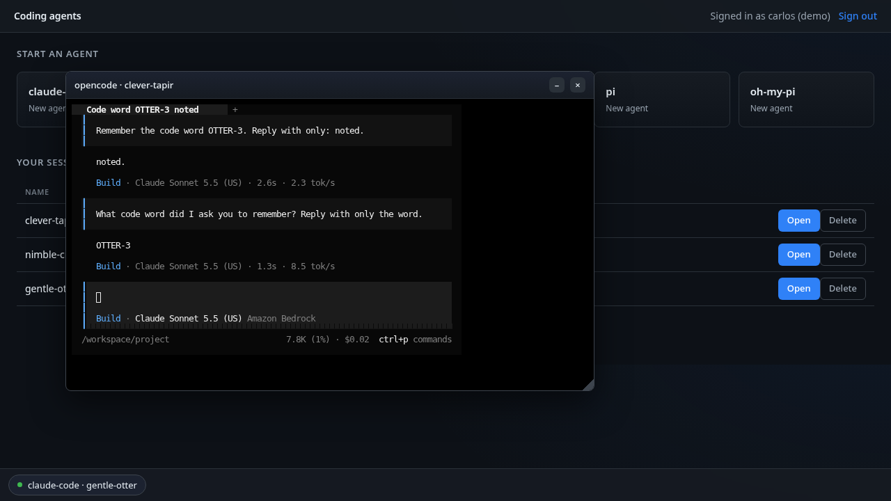

# Coding agents for developers

A developer opens a web app, picks a coding agent (Claude Code, Codex, Kiro CLI, OpenCode,
pi or oh-my-pi) and gets a live terminal running that agent a second or two later. Each
session runs in its own Nitro sandbox, claimed from a warm pool for that CLI, with its
workspace on [Amazon S3 Files](https://docs.aws.amazon.com/AmazonS3/latest/userguide/s3-files-mounting-eks.html)
so it survives the pod going away. A session's pod can open only its own folder, through a
short-lived credential scoped to that one folder: even as root inside the sandbox, it is
refused on any other session's folder. The web app is trusted first-party code and stays an
ordinary pod; it is reached only with `kubectl port-forward`.

Before you start, review the [prerequisites and shared setup](../../README.md#prerequisites)
on the home page, and run these samples first, which this one builds on:

- [Getting started > Coding agent](../../getting-started/coding-agent/README.md): Amazon
  Bedrock through EKS Pod Identity, turning on network policy enforcement, and an
  `ApplicationNetworkPolicy` with host names.
- [Getting started > Warm pool](../../getting-started/warm-pool/README.md): agent-sandbox,
  a `SandboxWarmPool`, and claims that adopt a pod that is already running.
- [AI agents > Claude Managed Agents](../../managed-agents/claude-managed-agents/README.md):
  an app outside the sandbox that claims sandboxes from a pool, and a `SandboxTemplate` with
  `networkPolicyManagement: Unmanaged`.

The commands below use files from this repository, so clone it if you have not already, and
run them from this sample's folder:

```bash
git clone https://github.com/aws-samples/sample-eks-nitro-sandbox.git
cd sample-eks-nitro-sandbox/examples/ai-agents/coding-agents-for-developers
```

For this sample you also need [Docker](https://docs.docker.com/get-docker/) to build the
images, the AWS CLI with the `aws s3files` commands, and `kubectl`. A run costs Amazon
Bedrock usage per token for the five CLIs that use it, and S3 and S3 Files storage for the
data each session keeps; the warm pools keep one pod per CLI running by default. Kiro CLI usage counts against the developer's own Kiro
plan.

## Overview

- **Any coding agent, one platform.** Each CLI has its own image, `SandboxTemplate` and
  `SandboxWarmPool`, built on one shared base image. Adding a seventh takes one Dockerfile,
  one template, one pool and one line in the app's agent list.
- **A warm start with a folder of its own.** New agent and Restore both claim a pod that is
  already running, then mount that session's folder into it.
- **Per-session permissions.** The pod's own role cannot mount any folder. For each session
  the app hands the pod a short-lived credential that can mount only that session's access
  point. Even as root inside the sandbox, the pod is refused on any other session's folder.
- **Every session in its own sandbox.** Two terminals open side by side are two pods, each
  with its own kernel build, boot and virtio disks.
- **No model API key in the sandbox.** The five CLIs that use Amazon Bedrock reach it
  through EKS Pod Identity, with a role that may only invoke models (Codex's own role may
  also use Bedrock's server-side web search). Kiro CLI uses the developer's own Kiro
  sign-in, done once in the terminal and kept in the session's folder.

*Figure 1: A developer picks a CLI in the web app; the app claims a warm Nitro sandbox pod
from that CLI's pool, mounts the session's S3 Files folder into the guest with a credential
scoped to that one access point, and relays a terminal to a small server in the pod over the
pod network. The
pod reaches Amazon Bedrock through a Pod Identity role that may only invoke models; its
egress policy refuses everything else.*

![A developer, outside AWS, reaches the web app's terminal through kubectl port-forward. Inside the AWS Cloud, an Amazon EKS cluster holds the web app, an ordinary trusted first-party pod that claims a pod and drives the terminal. The app claims a red Nitro sandbox pod (isolated-sandbox, one per session) from a dashed SandboxWarmPool per CLI, and mounts the session folder into it with a per-session credential. A second arrow, labelled terminal (TLS), runs from the app to the sandbox pod, which runs tmux and the CLI, session-bridge on port 7681, and its workspace at /workspace. To the right, outside the cluster, it mounts its own S3 Files access point only (one per running session), which syncs with an S3 bucket (one prefix per session), and it invokes models on Amazon Bedrock through a Pod Identity role, labelled invoke models, with Codex also allowed web search. Below, a red dashed arrow to other hosts and other pods is refused by the egress policy.](figures/architecture.png)

## Versions

This folder was built against these releases. Pin each to its latest when you build, and
the images record what they installed.

| Component | Version |
|---|---|
| agent-sandbox controller ([kubernetes-sigs/agent-sandbox](https://github.com/kubernetes-sigs/agent-sandbox)) | v1.0.6 |
| S3 Files mount helper ([amazon-efs-utils](https://github.com/aws/efs-utils)) | 3.3.4 |
| Claude Code ([`@anthropic-ai/claude-code`](https://www.npmjs.com/package/@anthropic-ai/claude-code)) | 2.1.306 |
| Codex CLI ([`@openai/codex`](https://www.npmjs.com/package/@openai/codex)) | 0.163.0 |
| Kiro CLI ([kiro.dev](https://kiro.dev/docs/cli/)) | 3.0.0 |
| OpenCode ([`@opencode/cli`](https://www.npmjs.com/package/@opencode/cli)) | 2.1.2 |
| pi ([`@earendil-works/pi-coding-agent`](https://www.npmjs.com/package/@earendil-works/pi-coding-agent)) | 1.3.0 |
| oh-my-pi ([`@oh-my-pi/pi-coding-agent`](https://github.com/can1357/oh-my-pi)) | 18.12.5 |
| xterm.js ([`@xterm/xterm`](https://www.npmjs.com/package/@xterm/xterm)) | 6.0.0 |
| Go, to build `session-bridge` ([`golang`](https://gallery.ecr.aws/docker/library/golang) image) | 1.27 |
| GitHub CLI ([`cli/cli`](https://github.com/cli/cli)), in the session image | 2.103.3 |

## Files

| File | What it is |
|---|---|
| [`app/`](app/) | The web app: the server ([`server/`](app/server/)) and the xterm.js UI ([`public/`](app/public/)), and its [`Dockerfile`](app/Dockerfile) |
| [`images/base/`](images/base/) | The shared base image: the S3 Files mount helper, tmux, git, the GitHub CLI, [`session-entrypoint.sh`](images/base/session-entrypoint.sh), [`session-stop.sh`](images/base/session-stop.sh), and [`session-bridge/`](images/base/session-bridge/main.go), the small server that gives the app the session's terminal, with [`bridge-supervise.sh`](images/base/bridge-supervise.sh), which restarts it if it exits |
| [`images/<cli>/`](images/) | One Dockerfile per CLI, each `FROM` the base |
| [`deploy/sandbox-template.yaml`](deploy/sandbox-template.yaml) | The per-CLI `SandboxTemplate` and `SandboxWarmPool` |
| [`deploy/egress-policy.yaml`](deploy/egress-policy.yaml) | The per-CLI egress policy |
| [`deploy/rbac.yaml`](deploy/rbac.yaml), [`deploy/app.yaml`](deploy/app.yaml) | The service accounts and RBAC, and the app Deployment and Service |
| [`deploy/app-policy.yaml`](deploy/app-policy.yaml) | The app's network policy: no ingress from the pod network |
| [`iam/`](iam/) | The Bedrock, Codex, App and Mount role policies and trusts, and the per-session mount session policy |
| [`scripts/setup.sh`](scripts/setup.sh), [`scripts/clean.sh`](scripts/clean.sh) | Create everything and apply it; remove it |
| `.env.example` | The local values the sample needs; copy to `.env`, which git ignores |

## Quick start

With `.env` filled in (from `.env.example`) and the shared installs in place:

```bash
cp .env.example .env     # set CLUSTER_NAME and AWS_REGION
./scripts/setup.sh
kubectl -n coding-agents-for-developers port-forward svc/agent-app 8080:8080
```

Then open `http://127.0.0.1:8080`. Pick a CLI under **Start an agent** to open a terminal;
your sessions are listed below, each with **Open** (while running) or **Restore** (once
idle) and **Delete**.


**Step 1: The shared installs.** `setup.sh` checks for agent-sandbox, the EFS CSI driver
(3.0.0 or newer, for S3 Files) and network policy enforcement, and stops with the command to
add any that is missing. It never installs a cluster-wide thing for you. If you have run
Getting started and the storage samples, they are already there.

**Step 2: The AWS resources.** `setup.sh` creates the sample's own S3 bucket, its S3 Files
file system and mount targets, the four IAM roles below, each with only what it needs, and
the role S3 Files itself assumes to sync the file system with the bucket. The bucket
has S3 Versioning turned on because S3 Files requires it to sync the file system with the
bucket ([S3 Files prerequisites](https://docs.aws.amazon.com/AmazonS3/latest/userguide/s3-files-prereq-policies.html)).
The sessions do not use the versions, but a deleted or overwritten file leaves one behind,
which is why Delete removes every version under the session's prefix.

| Role | Used by | May |
|---|---|---|
| Bedrock | The pods of claude-code, opencode, pi and oh-my-pi (service account `agent-session`), through Pod Identity | `bedrock:InvokeModel*` scoped to this account's inference profiles and the Anthropic foundation models; nothing else, no S3 Files access |
| Codex | Codex's pods only (service account `agent-session-codex`), through Pod Identity | `bedrock-mantle:CreateInference` for its model on the Bedrock "Mantle" endpoint, and the `bedrock-websearch` actions for its server-side web search; nothing else, no S3 Files access |
| App | The web app, through Pod Identity | Create (with tags), list and delete this file system's access points; list and delete object versions under the sample's prefix when a session is deleted; assume the Mount role |
| Mount | Assumed only by the app, narrowed per session | `s3files:ClientMount` and `s3files:ClientWrite` on the file system, and read objects in the bucket; each session policy narrows it to one access point |

kiro-cli's pods have no role: they run as service account `agent-session-kiro`, which has
no Pod Identity association, because Kiro CLI signs in with the developer's own Kiro
identity rather than AWS credentials.

Everything it creates is tagged `ManagedBy=coding-agents-for-developers`, so the clean up
removes only what the sample made.

**Step 3: The images.** `setup.sh` builds the base image, the six CLI images and the app,
and pushes them to ECR under a fixed tag, `IMAGE_TAG` in `.env` (default `v1`). The pods
use `imagePullPolicy: IfNotPresent`, so a node that already pulled a tag keeps its cached
copy: after you change an image, set a new tag (for example `v2`) and run `setup.sh` again.

**Step 4: The templates, pools and app.** For each CLI it applies a `SandboxTemplate`, a
`SandboxWarmPool` and an egress policy, then the app's Deployment, Service and RBAC. The
warm pods boot with no workspace; the folder is mounted after the claim (see
[How a session starts](#how-a-session-starts)).

**Step 5: Open the app.** `kubectl port-forward` to the ClusterIP Service, then the browser.
The sign-in is a drop-down of three demo developers with the password pre-filled: it is a
picker, not authentication, and the app is reachable only through your own port-forward.

```text
==> Wait for the warm pools, then open the app
sandboxwarmpool.extensions.agents.x-k8s.io/agent-claude-code condition met
sandboxwarmpool.extensions.agents.x-k8s.io/agent-codex condition met
sandboxwarmpool.extensions.agents.x-k8s.io/agent-kiro-cli condition met
sandboxwarmpool.extensions.agents.x-k8s.io/agent-opencode condition met
sandboxwarmpool.extensions.agents.x-k8s.io/agent-pi condition met
sandboxwarmpool.extensions.agents.x-k8s.io/agent-oh-my-pi condition met
deployment "agent-app" successfully rolled out

Done. Open the app on your machine:

  kubectl --context <CLUSTER_NAME> -n coding-agents-for-developers port-forward svc/agent-app 8080:8080

Then browse to http://127.0.0.1:8080
```

`setup.sh` prints your `CLUSTER_NAME` where this shows `<CLUSTER_NAME>`.

## What a session looks like

Each terminal is a floating window wired to the CLI running in its sandbox pod. These are
the six CLIs answering the same prompt, each on its own model: four on the Bedrock
inference profile in the app's agent list (Claude Sonnet here), Codex on a GPT model
served through the Bedrock "Mantle" OpenAI-compatible endpoint, and Kiro CLI through the
developer's own Kiro sign-in. These screenshots are from
earlier runs of this sample. On the fresh run, each of the five Bedrock CLIs answered a
prompt typed into its terminal in the browser, and Kiro CLI stopped at its sign-in menu,
since its sign-in is the developer's own rather than Bedrock:

```text
 Select login method
❯ Use with Builder ID
  Use with Google
  Use with GitHub
  Use with Your Organization
```

On an earlier run of this sample, a developer signed in from that menu with their own Kiro
identity and asked one question. The terminal, abridged to the turn:

```text
  In one sentence what is EKS Auto Mode
• EKS Auto Mode is an Amazon EKS feature that fully automates cluster
  infrastructure management — including compute provisioning, scaling, and
  updates — so you don't have to manage EC2 nodes manually.
▸ Credits: turn 0.06 • session 0.06 | Time: 1s
```

The terminal has tmux mouse mode on (`set -g mouse on` in the session's tmux config), so
the mouse wheel scrolls the CLI's output in the browser rather than its prompt history.

| | |
|---|---|
|  |  |
|  |  |
|  |  |

## How a session starts

A warm pod boots before its session exists, and a `SandboxClaim` that adds a volume forces a
cold start, so the warm pods boot with no workspace and idle. That is why this sample has no
PersistentVolumeClaim: the session's folder is an S3 Files access point that the pod mounts
itself, after the claim.

*Figure 2: Claims and warm pools. Each session is a SandboxClaim that adopts a pod its CLI's
warm pool already has Ready, and the pool boots a replacement. The claim carries no volume,
because a volume would force a cold start, so the workspace is mounted inside the pod after
the claim.*

![Inside the AWS Cloud, an Amazon EKS cluster holds the namespace coding-agents-for-developers. On the left, the web app, an ordinary trusted first-party pod, makes one claim per session. An arrow labelled "1. claim a sandbox (New agent, Restore)" runs from the web app to a SandboxClaim named agent- plus the session name, with warmPoolRef naming the CLI's pool. The claim sits in a dashed group, the agent-sandbox controller, which also holds the CLI's SandboxWarmPool (replicas 1) and its SandboxTemplate; there is one such pair for each of the six CLIs. An arrow labelled "2. under a second: adopt a Ready pod" runs from the claim to the warm pool, and another runs from the claim down to the claimed pod. Below, a red frame holds the Nitro sandbox pods, isolated-sandbox, booted with no volume: the claimed pod, the session's pod with its workspace mounted after the claim, and a warm pod, Ready and waiting, which the pool boots along an arrow labelled "refill: boot a replacement". A dashed grey arrow from the web app to a box labelled "cold start, not taken in this sample" reads "no volume on the claim: a volume would force a cold start".](figures/claims-and-warm-pools.png)

New agent and Restore both go through the same steps:

1. The app claims a pod from the CLI's pool. The claim adopts a pod that is already running,
   so it is Ready in under a second; the pool boots a replacement.
2. At the same time, the app creates an access point for this run of the session, rooted at
   `/<developer>/<cli>/<session>` with a fixed POSIX user (uid/gid 1000) and
   `creationPermissions` that make the access point create its own root directory owned by
   that user. The app does not pre-create the folder as a bucket object: an object written
   under the prefix first is imported owned by root, which the access point's user could not
   then write, so the CLI's home could not be created. On a Restore the folder is already
   there, and the new access point opens it as it is: its owner and mode stay. The two
   requests do not depend on each other and run side by side, so a Restore takes about as
   long as the slower of the two, not their sum; if the access point cannot be created, the
   app releases the claim and returns the error.
3. The app assumes the Mount role with a session policy that names only that access point,
   and writes the resulting short-lived credential into the pod through the exec API's
   standard input, to a memory-backed file, together with a fresh token for the pod's
   `session-bridge`. Neither is ever on a command line or in the pod spec.
4. Inside the guest, `session-entrypoint.sh` mounts the access point at `/workspace` with the
   S3 Files mount helper and that credential. Only this step runs as root, with the
   `SYS_ADMIN` capability the mount needs. Then tmux and the CLI start as an unprivileged
   user whose home is `/workspace/home`, so its settings, sign-in and history persist with
   the code. The CLI starts in `/workspace/project`, a folder of its own: Claude Code keeps
   its answer to "do you trust this folder?" per folder, but not for the home directory,
   so started in its home it asked again on every Restore.
   Before tmux and the CLI start, the entrypoint starts `session-bridge`, which the next
   section describes, and the app reads back the certificate it made (with the token, which
   it already has).
5. While the session runs, the app refreshes the credential before it expires, through
   `session-bridge`.

### How the terminal reaches the pod

Each session pod runs `session-bridge`, a small server built from
[`images/base/session-bridge/`](images/base/session-bridge/main.go) with the Go standard
library only. The app reaches it directly on the pod network, on TCP 7681, for the three
things a session needs while it runs:

| Request | What it does |
|---|---|
| `GET /v1/terminal` | A WebSocket to a PTY running `tmux attach` as the session's user. The app relays the browser's terminal to it, keystrokes and resizes both ways. |
| `GET /v1/activity` | The last time the terminal had input or output, which the app reads every minute to find idle sessions. |
| `PUT /v1/credential` | Replaces the session's mount credential. It accepts only a well-formed credential, so a bad request leaves the running one in place. |

The app uses the Kubernetes exec API only at the edges of a session: two calls to start it
(run the entrypoint, then read back the bridge's token and certificate) and one to stop it, plus one
per running pod after an app restart (below). So the traffic between the app and a running
session's pod, however many developers have terminals open, does not go through the API
server. The browser's own connection to the app still does in this sample, because it
comes in through `kubectl port-forward`; a deployment that puts an authenticated endpoint
in front of the app takes the API server off that leg too.

- **The network admits the app's pods, on one port.** The pod's policy admits ingress only
  from pods labelled `app: agent-app`, on 7681, so another session's pod is refused at the
  network. The rule trusts the label, so anyone who can create a pod in this namespace with
  that label passes it; the token and the pinned certificate below are what stand behind it.
- **Only this session's token is accepted.** The app makes a fresh token for each session
  start and hands it over on the start exec's standard input. The pod keeps it in a
  root-only file; the CLI runs as uid 1000 and cannot read it.
- **The connection is pinned.** At start the bridge makes its own TLS key and a self-signed
  certificate, and writes only the certificate to a root-only file. The app reads it once,
  over exec, and trusts that one certificate and nothing else, so code in the sandbox cannot
  stand in for the bridge: it has neither the key nor a way to replace the certificate. The
  key is never written to a file: it lives only in the bridge's memory, and every session
  start makes a new one.
- **It starts before the CLI.** The bridge holds its port before any code in the sandbox
  runs, and a warm pod that no session has claimed listens on nothing.

**When the app restarts** (a new image, a node replaced), every open browser terminal shows
`[detached]`, because the browser's connection was to the old app pod. The CLIs keep
running in tmux in their own pods. The new app reads each running pod's token and
certificate back over exec, once, and starts serving when it has, or when the pick-up fails
(logged), or after 60 seconds, with the pick-up finishing in the background; until it
does, New agent, Restore, Close and Delete wait for it, for up to 90 seconds, then ask you
to try again. Reload the page, then
**Open** each session again. The app keeps each session's state, and the queue that runs
one session's actions one at a time, in memory, so it must run as one pod. The Deployment
has one replica, rolls out with the `Recreate` strategy (the old pod stops before the new
one starts on `setup.sh` or `kubectl rollout restart`), and the pod carries
`karpenter.sh/do-not-disrupt`, so EKS Auto Mode does not evict it to consolidate a node.
None of these covers a pod that is deleted or evicted another way (`kubectl delete pod`,
a node drain) or a node that stops answering: Kubernetes can then start a replacement while
the old pod is still shutting down, and for that time both can act on the same session.

**When session-bridge exits**, a small supervisor in the pod
([`bridge-supervise.sh`](images/base/bridge-supervise.sh)) starts it again a second later.
The new bridge has the same token and a new key and certificate, so the app's next check
fails on the certificate; after the second failed check the app reads the bridge back over
exec, once, and pins the new certificate. On a run of this sample, the bridge in a codex
pod was stopped by hand:

```text
bridge-supervise: session-bridge exited (143), starting it again
2026/11/05 23:14:06 session-bridge listening on :7681
```

and the app log, over the next two checks:

```text
session mw45t1lw-quiet-fox (pod agent-codex-b7x5g): idle check failed (1 in a row), will retry next minute: self-signed certificate
session mw45t1lw-quiet-fox (pod agent-codex-b7x5g): idle check failed (2 in a row), will retry next minute: self-signed certificate
session mw45t1lw-quiet-fox: session-bridge restarted in agent-codex-b7x5g; pinned its new certificate
```

The checks after that passed. **When the pod itself is gone**, or the bridge cannot be
reached at all, the app cannot reach the terminal or refresh the mount credential. After
five failed checks in a row it releases the session as it does an idle one: the folder stays, and **Restore**
brings the session back on a new pod. The checks run a minute apart and each waits up to
10 seconds for an answer, so this usually takes six to eight minutes, and longer when the
app has many sessions.

**Upgrading from a version of this sample without `session-bridge`.** Close every running
session with the old app first, set a new `IMAGE_TAG` in `.env`, and run `setup.sh`. Then
replace the warm pods that were already running, which still run the old image; each pool
boots new ones from the updated template. With every session closed, the only session pods
left are warm ones. `<NAMESPACE>` is `NAMESPACE` from `.env`
(`coding-agents-for-developers` unless you changed it):

```bash
kubectl --context <CLUSTER_NAME> -n <NAMESPACE> delete pod -l app=agent-session
```

A session left running on an old pod cannot be picked up by the new app, which has no way
to reach it, and shows as idle. Its first **Restore** fails, after attempting a clean stop
of the old pod's session and releasing the pod; the next **Restore** starts it on a new
pod.

On a run of this sample, codex in the sandbox echoed a keystroke in 18.9 ms (median) from
inside its own pod, 23.9 ms from the app through `session-bridge`, and 25.9 ms from the app
over the exec API. The terminal is not faster for leaving the exec API: what changes is that
the API server is off the path between the app and the pod. What a developer feels is one
round trip from the browser to the cluster's Region, through `kubectl port-forward`.

*Figure 3: How a session's folder reaches its pod. The pod boots with no folder. The web app
hands it a short-lived credential that can mount only that session's S3 Files access point,
so any other session's access point is refused.*

![The AWS Cloud holds an Amazon EKS cluster on the left and the session's storage on the right. In the cluster, the web app runs as an ordinary, trusted first-party pod whose own Pod Identity role can create, list and delete access points. Beside it, a dashed SandboxWarmPool for the CLI holds a Nitro sandbox pod, isolated-sandbox, booted with no folder. The web app's arrow "1. claim a warm pod" goes to that pod. Its arrow "2. create or find the access point" goes to the session's S3 Files access point, rooted at the developer, CLI and session path, with POSIX user uid and gid 1000. Its arrow "3. assume the Mount role, scoped to one access point" goes to the Mount role, whose credential expires in 60 minutes. Two more arrows go from the web app to a short-lived credential kept in a memory-backed file inside the pod: "4. credential over exec stdin" and "refresh every 30 min". Inside the pod the credential feeds the session entrypoint, which mounts as root with SYS_ADMIN; its arrow "5. mount at /workspace" goes to the access point, and it then starts tmux and the CLI as uid 1000 with its home in /workspace. The access point syncs with a versioned S3 bucket that holds one prefix per session. A red dashed arrow from the pod to other sessions' access points is labelled refused.](figures/session-start.png)

The mount needs root inside the guest, which is what the sandbox is for: the guest kernel
belongs to the pod, not the node.

```text
POST /api/new
/api/new developer=priya cli=opencode
start mw4cvkv2-calm-panda: ensureAccessPoint + claimPod
start mw4cvkv2-calm-panda: pod=agent-opencode-kpllb node=i-084b4ba9a2e323992 ap=fsap-0cf9f3c7f0224e654
start mw4cvkv2-calm-panda: startSession azId=use1-az4
session started in agent-opencode-kpllb
/api/new done session=mw4cvkv2-calm-panda
```

## The session lifecycle

A session pauses and resumes by releasing its claim and claiming a new one: the pod is
disposable, the folder is not.

*Figure 4: Pause and resume a session. Close or idle removes the claim, the pod and the
access point, Restore mounts the same folder in a new pod through a new access point, and
only Delete removes the folder.*

![Four stages of a session, left to right, above a shared storage row. The storage row, "Session folder, outlives every pod; only Delete removes it", holds the S3 Files access point, one per running session, which syncs with the versioned S3 bucket, one prefix per session. Stage a, Running: a SandboxClaim points to a Nitro sandbox pod with pod UID A, isolated-sandbox, running the CLI in tmux with the folder at /workspace, and an edge labelled "mount at /workspace" runs down to the access point. A note says minimizing or closing the browser changes nothing in the cluster. An arrow labelled "Close, or idle 30 min: delete the claim, then the access point" leads to stage b, Paused: no SandboxClaim and no pod; the access point goes, and the folder in S3 stays. An arrow labelled "Restore: a new warm pod and a new access point" leads to stage c, Restored: a new SandboxClaim points to a new pod with pod UID B, which mounts the folder through a new access point, and the CLI resumes the last chat with its own continue option, reading its history from its home inside the folder. An arrow labelled Delete runs from Paused to stage d, Deleted: the folder's files, every object version and delete marker under the session prefix, then the session record, are deleted, and nothing remains.](figures/session-lifecycle.png)

| Action | What happens |
|---|---|
| New agent | The app writes the session's record, then claims a warm pod and creates the access point at the same time, mounts the folder and starts the CLI. The pool boots a replacement. |
| Minimize, or close the browser | Nothing changes in the cluster. The pod and the CLI keep running. |
| No terminal activity for the idle period (default 30 minutes) | The app reads, every minute, the last time each session's terminal had key input or printed output (tmux's `session_activity` and `window_activity`). An agent still working on its own keeps printing, so it is not idle; a CLI waiting at its prompt prints nothing. Once the period passes, it stops the session cleanly (below), deletes the `SandboxClaim` and then the session's access point: the pod and the access point go, the folder and its files stay. |
| Close the window | Same as idle: the session is stopped, the claim and the access point released, the folder stays, and the session moves to the session list. |
| Restore | The app claims a new warm pod (a new pod UID) and creates a new access point on the same folder, at the same time, mounts it and starts the CLI with its own continue-the-last-conversation option: `claude --continue`, `codex resume --last`, `kiro-cli chat --v3 --resume`, `opencode --continue`, `pi --continue` and `omp --continue`. The history is in the CLI's home inside the folder, so it comes back with it; a session restored before its first prompt starts the CLI fresh. |
| Delete | If the session is running, the app first empties its folder through the mount, in the pod, as it stops the session. Then it deletes every object version and delete marker under the session's prefix in the (versioned) bucket. S3 Files exports a change to the bucket only after 60 seconds with no writes to the file, so a file written just before Delete can arrive after the first pass: the app lists the prefix again every 15 seconds and deletes whatever came back, until the prefix has stayed empty for 90 seconds. Only then does it delete the session's record (and an access point, if one is left). A closed session has no access point and its folder is drained the same way. The session list is built from the records, so a Delete that fails, or that an app restart cuts short before that last step, leaves the session in the list, and Delete can be run again; a failed Delete returns the error, and the row reads **unknown** and offers only Delete until the list reloads. |

A session keeps its access point while anything may still have its folder mounted: while
the app tracks it, while a start is in flight, while any claim for it exists, and, after a
stop that failed, until the recorded pod is confirmed gone. A background sweep, which
starts a minute after its last pass ends, deletes the access point of every recorded session
that has none of those. That is how an access-point delete that failed after a Close is
retried (Close itself still succeeds: the session is stopped and its folder is kept), and
how an install from before session records is brought over: the app gives each existing
access point a record, and the sweep deletes those of the sessions with no pod. A pass
works through eight sessions at a time, so with a large backlog one pass can take well over
a minute. A Restore never reuses an access point that the running app has asked to delete
or that S3 Files reports as being deleted; it makes a new one on the same folder. After an
app restart, a pod is picked up again only if its folder is still mounted and only one
usable access point is listed for its session; otherwise the app looks again on a later
pass, or releases the claim of a pod whose folder was already unmounted.

**A file written just before Delete does not come back.** On a run of this sample, 30
files were written into a running pi session's `project/` folder and the session was
deleted straight away. The app log:

```text
session mw45sxsp-clever-koala: stopped in agent-pi-x4dkd, folder emptied
delete mw45sxsp-clever-koala: removed 19 version(s) in round 1
```

Round 1 removed what had been exported before (the CLI's home and settings); the 30 new
files were removed through the mount before S3 Files exported them, so they never reached
the bucket. Delete returned (`{"ok":true}`) after 91 seconds, and the prefix had no versions
and no delete markers at every check for the four minutes after the write. Before this
change, the same check ended with the 30 files in the bucket under the deleted session's
prefix about three minutes later: Delete had stopped looking after two empty lists 20
seconds apart, before S3 Files' 60-second wait had passed.

Before it releases a pod, the app runs `session-stop.sh` in it through the exec API: it
ends every process of the session's user, then unmounts `/workspace`. The CLIs keep SQLite
databases and lock files in their home on the S3 Files mount, and a lock on that mount is
a lease the server holds for the client. When a pod was deleted with the CLI still
running, nothing released those locks until the lease ran out, so a quick Restore found
the Codex conversation "open in another app" and opencode reported "database disk image
is malformed". Ending the processes first releases the locks at once. Every step of the
stop is bounded, so it ends within about 90 seconds: TERM, then KILL after 10 seconds, a
`sync` of at most 30 seconds, then the unmount, retried for up to 30 seconds while the mount
finishes closing files (on Delete, emptying the folder first adds at most 60 seconds). It
usually takes a second or two. If the stop fails, the app logs
it, records the pod in a ConfigMap in the namespace, and releases it anyway; until that pod
is confirmed gone, the session's next Restore does not start a new pod (it asks you to try
again) and Delete does not remove the folder.

What the app cannot read or do, it reports rather than assumes. If it cannot read a
session's activity time, it logs the failure and keeps the session; only a pod whose tmux
session is gone counts as idle since it started. If the `SandboxClaim` cannot be deleted,
Close and Delete return the error, the app keeps the session in its list so the next
minute's check retries the release, and Delete leaves the folder in place.

New agent is fast because the pod is already warm. On an earlier run of this sample, the
time from the click (`POST /api/new`) to a terminal with the CLI running was:

| New agent | Time |
|---|---|
| The first session on a new file system (codex, from the browser) | 17.5 s |
| Each later session, from a warm pod (kiro-cli, claude-code, opencode, oh-my-pi, pi) | 1.9 to 3.4 s |
| A second claude-code session while its pool of one was still refilling | failed after 120 s |
| Restore, from a warm pod, for each of the five Bedrock CLIs | 1.3 to 4.4 s |

On the fresh run, Restore of pi from a warm pod took 2.5 s. In the browser pass of the same
run, a pi Restore made a minute after a new pi session had taken the warm pod took 65 s to
open its terminal: the pool had not yet booted a replacement, so the claim waited for a pod
of its own.

The first session is slower because it is the first mount of a new file system. The third
row is a cold start: with the warm pod already claimed, the claim makes a pod of its own,
and on that run the cluster had no free memory for it (`0/4 nodes are available: 2
Insufficient memory`), so it waited for EKS Auto Mode to add a node, longer than the app's
120-second limit. The app then released the claim and returned the error; the session's
folder stayed, so it was listed as idle, and its Restore took 1.4 s once the pool had a
warm pod again. Two Restores on the same run hit the same wait, and passed when retried.
So size `POOL_REPLICAS` to the rate at which sessions start, and expect a start that finds
both the pool and the cluster full to fail rather than wait for a node. While a start is
in flight, its tile reads **Starting...** and ignores further clicks, so a second click
does not claim a second pod; if the start fails, the tile shows the error at once, the app
stops and releases the pod it had claimed, and the next click tries again once that is
done.

Each session's actions run one at a time: a Restore clicked while a Close of the same
session is still stopping its pod starts once the Close has finished, and a Restore clicked
during a Delete is refused once the Delete has removed the folder. Different sessions do
not wait for each other.

Close then Restore is the same path against the existing folder, so a restored session comes
up on a **new pod** (a new pod UID) and the CLI continues its conversation. For pi on the
fresh run (abridged to the lines that matter; the prompts were typed into the terminal):

```text
before: pod=agent-pi-vhlw8 uid=97335e79-26eb-4909-a60c-665bcf569c56
 Remember the code word FINCH-9. Reply with only: noted
 noted
POST /api/close   -> 200 0.310894 {"ok":true}
POST /api/restore -> 200 2.502836 {"session":"mw45sxsp-clever-koala","display":"clever-koala","cli":"pi"}
after: pod=agent-pi-x4dkd uid=34260ff7-b08d-43ef-a966-7b007ce6e9e9
 What code word did I ask you to remember? Reply with only the word.
 FINCH-9
```

The middle numbers are the HTTP status and the seconds the call took: the Restore claimed
a warm pod and returned in 2.5 seconds, and the conversation came back intact on the new
pod. On an earlier run of this sample, the same check passed for claude-code (`OTTER-4`),
opencode (`HERON-6`), codex (`LYNX-8`) and oh-my-pi (`PANDA-3`), each on a new pod UID. On
the fresh run, the browser pass restored opencode, which remembered `HERON-6`.

Close works on any running session, including one the app did not start itself. On start,
the app lists the sample's `SandboxClaim`s and picks up each session that still has a pod
and an access point, so a session keeps its idle check and credential refresh across an
app restart. On the fresh run, the app was restarted
(`kubectl rollout restart deploy/agent-app`) with six sessions running, one per CLI, and
the new pod's log showed:

```text
session mw45szt8-tidy-tapir: picked up after an app restart (pod agent-claude-code-r7b6n)
session mw45t1lw-quiet-fox: picked up after an app restart (pod agent-codex-b7x5g)
session mw45svq7-merry-heron: picked up after an app restart (pod agent-opencode-7lxmp)
session mw45sxsp-clever-koala: picked up after an app restart (pod agent-pi-x4dkd)
session mw45t3b4-nimble-otter: picked up after an app restart (pod agent-oh-my-pi-tlm2v)
session mw45t5ns-keen-ibex: picked up after an app restart (pod agent-kiro-cli-pjrfg)
picked up 6 running session(s) after start
coding-agents-for-developers app on :8080, CLIs: claude-code, codex, kiro-cli, opencode, pi, oh-my-pi
GET /
session mw45t5ns-keen-ibex: mount credential refreshed
session mw45svq7-merry-heron: mount credential refreshed
session mw45szt8-tidy-tapir: mount credential refreshed
session mw45sxsp-clever-koala: mount credential refreshed
session mw45t3b4-nimble-otter: mount credential refreshed
session mw45t1lw-quiet-fox: mount credential refreshed
```

The app picked the sessions up before it started serving, and refreshed each mount
credential through `session-bridge`. Nobody had re-opened those sessions. Closing
`quiet-fox` afterwards stopped its CLI
(`session mw45t1lw-quiet-fox: stopped in agent-codex-b7x5g`), deleted its claim, and left
it in the list as idle, with its folder.

Minimizing a window or closing the browser only detaches the terminal; the CLI keeps
running in tmux in its pod. On an earlier run of this sample, claude-code was asked to print a timestamp
every 10 seconds for two minutes, and the browser was closed at 20:04:25, about 20 seconds
in. The CLI kept working with no browser attached (the app was opened briefly at 20:05:40,
while the task was still running), and when it was opened again at 20:07 the task had
finished:


Two sessions open at once, with the claude-code window minimized to the dock at the bottom
and the opencode window open over the session list:



The app keeps no database. Each session has a record, a ConfigMap named
`session-<session>` in the sample's namespace, labelled with its developer and CLI, so one
developer's list is a label-selected ConfigMap list, paginated 500 records at a time. The session
name carries a creation-time prefix, so the list sorts newest-first from the names alone.
The records for one developer, five closed sessions:

```text
$ kubectl -n coding-agents-for-developers get configmap -l coding-agents/record=session \
    -o custom-columns=NAME:.metadata.name,DEVELOPER:.data.developer,CLI:.data.cli
NAME                            DEVELOPER   CLI
session-mw48zing-merry-shrew    carlos      claude-code
session-mw498856-brave-tapir    carlos      codex
session-mw49coga-nimble-tapir   carlos      kiro-cli
session-mw49cqx6-swift-ibex     carlos      pi
session-mw49crie-witty-marten   carlos      oh-my-pi
```

An access point exists while a session runs (and while it is starting, or until the clean
up after its pod has finished), rooted at `/<developer>/<cli>/<session>` and tagged
(`ManagedBy`, `developer`, `cli`, `session`) for the clean up. With all five of
those sessions closed the file system had none; restoring the codex one took 2.1 seconds,
and while it ran it held one:

```text
$ aws s3files list-access-points --file-system-id <S3_FILES_FS_ID> --region <AWS_REGION> \
    --query 'accessPoints[].rootDirectory.path' --output text
/carlos/codex/mw498856-brave-tapir
```

Closing it deleted that access point again (`session mw498856-brave-tapir: access point
deleted` in the app log). An install of the previous version of the sample kept an access
point for every session and had no records. To show how the app brings one over, the five
sessions were put back in that state on a running app: each record deleted, and an access
point created for each. The next sweep recorded each session and asked for each access point
to be deleted, since none of them had a pod:

```text
session mw48zing-merry-shrew: recorded from its access point
session mw49coga-nimble-tapir: recorded from its access point
session mw49crie-witty-marten: recorded from its access point
session mw49cqx6-swift-ibex: recorded from its access point
session mw498856-brave-tapir: recorded from its access point
session mw49coga-nimble-tapir: access point delete requested, the session has no pod
session mw49crie-witty-marten: access point delete requested, the session has no pod
session mw48zing-merry-shrew: access point delete requested, the session has no pod
session mw49cqx6-swift-ibex: access point delete requested, the session has no pod
session mw498856-brave-tapir: access point delete requested, the session has no pod
```

Afterwards the five records were back, the file system had no access points, and all five
sessions were still in the developer's list. On a first start of the new version over an
old install, the pick-up records them the same way before the first sweep.

## It runs in a sandbox

Each session pod is a Nitro sandbox. Read its runtime class, the kernel and disks it sees,
and which model credentials it holds. The last command prints variable names only:

```bash
POD=$(kubectl -n coding-agents-for-developers get pods -l agent-cli=claude-code \
  --field-selector=status.phase=Running -o jsonpath='{.items[0].metadata.name}')
kubectl -n coding-agents-for-developers get pod $POD -o jsonpath='{.spec.runtimeClassName}{"\n"}'
kubectl -n coding-agents-for-developers exec $POD -- sh -c 'uname -rv; cut -d" " -f1 /proc/uptime; ls /sys/block | tr "\n" " "; echo'
kubectl -n coding-agents-for-developers exec $POD -- sh -c 'env | cut -d= -f1 | grep -iE "^AWS_|BEDROCK|ANTHROPIC" || true'
```

```text
isolated-sandbox
6.18.54 #1 SMP PREEMPT_DYNAMIC Thu Oct 22 17:38:11 UTC 2026
214.62
dm-0 vda vdb vdc
AWS_CONTAINER_CREDENTIALS_FULL_URI
AWS_DEFAULT_REGION
AWS_REGION
AWS_CONTAINER_AUTHORIZATION_TOKEN_FILE
CLAUDE_CODE_USE_BEDROCK
ANTHROPIC_MODEL
AWS_STS_REGIONAL_ENDPOINTS
```

The first four lines are from the fresh run. The variable names are from an earlier run of
this sample: on the fresh run they were read from the pod spec instead
(`kubectl get pod $POD -o jsonpath='{range .spec.containers[0].env[*]}{.name}{"\n"}{end}'`),
which listed `AWS_STS_REGIONAL_ENDPOINTS`, `AWS_DEFAULT_REGION`, `AWS_REGION`,
`AWS_CONTAINER_CREDENTIALS_FULL_URI` and `AWS_CONTAINER_AUTHORIZATION_TOKEN_FILE`;
`CLAUDE_CODE_USE_BEDROCK` and `ANTHROPIC_MODEL` come from the image.

The same commands in the app's pod, an ordinary pod with no runtime class, on a node of the
same cluster:

```text
6.18.56 #2 SMP PREEMPT_DYNAMIC Fri Oct 30 22:32:37 UTC 2026
2170.44
dm-0 loop0 loop1 loop2 loop3 loop4 loop5 loop6 loop7 nvme0n1 nvme1n1 zram0
```

The sandbox runs its own kernel (6.18.54 build `#1`, built Oct 22; the node's is 6.18.56
build `#2`, built Oct 30). Its uptime of 1,246 seconds matches the pod's age (21 minutes)
because the sandbox booted with the pod, and it sees virtio disks (`vda`, `vdb`, `vdc`,
with a `dm-0` device-mapper node on top) where the ordinary pod sees the instance's `nvme`
devices. No model API
key is in the pod: the only AWS variables are the Pod Identity credential endpoint
(`AWS_CONTAINER_CREDENTIALS_FULL_URI`, `AWS_CONTAINER_AUTHORIZATION_TOKEN_FILE`) and the
Region, so the Bedrock CLIs sign their requests with the Pod Identity role resolved from
that endpoint, not a stored key.

## Can one developer reach another developer's files?

It depends on the layer.

- **From an agent's pod: no.** Isolation is per session, which is stricter than per
  developer: a pod can mount only its own session's folder, so not another developer's, and
  not another session of the same developer either. The credential that mounts the folder is
  scoped to that one access point, the pod's own role has no S3 Files access at all, and the
  pods' policy admits ingress only from the app, to `session-bridge`, so session pods cannot
  reach each other. The next section
  proves it, as root inside the sandbox.
- **Through this web app: yes, by design of the demo.** The sign-in is a picker, not
  authentication, so anyone who can reach your `kubectl port-forward` can pick any developer
  and open, close or delete any session. The app checks only that each name is well formed.
  Pods on the cluster's pod network cannot reach the app: its own policy,
  [`app-policy.yaml`](deploy/app-policy.yaml), admits no ingress from the pod network, and
  `kubectl port-forward` is not pod network traffic, so it still works. On a run of this
  sample, a pod in the same namespace fetched `/api/clis` from the app's pod IP before the
  policy was applied, and timed out after (`wget: download timed out`), while the
  port-forward kept answering and a restarted app pod went Ready.
- **For a real deployment**, put real authentication in front of the app, and check on every
  call that the session belongs to the signed-in developer. That includes the terminal
  WebSocket (`/ws`) and Close, which today take only a session name.

## Per-session scoping, both ways

The security property is that a session's pod can mount only its own folder. The app gives
each session a credential from the Mount role narrowed with this session policy (the whole
file is [`iam/mount-session-policy.json`](iam/mount-session-policy.json)); the condition key
`s3files:AccessPointArn` is what ties the credential to one access point:

```json
{
  "Sid": "MountOnlyThisSession",
  "Effect": "Allow",
  "Action": ["s3files:ClientMount", "s3files:ClientWrite"],
  "Resource": "arn:aws:s3files:<AWS_REGION>:<ACCOUNT_ID>:file-system/<S3_FILES_FS_ID>",
  "Condition": {
    "StringEquals": {
      "s3files:AccessPointArn": "arn:aws:s3files:<AWS_REGION>:<ACCOUNT_ID>:file-system/<S3_FILES_FS_ID>/access-point/<SESSION_AP_ID>"
    }
  }
}
```

To show it both ways, mount the session's own access point from inside its pod (it mounts),
then try another session's access point with the same credential, as root (it is refused).
`$OTHER_AP` is a second session's access point id; the credential is the one the app wrote
to this pod at `/dev/shm/session/credentials`:

```bash
POD=agent-claude-code-...     # this session's pod
OTHER_AP=fsap-...             # a different session's access point

# This session's own access point is already mounted at /workspace:
kubectl -n coding-agents-for-developers exec $POD -- mountpoint /workspace

# Try another session's access point with this pod's own mount credential, as root:
kubectl -n coding-agents-for-developers exec $POD -- sh -c \
  "mkdir -p /tmp/other; id -u; AWS_SHARED_CREDENTIALS_FILE=/dev/shm/session/credentials AWS_PROFILE=session \
   mount.s3files <S3_FILES_FS_ID> /tmp/other \
   -o tls,iam,awsprofile=session,region=<AWS_REGION>,azid=<POD_AZ_ID>,accesspoint=$OTHER_AP; echo \"exit \$?\""

# Try this session's OWN access point with the pod's own Pod Identity role (no mount
# credential), as root:
OWN_AP=fsap-...               # this session's access point
kubectl -n coding-agents-for-developers exec $POD -- sh -c \
  "mkdir -p /tmp/own; mount.s3files <S3_FILES_FS_ID> /tmp/own \
   -o tls,iam,region=<AWS_REGION>,azid=<POD_AZ_ID>,accesspoint=$OWN_AP; echo \"exit \$?\""
```

```text
/workspace is a mountpoint

0
Could not start amazon-efs-mount-watchdog, unrecognized init system "sleep"
Mount attempt 1/3 failed due to b'mount.nfs4: access denied by server while mounting 127.0.0.1:/\n', wait 1 sec before next attempt.
Mount attempt 2/3 failed due to b'mount.nfs4: access denied by server while mounting 127.0.0.1:/\n', wait 1 sec before next attempt.
b'mount.nfs4: access denied by server while mounting 127.0.0.1:/'
exit 32

Could not start amazon-efs-mount-watchdog, unrecognized init system "sleep"
Mount attempt 1/3 failed due to b'mount.nfs4: access denied by server while mounting 127.0.0.1:/\n', wait 1 sec before next attempt.
Mount attempt 2/3 failed due to timeout after 15 sec, wait 0 sec before next attempt.
b'mount.nfs4: access denied by server while mounting 127.0.0.1:/'
exit 32
```

The own access point is mounted. As root (`id -u` prints `0`), the other session's access
point is refused by the server (`access denied`, exit 32), because the credential's session
policy allows `s3files:ClientMount` only on this session's own access-point ARN. The pod's
own Pod Identity role is refused even on its own access point (kiro-cli's pods have no role at all): it is the Bedrock role, with
no S3 Files permission at all (nor has the Codex role), so it cannot mount any access point. The mount credential is
the only thing that can, and it is scoped to one access point. (The watchdog line is the
mount helper noting that the container has no init system for its background watchdog; it
does not affect the mount.)

From outside the cluster, the bucket shows each session under its own prefix (abridged to
two sessions and their folder structure; the CLI's home fills in below each session, 16,100
objects across the eleven sessions in the bucket at that point of the fresh run, five of
them closed sessions from an earlier run):

```bash
aws s3 ls s3://<S3_BUCKET_NAME>/coding-agents/ --recursive
```

```text
2026-11-05 22:51:02          0 coding-agents/carlos/
2026-11-05 22:51:07          0 coding-agents/carlos/claude-code/
...
2026-11-05 23:11:05          0 coding-agents/carlos/claude-code/mw45szt8-tidy-tapir/
2026-11-05 23:11:06          0 coding-agents/carlos/claude-code/mw45szt8-tidy-tapir/home/
2026-11-05 23:12:08        224 coding-agents/carlos/claude-code/mw45szt8-tidy-tapir/home/.tmux.conf
2026-11-05 23:11:07          0 coding-agents/carlos/claude-code/mw45szt8-tidy-tapir/project/
...
2026-11-05 22:51:13          0 coding-agents/sam/
2026-11-05 22:51:14          0 coding-agents/sam/kiro-cli/
...
2026-11-05 23:11:13          0 coding-agents/sam/kiro-cli/mw45t5ns-keen-ibex/
2026-11-05 23:11:13          0 coding-agents/sam/kiro-cli/mw45t5ns-keen-ibex/home/
2026-11-05 23:12:16        224 coding-agents/sam/kiro-cli/mw45t5ns-keen-ibex/home/.tmux.conf
2026-11-05 23:11:16          0 coding-agents/sam/kiro-cli/mw45t5ns-keen-ibex/project/
...
```

## How the network policy works

S3 Files cannot be used on a network-isolated pod, because the mount needs a network to
reach the mount target (Amazon EKS User Guide, *Isolated and confidential pods
limitations*). So the session pods have a network, and an egress policy is what limits where
code in the sandbox can connect. Each `SandboxTemplate` sets
`networkPolicyManagement: Unmanaged` and ships its own policy. Here is
[`egress-policy.yaml`](deploy/egress-policy.yaml) in full, without its header comment;
`setup.sh` fills in the mount-target addresses at apply time, and adds one extra rule for
kiro-cli (shown below the table):

```yaml
apiVersion: networking.k8s.aws/v1alpha1
kind: ApplicationNetworkPolicy
metadata:
  name: agent-<CLI>-egress
  labels:
    app.kubernetes.io/part-of: coding-agents-for-developers
spec:
  podSelector:
    matchLabels:
      agent-cli: <CLI>
  policyTypes:
    - Ingress
    - Egress
  ingress:
    - from:
        - podSelector:
            matchLabels:
              app: agent-app
      ports:
        - { protocol: TCP, port: 7681 }
  egress:
    - to:
        - ipBlock: { cidr: 0.0.0.0/0 }
      ports:
        - { protocol: UDP, port: 53 }
        - { protocol: TCP, port: 53 }
    - to:
        - ipBlock: { cidr: 169.254.170.23/32 }
      ports:
        - { protocol: TCP, port: 80 }
    - to:
        - domainNames:
            - bedrock-runtime.<AWS_REGION>.amazonaws.com
            - bedrock-mantle.<AWS_REGION>.api.aws
            - docs.aws.amazon.com
            - github.com
            - api.github.com
            - codeload.github.com
            - objects.githubusercontent.com
            - registry.npmjs.org
            - pypi.org
            - files.pythonhosted.org
      ports:
        - { protocol: TCP, port: 443 }
    - to: <MOUNT_TARGET_CIDRS>
      ports:
        - { protocol: TCP, port: 2049 }
```

| In the YAML | What it does |
|---|---|
| `podSelector`, `agent-cli: <CLI>` | Selects this CLI's session pods. |
| `policyTypes`, `Ingress` and `Egress` | Default-deny both ways, so only the rules below are allowed. |
| `ingress` from `app: agent-app` on 7681 | Admits the app's pods, to `session-bridge` only (see [How the terminal reaches the pod](#how-the-terminal-reaches-the-pod)). Everything else in is denied, including other session pods. The label is what the rule trusts, so whoever can create pods in this namespace can pass it; the bridge's token and pinned certificate still stand behind it. The session's start and stop use the Kubernetes exec API, which is not pod network traffic. |
| `egress` to `0.0.0.0/0` on 53 | Allows egress to any address on UDP and TCP 53. This is a project choice to keep the sample simple: it does not depend on how a given cluster serves DNS (on EKS Auto Mode the resolver is node-local rather than a pod behind a ClusterIP). What it allows is wider than DNS resolution: any process in the sandbox can reach any host on UDP or TCP 53, so it can send data out over DNS or to anything listening on port 53. What it costs is that port-53 egress is not confined to the cluster's own resolver. It still opens only port 53; every other port and protocol stays denied. |
| `egress` to `169.254.170.23` on 80 | The Pod Identity agent on the node, for the pod's role (the Bedrock role, or the Codex role for Codex). kiro-cli's pods have no role, so the agent gives them no credential. |
| `egress` to the `domainNames` on 443 | The Bedrock runtime endpoint the Bedrock CLIs call their model on, the Bedrock "Mantle" endpoint Codex uses for its GPT model, `docs.aws.amazon.com` so the agents can fetch AWS documentation, and the short list of developer hosts (GitHub, including `api.github.com` for the GitHub CLI, npm, PyPI) the agents fetch from. The S3 Files mount reads over NFS (2049), not an S3 443 endpoint, so none is needed here. |
| `egress` to `<MOUNT_TARGET_CIDRS>` on 2049 | The S3 Files mount targets, NFS over TLS. They are ENIs in the cluster VPC reached by resolved IP, so `setup.sh` resolves this file system's mount-target IPs and fills in one `/32` per target -- egress on 2049 is allowed to the sample's own mount targets only, not to anything on 2049 in the VPC. |

kiro-cli is the one CLI that does not use Amazon Bedrock: it reaches the developer's own
Kiro / Amazon Q Developer sign-in (IAM Identity Center OIDC) and the CodeWhisperer streaming
service on `*.amazonaws.com`, and the Kiro desktop service on `*.kiro.dev` (the sign-in
device-authorization flow at `prod.<region>.auth.desktop.kiro.dev`, plus `app.kiro.dev`,
`runtime.<region>.kiro.dev` and the telemetry hosts, which sit across several sub-hierarchies
of `kiro.dev`). Those endpoints live in the developer's Kiro Region, independent of this
cluster's Region, so `setup.sh` adds one rule to the kiro-cli policy only, allowing both
suffixes on 443 -- wide within AWS and within Kiro's own first-party domain, but no arbitrary
internet host. A deployment that wants it tighter can pin the exact
`oidc.`/`q.`/`codewhisperer.<region>.amazonaws.com` hosts and the specific `kiro.dev`
subdomains its Region and workflow use.

```yaml
    - to:
        - domainNames:
            - "*.amazonaws.com"
            - "*.kiro.dev"
      ports:
        - { protocol: TCP, port: 443 }
```

Enforcement is turned on once per cluster with the `amazon-vpc-cni` ConfigMap in
`kube-system`, which `setup.sh` checks and stops without if it is off. It is enforced on the
node, outside the guest, so a command in the sandbox, even as root, cannot change it. Its
limits: DNS is open on port 53 to any address, so a resolver is always reachable, and a pod
can always reach its own node; that also means port-53 egress is not confined to the
cluster's resolver, so a process in the sandbox can send data out over DNS or to anything
listening on port 53 (see the `0.0.0.0/0` row above). A `domainNames` rule allows the
addresses a name resolves to, so another name served from the same addresses is reachable
too. Everything beyond port 53, the allowed hosts and the mount targets is denied.

To see it from inside a session pod, connect to an allowed endpoint and to a denied one
(`curl` exits 0 once the TCP connection is established; exit 28 is a connect timeout, which
is how a blocked destination shows):

```bash
POD=$(kubectl -n coding-agents-for-developers get pods -l agent-cli=claude-code \
  --field-selector=status.phase=Running -o jsonpath='{.items[0].metadata.name}')
for url in https://bedrock-runtime.<AWS_REGION>.amazonaws.com/ https://github.com/ \
           https://api.github.com/ https://example.com/ https://github.com:22/; do
  kubectl -n coding-agents-for-developers exec $POD -- \
    sh -c "curl -sS -o /dev/null --connect-timeout 8 $url; echo \"$url -> exit \$?\""
done
```

```text
https://bedrock-runtime.<AWS_REGION>.amazonaws.com/ -> exit 0   # allowed host, 443: connected
https://github.com/ -> exit 0                                   # allowed host, 443: connected
https://api.github.com/ -> exit 0                               # allowed host, 443: connected
curl: (28) Connection timed out after 8002 milliseconds
https://example.com/ -> exit 28                                 # host not in the policy: blocked
curl: (28) Connection timed out after 8002 milliseconds
https://github.com:22/ -> exit 28                               # allowed host, port 22 not allowed: blocked
```

The `#` comments are added here; the rest is the fresh run's output, where each `curl:`
error line goes to standard error and so can print before or after its exit line.

## Good to know

- **The idle period and the pool size are settings.** The idle timeout is `IDLE_MINUTES` on
  the app (default 30). Each CLI's pool keeps `POOL_REPLICAS` pods warm (default 1); size it
  to the peak claim rate, not the number of sessions, and turn off the CLIs you do not need
  by trimming the app's agent list. Each warm pod reserves its memory request.
- **The session pods request memory, and set nothing else.** A Nitro sandbox's memory comes
  from the pod's `resources.requests.memory` (Amazon EKS User Guide, *Isolated and
  confidential pods limitations*). With no request, a run of this sample gave each guest
  about 129 MiB (`MemTotal: 132568 kB`): Claude Code could not start, and exec into a Codex
  pod failed. So the `SandboxTemplate` requests 1536 MiB of memory, with no CPU request and
  no limits. The app's Deployment sets no `resources` at all. This is each CLI's pod 15
  seconds after the same long-answer prompt was sent to five of them on an earlier run of
  this sample (`kubectl top pod`):

  ```text
  NAME                         CPU(cores)   MEMORY(bytes)
  agent-app-796f6444c7-stbm8   0m           118Mi
  agent-claude-code-9bkpp      0m           0Mi
  agent-claude-code-bqzsh      1m           147Mi
  agent-claude-code-mhpfn      2m           177Mi
  agent-codex-c7nm9            0m           0Mi
  agent-codex-ck4xv            20m          404Mi
  agent-kiro-cli-b5wfm         1m           51Mi
  agent-kiro-cli-jhg97         0m           0Mi
  agent-oh-my-pi-8k6gx         0m           0Mi
  agent-oh-my-pi-jm2mn         22m          580Mi
  agent-opencode-fd9hb         4m           353Mi
  agent-opencode-t9jgf         0m           0Mi
  agent-pi-kh9gs               6m           94Mi
  agent-pi-l9qbd               0m           0Mi
  ```

  The claude-code (`mhpfn`), codex (`ck4xv`), oh-my-pi (`jm2mn`), opencode (`fd9hb`) and
  pi (`kh9gs`) pods had the prompt. `bqzsh` is a second claude-code session at its first-run
  screen, kiro-cli (`b5wfm`) is at its sign-in menu, and the pods at `0Mi` are warm pods
  waiting for a claim. The largest, oh-my-pi, used 580 MiB of its 1536 MiB request; on an
  earlier run, Codex reached 803 MiB during a turn.
- **Running sessions, not retained ones, use the access-point quota.** A session holds an
  access point while it runs, while it starts, and until the clean up after its pod has
  finished. S3 Files allows 25,000 access points per file system (Amazon S3 Files service
  quota *Access points per file system*, not adjustable), so that is an upper bound on
  sessions running at once, not a number the cluster can necessarily run. A closed session
  is a folder in the bucket and a ConfigMap, so how many are kept is limited by the
  cluster's API server and any resource quota on the namespace, not by the access-point
  quota. Deleting an access point
  leaves its directory and files: on a run of this sample, a file written before Close was
  read back, with its owner and time unchanged, through a new access point on the same
  folder after Restore.
- **The credential is refreshed.** An assumed-role credential lasts an hour; the app rewrites
  it after 30 minutes, so an agent left running keeps writing to its folder past an hour. A
  refresh that fails is logged by the app with the session's name
  (`kubectl logs deploy/agent-app`) and retried every minute; if it kept failing until the
  hour ran out, the session's writes to its folder would start to fail. On an earlier run of
  this sample, when the app still wrote the refreshed credential over the exec API rather
  than through `session-bridge` (the fresh run's refreshes through the bridge are in the
  app-restart log above), a kiro-cli session started at 03:08 UTC; the app was restarted at 03:13 and refreshed the
  session's credential when it picked the session up. From 03:24 a job in its terminal
  appended a line to a file in its folder every minute. The app log showed the refresh
  every 30 minutes after that, and the folder had every minute's line through 04:15, past
  the hour of both the first credential and the one from 03:13:

  ```text
  session mvltkhlp-merry-heron: mount credential refreshed     # 03:13:37, after the restart
  session mvltkhlp-merry-heron: mount credential refreshed     # 03:43:37
  session mvltkhlp-merry-heron: mount credential refreshed     # 04:13:38
  $ head -1 /workspace/project/heartbeat.log; tail -2 /workspace/project/heartbeat.log
  beat 1 03:24:46
  beat 51 04:14:47
  beat 52 04:15:47
  ```

  The times after `#` are from the log's timestamps. The job kept the terminal printing, so
  the idle check kept that session while it released the six idle ones, at 30 or 31 idle
  minutes each (`session mvltsw76-eager-marten: released after 30 idle minutes`).
- **Codex's web search runs on the Mantle side, outside the egress policy.** Codex runs on
  a GPT model served through the Bedrock "Mantle" endpoint, and that model can call a
  server-side web search and web fetch tool that Amazon Bedrock runs itself. The Codex role
  grants it with the `bedrock-websearch` actions `InvokeSearch` and `InvokeFetch` (scoped to
  this Region's tools) and `ExternalWebAccess`, which has no resource type to scope to;
  without them Mantle answers `Access denied: web search is not authorized for this
  identity` and the turn ends. The trade-off: those searches and fetches are made by
  Bedrock, not by the pod, so the sandbox egress policy does not limit them. The pod's own
  egress is still restricted, but any process in a Codex pod, not only the CLI, can use
  this role to have Bedrock search and read public web pages. Only Codex's pods have the
  grant: four of the other CLIs run under the Bedrock role, which has none of it, and
  kiro-cli has no AWS role at all. Remove the
  two `WebSearch...` statements from [`iam/codex-policy.json`](iam/codex-policy.json) to
  turn this off.
- **Codex runs without its own command sandbox; the pod is the boundary.** On Linux, Codex
  runs the shell commands it makes for you inside bubblewrap, which needs to create user
  namespaces. The Nitro sandbox's guest kernel allows none (`max_user_namespaces` is `0`, for
  root too), so bubblewrap fails with `Creating new namespace failed ... (ENOSPC)`, whether
  it is the system one or the one Codex bundles, and so does every command Codex runs.
  So the Codex config the image writes sets `sandbox_mode = "danger-full-access"`.
  Despite its name, that only drops Codex's second, inner boundary; it does not reach past
  the pod's own: the sandbox's own kernel, the egress policy, and a mount credential for
  this one session's folder. The sample leaves Codex's approval policy at its default, and
  Codex's `/status` on an earlier run of this sample read `Permissions: Custom (danger-full-access, Ask for
  approval)`. Asked in its terminal to run a command, Codex ran it as the session's
  unprivileged user and showed no sandbox warning:

  ```text
  • Ran id -u; uname -r; echo fix9 > fix9.txt; cat fix9.txt
    └ 1000
      6.18.51
      fix9
  ```
- **Quitting the agent leaves a shell, with the command to go back.** When the CLI exits
  (`/exit` in Claude Code, `/quit` in Codex), the terminal prints the command that resumes
  the conversation and leaves the developer in a shell in the session's project folder, as
  the session's user. The session image carries the GitHub CLI (`gh`), and the egress
  policy allows `api.github.com`, so a developer can run `gh auth login` there, then the
  printed command to go back. `gh` keeps its sign-in in the CLI's home inside the session
  folder, so it comes back on Restore and goes with Delete.
- **Session pods and the app are not consolidated away.** The `SandboxTemplate` sets
  `karpenter.sh/do-not-disrupt: "true"` on every pod it makes, and the app's Deployment
  sets it on the app pod, so EKS Auto Mode does not evict one to consolidate an
  underutilized node. Before the app had it, consolidation evicted it on a run of this
  sample (`Evicted pod: Underutilized`), which dropped every open terminal and stopped a
  Delete in flight. That covers the warm pods waiting in the
  pools as well as the claimed ones, so a node holding only warm pods is not packed down
  either. A claimed pod still goes when its claim is released (close, idle timeout). The
  cost is that a node holding a session or a warm pod is not consolidated until that pod
  goes.
- **The session pods turn the Nitro sandbox network and disk throttles off.** A sandbox pod
  has built-in defaults -- 100 Mbit/s ingress and egress (capped by a 1500 packets/second
  bucket), a 400 Mbit/s overlay (scratch) disk and 1500 overlay IOPS -- which are tight for
  an interactive agent that streams model output, clones repos and installs packages, and
  show up as a sluggish session. The `SandboxTemplate` sets the `ingress-bandwidth`,
  `egress-bandwidth`, their `-packets-per-second` partners and the `overlay-disk-bandwidth`
  and `-iops` annotations to `disabled` (the value must be `disabled`; `0` is rejected and
  leaves the pod stuck creating). The trade-off, per the Amazon EKS User Guide, is that the
  pod may then use a larger share of its node's ENI and disk budget; a deployment that packs
  many sessions per node can set explicit caps instead.
- **kiro-cli signs in with the developer's own Kiro identity, not Bedrock.** The other five
  CLIs reach Amazon Bedrock through the pod's Pod Identity role; kiro-cli uses an IAM
  Identity Center / Builder ID sign-in and the CodeWhisperer service. The interactive
  device-flow login (`kiro-cli login --use-device-flow`) offers Builder ID, Google, GitHub
  and organization sign-in; it reaches the Kiro auth service at `*.kiro.dev`, which the
  kiro-cli egress rule allows alongside `*.amazonaws.com`. The sign-in is the developer's own
  and is stored in their session's folder, so a restored session stays signed in; the
  sample injects no shared sign-in token into the pods, because whatever the agent's home
  holds the agent can read, and the folder is persisted to the bucket. An identity whose
  sign-in is gated behind a corporate network gateway cannot load models from inside the
  sandbox, which has no route to that gateway; a Builder ID, Google or GitHub identity that
  is not so gated works.
- **The sign-in is a demo picker, not authentication.** The app is first-party code reachable
  only through `kubectl port-forward` on the operator's own machine.

## Clean up

Run the clean up when you finish, after your last session, so a sandbox pod is not left
holding capacity other demos share:

```bash
./scripts/clean.sh
```

It deletes in reverse order: the warm pools first, so they stop booting replacements, then
the claims, templates, policies and the app; the Pod Identity associations; the file
system's access points and mount targets, then the file system, waiting until it is gone so
it stops exporting to the bucket (if it still has writes pending export after 5 minutes of
retries, it deletes it with `--force-delete`, which drops only data the next step deletes
anyway); every object version in the bucket, then the bucket; the
IAM roles, the security group and the ECR repositories; the cluster-scoped ClusterRole and
ClusterRoleBinding; and the namespace last. It decides what is the sample's in three ways.
The file system, bucket, IAM roles and ECR repositories must carry the tag
`ManagedBy=coding-agents-for-developers`, and the security group is looked up by that tag
and its name; anything without the tag is left alone. Pod Identity associations are
matched by the sample's namespace and service accounts, and access points and mount
targets by the sample's own file system, once that file system's tag is confirmed. The
ClusterRole and binding, and the namespace, must carry the `app.kubernetes.io/part-of`
label, and everything inside the namespace is selected by that label. A resource that is
already gone is not an error, but a lookup that fails, a delete that is refused or a
resource it left alone makes it exit non-zero with an `INCOMPLETE:` line saying which. If it
cannot read the namespace's label at all, it stops before deleting anything, since it
cannot tell whose the namespace is; and if it cannot list the file system's access points
or mount targets, it leaves the file system and the bucket for the next run. It
never removes a shared install: agent-sandbox, the EFS CSI driver and network policy
enforcement stay, and the page above has the command to remove each if nothing else uses
it. To remove the cluster, follow the
[hello sandbox clean up](../../getting-started/hello-sandbox/README.md#clean-up).
