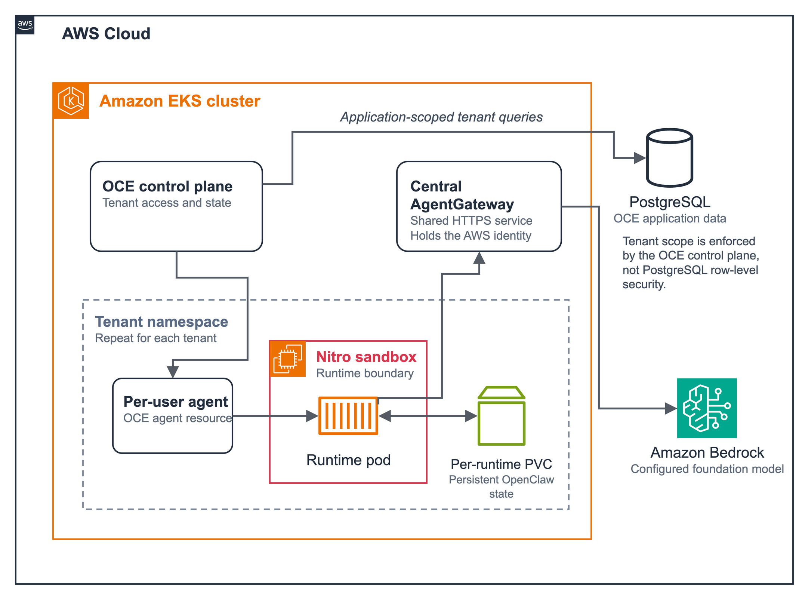
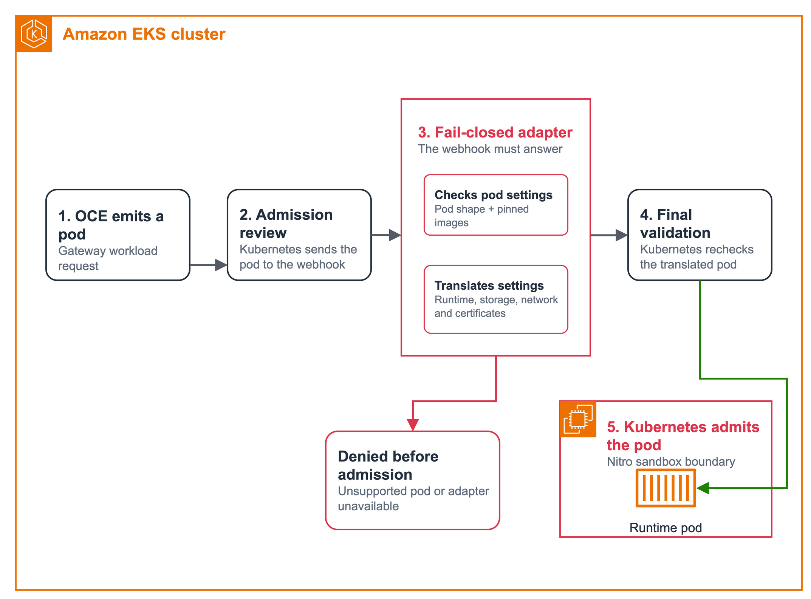

# Run OpenClaw Enterprise agents in AWS Nitro Sandboxes on Amazon EKS

Before you start, review the
[prerequisites and shared setup](../../README.md#prerequisites) on the home page
and run the
[hello sandbox](../../getting-started/hello-sandbox/README.md) blueprint. The
commands below use files from this repository, so clone it and enter this
blueprint's folder:

```bash
git clone https://github.com/aws-samples/sample-eks-nitro-sandbox.git
cd sample-eks-nitro-sandbox/examples/ai-agents/openclaw-enterprise
```

This blueprint installs OpenClaw Enterprise (OCE) on Amazon EKS and runs two
tenant agent runtimes in separate
[AWS Nitro Sandboxes](https://aws.amazon.com/blogs/containers/aws-nitro-sandboxes-hardware-enforced-workload-isolation-on-amazon-eks/).
Both tenants call Amazon Nova Lite through one private, shared AgentGateway.
Only AgentGateway receives an AWS identity.

Live validation is still pending. Commands below use explicit output
placeholders instead of claiming a successful run.

*Figure 1: OCE manages two tenant agent runtimes. Each runtime has its own
kernel and persistent volume, and only the shared AgentGateway receives AWS
identity and calls Amazon Bedrock.*



Editable diagrams:
[architecture](images/openclaw-enterprise-architecture.drawio),
[model request](images/openclaw-enterprise-model-request.drawio), and
[pod admission](images/openclaw-enterprise-pod-admission.drawio).

## Prerequisites

- An EKS Auto Mode cluster with the `isolated-sandbox` RuntimeClass, created by
  the shared setup. Before using the disposable database path, the cluster must
  already carry the tag `Environment=validation`; you need
  `eks:ListTagsForResource` to verify it.
- Access to Amazon Bedrock model `amazon.nova-lite-v1:0` in `us-west-2`.
- Private OCE authentication and Agent DNS names that resolve from the cluster.
- [cert-manager](https://cert-manager.io/docs/installation/) `v1.21.3`
  for a new installation, or an existing installation that serves the
  `cert-manager.io/v1` `Issuer` and `Certificate` APIs. The adapter and
  AgentGateway manifests create these resources.
- A scanned, digest-pinned CodeBuild builder image in private Amazon ECR.
- Amazon Inspector enhanced scanning for Amazon ECR already enabled in the
  build account and Region, with a registry rule that covers
  `openclaw-enterprise/*`.
- AWS CLI v2 with a named profile whose source credentials remain valid or
  refresh automatically throughout the image build, Bash 4 or later, Docker,
  Git, Go, Helm 3, `jq`, `kubectl`, Node.js 22 or later, OpenSSL, Python 3,
  GNU `envsubst` (from `gettext`), and
  [Mike Farah `yq`](https://github.com/mikefarah/yq) `v4.54.3`.
  This sample was tested with Helm `v3.22.1`. The pinned OCE revision predates
  [upstream Helm 4 support](https://github.com/openclaw/openclaw-enterprise/pull/6691).
- Kubernetes permissions for each phase:
  - setup and install: read cluster discovery data; install the documented
    cluster-scoped admission, storage, and RBAC resources; and manage the
    blueprint namespaces and their workloads
  - validation: manage the two retained validation tenants and create
    `pods/portforward` requests
  - cleanup: delete only receipt-matched blueprint resources, create
    server-side dry-run ConfigMaps, and temporarily manage the documented
    admission policies and bindings
- AWS permissions for each phase:
  - image build: inspect the regional Amazon Inspector and ECR scanning
    configuration; manage the receipt-bound builder repository and
    CloudFormation stack; read its outputs; assume the generated invocation
    role; and read the resulting Step Functions and CodeBuild execution
  - install and validation: call `sts:GetCallerIdentity`; read the EKS cluster,
    tags, VPC, and network interfaces; and manage the receipt-bound IAM role,
    inline Bedrock policy, and EKS Pod Identity association
  - cleanup: delete only the receipt-matched stack, repositories, IAM role,
    inline policy, and Pod Identity association

The image-build stack creates its own CodeBuild, Step Functions, ECR, KMS,
CloudWatch Logs, and IAM resources through CloudFormation. It relies on Amazon
Inspector enhanced ECR scanning already being enabled for the account and
Region. The generated invocation role, not the operator's base identity, starts
and reads the build workflow.

This terminal-managed topology disables OCE gateway routing and native browser
routing. It does not require Gateway API, Envoy Gateway, or their CRDs, and the
blueprint does not install them.

Keep credentials, account details, generated state, receipts, and validation
evidence outside the repository.

This blueprint incurs charges for the EKS cluster and worker capacity,
Amazon EBS volumes, CodeBuild, private ECR storage and scanning, CloudWatch
Logs, KMS keys, and Amazon Bedrock model usage. Delete the resources when you
finish.

## Overview

OCE creates and controls each tenant runtime. Its native shared
`modelProvider` uses the `openai-responses` protocol and the private HTTPS URL
`https://agentgateway.openclaw-enterprise-agw.svc.cluster.local/v1`.
AgentGateway authenticates separate tenant keys and makes the Bedrock request
with EKS Pod Identity.

The admission adapter is a compatibility layer for the pinned OCE pod shape. It
sets the RuntimeClass, replaces the incompatible state PVC mount, installs the
private CA trust, and applies the related strict Nitro compatibility changes.
It does not implement or redirect model routing.

*Figure 2: Tenant runtimes use OCE's native model provider path. The shared,
stateless AgentGateway holds no tenant runtime state.*


The blueprint layers these controls:

| Boundary | How the blueprint enforces it | Remaining shared boundary |
|---|---|---|
| Compute | The fail-closed admission chain verifies the OCE controller lineage and expected pod shape, then sets `runtimeClassName: isolated-sandbox`. Each admitted runtime gets its own Nitro sandbox, kernel, and memory boundary. | The OCE control plane and EKS cluster remain shared. |
| Storage | The adapter derives the expected PVC from the gateway identity and rejects another claim. Each runtime mounts its own persistent volume. | The OCE database is shared and is outside the runtime storage boundary. |
| Network | The blueprint permits the EKS DNS address, Kubernetes API Service address on TCP 443, and private AgentGateway Service address. These are the control and model paths OCE needs. | The cluster network remains shared. Add tenant network isolation separately. Native OCE support for private model services would remove the operator-owned AgentGateway rule. |
| AWS identity | Tenant runtimes receive no EKS Pod Identity association, IRSA annotation, common AWS credential variables, or unapproved credential-capable mounts. | AgentGateway alone has a shared IAM role for the configured Bedrock model. |
| OCE authorization | Each validator identity receives `read` permission on only its own OCE namespace and agent. The live test requires same-tenant success and cross-tenant HTTP `403` responses. | A compromised OCE control plane or copied bearer key is outside this boundary. |

The adapter does not modify upstream OCE, choose a model, or rewrite model
routing. It applies a narrow pod-admission compatibility patch only after all
expected ownership and pod-shape checks pass. A mismatch is refused rather
than admitted unchanged.

### Database and control-plane boundary

AgentGateway is shared and stateless. It stores no tenant runtime state, but
all tenants depend on its Deployment, private Service, bearer-key
configuration, and Bedrock IAM role. Separate AgentGateway keys authorize
tenant requests, so per-tenant Bedrock inference profiles are not required.

The OCE control plane and database are also shared. This blueprint does not
modify upstream OCE and does not enable PostgreSQL row-level security. It
validates OCE API authorization and makes no claim about database row
isolation. Use separate control planes, databases, clusters, or AWS accounts
when your threat model requires those stronger boundaries.

## Versions

| Component | Version or constraint |
|---|---|
| OpenClaw Enterprise | Chart `0.1.0` at commit `86c8c12310f691bb21651118ffffd6bfd460e9ff` |
| Helm | `v3.22.1`; the installer rejects Helm 4 for the pinned OCE revision |
| AgentGateway | `v1.7.0`, digest-pinned in `deploy/agentgateway.yaml` |
| Amazon Bedrock model | `amazon.nova-lite-v1:0` in `us-west-2` |
| Adapter, controller, ownership helper, runtime | Digest-qualified outputs from one successful CodeBuild run |
| OCE Node.js build and runtime bases | Node.js `24.22.1` on Debian 13 (Trixie), each pinned by multi-platform image digest; the build records both references in `image-digests.json` |
| Controller runtime base | Allowlisted, digest-pinned distroless Node.js 24 on Debian 13 (`nonroot`); the build verifies Node.js 24.22.1+, UID and GID 1000, and the absence of shell and package-manager tools. |
| cert-manager | `v1.21.3` |
| Validation PostgreSQL | OCE-qualified `18.6`, digest-pinned in Step 6 |
| Local Node.js tooling | `22` or later |
| `yq` | Mike Farah `yq` `v4.54.3` |

## Files

| Path | Purpose |
|---|---|
| [`build/codebuild-builder.Dockerfile`](build/codebuild-builder.Dockerfile) | Build a pinned, purpose-built Alpine image with the Docker engine and only the host tools required by the image build. |
| [`build/template.yaml`](build/template.yaml) | Build and scan the four deployable images. |
| [`deploy/adapter-webhook.yaml`](deploy/adapter-webhook.yaml) | Define the admission adapter; adjacent manifests define AgentGateway and storage settings. |
| [`scripts/manage-builder-repository.sh`](scripts/manage-builder-repository.sh) | Create and delete one receipt-bound private builder repository. |
| [`scripts/manage-image-build-stack.sh`](scripts/manage-image-build-stack.sh) | Create and delete one receipt-bound image build stack. |
| [`scripts/setup-storage-class.sh`](scripts/setup-storage-class.sh) | Create or verify the blueprint-owned EKS Auto Mode StorageClass. |
| [`scripts/setup-agentgateway-pod-identity.sh`](scripts/setup-agentgateway-pod-identity.sh) | Create or verify AgentGateway's IAM role, Bedrock policy, and Pod Identity association. |
| [`scripts/setup-agentgateway.sh`](scripts/setup-agentgateway.sh) | Create or verify AgentGateway and its private key state. |
| [`scripts/install-oce.sh`](scripts/install-oce.sh) | Install the exact OCE revision in a terminal-managed topology. |
| [`scripts/configure-tenant-model-gateway.sh`](scripts/configure-tenant-model-gateway.sh) | Add private AgentGateway CA trust and exact private service egress to one OCE tenant namespace. |
| [`scripts/oce-api-tunnel.sh`](scripts/oce-api-tunnel.sh) | Open temporary loopback-only access to the private OCE API through a network-restricted relay. |
| [`scripts/validate-live.sh`](scripts/validate-live.sh) | Run the destructive two-tenant validation. |
| [`scripts/lib/evaluate-native-tool-history.mjs`](scripts/lib/evaluate-native-tool-history.mjs) | Evaluate native OpenClaw tool-call history for live validation. |
| [`scripts/cleanup.sh`](scripts/cleanup.sh) | Remove resources only after ownership checks pass. |

**Step 1: Set local values and check access**

Use one explicit kube context and kubeconfig throughout:

```bash
export SAMPLE_DIR="$PWD"
export AWS_PROFILE='<aws-cli-profile>'
export KUBECONFIG='<absolute-kubeconfig-path>'
export KUBE_CONTEXT='<eks-kube-context>'
export AWS_ACCOUNT_ID='<12-digit-account-id>'
export AWS_REGION='us-west-2'
export EKS_CLUSTER_NAME='<eks-cluster-name>'
export PRIVATE_STATE_DIR='<private-directory-outside-the-repository>'
export BUILDER_REPOSITORY_RECEIPT="$PRIVATE_STATE_DIR/builder-repository.json"
export IMAGE_BUILD_STACK_RECEIPT="$PRIVATE_STATE_DIR/image-build-stack.json"
export STORAGE_CLASS_RECEIPT="$PRIVATE_STATE_DIR/storage-class-receipt.json"
export AGENTGATEWAY_POD_IDENTITY_RECEIPT="$PRIVATE_STATE_DIR/agentgateway-pod-identity-receipt.json"
export AGENTGATEWAY_IAM_ROLE_NAME='openclaw-enterprise-agentgateway'
export AGENTGATEWAY_STATE_DIR="$PRIVATE_STATE_DIR/agentgateway"
export AGENTGATEWAY_RECEIPT="$AGENTGATEWAY_STATE_DIR/lifecycle-receipt.json"
export OCE_SOURCE_REVISION='86c8c12310f691bb21651118ffffd6bfd460e9ff' # pragma: allowlist secret -- public source revision
export CERT_MANAGER_VERSION='v1.21.3'
export YQ_VERSION='v4.54.3'

chmod 600 "$KUBECONFIG"
install -d -m 700 "$PRIVATE_STATE_DIR"
caller_arn="$(aws sts get-caller-identity --query Arn --output text)"
case "$caller_arn" in
  arn:aws:iam::*:role/*|arn:aws:iam::*:user/*)
    export TRUSTED_BUILD_INVOKER_ARN="$caller_arn"
    ;;
  arn:aws:sts::*:assumed-role/*/*)
    caller_role_and_session="${caller_arn#*:assumed-role/}"
    caller_role_name="${caller_role_and_session%%/*}"
    export TRUSTED_BUILD_INVOKER_ARN="$(
      aws iam get-role \
        --role-name "$caller_role_name" \
        --query 'Role.Arn' \
        --output text
    )"
    ;;
  *)
    printf 'Set TRUSTED_BUILD_INVOKER_ARN to your IAM role or user ARN.\n' >&2
    return 1 2>/dev/null || exit 1
    ;;
esac
kubectl --context "$KUBE_CONTEXT" config get-contexts "$KUBE_CONTEXT"
kubectl --context "$KUBE_CONTEXT" get --raw=/readyz
test "$(yq --version | awk '{print $NF}')" = "$YQ_VERSION"
node_major="$(node --version | sed -E 's/^v([0-9]+).*/\1/')"
test "$node_major" -ge 22
docker version >/dev/null
```

Install the pinned cert-manager release when the cluster does not already have
a shared cert-manager installation:

```bash
if kubectl --context "$KUBE_CONTEXT" \
  --namespace cert-manager get deployment cert-manager >/dev/null 2>&1; then
  existing_cert_manager_version="$(
    kubectl --context "$KUBE_CONTEXT" \
      --namespace cert-manager get deployment \
      cert-manager cert-manager-webhook cert-manager-cainjector \
      --output json |
      jq -er '
        [.items[].metadata.labels["app.kubernetes.io/version"]]
        | unique
        | if length == 1 then .[0]
          else error("cert-manager components have inconsistent versions")
          end
      '
  )"
  printf 'Using existing cert-manager %s without modifying it.\n' \
    "$existing_cert_manager_version"
else
  helm upgrade --install cert-manager \
    oci://quay.io/jetstack/charts/cert-manager \
    --kube-context "$KUBE_CONTEXT" \
    --version "$CERT_MANAGER_VERSION" \
    --namespace cert-manager \
    --create-namespace \
    --set crds.enabled=true
fi
kubectl --context "$KUBE_CONTEXT" --namespace cert-manager \
  rollout status deployment/cert-manager
kubectl --context "$KUBE_CONTEXT" --namespace cert-manager \
  rollout status deployment/cert-manager-webhook
kubectl --context "$KUBE_CONTEXT" --namespace cert-manager \
  rollout status deployment/cert-manager-cainjector
for crd in issuers.cert-manager.io certificates.cert-manager.io; do
  kubectl --context "$KUBE_CONTEXT" wait \
    --for=condition=Established "customresourcedefinition/$crd"
  kubectl --context "$KUBE_CONTEXT" get \
    "customresourcedefinition/$crd" --output json |
    jq -e '
      any(
        .spec.versions[];
        .name == "v1" and .served == true
      )
    ' >/dev/null
done
```

cert-manager is a shared cluster prerequisite. The cleanup script does not
delete or upgrade it.

```text
TODO: output from the fresh run
```

Before building images, verify that Amazon Inspector enhanced scanning is
enabled for Amazon ECR and that a registry rule covers
`openclaw-enterprise/*`. These are account-and-Region settings. Ask the
registry owner to configure them by following the
[Amazon ECR enhanced scanning documentation](https://docs.aws.amazon.com/AmazonECR/latest/userguide/image-scanning-enhanced.html)
if either check fails. The sample reads this configuration but does not change
or later restore shared registry settings.

```bash
aws inspector2 batch-get-account-status \
  --region "$AWS_REGION" \
  --account-ids "$AWS_ACCOUNT_ID" \
  --query 'accounts[0].{Inspector:state.status,ECR:resourceState.ecr.status}'
aws ecr get-registry-scanning-configuration \
  --region "$AWS_REGION" \
  --query 'scanningConfiguration.{ScanType:scanType,Rules:rules}'
```

Both Inspector statuses must be `ENABLED`, the scan type must be `ENHANCED`,
and an enabled `SCAN_ON_PUSH` or `CONTINUOUS_SCAN` rule must cover the sample
repositories. The build repeats these checks and stops before cloning or
building when the configuration is incomplete. Amazon Inspector charges apply
to images covered by the rule.

**Step 2: Build and scan the images**

Build the purpose-built image from a pinned Alpine base and push it to private
ECR. It contains the Docker engine and only the host tools required by the
image build.
The build project selects the private image by digest, and the stack manager
waits for Amazon Inspector to report no active HIGH or CRITICAL package
findings before creating the build resources.

```bash
export BUILDER_TAG='alpine-3.24-openclaw-builder'
export ECR_REGISTRY="${AWS_ACCOUNT_ID}.dkr.ecr.${AWS_REGION}.amazonaws.com"

"$SAMPLE_DIR/scripts/manage-builder-repository.sh" create \
  --receipt "$BUILDER_REPOSITORY_RECEIPT" \
  --region "$AWS_REGION"
export BUILDER_REPOSITORY="$(
  jq -er '.repositoryName' "$BUILDER_REPOSITORY_RECEIPT"
)"

aws ecr get-login-password --region "$AWS_REGION" |
  docker login --username AWS --password-stdin "$ECR_REGISTRY"
docker build \
  --platform linux/amd64 \
  --pull \
  --file "$SAMPLE_DIR/build/codebuild-builder.Dockerfile" \
  --tag "$ECR_REGISTRY/$BUILDER_REPOSITORY:$BUILDER_TAG" \
  "$SAMPLE_DIR/build"
docker push "$ECR_REGISTRY/$BUILDER_REPOSITORY:$BUILDER_TAG"
export BUILDER_DIGEST="$(
  aws ecr describe-images \
    --region "$AWS_REGION" \
    --repository-name "$BUILDER_REPOSITORY" \
    --image-ids "imageTag=$BUILDER_TAG" \
    --query 'imageDetails[0].imageDigest' \
    --output text
)"
[[ "$BUILDER_DIGEST" =~ ^sha256:[0-9a-f]{64}$ ]]

export SAMPLE_GIT_REVISION="$(git -C ../../.. rev-parse HEAD)"
"$SAMPLE_DIR/scripts/manage-image-build-stack.sh" create \
  --receipt "$IMAGE_BUILD_STACK_RECEIPT" \
  --region "$AWS_REGION" \
  --sample-revision "$SAMPLE_GIT_REVISION" \
  --builder-repository "$BUILDER_REPOSITORY" \
  --builder-digest "$BUILDER_DIGEST" \
  --trusted-build-invoker-arn "$TRUSTED_BUILD_INVOKER_ARN"
export IMAGE_BUILD_STACK_ID="$(
  jq -er '.stackId' "$IMAGE_BUILD_STACK_RECEIPT"
)"
```

Use new builder-repository and image-build-stack receipt files for each build.
Both `create` actions refuse to replace an existing receipt. If either manager
cannot confirm creation or deletion, rerun its `delete` command in Cleanup with
the same receipt. Each `delete` command safely reconciles `create-planned`,
`create-unconfirmed`, `delete-planned`, and `delete-unconfirmed` receipts,
verifies ownership before deleting a present resource, and records an absent or
deleted resource as `deleted`.

The lifecycle managers serialize operations on a receipt with a
`<receipt>.lock` directory. They remove the lock after normal completion or a
failure before a cloud mutation starts. They retain it after a signal or error
interrupts a mutation or its verification. If a retained lock remains, verify
that its recorded PID is inactive when the PID file exists, then inspect the
exact resource named in the receipt. A process terminated while acquiring the
lock can leave an empty lock directory before a receipt exists. In either case,
reconcile the resource before removing only the lock directory, then rerun the
corresponding `delete` command with the same receipt.

The script creates a uniquely named, run-owned stack and records its exact ARN
in a private receipt. The stack creates four encrypted, immutable ECR
repositories and a fixed Step Functions workflow. CodeBuild checks out this
repository and OCE at exact commits, builds the adapter, controller, ownership
helper, and runtime images, waits for Amazon Inspector `PACKAGE` coverage, and
rejects active `HIGH` or `CRITICAL` findings before it exports digest-qualified
references. ECR basic scanning alone does not meet this gate.

Assume the generated invocation role in a subshell and start the fixed
workflow. The temporary credentials disappear when the subshell exits; only
the four non-secret image references are returned to the operator shell. The
command re-assumes the generated role from `AWS_PROFILE` every 45 minutes,
replacing its one-hour session while the Step Functions workflow continues
independently. This supports role-chained callers without long-lived
credentials. The command stops waiting after 185 minutes, covering the
workflow's 60-minute queue and 120-minute build limits with five minutes of
overhead:

```bash
invocation_role_arn="$(
  aws cloudformation describe-stacks \
    --region "$AWS_REGION" \
    --stack-name "$IMAGE_BUILD_STACK_ID" \
    --query 'Stacks[0].Outputs[?OutputKey==`BuildInvocationRoleArn`].OutputValue' \
    --output text
)"
state_machine_arn="$(
  aws cloudformation describe-stacks \
    --region "$AWS_REGION" \
    --stack-name "$IMAGE_BUILD_STACK_ID" \
    --query 'Stacks[0].Outputs[?OutputKey==`BuildStateMachineArn`].OutputValue' \
    --output text
)"
(
set -euo pipefail
set +x
source_aws_profile="$AWS_PROFILE"
assume_build_invocation_role() {
  credentials="$(
    (
      unset AWS_ACCESS_KEY_ID AWS_SECRET_ACCESS_KEY AWS_SESSION_TOKEN
      aws --profile "$source_aws_profile" sts assume-role \
        --role-arn "$invocation_role_arn" \
        --role-session-name openclaw-enterprise-image-build \
        --duration-seconds 3600 \
        --output json
    )
  )"
  credential_values="$(
    printf '%s' "$credentials" |
      jq -er '
        [
          .Credentials.AccessKeyId,
          .Credentials.SecretAccessKey,
          .Credentials.SessionToken
        ]
        | if all(.[];
            type == "string" and length > 0 and (contains("\t") | not)
          )
          then @tsv
          else error("STS returned incomplete credentials")
          end
      '
  )"
  IFS=$'\t' read -r access_key secret_key session_token \
    <<<"$credential_values"
  [[ -n "$access_key" && -n "$secret_key" && -n "$session_token" ]]
  export AWS_ACCESS_KEY_ID="$access_key"
  export AWS_SECRET_ACCESS_KEY="$secret_key"
  export AWS_SESSION_TOKEN="$session_token"
  unset credentials credential_values access_key secret_key session_token
  credentials_refreshed_at="$(date +%s)"
}
trap 'unset credentials AWS_ACCESS_KEY_ID AWS_SECRET_ACCESS_KEY AWS_SESSION_TOKEN' EXIT
assume_build_invocation_role
execution_deadline=$(($(date +%s) + 11100))
execution_arn="$(
  aws stepfunctions start-execution \
    --state-machine-arn "$state_machine_arn" \
    --input '{}' \
    --query executionArn \
    --output text
)"
while :; do
  current_epoch="$(date +%s)"
  if ((current_epoch >= execution_deadline)); then
    printf 'Timed out waiting for Step Functions execution: %s\n' \
      "$execution_arn" >&2
    exit 1
  fi
  if ((current_epoch - credentials_refreshed_at >= 2700)); then
    assume_build_invocation_role
  fi
  execution_json="$(
    aws stepfunctions describe-execution \
      --execution-arn "$execution_arn" \
      --output json
  )"
  status="$(printf '%s' "$execution_json" | jq -r '.status')"
  case "$status" in
    SUCCEEDED)
      build_id="$(
        printf '%s' "$execution_json" |
          jq -er '.output | fromjson | .Build.Id'
      )"
      break
      ;;
    FAILED|ABORTED|TIMED_OUT)
      printf '%s' "$execution_json" | jq '{status, error, cause}' >&2
      exit 1
      ;;
    RUNNING) ;;
    *)
      printf 'Unexpected Step Functions status %s for %s\n' \
        "$status" "$execution_arn" >&2
      exit 1
      ;;
  esac
  sleep 20
done
build_json="$(
  aws codebuild batch-get-builds \
    --ids "$build_id" \
    --output json
)"
test "$(printf '%s' "$build_json" | jq -r '.builds[0].buildStatus')" = \
  'SUCCEEDED'

image_outputs="$PRIVATE_STATE_DIR/image-build-outputs.json"
printf '%s' "$build_json" |
  jq -e '
    .builds[0].exportedEnvironmentVariables
    | map({key: .name, value: .value})
    | from_entries
    | {
        ADAPTER_IMAGE,
        CONTROLLER_IMAGE,
        OWNERSHIP_INIT_IMAGE,
        RUNTIME_IMAGE
      }
    | if all(.[]; type == "string" and contains("@sha256:"))
      then .
      else error("missing digest-qualified image output")
      end
  ' >"$image_outputs"
chmod 600 "$image_outputs"
)

export ADAPTER_IMAGE="$(
  jq -er '.ADAPTER_IMAGE' "$PRIVATE_STATE_DIR/image-build-outputs.json"
)"
export CONTROLLER_IMAGE="$(
  jq -er '.CONTROLLER_IMAGE' "$PRIVATE_STATE_DIR/image-build-outputs.json"
)"
export OWNERSHIP_INIT_IMAGE="$(
  jq -er '.OWNERSHIP_INIT_IMAGE' "$PRIVATE_STATE_DIR/image-build-outputs.json"
)"
export RUNTIME_IMAGE="$(
  jq -er '.RUNTIME_IMAGE' "$PRIVATE_STATE_DIR/image-build-outputs.json"
)"
```

Use all four outputs from the same build. Do not substitute image tags.

CodeBuild has no project setting or resource policy that blocks every direct
build override. Human and CI principals must not have
`codebuild:StartBuild`, `codebuild:StartBuildBatch`, or
`codebuild:RetryBuild` on this project. Use a permissions boundary or SCP to
enforce that deny, and exempt only `ImageBuildWorkflowRole`. Release operators
should receive only permission to assume the generated invocation role.

```text
TODO: output from the fresh run
```

**Step 3: Configure storage**

Create or verify the non-default, encrypted `gp3` StorageClass:

```bash
export RUNTIME_STORAGE_CLASS="$(
  "$SAMPLE_DIR/scripts/setup-storage-class.sh" \
    --kube-context "$KUBE_CONTEXT" \
    --receipt "$STORAGE_CLASS_RECEIPT"
)"
test "$RUNTIME_STORAGE_CLASS" = 'openclaw-enterprise-gp3'
```

The script creates the StorageClass only when it is absent. It refuses to patch
or adopt an existing resource with the same name unless the complete storage
and ownership contract already matches.

```text
TODO: output from the fresh run
```

**Step 4: Install AgentGateway and Pod Identity**

The setup script creates this IAM policy and attaches it to a role associated
only with the `openclaw-enterprise-agw/agentgateway` ServiceAccount:

```json
{
  "Version": "2012-10-17",
  "Statement": [
    {
      "Sid": "InvokeCentralBedrockModel",
      "Effect": "Allow",
      "Action": [
        "bedrock:InvokeModel",
        "bedrock:InvokeModelWithResponseStream"
      ],
      "Resource": "arn:aws:bedrock:us-west-2::foundation-model/amazon.nova-lite-v1:0",
      "Condition": {
        "StringEquals": {
          "aws:RequestedRegion": "us-west-2"
        }
      }
    }
  ]
}
```

Create or verify the AgentGateway namespace, ServiceAccount, immutable Region
ConfigMap, IAM role, policy, and Pod Identity association. The script records
which resources it created and reuses an existing resource only when its
complete contract already matches:

```bash
"$SAMPLE_DIR/scripts/setup-agentgateway-pod-identity.sh" \
  --aws-region "$AWS_REGION" \
  --aws-account-id "$AWS_ACCOUNT_ID" \
  --eks-cluster-name "$EKS_CLUSTER_NAME" \
  --kube-context "$KUBE_CONTEXT" \
  --iam-role-name "$AGENTGATEWAY_IAM_ROLE_NAME" \
  --receipt "$AGENTGATEWAY_POD_IDENTITY_RECEIPT"
```

Read the association ID from the lifecycle receipt for cleanup:

```bash
export POD_IDENTITY_ASSOCIATION_ID="$(
  jq -er '.resources.podIdentityAssociation.associationId' \
    "$AGENTGATEWAY_POD_IDENTITY_RECEIPT"
)"
```

Keep the receipt and any adjacent `.journal` file. If setup is interrupted,
rerun the same command with the same receipt. The script reconciles only
resources with its recorded invocation identity. Do not edit the receipt or
journal. If the script reports that a receipt predates the Region ConfigMap
lifecycle contract, use that receipt's original sample revision to clean up
before creating a new receipt.

Create or verify AgentGateway and its private key state:

```bash
"$SAMPLE_DIR/scripts/setup-agentgateway.sh" \
  --kubeconfig "$KUBECONFIG" \
  --kube-context "$KUBE_CONTEXT" \
  --state-dir "$AGENTGATEWAY_STATE_DIR" \
  --receipt "$AGENTGATEWAY_RECEIPT"
```

Ordinary reruns are idempotent: the script preserves the key bytes and verifies
that existing resources still match. To rotate all AgentGateway keys, rerun the
same command with `--rotate-keys`. If setup or rotation is forcibly
interrupted, the script preserves its private journal and setup lock rather than
guessing whether another writer is active. Confirm that the PID recorded in
`.setup-agentgateway.lock.active/pid` is no longer running, inspect the journal,
then remove only `.setup-agentgateway.lock.active`. Rerun the same command with
the same kubeconfig, context, state directory, and receipt. Do not edit or
delete the journal.

```text
TODO: output from the fresh run
```

**Step 5: Install the admission adapter**

Render all three digest-qualified image references before applying the
manifest:

```bash
"$SAMPLE_DIR/scripts/render-adapter-manifest.sh" \
  "$SAMPLE_DIR/deploy/adapter-webhook.yaml" \
  "$ADAPTER_IMAGE" \
  "$OWNERSHIP_INIT_IMAGE" \
  "$RUNTIME_IMAGE" |
  kubectl --context "$KUBE_CONTEXT" apply --filename -

kubectl --context "$KUBE_CONTEXT" \
  --namespace openclaw-enterprise-adapter rollout status \
  deployment/openclaw-enterprise-nitro-adapter
```

Do not apply the raw adapter manifest. It contains image placeholders. Wait for
the adapter before creating the first OCE Agent because its admission webhooks
fail closed.

*Figure 3: The adapter accepts only the pinned controller chain and expected pod
shape before applying the Nitro compatibility patch.*



```text
TODO: output from the fresh run
```

**Step 6: Install the pinned OCE revision**

Clone OCE into a clean directory and verify the exact revision:

```bash
export OCE_SOURCE_DIR='<clean-openclaw-enterprise-checkout>'
git clone https://github.com/openclaw/openclaw-enterprise.git "$OCE_SOURCE_DIR"
git -C "$OCE_SOURCE_DIR" switch --detach "$OCE_SOURCE_REVISION"
test "$(git -C "$OCE_SOURCE_DIR" rev-parse HEAD)" = "$OCE_SOURCE_REVISION"
test -z "$(git -C "$OCE_SOURCE_DIR" status --porcelain)"
```

Use the disposable PostgreSQL mode only on an EKS cluster that was already
tagged `Environment=validation` through your cluster provisioning or
administrator-approved process. Verify the existing tag without changing it:

```bash
export OCE_NAMESPACE='openclaw-system'
export OCE_STATE_DIR="$PRIVATE_STATE_DIR/oce-install"
export OCE_RECEIPT_DIR="$OCE_STATE_DIR/receipt"
export OCE_VALIDATION_POSTGRES_IMAGE='public.ecr.aws/docker/library/postgres@sha256:86c951e05bf56c93d95d397747fb8820ac76cc3bedb78f43abd83eedbe3666ae'

cluster_arn="$(
  aws eks describe-cluster \
    --region "$AWS_REGION" \
    --name "$EKS_CLUSTER_NAME" \
    --query 'cluster.arn' \
    --output text
)"
cluster_environment="$(
  aws eks list-tags-for-resource \
    --region "$AWS_REGION" \
    --resource-arn "$cluster_arn" \
    --query 'tags.Environment' \
    --output text
)"
if [[ "$cluster_environment" != validation ]]; then
  printf 'This sample requires the existing EKS tag Environment=validation.\n' >&2
  exit 1
fi

vpc_id="$(
  aws eks describe-cluster \
    --region "$AWS_REGION" \
    --name "$EKS_CLUSTER_NAME" \
    --query 'cluster.resourcesVpcConfig.vpcId' \
    --output text
)"
sample_pod_ip="$(
  kubectl --context "$KUBE_CONTEXT" get pods --all-namespaces \
    --field-selector=status.phase=Running --output json |
    jq -er '[.items[].status.podIP | select(test("^[0-9.]+$"))][0]'
)"
read -r -a vpc_cidrs <<<"$(
  aws ec2 describe-vpcs \
    --region "$AWS_REGION" \
    --vpc-ids "$vpc_id" \
    --query 'Vpcs[0].CidrBlockAssociationSet[?CidrBlockState.State==`associated`].CidrBlock' \
    --output text
)"
export POD_CIDR="$(
  python3 - "$sample_pod_ip" "${vpc_cidrs[@]}" <<'PY'
import ipaddress
import sys

pod_ip = ipaddress.ip_address(sys.argv[1])
matches = [cidr for cidr in sys.argv[2:] if pod_ip in ipaddress.ip_network(cidr)]
if len(matches) != 1:
    raise SystemExit(f"expected one VPC CIDR for pod IP, found {matches}")
print(matches[0])
PY
)"

cluster_security_group_id="$(
  aws eks describe-cluster \
    --region "$AWS_REGION" \
    --name "$EKS_CLUSTER_NAME" \
    --query 'cluster.resourcesVpcConfig.clusterSecurityGroupId' \
    --output text
)"
cluster_api_cidr_args=()
while IFS= read -r ip; do
  [[ "$ip" =~ ^([0-9]{1,3}\.){3}[0-9]{1,3}$ ]] || {
    printf 'Invalid EKS control-plane address: %s\n' "$ip" >&2
    exit 1
  }
  cluster_api_cidr_args+=(--cluster-api-cidr "$ip/32")
done < <(
  aws ec2 describe-network-interfaces \
    --region "$AWS_REGION" \
    --filters \
      "Name=vpc-id,Values=$vpc_id" \
      "Name=group-id,Values=$cluster_security_group_id" \
      "Name=description,Values=Amazon EKS $EKS_CLUSTER_NAME" \
      'Name=requester-managed,Values=true' \
      'Name=status,Values=in-use' \
    --query 'NetworkInterfaces[].PrivateIpAddress' \
    --output text |
    tr '\t' '\n' |
    sort -u
)
((${#cluster_api_cidr_args[@]} > 0))

"$SAMPLE_DIR/scripts/install-oce.sh" \
  --aws-account-id "$AWS_ACCOUNT_ID" \
  --aws-region "$AWS_REGION" \
  --eks-cluster-name "$EKS_CLUSTER_NAME" \
  --kubeconfig "$KUBECONFIG" \
  --kube-context "$KUBE_CONTEXT" \
  --oce-source "$OCE_SOURCE_DIR" \
  --build-occ \
  --controller-image "$CONTROLLER_IMAGE" \
  --runtime-image "$RUNTIME_IMAGE" \
  --auth-base-url 'https://<private-auth-host>' \
  --agent-domain '<private-agent-domain>' \
  --admin-email '<initial-admin-email>' \
  --runtime-storage-class "$RUNTIME_STORAGE_CLASS" \
  --pod-cidr "$POD_CIDR" \
  "${cluster_api_cidr_args[@]}" \
  --state-dir "$OCE_STATE_DIR" \
  --receipt "$OCE_RECEIPT_DIR" \
  --namespace "$OCE_NAMESPACE" \
  --validation-postgres \
  --validation-postgres-image "$OCE_VALIDATION_POSTGRES_IMAGE"
```

This optional database is a single validation-only PostgreSQL 18.6 pod backed
by an encrypted `gp3` Amazon EBS volume. The data survives pod replacement.
The sample cleanup deletes the claim and its `Delete`-policy volume with the
system namespace. This is not a highly available or backed-up database. The
installer creates separate least-privilege application and migration roles,
then checks the PostgreSQL version and role contract before it dispatches the
OCE installation.

For an external database, omit the two validation flags and provide protected
application URL, migration URL, and CA files plus at least one exact database
`/32` CIDR. Both URLs must use a DNS hostname, `sslmode=verify-full`, and
`sslrootcert=/etc/openclaw/database-ca/ca.pem`. The CA file must contain only
trusted PEM CA certificates. See `install-oce.sh --help`.

The installer uses `occ installation install`. It deliberately disables direct
Pod API clients with an unmatched label selector. It also disables browser
gateway routing and agent native administration. Use the temporary API tunnel
in the next step for terminal administration.

```text
TODO: output from the fresh run
```

**Step 7: Onboard two tenants from the terminal**

Complete this sequence once for tenant A and once for tenant B. Finish one
tenant before starting the next, and use separate OCE namespaces, backing
Kubernetes namespaces, AgentGateway keys, agents, and validator service keys.

Open the private OCE API on loopback in a dedicated terminal:

```bash
"$SAMPLE_DIR/scripts/oce-api-tunnel.sh" \
  --kube-context "$KUBE_CONTEXT" \
  --namespace "$OCE_NAMESPACE" \
  --local-port 18080
```

The helper creates a temporary relay that can connect only to the selected,
Ready OCE API pod. A network policy permits that API pod to accept traffic only
from this relay. The local listener binds only to `127.0.0.1`. Press `Ctrl-C`
when onboarding is complete; the helper removes the relay and both policies.

In another terminal:

```bash
export OCC_URL='http://127.0.0.1:18080'
export OCC_SERVICE_KEY_FILE="$OCE_STATE_DIR/initial-admin-service-key.json"
export OCC_BIN="$OCE_STATE_DIR/occ-$OCE_SOURCE_REVISION"
test -x "$OCC_BIN"
jq -e '.data.key | type == "string" and length > 0' \
  "$OCC_SERVICE_KEY_FILE" >/dev/null
```

The installer copies the initial administrator service key and password into
`$OCE_STATE_DIR` at mode `0600`, verifies both files, erases the cluster copies,
and deletes the temporary Job, PVC, and encrypted EBS volume before recording a
successful install. If the command stops after OCC deploys, rerun the exact same
command with the same state directory and receipt. The installer resumes only
when its journal, OCC receipt, Helm release, and recorded bootstrap resource
UIDs still match. If the Helm release is absent, preserve the state and receipt
and follow the installer's diagnostic instead of retrying blindly. Protect the
local state directory and rotate or revoke the administrator service key if it
is exposed.

The local Kubernetes identity needs permission to read the Service and its
selected Pod and to create `pods/portforward`. Port-forwarding bypasses
in-cluster NetworkPolicy for the operator path and gives local processes on the
workstation access to the forwarded API. Bind only to `127.0.0.1`, protect the
service key, and stop the process when administration is complete.

For each tenant, create an OCE namespace and identify its one Kubernetes
namespace:

```bash
export TENANT_NAME='<tenant-a-or-tenant-b>'
export NAMESPACE_ID="$(
  "$OCC_BIN" namespace create "$TENANT_NAME" --output json |
    jq -er '.id'
)"
export TENANT_NAMESPACE="$(
  kubectl --context "$KUBE_CONTEXT" get namespaces \
    --selector "openclaw.dev/namespace=$NAMESPACE_ID" \
    --output json |
    jq -er '
      if (.items | length) == 1
      then .items[0].metadata.name
      else error("expected exactly one OCE backing namespace")
      end
    '
)"
```

Give the OCE worker and API only the Kubernetes permissions required in that
namespace:

```bash
kubectl --context "$KUBE_CONTEXT" --namespace "$TENANT_NAMESPACE" \
  create rolebinding openclaw-enterprise-worker \
  --clusterrole oce-openclaw-tenant-worker \
  --serviceaccount openclaw-system:openclaw-enterprise-worker \
  --dry-run=client --output=yaml |
  kubectl --context "$KUBE_CONTEXT" apply --filename -
kubectl --context "$KUBE_CONTEXT" --namespace "$TENANT_NAMESPACE" \
  create rolebinding openclaw-enterprise-api-secrets \
  --clusterrole oce-openclaw-tenant-api \
  --serviceaccount openclaw-system:openclaw-enterprise-api \
  --dry-run=client --output=yaml |
  kubectl --context "$KUBE_CONTEXT" apply --filename -
kubectl --context "$KUBE_CONTEXT" --namespace "$TENANT_NAMESPACE" \
  create rolebinding openclaw-enterprise-api-configuration \
  --clusterrole oce-openclaw-tenant-configuration \
  --serviceaccount openclaw-system:openclaw-enterprise-api \
  --dry-run=client --output=yaml |
  kubectl --context "$KUBE_CONTEXT" apply --filename -

"$SAMPLE_DIR/scripts/configure-tenant-model-gateway.sh" \
  "$KUBE_CONTEXT" \
  "$TENANT_NAMESPACE" \
  "$(<"$OCE_STATE_DIR/cluster-dns-cidr")"
```

Set the tenant-specific key path and create the namespace-owned model Secret:

```bash
export OCC_NAMESPACE="$NAMESPACE_ID"
export TENANT_MODEL_KEY_FILE="$AGENTGATEWAY_STATE_DIR/$TENANT_NAME-agentgateway.key"
export TENANT_WORK_DIR="$PRIVATE_STATE_DIR/$TENANT_NAME"
install -d -m 700 "$TENANT_WORK_DIR"

jq -Rs \
  '{name:"agentgateway-key",value:gsub("\n";"")}' \
  "$TENANT_MODEL_KEY_FILE" >"$TENANT_WORK_DIR/model-secret.json"
export MODEL_SECRET_ID="$(
  "$OCC_BIN" secret create \
    --file "$TENANT_WORK_DIR/model-secret.json" \
    --output json |
    jq -er '.id'
)"
rm "$TENANT_WORK_DIR/model-secret.json"
```

Create an embedded OpenClaw configuration. The default OpenAI URL is required
in the agent metadata; the installation-level model provider replaces it with
the private AgentGateway URL when OCE prepares the revision.

```bash
cat >"$TENANT_WORK_DIR/configuration.json" <<'JSON'
{
  "kind": "agent",
  "values": {
    "gateway": {
      "mode": "local",
      "bind": "lan",
      "controlUi": {
        "enabled": true,
        "allowedOrigins": [
          "http://127.0.0.1:18789",
          "http://localhost:18789"
        ]
      },
      "auth": {
        "password": {
          "source": "env",
          "provider": "default",
          "id": "OPENCLAW_GATEWAY_PASSWORD"
        }
      },
      "http": {
        "endpoints": {
          "chatCompletions": {
            "enabled": true
          }
        }
      }
    },
    "agents": {
      "defaults": {
        "model": "openai/nova-lite",
        "skipBootstrap": true,
        "models": {
          "openai/nova-lite": {
            "agentRuntime": {
              "id": "openclaw"
            }
          }
        }
      }
    },
    "models": {
      "providers": {
        "openai": {
          "baseUrl": "https://api.openai.com/v1",
          "api": "openai-responses",
          "models": [
            {
              "id": "nova-lite",
              "name": "nova-lite"
            }
          ]
        }
      }
    }
  }
}
JSON

export CONFIGURATION_ID="$(
  "$OCC_BIN" configuration create \
    --file "$TENANT_WORK_DIR/configuration.json" \
    --output json |
    jq -er '.id'
)"
export CONFIGURATION_GENERATION="$(
  "$OCC_BIN" configuration get "$CONFIGURATION_ID" --output json |
    jq -er '.generation'
)"
```

Create the agent with its own model credential:

```bash
jq -n \
  --arg name "$TENANT_NAME-agent" \
  --arg configuration "$CONFIGURATION_ID" \
  --arg namespace "$NAMESPACE_ID" \
  --arg secret "$MODEL_SECRET_ID" \
  '{
    name: $name,
    configurationId: $configuration,
    executionMode: "embedded",
    harnessAuth: {
      method: "api_key",
      source: {
        kind: "secret",
        namespaceId: $namespace,
        id: $secret
      }
    }
  }' >"$TENANT_WORK_DIR/agent.json"
export AGENT_RESPONSE="$(
  "$OCC_BIN" agent create \
    --file "$TENANT_WORK_DIR/agent.json" \
    --output json
)"
export AGENT_ID="$(printf '%s' "$AGENT_RESPONSE" | jq -er '.id')"
export AGENT_SERVICE_PRINCIPAL_ID="$(
  printf '%s' "$AGENT_RESPONSE" |
    jq -er '.servicePrincipalId'
)"
unset AGENT_RESPONSE
```

Give the agent service principal permission to operate only its own model
Secret:

```bash
cat >"$TENANT_WORK_DIR/model-secret-role.json" <<'JSON'
{
  "name": "Use a model Secret",
  "permissions": [
    {
      "action": "operate",
      "resourceKind": "secret"
    }
  ]
}
JSON
export MODEL_SECRET_ROLE_ID="$(
  "$OCC_BIN" iam role create \
    --file "$TENANT_WORK_DIR/model-secret-role.json" \
    --output json |
    jq -er '.id'
)"
jq -n \
  --arg principal "$AGENT_SERVICE_PRINCIPAL_ID" \
  --arg role "$MODEL_SECRET_ROLE_ID" \
  --arg secret "$MODEL_SECRET_ID" \
  '{
    subjectKind: "identity",
    subjectId: $principal,
    roleId: $role,
    resourceKind: "secret",
    resourceId: $secret
  }' >"$TENANT_WORK_DIR/model-secret-binding.json"
"$OCC_BIN" iam access-binding create \
  --file "$TENANT_WORK_DIR/model-secret-binding.json" \
  --output json >/dev/null
```

Deploy exactly the configuration generation you reviewed:

```bash
export FIRST_DEPLOYMENT_KEY="$TENANT_NAME-first"
export REVISION_ID="$(
  "$OCC_BIN" agent deploy-first "$AGENT_ID" \
    --configuration "$CONFIGURATION_ID" \
    --generation "$CONFIGURATION_GENERATION" \
    --key "$FIRST_DEPLOYMENT_KEY" \
    --output json |
    jq -er '.revisionId'
)"
"$OCC_BIN" agent deployment-status "$AGENT_ID" "$REVISION_ID"
```

Create a separate validator service principal for this tenant. Grant it
`read` on only the exact namespace and agent, then issue its key into a new
protected file:

```bash
export VALIDATOR_SERVICE_PRINCIPAL_ID="$(
  "$OCC_BIN" iam service-principal create \
    --namespace "$NAMESPACE_ID" \
    --output json |
    jq -er '.id'
)"
cat >"$TENANT_WORK_DIR/validator-role.json" <<'JSON'
{
  "name": "Read Namespace and Agent",
  "permissions": [
    {
      "action": "read",
      "resourceKind": "namespace"
    },
    {
      "action": "read",
      "resourceKind": "agent"
    }
  ]
}
JSON
export VALIDATOR_ROLE_ID="$(
  "$OCC_BIN" iam role create \
    --file "$TENANT_WORK_DIR/validator-role.json" \
    --output json |
    jq -er '.id'
)"
for target in "namespace:$NAMESPACE_ID" "agent:$AGENT_ID"; do
  jq -n \
    --arg principal "$VALIDATOR_SERVICE_PRINCIPAL_ID" \
    --arg role "$VALIDATOR_ROLE_ID" \
    --arg kind "${target%%:*}" \
    --arg id "${target#*:}" \
    '{
      subjectKind: "identity",
      subjectId: $principal,
      roleId: $role,
      resourceKind: $kind,
      resourceId: $id
    }' >"$TENANT_WORK_DIR/validator-binding.json"
  "$OCC_BIN" iam access-binding create \
    --file "$TENANT_WORK_DIR/validator-binding.json" \
    --output json >/dev/null
done

export VALIDATOR_KEY_FILE="$TENANT_WORK_DIR/validator-service-key.json"
test ! -e "$VALIDATOR_KEY_FILE"
"$OCC_BIN" service-key create \
  --namespace "$NAMESPACE_ID" \
  --service-principal "$VALIDATOR_SERVICE_PRINCIPAL_ID" \
  --name "$TENANT_NAME-validator" \
  --expires-in-days 30 \
  --out "$VALIDATOR_KEY_FILE"
jq -e '.data.key | type == "string" and length > 0' \
  "$VALIDATOR_KEY_FILE" >/dev/null
if VALIDATOR_KEY_MODE="$(stat -c '%a' "$VALIDATOR_KEY_FILE" 2>/dev/null)"; then
  :
else
  VALIDATOR_KEY_MODE="$(stat -f '%Lp' "$VALIDATOR_KEY_FILE")"
fi
test "$VALIDATOR_KEY_MODE" = '600'
```

Discover the one ready gateway pod for the deployed revision:

```bash
export RUNTIME_POD="$(
  kubectl --context "$KUBE_CONTEXT" \
    --namespace "$TENANT_NAMESPACE" \
    get pods \
    --selector \
      "app.kubernetes.io/managed-by=openclaw-enterprise,openclaw.dev/workload-role=gateway,openclaw.dev/namespace=$NAMESPACE_ID,openclaw.dev/agent=$AGENT_ID,openclaw.dev/revision=$REVISION_ID" \
    --output json |
    jq -er '
      [
        .items[]
        | select(.metadata.deletionTimestamp == null)
        | select(.status.phase == "Running")
        | select(
            (.status.conditions // [])
            | any(.type == "Ready" and .status == "True")
          )
        | .metadata.name
      ]
      | if length == 1
        then .[0]
        else error("expected exactly one ready gateway pod")
        end
    '
)"
export RUNTIME_CONTAINER="$(
  kubectl --context "$KUBE_CONTEXT" \
    --namespace "$TENANT_NAMESPACE" \
    get pod "$RUNTIME_POD" \
    --output json |
    jq -er '
      [
        .spec.containers[]
        | select(any(.ports[]?; .name == "http"))
        | .name
      ]
      | if length == 1
        then .[0]
        else error("expected exactly one gateway HTTP container")
        end
    '
)"
```

The `--out` path must not exist. `occ` creates it with mode `0600`. Record each
namespace ID, agent ID, backing namespace, runtime pod and container, and
validator key path for the next step.

```text
TODO: output from the fresh run
```

**Step 8: Validate the two-tenant boundary**

Run the static contracts from the repository root:

```bash
cd "$(git -C "$SAMPLE_DIR" rev-parse --show-toplevel)"
export STATIC_VALIDATION_VENV="$PRIVATE_STATE_DIR/static-validation-venv"
python3 -m venv "$STATIC_VALIDATION_VENV"
. "$STATIC_VALIDATION_VENV/bin/activate"
python -m pip install \
  --requirement \
  examples/ai-agents/openclaw-enterprise/tests/requirements.txt
python -m pytest \
  examples/ai-agents/openclaw-enterprise/adapter \
  examples/ai-agents/openclaw-enterprise/tests
```

Then run the destructive two-tenant check:

Commit the sample changes first. The validator refuses a dirty Git worktree so
the evidence identifies the exact revision tested.

Set `EVIDENCE_DIR` to a path that does not exist. Every existing parent must
be owned by root or the current user and must not be group- or other-writable,
except for root-owned sticky directories such as `/tmp`. The validator creates
the evidence directory with mode `0700` and its files with mode `0600`. It
refuses a reused or replaced path.

```bash
export EVIDENCE_DIR='<new-private-evidence-directory>'

"$SAMPLE_DIR/scripts/validate-live.sh" \
  --account-id "$AWS_ACCOUNT_ID" \
  --region "$AWS_REGION" \
  --cluster "$EKS_CLUSTER_NAME" \
  --kube-context "$KUBE_CONTEXT" \
  --tenant-a-namespace '<tenant-a-kubernetes-namespace>' \
  --tenant-a-pod '<tenant-a-runtime-pod>' \
  --tenant-a-container '<tenant-a-runtime-container>' \
  --tenant-b-namespace '<tenant-b-kubernetes-namespace>' \
  --tenant-b-pod '<tenant-b-runtime-pod>' \
  --tenant-b-container '<tenant-b-runtime-container>' \
  --runtime-image "$RUNTIME_IMAGE" \
  --oce-api-local-port 18081 \
  --oce-system-namespace "$OCE_NAMESPACE" \
  --oce-source-revision \
    86c8c12310f691bb21651118ffffd6bfd460e9ff \
  --tenant-a-oce-namespace '<tenant-a-ns_ID>' \
  --tenant-a-agent-id '<tenant-a-agt_ID>' \
  --tenant-a-credential-file '<tenant-a-validator-key-file>' \
  --tenant-b-oce-namespace '<tenant-b-ns_ID>' \
  --tenant-b-agent-id '<tenant-b-agt_ID>' \
  --tenant-b-credential-file '<tenant-b-validator-key-file>' \
  --evidence-dir "$EVIDENCE_DIR" \
  --confirm-pod-replacement
```

To sign the evidence with an asymmetric AWS KMS key, add
`--kms-signing-key-id <key-id-or-arn>`. The validator signs and verifies the
bundle before publishing it.

The validator starts and stops its own temporary API relay and loopback
port-forward. It writes test markers, replaces tenant A's runtime pod, and
removes temporary test resources on exit. Run it only against retained
validation tenants.

The command exits zero only after it verifies:

1. Both non-root runtimes use `isolated-sandbox` and the expected image. Each
   runtime exposes `OPENCLAW_POD_UID` from Downward API `metadata.uid`, and the
   validator rechecks it before managed-runtime commands to reject pod-name
   reuse.
2. Each sandbox has a distinct kernel, boot identity, PVC, and PV.
3. Neither runtime receives an AWS credential path.
4. A cross-tenant PVC mount, forged pod, forged revision ConfigMap, and
   ephemeral-container update are denied.
5. Each sandbox exposes a virtio block device and partition, the temporary
   ordinary pod exposes no virtio device and has an NVMe block device and
   partition, and all three boot identities differ.
6. AgentGateway rejects missing and incorrect tenant keys and accepts the
   matching tenant key over verified TLS.
7. Each native OpenClaw gateway rejects an unauthenticated request, returns the
   exact nonce-bound answer to a freshly generated random arithmetic challenge
   through AgentGateway and Amazon Bedrock, and records one unique `exec` tool
   call, at least one correlated successful result, and exactly one requested
   final reply.
8. Each validator key reads its own OCE namespace and agent; both cross-tenant
   reads return HTTP `403` with code `FORBIDDEN`.
9. Tenant A's `.openclaw` marker and model path survive controller-driven pod
   replacement, while a generic home marker does not.

Do not publish successful output until a fresh run has completed against the
exact OCE revision and image digests.

Keep the evidence private. It contains deployment identifiers and topology
details, but not service keys. A passing run validates only the exact
Kubernetes, OCE API, AgentGateway, Bedrock, source revision, and image digests
supplied to the command. It also records SHA-256 digests for the validator and
its native tool-history evaluator.

```text
TODO: output from the fresh run
```

## Good to know

- The central AgentGateway is shared and stateless. It stores no tenant runtime
  state, but its availability, bearer-key configuration, and Bedrock IAM role
  remain shared trust and blast-radius boundaries.
- The blueprint tests OCE authorization through the native API. It does not
  claim database-level tenant isolation.
- The adapter supports only the pinned OCE revision and expected pod shape. A
  different revision needs a new compatibility review and live validation.
  Harness credentials may select only `ANTHROPIC_API_KEY`,
  `OCE_MODEL_API_KEY`, or `OPENAI_API_KEY`.
- The blueprint permits only the EKS DNS route, the Kubernetes API Service
  `/32` on TCP 443, and the private AgentGateway Service route required by OCE
  gateway pods. It does not provide general tenant network isolation. Add that
  boundary with the
  [dedicated network-policy sample](../../isolation/network-policy/README.md).
  DNS egress permits name resolution; it is not DNS content filtering. For
  hostile workloads, add Route 53 Resolver DNS Firewall and query logging, or
  use a dedicated VPC or cluster.
  [OCE issue #4254](https://github.com/openclaw/openclaw-enterprise/issues/4254)
  tracks native support for private model service egress.
- Do not run setup, rotation, and cleanup concurrently. Receipts and ownership
  checks refuse mismatched resources, but the separate AWS and Kubernetes API
  calls are not one atomic transaction.
- The validation procedure is destructive to tenant A's runtime pod. Use
  retained validation tenants.
- The blueprint does not validate human SSO, sustained load, high
  availability, node drain, nested OpenClaw execution isolation, or a different
  OCE revision.

## Clean up

Stop every local OCE API tunnel with `Ctrl-C` and confirm that its temporary
relay is gone. By default, cleanup refuses to change the deployment while an
OCE-managed tenant namespace exists. To delete the disposable validation
tenants and their data, run cleanup with the original state, receipts, context,
exact tenant namespace list, Pod Identity values, and the explicit
`--delete-tenant-data` opt-in:

```bash
"$SAMPLE_DIR/scripts/cleanup.sh" \
  --kubeconfig "$KUBECONFIG" \
  --kube-context "$KUBE_CONTEXT" \
  --state-dir "$OCE_STATE_DIR" \
  --receipt "$OCE_RECEIPT_DIR" \
  --namespace "$OCE_NAMESPACE" \
  --release oce \
  --tenant-namespace '<tenant-a-kubernetes-namespace>' \
  --tenant-namespace '<tenant-b-kubernetes-namespace>' \
  --delete-tenant-data \
  --storage-class-receipt "$STORAGE_CLASS_RECEIPT" \
  --agentgateway-receipt "$AGENTGATEWAY_RECEIPT" \
  --agentgateway-pod-identity-receipt "$AGENTGATEWAY_POD_IDENTITY_RECEIPT" \
  --aws-region "$AWS_REGION" \
  --aws-account-id "$AWS_ACCOUNT_ID" \
  --eks-cluster-name "$EKS_CLUSTER_NAME" \
  --pod-identity-association-id "$POD_IDENTITY_ASSOCIATION_ID" \
  --iam-role-name "$AGENTGATEWAY_IAM_ROLE_NAME" \
  --iam-inline-policy-name openclaw-enterprise-bedrock-invoke
```

Delete the build resources only after cluster cleanup exits zero:

```bash
"$SAMPLE_DIR/scripts/manage-image-build-stack.sh" delete \
  --receipt "$IMAGE_BUILD_STACK_RECEIPT" &&
"$SAMPLE_DIR/scripts/manage-builder-repository.sh" delete \
  --receipt "$BUILDER_REPOSITORY_RECEIPT"
```

Cleanup verifies the installation and lifecycle receipts before it changes the
cluster. The supplied tenant namespace list must exactly match the recorded
cleanup set. With `--delete-tenant-data`, cleanup records each namespace UID
and tenant-bound persistent volume, temporarily blocks namespaced `CREATE` and
`UPDATE` requests, removes the OCE control plane, and deletes only those exact
namespaces. It waits until the tenant namespaces, PVCs, and recorded PVs are
absent before removing the temporary freeze or the original Nitro admission
controls. If cleanup stops partway through, rerun the same command and private
state; the deletion record prevents a same-name replacement from being
accepted.

The script removes the Pod Identity association before its Kubernetes identity,
then uninstalls OCE and deletes only receipt-matched system, adapter,
AgentGateway, and cluster-scoped resources. AgentGateway resources must match
their recorded UID and setup identity. Cleanup combines both AgentGateway
receipts: it can delete a shared namespace or ServiceAccount that Pod Identity
setup created even though AgentGateway setup later reused it. It preserves
the complete AgentGateway dependency closure when either receipt identifies a
reused workload or dependency.

Before deleting each blueprint-owned system namespace, cleanup also
temporarily denies namespaced `CREATE` and `UPDATE` requests and verifies the
guard with a server-side dry-run ConfigMap. `DELETE` requests remain available
throughout cleanup.

It preserves any external database. It deletes the blueprint StorageClass only
when no PVC still references it. Cleanup reports intentionally preserved
resources and exits non-zero when required lifecycle evidence is missing or an
identity or ownership check fails. It removes a tenant freeze only while the
original admission controls remain or after every recorded tenant namespace
and volume is gone. If the process is forcibly terminated while a freeze is
active, rerun the same cleanup command with the same private state. The stack
manager deletes the image build workflow and its four ECR repositories,
including the sample images, then marks its private receipt as deleted. The
builder repository manager separately deletes only the exact private builder
recorded in its receipt after it verifies the AWS account, Region, repository
ARN, and random ownership tag.

The cluster cleanup does not delete the local AgentGateway state directory or
its receipt. Securely archive them if you need an audit record; otherwise
delete them after cleanup. Never reuse the generated keys for another
deployment.

```text
TODO: output from the fresh run
```
