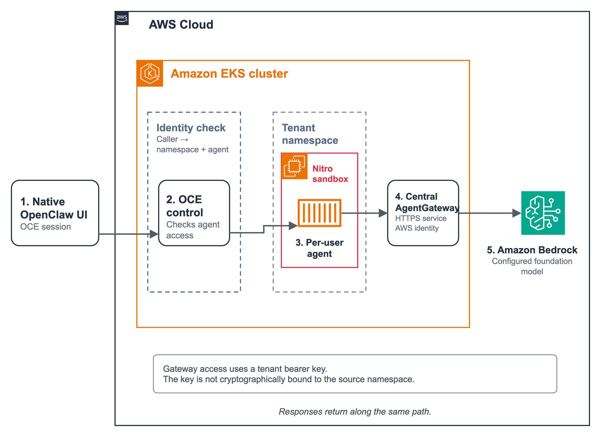

# OpenClaw Enterprise on EKS with Nitro sandboxes

This blueprint installs OpenClaw Enterprise (OCE) on Amazon EKS and runs two
tenant runtimes in separate Nitro sandboxes. Both tenants call Amazon Nova Lite
through one private, shared AgentGateway. Tenant runtimes receive no AWS
identity.

Live validation is still pending. Commands below therefore use explicit output
placeholders instead of claiming a successful run.


*Figure 1: OCE manages the tenant runtimes. AgentGateway is the only component
that receives AWS identity and calls Amazon Bedrock.*

Editable diagrams:
[architecture](images/openclaw-enterprise-architecture.drawio),
[model request](images/openclaw-enterprise-model-request.drawio), and
[pod admission](images/openclaw-enterprise-pod-admission.drawio).

## Prerequisites

- An EKS Auto Mode cluster with the `isolated-sandbox` RuntimeClass.
- Access to Amazon Bedrock model `amazon.nova-lite-v1:0` in `us-west-2`.
- Private OCE authentication and Agent DNS names that resolve from the cluster.
- cert-manager installed in the cluster.
- A reviewed, digest-pinned CodeBuild builder image in private Amazon ECR.
- AWS CLI v2, Bash, Git, Go, Helm, `jq`, `kubectl`, OpenSSL, Python 3, and
  [Mike Farah `yq`](https://github.com/mikefarah/yq) version 4.
- Kubernetes permission to create cluster-scoped admission resources and a
  StorageClass, update the `amazon-vpc-cni` ConfigMap field, and create
  `pods/portforward` requests.
- AWS permission to manage the blueprint IAM role and EKS Pod Identity
  association.

Clone the repository and enter its root directory:

```bash
git clone https://github.com/aws-samples/sample-eks-nitro-sandbox.git
cd sample-eks-nitro-sandbox
```

Keep credentials, account details, generated state, receipts, and validation
evidence outside the repository.

## Architecture

OCE creates and controls each tenant runtime. Its native shared
`modelProvider` uses the `openai-responses` protocol and the private HTTPS URL
`https://agentgateway.openclaw-enterprise-agw.svc.cluster.local/v1`.
AgentGateway authenticates separate tenant keys and makes the Bedrock request
with EKS Pod Identity.

The admission adapter is a compatibility layer for the pinned OCE pod shape. It
sets the RuntimeClass, replaces the incompatible state PVC mount, installs the
private CA trust, and applies the related strict Nitro compatibility changes.
It does not implement or redirect model routing.

Read [Tenant isolation boundary](TENANT-ISOLATION.md) before adapting this
design.



*Figure 2: Tenant runtimes use OCE's native model provider path. The shared,
stateless AgentGateway holds no tenant runtime state.*

## Versions

| Component | Version or constraint |
|---|---|
| OpenClaw Enterprise | Commit `86c8c12310f691bb21651118ffffd6bfd460e9ff` |
| AgentGateway | `v1.7.0`, digest-pinned in `deploy/agentgateway.yaml` |
| Amazon Bedrock model | `amazon.nova-lite-v1:0` in `us-west-2` |
| Adapter, controller, ownership helper, runtime | Digest-qualified outputs from one successful CodeBuild run |
| `yq` | Mike Farah `yq` version 4 |

## Files

| Path | Purpose |
|---|---|
| `build/` | Build and scan the four deployable images. |
| `deploy/` | Define AgentGateway, the admission adapter, storage, and network-policy settings. |
| `scripts/setup-storage-class.sh` | Create or verify the blueprint-owned EKS Auto Mode StorageClass. |
| `scripts/setup-agentgateway-pod-identity.sh` | Create or verify AgentGateway's IAM role, Bedrock policy, and Pod Identity association. |
| `scripts/install-oce.sh` | Install the exact OCE revision in a terminal-managed topology. |
| `scripts/configure-tenant-model-gateway.sh` | Add private CA trust and restricted egress to one OCE tenant namespace. |
| `scripts/validate-live.sh` | Run the destructive two-tenant validation. |
| `scripts/cleanup.sh` | Remove resources only after ownership checks pass. |

**Step 1: Set local values and check access**

Use one explicit kube context and kubeconfig throughout:

```bash
export SAMPLE_DIR='examples/ai-agents/openclaw-enterprise'
export KUBECONFIG='<absolute-kubeconfig-path>'
export KUBE_CONTEXT='<eks-kube-context>'
export AWS_ACCOUNT_ID='<12-digit-account-id>'
export AWS_REGION='us-west-2'
export EKS_CLUSTER_NAME='<eks-cluster-name>'
export PRIVATE_STATE_DIR='<private-directory-outside-the-repository>'

chmod 600 "$KUBECONFIG"
install -d -m 700 "$PRIVATE_STATE_DIR"
kubectl --context "$KUBE_CONTEXT" config get-contexts "$KUBE_CONTEXT"
kubectl --context "$KUBE_CONTEXT" get --raw=/readyz
yq --version | grep -Eq 'version v?4\.'
```

```text
TODO: output from the fresh run
```

**Step 2: Build and scan the images**

Follow [Build the images](build/README.md#build-the-images). Wait for the
workflow to succeed, then export its four digest-qualified outputs:

```bash
: "${ADAPTER_IMAGE:?set the successful CodeBuild output}"
: "${CONTROLLER_IMAGE:?set the successful CodeBuild output}"
: "${OWNERSHIP_INIT_IMAGE:?set the successful CodeBuild output}"
: "${RUNTIME_IMAGE:?set the successful CodeBuild output}"
```

Use all four outputs from the same build. Do not substitute image tags.

```text
TODO: output from the fresh run
```

**Step 3: Configure storage and Auto Mode network policy**

Create or verify the non-default, encrypted `gp3` StorageClass:

```bash
export RUNTIME_STORAGE_CLASS="$(
  "$SAMPLE_DIR/scripts/setup-storage-class.sh" \
    --kube-context "$KUBE_CONTEXT"
)"
test "$RUNTIME_STORAGE_CLASS" = 'openclaw-enterprise-gp3'
```

The script creates the StorageClass only when it is absent. It refuses to patch
or adopt an existing resource with the same name unless the complete storage
and ownership contract already matches.

Enable the EKS Auto Mode network-policy controller:

```bash
kubectl --context "$KUBE_CONTEXT" apply \
  --server-side \
  --field-manager=openclaw-enterprise-blueprint \
  --filename "$SAMPLE_DIR/deploy/auto-mode-network-policy.yaml"
```

Do not patch `enable-network-policy`. EKS Auto Mode owns the network-policy
implementation. This blueprint owns only the
`enable-network-policy-controller` ConfigMap field when server-side apply
succeeds without an ownership conflict.

```text
TODO: output from the fresh run
```

**Step 4: Install AgentGateway and Pod Identity**

Create the AgentGateway namespace and ServiceAccount before the Pod Identity
association:

```bash
yq ea '
  select(
    .kind == "Namespace" or
    (.kind == "ServiceAccount" and .metadata.name == "agentgateway")
  )
' "$SAMPLE_DIR/deploy/agentgateway.yaml" |
  kubectl --context "$KUBE_CONTEXT" apply --filename -

"$SAMPLE_DIR/scripts/setup-agentgateway-pod-identity.sh" \
  --aws-region "$AWS_REGION" \
  --aws-account-id "$AWS_ACCOUNT_ID" \
  --eks-cluster-name "$EKS_CLUSTER_NAME" \
  --kube-context "$KUBE_CONTEXT"
```

Record the returned association ID for cleanup:

```bash
export POD_IDENTITY_ASSOCIATION_ID='<association-id-from-script-output>'
```

Create distinct tenant keys and the AgentGateway session key:

```bash
umask 077
openssl rand -hex 32 >"$PRIVATE_STATE_DIR/tenant-a-agentgateway.key"
openssl rand -hex 32 >"$PRIVATE_STATE_DIR/tenant-b-agentgateway.key"
openssl dgst -sha256 -r "$PRIVATE_STATE_DIR/tenant-a-agentgateway.key" |
  awk '{print $1}' >"$PRIVATE_STATE_DIR/tenant-a-sha256"
openssl dgst -sha256 -r "$PRIVATE_STATE_DIR/tenant-b-agentgateway.key" |
  awk '{print $1}' >"$PRIVATE_STATE_DIR/tenant-b-sha256"
openssl rand -hex 32 >"$PRIVATE_STATE_DIR/agentgateway-session.key"

kubectl --context "$KUBE_CONTEXT" \
  --namespace openclaw-enterprise-agw create secret generic agw-client-key \
  --from-file=tenant-a-sha256="$PRIVATE_STATE_DIR/tenant-a-sha256" \
  --from-file=tenant-b-sha256="$PRIVATE_STATE_DIR/tenant-b-sha256" \
  --dry-run=client --output=yaml |
  kubectl --context "$KUBE_CONTEXT" apply --filename -

kubectl --context "$KUBE_CONTEXT" \
  --namespace openclaw-enterprise-agw create secret generic agw-session-key \
  --from-file=key="$PRIVATE_STATE_DIR/agentgateway-session.key" \
  --dry-run=client --output=yaml |
  kubectl --context "$KUBE_CONTEXT" apply --filename -

kubectl --context "$KUBE_CONTEXT" apply \
  --filename "$SAMPLE_DIR/deploy/agentgateway.yaml"
kubectl --context "$KUBE_CONTEXT" \
  --namespace openclaw-enterprise-agw rollout status \
  deployment/agentgateway
```

```text
TODO: output from the fresh run
```

**Step 5: Install the admission adapter**

Render all three digest-qualified image references before applying the
manifest:

```bash
"$SAMPLE_DIR/scripts/render-adapter-manifest.sh" \
  "$SAMPLE_DIR/deploy/adapter-webhook.yaml" \
  "$ADAPTER_IMAGE" \
  "$OWNERSHIP_INIT_IMAGE" \
  "$RUNTIME_IMAGE" |
  kubectl --context "$KUBE_CONTEXT" apply --filename -

kubectl --context "$KUBE_CONTEXT" \
  --namespace openclaw-enterprise-adapter rollout status \
  deployment/openclaw-enterprise-nitro-adapter
```

Do not apply the raw adapter manifest. It contains image placeholders. Wait for
the adapter before creating the first OCE Agent because its admission webhooks
fail closed.


*Figure 3: The adapter accepts only the pinned controller chain and expected pod
shape before applying the Nitro compatibility patch.*

```text
TODO: output from the fresh run
```

**Step 6: Install the pinned OCE revision**

Clone OCE into a clean directory and verify the exact revision:

```bash
export OCE_SOURCE_DIR='<clean-openclaw-enterprise-checkout>'
git clone https://github.com/openclaw/openclaw-enterprise.git "$OCE_SOURCE_DIR"
git -C "$OCE_SOURCE_DIR" switch --detach \
  86c8c12310f691bb21651118ffffd6bfd460e9ff
test "$(git -C "$OCE_SOURCE_DIR" rev-parse HEAD)" = \
  86c8c12310f691bb21651118ffffd6bfd460e9ff
test -z "$(git -C "$OCE_SOURCE_DIR" status --porcelain)"
```

Use the disposable PostgreSQL mode only on an EKS cluster tagged
`Environment=validation`:

```bash
export OCE_NAMESPACE='openclaw-system'
export OCE_STATE_DIR="$PRIVATE_STATE_DIR/oce-install"
export OCE_RECEIPT_DIR="$OCE_STATE_DIR/receipt"
export OCE_VALIDATION_POSTGRES_IMAGE='<postgres-repository>@sha256:<digest>'

"$SAMPLE_DIR/scripts/install-oce.sh" \
  --aws-account-id "$AWS_ACCOUNT_ID" \
  --aws-region "$AWS_REGION" \
  --eks-cluster-name "$EKS_CLUSTER_NAME" \
  --kubeconfig "$KUBECONFIG" \
  --kube-context "$KUBE_CONTEXT" \
  --oce-source "$OCE_SOURCE_DIR" \
  --build-occ \
  --controller-image "$CONTROLLER_IMAGE" \
  --runtime-image "$RUNTIME_IMAGE" \
  --auth-base-url 'https://<private-auth-host>' \
  --agent-domain '<private-agent-domain>' \
  --admin-email '<initial-admin-email>' \
  --runtime-storage-class "$RUNTIME_STORAGE_CLASS" \
  --pod-cidr '<cluster-pod-cidr>' \
  --cluster-api-cidr '<eks-private-api-ip>/32' \
  --state-dir "$OCE_STATE_DIR" \
  --receipt "$OCE_RECEIPT_DIR" \
  --namespace "$OCE_NAMESPACE" \
  --validation-postgres \
  --validation-postgres-image "$OCE_VALIDATION_POSTGRES_IMAGE"
```

This optional database is a single validation-only pod with `emptyDir`
storage. Its data disappears when the pod or system namespace is removed.

For an external database, omit the two validation flags and provide protected
application URL, migration URL, and CA files plus at least one exact database
`/32` CIDR. Both URLs must use a DNS hostname, `sslmode=verify-full`, and
`sslrootcert=/etc/openclaw/database-ca/ca.pem`. The CA file must contain only
trusted PEM CA certificates. See `install-oce.sh --help`.

The installer uses `occ installation install`. It deliberately disables direct
Pod API clients with an unmatched label selector. It also disables browser
gateway routing and agent native administration. Use local `kubectl
port-forward` for API administration.

```text
TODO: output from the fresh run
```

**Step 7: Onboard two tenants from the terminal**

Follow [Onboard two tenants](scripts/README.md#onboard-two-tenants) once for
tenant A and once for tenant B. Use separate OCE Namespaces, backing Kubernetes
namespaces, AgentGateway keys, Agents, and validator service keys.

Open the private OCE API on loopback in a dedicated terminal:

```bash
kubectl --context "$KUBE_CONTEXT" \
  --namespace "$OCE_NAMESPACE" \
  port-forward --address=127.0.0.1 \
  service/openclaw-enterprise-api 18080:8080
```

In another terminal:

```bash
export OCC_URL='http://127.0.0.1:18080'
export OCC_SERVICE_KEY_FILE='<protected-bootstrap-service-key-response.json>'
chmod 600 "$OCC_SERVICE_KEY_FILE"
jq -e '.data.key | type == "string" and length > 0' \
  "$OCC_SERVICE_KEY_FILE" >/dev/null
```

The local Kubernetes identity needs permission to read the Service and its
selected Pod and to create `pods/portforward`. Port-forwarding bypasses
in-cluster NetworkPolicy for the operator path and gives local processes on the
workstation access to the forwarded API. Bind only to `127.0.0.1`, protect the
service key, and stop the process when administration is complete.

```text
TODO: output from the fresh run
```

**Step 8: Validate the two-tenant boundary**

Run the static contracts and the destructive live procedure in
[Validation](VALIDATION.md). The live validator starts and stops its own local
loopback port-forward. It does not deploy an API client pod.

Do not publish successful output until a fresh run has completed against the
exact OCE revision and image digests.

```text
TODO: output from the fresh run
```

## Good to know

- The central AgentGateway is shared and stateless. It stores no tenant runtime
  state, but its availability, bearer-key configuration, and Bedrock IAM role
  remain shared trust and blast-radius boundaries.
- The blueprint tests OCE authorization through the native API. It does not
  claim database-level tenant isolation.
- The adapter supports only the pinned OCE revision and expected pod shape. A
  different revision needs a new compatibility review and live validation.
- NetworkPolicy enforcement depends on the EKS Auto Mode controller setting.
  Kubernetes objects alone do not prove live enforcement.
- The validation procedure is destructive to tenant A's runtime pod. Use
  retained validation tenants.
- The blueprint does not validate human SSO, sustained load, high
  availability, node drain, nested OpenClaw execution isolation, or a different
  OCE revision.

## Clean up

Stop every local OCE API port-forward, then run cleanup with the original
state, receipt, context, tenant namespaces, and Pod Identity values:

```bash
"$SAMPLE_DIR/scripts/cleanup.sh" \
  --kubeconfig "$KUBECONFIG" \
  --kube-context "$KUBE_CONTEXT" \
  --state-dir "$OCE_STATE_DIR" \
  --receipt "$OCE_RECEIPT_DIR" \
  --namespace "$OCE_NAMESPACE" \
  --release oce \
  --tenant-namespace '<tenant-a-kubernetes-namespace>' \
  --tenant-namespace '<tenant-b-kubernetes-namespace>' \
  --aws-region "$AWS_REGION" \
  --aws-account-id "$AWS_ACCOUNT_ID" \
  --eks-cluster-name "$EKS_CLUSTER_NAME" \
  --pod-identity-association-id "$POD_IDENTITY_ASSOCIATION_ID" \
  --iam-role-name openclaw-enterprise-agentgateway \
  --iam-inline-policy-name openclaw-enterprise-bedrock-invoke
```

Cleanup verifies the installation receipt and resource ownership before it
uninstalls the OCE release, deletes the blueprint-owned system, adapter, and
AgentGateway namespaces, removes the supplied tenant namespaces' blueprint
ConfigMap and NetworkPolicies, and deletes the verified Pod Identity and IAM
resources.

It preserves the OCE-created tenant namespaces and any external database. It
deletes the blueprint StorageClass only when no PVC still references it. It
removes `enable-network-policy-controller` only when
`openclaw-enterprise-blueprint` is the field's sole manager and the value is
still `true`; otherwise it preserves the field. Cleanup exits non-zero when a
blueprint-owned resource must be preserved for safety.

```text
TODO: output from the fresh run
```
