# Warm pools with agent-sandbox

Before you start, review the [prerequisites and shared setup](../../README.md#prerequisites)
on the home page, and run the [hello sandbox](../hello-sandbox/README.md) sample first so
you have a cluster with the runtime classes. The commands below use files from this
repository, so clone it if you have not already, and run them from this sample's folder:

```bash
git clone https://github.com/aws-samples/sample-eks-nitro-sandbox.git
cd sample-eks-nitro-sandbox/examples/getting-started/warm-pool
```

A sandboxed pod does more work at startup than a regular pod: EC2 creates the pod's Nitro
sandbox and boots its kernel before the containers start. That adds about 5 to 6 seconds
on a warm node. For an interactive agent, where a user or a model is waiting for a code
cell to run, that is the difference between a tool that feels instant and one that feels
slow.

[agent-sandbox](https://github.com/kubernetes-sigs/agent-sandbox) is a Kubernetes SIG
project that adds a `Sandbox` API and a warm-pool controller for agent workloads. Because
a Nitro Sandbox is a RuntimeClass on a pod template, agent-sandbox works with it
unchanged.

**Step 1: Install agent-sandbox** with its extensions (`SandboxTemplate`,
`SandboxWarmPool`, `SandboxClaim`). This folder was built against v1.0.6:

```bash
kubectl apply -f https://github.com/kubernetes-sigs/agent-sandbox/releases/download/v1.0.6/sandbox-with-extensions.yaml
kubectl -n agent-sandbox-system rollout status deploy/agent-sandbox-controller
```

**Step 2: Create the template and the pool.** [`warm-pool.yaml`](warm-pool.yaml)
points a `SandboxTemplate` at `isolated-sandbox`, marks it network-isolated, and asks a
`SandboxWarmPool` to keep five booted:

```yaml
apiVersion: extensions.agents.x-k8s.io/v1beta1
kind: SandboxTemplate
metadata:
  name: nitro-agent
spec:
  podTemplate:
    metadata:
      annotations:
        sandbox.amazonaws.com/network-isolated: "true"   # optional: no network besides loopback
    spec:
      runtimeClassName: isolated-sandbox
      containers:
        - name: agent
          image: public.ecr.aws/docker/library/python:3.12-slim
          imagePullPolicy: IfNotPresent
          command: ["sleep", "infinity"]
          resources:
            requests: { cpu: "1", memory: 768Mi }
            limits:   { cpu: "1", memory: 768Mi }
---
apiVersion: extensions.agents.x-k8s.io/v1beta1
kind: SandboxWarmPool
metadata:
  name: nitro-agent-pool
spec:
  replicas: 5                       # five sandboxes booted and waiting
  sandboxTemplateRef:
    name: nitro-agent
```

```bash
kubectl apply -f warm-pool.yaml
kubectl wait sandboxwarmpool/nitro-agent-pool --for=jsonpath='{.status.readyReplicas}'=5 --timeout=600s
kubectl get sandboxwarmpool nitro-agent-pool
```

```text
NAME               READY   DESIRED   AGE
nitro-agent-pool   5       5         41s
```

**Step 3: Claim one.** A [`SandboxClaim`](claim.yaml) is what your
application creates per user session or per task:

```yaml
apiVersion: extensions.agents.x-k8s.io/v1beta1
kind: SandboxClaim                  # created per user session / per task
metadata:
  name: session-7f3a
spec:
  warmPoolRef:
    name: nitro-agent-pool
```

```bash
time ( kubectl apply -f claim.yaml \
  && kubectl wait sandboxclaim/session-7f3a --for=condition=Ready --timeout=60s )
```

```text
sandboxclaim.extensions.agents.x-k8s.io/session-7f3a created
sandboxclaim.extensions.agents.x-k8s.io/session-7f3a condition met

real    0m1.928s
```

The claim adopts a pod that was already running, so it is Ready in under 1 second. The
`time` above is a little longer because it includes kubectl's own round trips. The pool
boots a replacement in the background and is back to five.

**Step 4: Use it.** Your application talks to the claimed sandbox as it would to any pod:
`kubectl exec` to run code, `kubectl cp` to move files, `kubectl logs` to read output.

```bash
POD=$(kubectl get sandboxclaim session-7f3a -o jsonpath='{.status.sandbox.name}')
echo 'print(sum(range(10)))' > /tmp/hands.py
kubectl cp /tmp/hands.py $POD:/tmp/hands.py
kubectl exec $POD -- python3 /tmp/hands.py
kubectl exec $POD -- python3 -c 'import socket; socket.create_connection(("1.1.1.1", 443), timeout=3)'
kubectl get sandboxwarmpool nitro-agent-pool
```

```text
45
Traceback (most recent call last):
  ...
OSError: [Errno 101] Network is unreachable
command terminated with exit code 1
NAME               READY   DESIRED   AGE
nitro-agent-pool   5       5         79s
```

Code runs, files move, and the sandbox has no route out. Delete the claim and its pod is
torn down; nothing from that session survives into the next one:

```bash
kubectl delete -f claim.yaml
```

**A pattern worth copying: separate the brain from the hands.** The coding agent sample put
the whole agent in one sandbox, the easiest way to start. The warm pool enables the design
Anthropic describes in
[Scaling Managed Agents: decoupling the brain from the hands](https://www.anthropic.com/engineering/managed-agents):
run the agent's reasoning loop on an ordinary pod with model access and no local shell,
and give it one tool: claim a warm sandbox and run code in it. Mark the sandbox template
network-isolated, as above. Now the component that can talk to the internet cannot run
commands, and the component that can run commands has no network besides loopback. The only wire
between them is the Kubernetes API, which keeps working under network isolation because
exec uses the sandbox's internal control channel, as step 4 showed.

*Figure 3: Warm pool with the brain and hands separated. The driver pod reasons and talks
to Bedrock; the claimed sandbox runs code with no network besides loopback; the Kubernetes API is
the only wire between them.*


*Figure 4: Time to first command. A cold start pays for sandbox creation and image
pull; a warm-pool claim adopts a sandbox that is already running, in under 1 second.*

```mermaid
gantt
    title Time to first command (illustrative, warm node)
    dateFormat  s
    axisFormat  %S s
    section Cold start
    create sandbox, boot guest :a1, 0, 3s
    pull image, start containers :a2, after a1, 3s
    first command runs           :milestone, m1, after a2, 0s
    section Warm pool claim
    adopt pre-booted pod, under 1 s :b1, 0, 1s
    first command runs           :milestone, m2, after b1, 0s
```



**Sizing.** Each sandbox reserves its full memory request up front, so bin-packing is by
reservation, not by usage: size requests honestly and expect fewer, larger pods per node
than with regular containers. A warm pool trades its idle replicas for the latency win;
size `replicas` to your peak claim rate, not your total session count.

## Clean up

Delete the warm pool before anything else, so it stops booting replacements, then remove
agent-sandbox, including its CRDs and every Sandbox resource in the cluster:

```bash
kubectl delete -f warm-pool.yaml --ignore-not-found
kubectl delete -f https://github.com/kubernetes-sigs/agent-sandbox/releases/download/v1.0.6/sandbox-with-extensions.yaml
rm -f /tmp/hands.py
```

If this is the last sample you ran, follow the [hello sandbox](../hello-sandbox/README.md#clean-up)
clean up to remove the namespace and the cluster.
