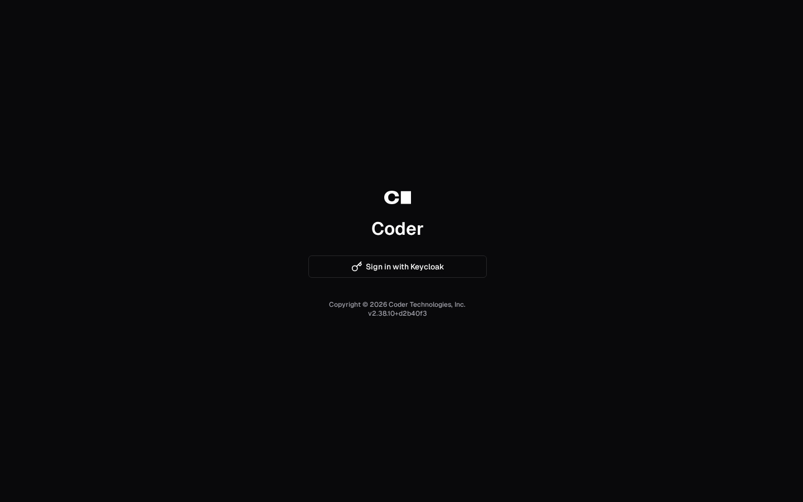
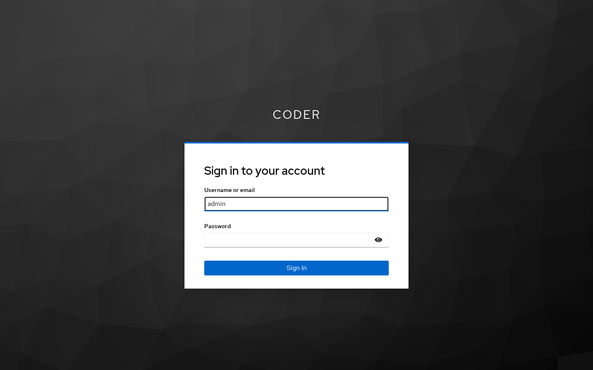
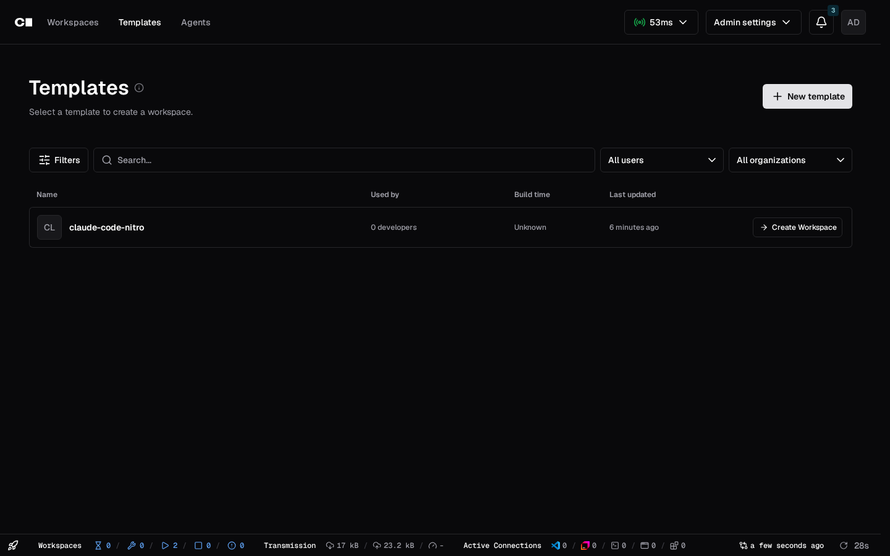
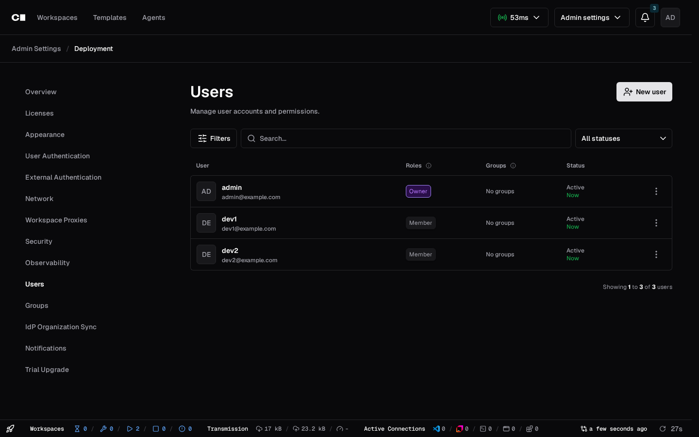
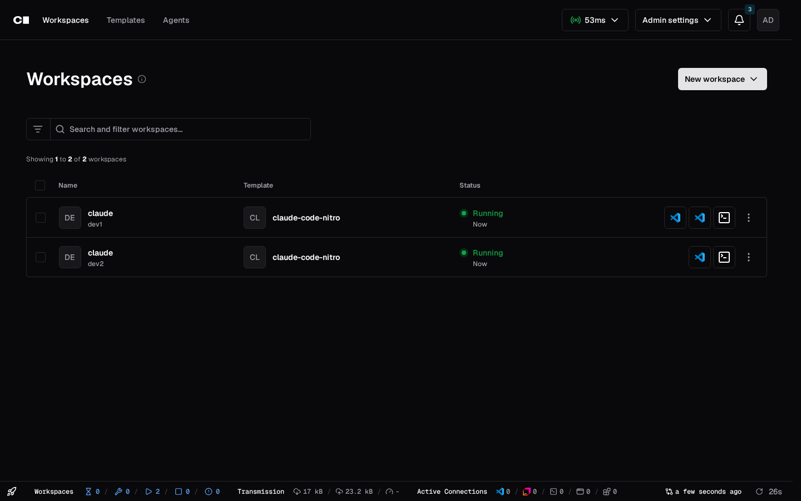
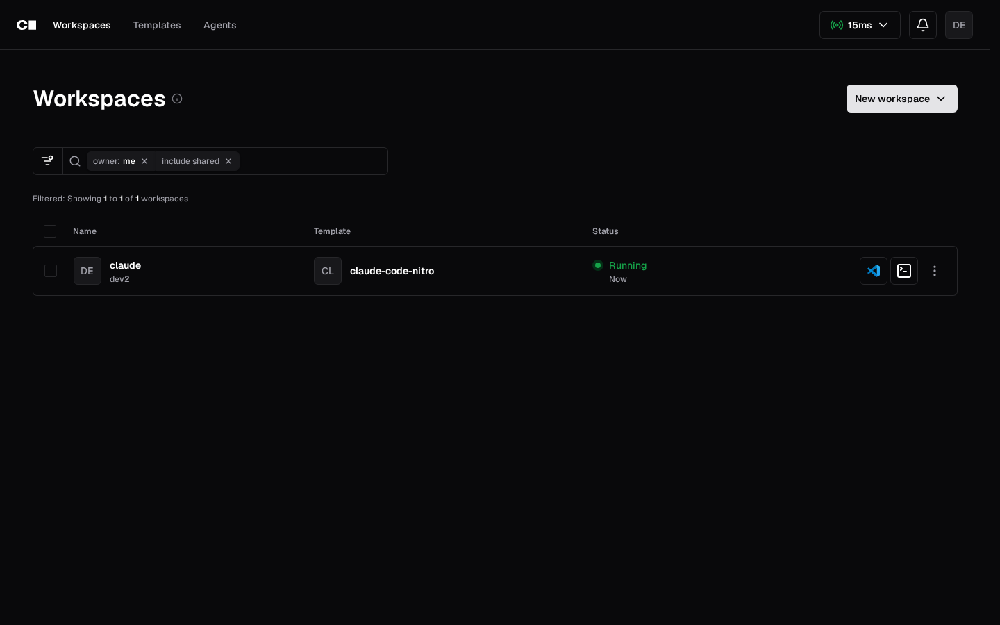
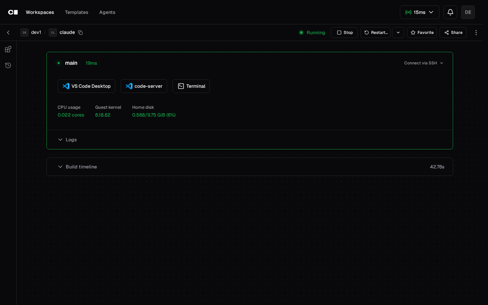

# Give every developer a Coder workspace in its own Nitro sandbox

Before you start, review the [prerequisites and shared setup](../../README.md#prerequisites)
on the home page, and run the [hello sandbox](../../getting-started/hello-sandbox/README.md)
blueprint first so you have a cluster with the runtime classes. This blueprint builds on
[VS Code in the browser](../../agent-sandbox/ide/README.md) (code-server in a sandbox) and
[Coding agents for developers](../../ai-agents/coding-agents-for-developers/README.md)
(Claude Code on Amazon Bedrock through EKS Pod Identity). The commands below use files from
this repository, so clone it if you have not already, and run them from this blueprint's
folder:

```bash
git clone https://github.com/aws-samples/sample-eks-nitro-sandbox.git
cd sample-eks-nitro-sandbox/examples/integrations/coder
```

For this blueprint you also need, on your own machine:

- The [Coder CLI](https://coder.com/docs/install/cli), version 2.38.10, the same version as
  the server. Coder's install script takes an exact version:
  `curl -fsSL https://coder.com/install.sh | sh -s -- --version 2.38.10`. On Windows, use the
  `coder_2.38.10_windows_amd64.zip` from the
  [v2.38.10 release](https://github.com/coder/coder/releases/tag/v2.38.10).
- [Helm](https://helm.sh/docs/intro/install/) 3 or 4, `jq`, `openssl` and `curl`. The scripts
  also use the AWS CLI and `kubectl` from the home page. You do not need Terraform: Coder runs
  it inside the cluster.
- A browser, to sign in through Keycloak.
- Access to the Anthropic Claude model in
  [Amazon Bedrock](https://docs.aws.amazon.com/bedrock/latest/userguide/model-access.html) in
  your Region. Workspaces use `us.anthropic.claude-sonnet-5-5`; `BEDROCK_MODEL_ID` in `.env`
  changes it.

The cluster needs three things beyond Getting started, and `setup.sh` checks each one and
stops with the fix when it is missing:

- Private subnets tagged `kubernetes.io/role/internal-elb=1`, so EKS Auto Mode can place an
  internal load balancer (Amazon EKS User Guide,
  [*Tag subnets for EKS Auto Mode*](https://docs.aws.amazon.com/eks/latest/userguide/tag-subnets-auto.html)).
  The tag is on the VPC's subnets, which other workloads share, so adding it is your step,
  not the script's.
- An internet gateway on the VPC, which
  [CloudFront VPC origins](https://docs.aws.amazon.com/AmazonCloudFront/latest/DeveloperGuide/private-content-vpc-origins.html)
  require even though they do not route through it.
- A Region where CloudFront VPC origins are available.

Beyond the cluster, a run costs Bedrock tokens for the Claude Code prompts, an internal
Application Load Balancer (hourly plus LCU charges), CloudFront requests and data transfer,
and one EBS volume per workspace plus PostgreSQL's volume while they exist. Coder Community
Edition needs no license.

## Overview

A platform team that hands every developer a cloud workspace runs every developer's code,
and every agent's tool call, on shared infrastructure. [Coder](https://coder.com/docs) is a
self-hosted platform for exactly that: an admin publishes a Terraform template, and Coder
creates, stops, starts and deletes developers' workspaces from it. This blueprint runs
Coder Community Edition on Amazon EKS and has its template make each workspace a pod with
`runtimeClassName: isolated-sandbox`, so a developer's terminal, their browser IDE and
Claude Code all run in a Nitro sandbox of their own.

The Coder control plane (`coderd`), the Keycloak identity provider and the PostgreSQL
database they share are ordinary pods in the namespace `coder`. They run code the platform
team chose. The workspaces, which run code any developer or agent chose, live in the
namespace `coder-workspaces`, each in its own sandbox.

- **Each workspace is a Nitro sandbox.** Coder's template creates a Deployment with one pod
  per running workspace, and that pod sets `runtimeClassName: isolated-sandbox`. The page
  shows the pod's own kernel build, boot and virtio disks, each next to what an ordinary pod
  on the same node shows.
- **Coder's Kubernetes access covers only the workspaces.** Coder's built-in provisioner runs
  inside `coderd` and creates workspaces with a Role in `coder-workspaces` that covers
  Deployments and PersistentVolumeClaims there. The chart's own Role is off, and Step 4 shows
  what that leaves.
- **Everyone signs in through Keycloak, over HTTPS.** Admins and developers open one
  `https://` address on Amazon CloudFront and sign in as Keycloak users that setup generates
  with random passwords. Coder's own password sign-in is off.
- **Claude Code uses Bedrock with no key.** Each workspace pod's ServiceAccount has an EKS
  Pod Identity role that may invoke the configured model and nothing else, and the page
  shows its policy document.
- **Stop frees the sandbox, the home volume stays.** Stopping a workspace deletes its pod and
  keeps its EBS claim; starting it boots a new pod in a new sandbox on the same files.
- **One template, many developers.** Two developers start a workspace from the same template,
  and each one runs in its own sandbox.

Developers' browsers reach Coder and Keycloak through CloudFront, whose VPC origin is an
internal Application Load Balancer (ALB) that EKS Auto Mode creates from the blueprint's
Ingress. The workspaces connect to what the template has them use: Amazon Bedrock, the
`coderd` Service inside the cluster, and the sites the Coder registry modules download
code-server and Claude Code from.

Figure 1 shows the blueprint at a glance:

*Figure 1: Coder on Amazon EKS at a glance. Admins and developers reach Coder through Amazon CloudFront, and Coder gives each developer a workspace in its own Nitro sandbox that calls Claude on Amazon Bedrock.*

![A figure read from left to right. A box labelled Browser holds two people icons, Admins and Developers. An arrow labelled HTTPS leads to Amazon CloudFront, which is described as one HTTPS address and sits inside the AWS Cloud frame. An arrow labelled private path leads from CloudFront to a box labelled Coder platform, which holds Coder, described as creating workspaces, and Keycloak, described as sign-in. The Coder platform box sits inside an Amazon EKS cluster frame. From the Coder platform box, an arrow labelled developer workspaces splits into two arrows, one for each of two example workspaces. Each arrow leads to its own Nitro sandbox frame. Each sandbox holds one Workspace running Claude Code and code-server. An arrow labelled calls Claude leads from each Nitro sandbox to Amazon Bedrock, which sits at the right of the AWS Cloud frame outside the EKS cluster.](images/coder-high-level.png)

Figure 2 shows every part setup creates and how they connect. The rest of the page goes
through them one by one.

*Figure 2: The detailed architecture. A developer reaches Coder and Keycloak only through CloudFront, a VPC origin and an internal load balancer whose security group admits only CloudFront, and every workspace Coder creates runs in its own Nitro sandbox with its own EBS home volume and a Pod Identity role that may only invoke the configured model.*

![An architecture figure read from left to right. A browser on the internet sends HTTPS requests to Amazon CloudFront inside the AWS Cloud frame. CloudFront uses the default cloudfront.net certificate and redirects plain HTTP to HTTPS. CloudFront connects over HTTP on port 80 to a VPC origin, and the VPC origin connects on TCP 80 to an internal Application Load Balancer. The VPC origin and the load balancer sit in a dashed frame labelled VPC with private subnets. A red security group icon, coder-alb-origin, is attached to the load balancer. It admits only TCP 80 from CloudFront-VPCOrigins-Service-SG. The VPC frame also holds the Amazon EKS cluster. The load balancer has two rules. Path /auth goes to Keycloak, and all other paths go to Coder. Coder, Keycloak and PostgreSQL are ordinary pods in the namespace coder. Keycloak holds the realm coder and provides OIDC sign-in for Coder. PostgreSQL holds the databases for Coder and Keycloak and has no connection from the load balancer. An arrow labelled creates workspaces leads from Coder to the namespace coder-workspaces. That namespace is labelled with a Role for Coder's provisioner that allows Deployments and PersistentVolumeClaims only. It holds two workspaces. Each workspace is a Nitro sandbox pod with runtimeClassName isolated-sandbox and ServiceAccount coder-workspace. It runs Claude Code and code-server. It has its own Amazon EBS home volume, ReadWriteOncePod, mounted at /home/coder. An arrow labelled agent, in-cluster Service leads from each pod back to Coder, so agent traffic stays inside the cluster. An arrow labelled EKS Pod Identity leads from each pod to an IAM role, which may invoke only the configured profile. The IAM role has an arrow labelled InvokeModel to Amazon Bedrock. The IAM role and Amazon Bedrock sit outside the VPC, at the right of the AWS Cloud frame.](images/coder-architecture.png)

## The HTTPS endpoint, and who can reach what

This blueprint gives Coder a public HTTPS address, because Coder needs one address that the
browser and the cluster can both reach. Coder builds its dashboard links, its sign-in
redirect and, by default, the address its workspace agents connect to from a single setting,
the access URL (`CODER_ACCESS_URL`). Sign-in has the same need: the browser is sent to the
Keycloak issuer URL to sign in, and `coderd` reads the same URL when it starts and checks
every sign-in against it. A `kubectl port-forward` address exists only on the machine that
runs it, so it can be neither. The distribution's default `dXXXX.cloudfront.net` name and
certificate give the browser, `coderd` and the workspaces one HTTPS address, with no domain
of your own:

- `https://<DOMAIN>/` is Coder.
- `https://<DOMAIN>/auth/` is Keycloak, with the realm `coder` and the issuer
  `https://<DOMAIN>/auth/realms/coder`.

<!-- excerpt: deploy/coder-values.yaml -->
```yaml
    # The one URL the browser and the workspace agents both use. Setting it
    # here also stops the chart from adding its in-cluster default.
    - name: CODER_ACCESS_URL
      value: "https://<DOMAIN>"
```

CloudFront redirects plain HTTP to HTTPS, caches nothing and passes the viewer's headers,
cookies and query strings on. It reaches the ALB over HTTP on port 80 through a
[VPC origin](https://docs.aws.amazon.com/AmazonCloudFront/latest/DeveloperGuide/private-content-vpc-origins.html).
The ALB is internal, in the cluster's private subnets:

<!-- excerpt: deploy/ingress.yaml -->
```yaml
spec:
  # Private IP addresses only. CloudFront reaches it through the VPC origin.
  scheme: internal
  ipAddressType: ipv4
```

Setup names the subnets too: the cluster's private subnets, the ones with no route to an
internet gateway. Once Auto Mode has created the ALB, setup checks that it is internal, sits in
exactly those subnets and has no public IP address on any of its network interfaces. If any of
that is not so, setup deletes the Ingress, so Auto Mode removes the load balancer, and stops.

The output blocks on this page are from one run of the steps below. In every block, values
that belong to the run's own account and cluster are replaced with placeholders: the account
ID with `<ACCOUNT_ID>`, the distribution's name with `dXXXX.cloudfront.net`, and resource IDs,
private IP addresses, generated names and UUIDs with a numbered placeholder such as
`<SUBNET_ID_1>`, `<PRIVATE_IP_2>` or `<UUID_3>`. The same value gets the same placeholder
everywhere on the page, so a value that matches, or differs, between two blocks still does.
You can read the same three things yourself:

```bash
lb_arn="$(aws elbv2 describe-load-balancers --region "$AWS_REGION" \
  --query "LoadBalancers[?starts_with(LoadBalancerName,'k8s-coder-coder')].LoadBalancerArn" --output text)"
aws elbv2 describe-load-balancers --region "$AWS_REGION" --load-balancer-arns "$lb_arn" \
  --query 'LoadBalancers[0].{Scheme:Scheme,Subnets:AvailabilityZones[].SubnetId}'
aws ec2 describe-route-tables --region "$AWS_REGION" \
  --filters "Name=association.subnet-id,Values=$(aws elbv2 describe-load-balancers --region "$AWS_REGION" \
    --load-balancer-arns "$lb_arn" --query 'join(`,`, LoadBalancers[0].AvailabilityZones[].SubnetId)' --output text)" \
  --query 'RouteTables[].{Subnets:Associations[].SubnetId,DefaultRoute:Routes[?DestinationCidrBlock==`0.0.0.0/0`].[GatewayId,NatGatewayId][]}'
aws ec2 describe-network-interfaces --region "$AWS_REGION" \
  --filters "Name=description,Values=ELB ${lb_arn#*:loadbalancer/}" \
  --query 'NetworkInterfaces[].{PrivateIp:PrivateIpAddress,PublicIp:Association.PublicIp}'
```

```text
{
    "Scheme": "internal",
    "Subnets": [
        "<SUBNET_ID_1>",
        "<SUBNET_ID_2>",
        "<SUBNET_ID_3>"
    ]
}
[
    {
        "Subnets": [
            "<SUBNET_ID_2>"
        ],
        "DefaultRoute": [
            "<NAT_GATEWAY_ID_1>"
        ]
    },
    {
        "Subnets": [
            "<SUBNET_ID_3>"
        ],
        "DefaultRoute": [
            "<NAT_GATEWAY_ID_1>"
        ]
    },
    {
        "Subnets": [
            "<SUBNET_ID_1>"
        ],
        "DefaultRoute": [
            "<NAT_GATEWAY_ID_1>"
        ]
    }
]
[
    {
        "PrivateIp": "<PRIVATE_IP_1>",
        "PublicIp": null
    },
    {
        "PrivateIp": "<PRIVATE_IP_2>",
        "PublicIp": null
    },
    {
        "PrivateIp": "<PRIVATE_IP_3>",
        "PublicIp": null
    }
]
```

The scheme is `internal`, each subnet's default route goes to a NAT gateway rather than an
internet gateway, and no network interface has a public IP address.

The ALB's security group, `coder-alb-origin`, is the blueprint's own, and it has one inbound
rule: TCP 80 from `CloudFront-VPCOrigins-Service-SG`, the group CloudFront creates and manages
for its VPC origins in your VPC. So the distribution is the only way to the ALB:

<!-- excerpt: deploy/ingress.yaml -->
```yaml
    # The blueprint's own security group instead of one Auto Mode would open to
    # 0.0.0.0/0. It has no inbound rule until setup adds the single rule that admits
    # CloudFront's VPC origin security group.
    alb.ingress.kubernetes.io/security-groups: <SECURITY_GROUP_ID>
```

Once setup has run (Step 1, which also sets the variables these commands use), read the rule
and the group it admits:

```bash
aws ec2 describe-security-groups --region "$AWS_REGION" \
  --filters Name=group-name,Values=coder-alb-origin Name=tag:ManagedBy,Values=coder \
  --query 'SecurityGroups[].{GroupId:GroupId,Inbound:IpPermissions}'
aws ec2 describe-security-groups --region "$AWS_REGION" \
  --filters Name=group-name,Values=CloudFront-VPCOrigins-Service-SG \
  --query 'SecurityGroups[].{GroupId:GroupId,GroupName:GroupName,VpcId:VpcId}'
```

```text
[
    {
        "GroupId": "<SECURITY_GROUP_ID_1>",
        "Inbound": [
            {
                "IpProtocol": "tcp",
                "FromPort": 80,
                "ToPort": 80,
                "UserIdGroupPairs": [
                    {
                        "Description": "CloudFront VPC origins only",
                        "UserId": "<ACCOUNT_ID>",
                        "GroupId": "<SECURITY_GROUP_ID_2>"
                    }
                ],
                "IpRanges": [],
                "Ipv6Ranges": [],
                "PrefixListIds": []
            }
        ]
    }
]
[
    {
        "GroupId": "<SECURITY_GROUP_ID_2>",
        "GroupName": "CloudFront-VPCOrigins-Service-SG",
        "VpcId": "<VPC_ID_1>"
    },
    {
        "GroupId": "<SECURITY_GROUP_ID_3>",
        "GroupName": "CloudFront-VPCOrigins-Service-SG",
        "VpcId": "<VPC_ID_2>"
    }
]
```

The ALB has two backend rules: `/auth` and everything under it goes to Keycloak, and every
other path goes to Coder. PostgreSQL has no route, and neither has Keycloak's management port,
9000, where its health checks live:

<!-- excerpt: deploy/ingress.yaml -->
```yaml
spec:
  ingressClassName: coder-alb
  rules:
    - http:
        paths:
          # Keycloak serves everything under /auth (KC_HTTP_RELATIVE_PATH=/auth). Its
          # management port, 9000, is not routed.
          - path: /auth
            pathType: Prefix
            backend:
              service:
                name: keycloak
                port:
                  number: 8080
          # coder-route: begin. Everything else is Coder. Added by setup's second apply.
          - path: /
            pathType: Prefix
            backend:
              service:
                name: coder
                port:
                  number: 80
          # coder-route: end
```

Who can reach what:

| Who | What they reach | What it takes |
|---|---|---|
| Anyone on the internet | Coder's sign-in page, whose only option is **Sign in with Keycloak**; Keycloak's sign-in pages for the realm `coder`; the sign-in page of Keycloak's admin console; and the endpoints sign-in itself needs before anyone is signed in, such as Coder's `/api/v2/users/authmethods` and Keycloak's discovery document | Nothing: these are public |
| A Keycloak user in the realm `coder` (`admin`, `dev1`, `dev2`, or anyone a Keycloak administrator adds with a verified email) | The Coder dashboard, their own workspaces, the web terminal and code-server. `admin` is a Coder owner and also publishes templates and manages users; everyone else gets the member role at their first sign-in | A Keycloak sign-in with their password: for setup's users, the random one setup generated |
| Keycloak's own admin, in the realm `master` | The Keycloak admin console at `https://<DOMAIN>/auth/admin/` | Keycloak's admin password, random, in `tmp/coder/keycloak-admin-password` with mode 600 |
| No one from outside the cluster | PostgreSQL, Keycloak's management port, the `coder` and `keycloak` Services, and the ALB itself | Not routed, or admitted only from CloudFront's VPC origin group |

**The order setup opens it in.** Two Coder behaviours set the order. While Coder has no
user, anyone who reaches it can create the first owner, and the first account to sign in
through Keycloak becomes an owner too. And `coderd` stops at start-up if it cannot read
Keycloak's discovery document, which is only reachable through the distribution. So
[`scripts/setup.sh`](scripts/setup.sh) exposes Keycloak first, alone, and Coder last:

1. It creates the ALB with its security group closed and only the `/auth` route, then the VPC
   origin and the distribution, so the `dXXXX.cloudfront.net` name is known before anything
   is configured with it.
2. It starts Keycloak with the realm `coder` holding Coder's OIDC client and no users, with
   self-registration off and a random admin password, and only then opens the security
   group. At this point the only thing on the internet is a sign-in page nobody can sign in
   to, apart from Keycloak's own admin.

   <!-- excerpt: deploy/realm.json -->
   ```json
     "sslRequired": "all",
     "registrationAllowed": false,
   ```

3. It installs Coder with Keycloak sign-in on. Coder has no route yet. Setup creates the
   owner from inside the cluster: a short-lived bootstrap user, then `admin` as a Keycloak
   sign-in owner, then it deletes the bootstrap user. With a user in place, the first-user
   page is closed.
4. It turns Coder's password sign-in off with a `helm upgrade`, so Keycloak is the only way
   to sign in, admins included.

   <!-- excerpt: deploy/coder-values.yaml -->
   ```yaml
       # "false" while setup creates the owner, then "true" for good. With it on,
       # Coder refuses every password sign-in and refuses to create password users.
       - name: CODER_DISABLE_PASSWORD_AUTH
         value: "<DISABLE_PASSWORD_AUTH>"
   ```

5. It adds the `/` route to Coder, and shows anonymous requests refused (Step 2).
6. Only then does it create the Keycloak users, each with a random password.

## Versions

This folder was built against these releases:

| Component | Version |
|---|---|
| Coder Helm chart, server and CLI ([coder/coder](https://github.com/coder/coder/releases/tag/v2.38.10)), stable channel, Community Edition | 2.38.10, chart `oci://ghcr.io/coder/chart/coder` |
| Coder Terraform provider ([coder/terraform-provider-coder](https://github.com/coder/terraform-provider-coder/releases/tag/v2.20.0)) | 2.20.0 |
| Kubernetes Terraform provider ([hashicorp/terraform-provider-kubernetes](https://github.com/hashicorp/terraform-provider-kubernetes/releases/tag/v3.5.0)) | 3.5.0 |
| code-server module ([registry.coder.com/coder/code-server](https://registry.coder.com/modules/coder/code-server)) | 1.6.0 |
| code-server, installed by the module ([coder/code-server](https://github.com/coder/code-server/releases/tag/v4.145.2)) | 4.145.2 |
| Claude Code module ([registry.coder.com/coder/claude-code](https://registry.coder.com/modules/coder/claude-code)) | 5.5.2 |
| Claude Code, installed by that module (the template's `claude_code_version`) | 2.1.328 |
| Workspace image ([codercom/enterprise-base](https://hub.docker.com/r/codercom/enterprise-base/tags?name=ubuntu-20261112)) | `ubuntu-20261112` |
| Keycloak ([keycloak/keycloak](https://github.com/keycloak/keycloak/releases/tag/26.8.2)) | 26.8.2, as `quay.io/keycloak/keycloak:26.8.2` |
| PostgreSQL ([official image](https://hub.docker.com/_/postgres)) | 18.7, as `postgres:18.7` |

Coder's [release channels](https://coder.com/docs/reference/releases) page calls the stable
channel the safest installation path, which is why the blueprint pins 2.38.10 rather than the
newer mainline release.

## Files

| File | What it is |
|---|---|
| [`deploy/postgres.yaml`](deploy/postgres.yaml) | PostgreSQL: one pod, one EBS volume, two databases (`coder` and `keycloak`), each with its own role and generated password |
| [`deploy/keycloak.yaml`](deploy/keycloak.yaml) | Keycloak in production mode under `/auth`, and its `ClusterIP` Service |
| [`deploy/realm.json`](deploy/realm.json) | The realm `coder`: Coder's confidential OIDC client, no users, self-registration off |
| [`deploy/coder-values.yaml`](deploy/coder-values.yaml) | Helm values for Coder: `ClusterIP` Service, access URL, Keycloak sign-in, password sign-in switch |
| [`deploy/ingress.yaml`](deploy/ingress.yaml) | `IngressClassParams` and `IngressClass` `coder-alb` (internal ALB), and the Ingress with the `/auth` and `/` routes |
| [`deploy/workspace-rbac.yaml`](deploy/workspace-rbac.yaml) | The workspaces' ServiceAccount, and the Role and RoleBinding that are Coder's only Kubernetes permission |
| [`deploy/storage-class.yaml`](deploy/storage-class.yaml) | The blueprint's own EBS `StorageClass`, created only when the cluster has no default class that fits |
| [`templates/claude-code-nitro/main.tf`](templates/claude-code-nitro/main.tf) | The Coder template: each workspace is an `isolated-sandbox` pod with Claude Code, code-server and an EBS home |
| [`templates/claude-code-nitro/.terraform.lock.hcl`](templates/claude-code-nitro/.terraform.lock.hcl) | The template's provider lock file, so Coder installs the same provider builds each time |
| [`scripts/common.sh`](scripts/common.sh) | Names, defaults and helpers the two scripts share |
| [`scripts/setup.sh`](scripts/setup.sh) | Checks, installs, the ALB, CloudFront, the owner, the anonymous checks, the Keycloak users and the template variables |
| [`scripts/cleanup.sh`](scripts/cleanup.sh) | Removes everything the blueprint created, and only that |
| [`.env.example`](.env.example) | The local values the blueprint reads, with their defaults |

**Step 1: Configure `.env` and run setup.** Every value has a default, so `.env` is optional.
Set `KUBE_CONTEXT` to the context of the cluster you ran Getting started on, so a run never
depends on the machine's current context; setup also checks that the context's API server is
the endpoint `aws eks describe-cluster` reports for `CLUSTER_NAME`, and stops if it is not.

| Name | Default | What it sets |
|---|---|---|
| `NAMESPACE` | `coder` | The namespace for `coderd`, Keycloak and PostgreSQL |
| `WORKSPACE_NAMESPACE` | `coder-workspaces` | The namespace Coder creates workspaces in |
| `KUBE_CONTEXT` | the current context | The cluster the scripts talk to |
| `CLUSTER_NAME`, `AWS_REGION` | `sandbox-demo`, `us-west-2` | The EKS cluster and its Region |
| `BEDROCK_MODEL_ID` | `us.anthropic.claude-sonnet-5-5` | The inference profile Claude Code uses, and the only one the Pod Identity role may invoke |
| `DEVELOPER_COUNT` | `2` | How many developer users (`dev1` to `devN`) setup creates, besides `admin` |
| `LOCAL_DIR` | `tmp/coder` under the repository root | Where setup writes passwords, generated files and its state: the folder is mode 700 and every file setup writes in it is mode 600; the repository's `tmp/` is git-ignored |

Setup installs Coder with these values. Here is the part of
[`deploy/coder-values.yaml`](deploy/coder-values.yaml) that points Coder at Keycloak:

<!-- excerpt: deploy/coder-values.yaml -->
```yaml
    # Sign in with Keycloak. coderd reads the issuer's discovery document at
    # startup and exits if it cannot, so the Keycloak route on the
    # distribution must answer before this release starts.
    - name: CODER_OIDC_ISSUER_URL
      value: "https://<DOMAIN>/auth/realms/coder"
    - name: CODER_OIDC_CLIENT_ID
      value: "coder"
    - name: CODER_OIDC_CLIENT_SECRET
      valueFrom:
        secretKeyRef:
          name: coder-oidc
          key: client-secret
```

Every password and the OIDC client secret come from `openssl`, are written to files under
`LOCAL_DIR` with mode 600, and reach the cluster as Kubernetes Secrets created from those
files, so none of them is on a command line.

```bash
cp .env.example .env    # optional: set KUBE_CONTEXT, and anything else you want to change
./scripts/setup.sh
```

```text
cluster sandbox-demo in us-west-2, kube context <KUBE_CONTEXT> (current)
namespaces: coder (Coder, Keycloak, PostgreSQL) and coder-workspaces (workspaces)

== 1/13 Checks, namespaces, secrets, PostgreSQL and the Keycloak Service ==
cluster sandbox-demo: EKS Auto Mode, load balancing on, VPC <VPC_ID_1>; the kube context points at it
private subnets for the ALB, each tagged kubernetes.io/role/internal-elb: <SUBNET_ID_3>, <SUBNET_ID_2>, <SUBNET_ID_1>
checks passed: nothing that exists is outside the blueprint, and no install is present
no default class fits; created storageclass/coder-gp3
created namespace coder, labelled app.kubernetes.io/part-of=coder
created namespace coder-workspaces, labelled app.kubernetes.io/part-of=coder
created secret/postgres-passwords from files in tmp/coder
created secret/keycloak-admin from files in tmp/coder
created secret/coder-oidc from files in tmp/coder
created secret/coder-db-url from files in tmp/coder
configmap/postgres-init created
persistentvolumeclaim/postgres-data created
deployment.apps/postgres created
service/postgres created
deployment "postgres" successfully rolled out
service/keycloak created

== 2/13 The internal ALB, closed, with only the Keycloak route ==
created security group coder-alb-origin (<SECURITY_GROUP_ID_1>) with no inbound rule
ingressclassparams.eks.amazonaws.com/coder-alb created
ingressclass.networking.k8s.io/coder-alb created
ingress.networking.k8s.io/coder created
waiting for EKS Auto Mode to create the ALB (up to 10 minutes)
security groups on the ALB:
  <SECURITY_GROUP_ID_1>: no inbound rule
  <SECURITY_GROUP_ID_4>: no inbound rule
ALB <ALB_DNS_NAME_1> is internal and active; nothing can reach it yet

== 3/13 The CloudFront VPC origin and distribution ==
created VPC origin coder-sandbox-demo (<VPC_ORIGIN_ID_1>)
waiting for the VPC origin to deploy (up to 20 minutes)
created distribution <DISTRIBUTION_ID_1>: https://dXXXX.cloudfront.net
waiting for distribution <DISTRIBUTION_ID_1> to deploy (up to 35 minutes)

== 4/13 Keycloak, with the realm coder and no users ==
deployment.apps/keycloak created
service/keycloak unchanged
deployment "keycloak" successfully rolled out

== 5/13 Open the ALB to CloudFront's VPC origins only ==
security groups on the ALB:
  <SECURITY_GROUP_ID_1>: inbound TCP 80 from <SECURITY_GROUP_ID_2> (CloudFront-VPCOrigins-Service-SG) only
  <SECURITY_GROUP_ID_4>: no inbound rule
https://dXXXX.cloudfront.net/auth/realms/coder/.well-known/openid-configuration answers 200

== 6/13 The workspace namespace: ServiceAccount, provisioner Role, IAM role, Pod Identity ==
serviceaccount/coder-workspace created
role.rbac.authorization.k8s.io/coder-workspace-provisioner created
rolebinding.rbac.authorization.k8s.io/coder-workspace-provisioner created
created IAM role coder-workspace-bedrock-sandbox-demo
policy bedrock-invoke (tmp/coder/workspace-bedrock-policy.json):
{
  "Version": "2012-10-17",
  "Statement": [
    {
      "Sid": "InvokeConfiguredModel",
      "Effect": "Allow",
      "Action": [
        "bedrock:InvokeModel",
        "bedrock:InvokeModelWithResponseStream"
      ],
      "Resource": [
        "arn:aws:bedrock:us-west-2:<ACCOUNT_ID>:inference-profile/us.anthropic.claude-sonnet-5-5",
        "arn:aws:bedrock:us-east-1::foundation-model/anthropic.claude-sonnet-5-5",
        "arn:aws:bedrock:us-east-2::foundation-model/anthropic.claude-sonnet-5-5",
        "arn:aws:bedrock:us-west-2::foundation-model/anthropic.claude-sonnet-5-5"
      ]
    }
  ]
}
created Pod Identity association <ASSOCIATION_ID_1>: coder-workspaces/coder-workspace -> coder-workspace-bedrock-sandbox-demo

== 7/13 Install Coder (OIDC on, password login on, not routed) ==
Pulled: ghcr.io/coder/chart/coder:2.38.10
Digest: sha256:2cb0a1331803b4d2eb26bed07f1e3dacdb682d74f3a59016a102e6fd05d6e404
DESCRIPTION: Install complete

== 8/13 Create the Coder owner from inside the cluster ==
Attempting to authenticate with argument URL: 'http://127.0.0.1:8080'
  Your Coder deployment hasn't been set up!
Welcome to Coder, bootstrap! You're authenticated.Get started by creating a template: coder templates init
A new user has been created!
Share the instructions below to get them started.
—————————————————————————————————————————————————
Download the Coder command line for your operating system:
https://github.com/coder/coder/releases

Run coder login http://127.0.0.1:8080 to authenticate.

Your email is:  admin@example.com
Login is authenticated through the configured OIDC provider.

Create a workspace  coder create!
Successfully deleted bootstrap.
ID:             <UUID_1>  
Username:       admin  
Full name:      Coder admin  
Email:          admin@example.com  
Status:         active  
Created At:     Nov 19 06:09:08  

Roles:          Owner  

Organizations:  coder  
Token has been deleted.
GET /api/v2/users/first: {"message":"The initial user has already been created!"}

== 9/13 Turn Coder password login off ==
Pulled: ghcr.io/coder/chart/coder:2.38.10
Digest: sha256:2cb0a1331803b4d2eb26bed07f1e3dacdb682d74f3a59016a102e6fd05d6e404
Release "coder" has been upgraded. Happy Helming!
DESCRIPTION: Upgrade complete
deployment "coder" successfully rolled out
sign-in methods: {"password":false,"oidc":true}

== 10/13 Route / to Coder ==
ingress.networking.k8s.io/coder configured
https://dXXXX.cloudfront.net/healthz answers 200

== 11/13 Anonymous requests through https://dXXXX.cloudfront.net, before any user exists in the coder realm ==
GET http://dXXXX.cloudfront.net/    301 https://dXXXX.cloudfront.net/
GET /api/v2/users/me                         401
POST /api/v2/users/first                     409
GET /api/v2/users/authmethods                {"password":false,"oidc":true}
GET /auth/admin/                             302 https://dXXXX.cloudfront.net/auth/admin/master/console/

== 12/13 Create the Keycloak users (admin and 2 developers) ==
Logging into http://127.0.0.1:8080/auth as user admin of realm master
Created new user with id '<UUID_2>'
created Keycloak user admin (admin@example.com)
Logging into http://127.0.0.1:8080/auth as user admin of realm master
Created new user with id '<UUID_3>'
created Keycloak user dev1 (dev1@example.com)
Logging into http://127.0.0.1:8080/auth as user admin of realm master
Created new user with id '<UUID_4>'
created Keycloak user dev2 (dev2@example.com)

== 13/13 Template variables and next steps ==
Coder:          https://dXXXX.cloudfront.net
Keycloak admin: https://dXXXX.cloudfront.net/auth/admin/  (user admin, password in tmp/coder/keycloak-admin-password)
Users:          tmp/coder/users.txt  (mode 600: user, email, password)

Publish the template as the Coder admin (sign in through Keycloak as admin in the browser):
  coder login https://dXXXX.cloudfront.net
  coder templates push claude-code-nitro --directory examples/integrations/coder/templates/claude-code-nitro \
    --variables-file tmp/coder/template-variables.yaml --yes
Tear it down:   ./scripts/cleanup.sh
```

Setup prints thirteen step headers in the order of the previous section, then the Coder and
Keycloak addresses, where it wrote the passwords, and the next commands. The rest of this
page uses the distribution's name, which setup keeps in its state file, and the names from
`.env`. Set them in each shell you use, with your own values if you changed them:

```bash
export DOMAIN=$(sed -n 's/^DOMAIN=//p' ../../../tmp/coder/state.env)
export NAMESPACE=coder WORKSPACE_NAMESPACE=coder-workspaces CLUSTER_NAME=sandbox-demo AWS_REGION=us-west-2
echo "https://$DOMAIN"
```

```text
https://dXXXX.cloudfront.net
```

**Step 2: Check the endpoint before any user exists in the `coder` realm.** Setup's step 11
is this check. It sends anonymous requests through the distribution after Coder is routed and
before step 12 creates the realm's first user, and it stops if any of them is not refused. At
that point the only Keycloak account is Keycloak's own admin in the `master` realm, whose
password is random. Here is that part of the setup output:

```text
== 11/13 Anonymous requests through https://dXXXX.cloudfront.net, before any user exists in the coder realm ==
GET http://dXXXX.cloudfront.net/    301 https://dXXXX.cloudfront.net/
GET /api/v2/users/me                         401
POST /api/v2/users/first                     409
GET /api/v2/users/authmethods                {"password":false,"oidc":true}
GET /auth/admin/                             302 https://dXXXX.cloudfront.net/auth/admin/master/console/
```

Read it line by line. Plain HTTP is redirected to HTTPS. Coder's API answers an anonymous
request with 401. A request to create the first user is refused with 409, because the owner
already exists, so the first-user setup page is closed. The sign-in methods are Keycloak
only, with password sign-in off. Keycloak's admin console sends an anonymous visitor to
Keycloak's sign-in.

The same checks, from your own machine, at any time:

```bash
curl -sS -o /dev/null -w '%{http_code} %{redirect_url}\n' "http://$DOMAIN/"
curl -sS -w '\n%{http_code}\n' "https://$DOMAIN/api/v2/users/me"
curl -sS -w '\n%{http_code}\n' "https://$DOMAIN/api/v2/users/first"
curl -sS "https://$DOMAIN/api/v2/users/authmethods" | jq -c '{password: .password.enabled, oidc: .oidc.enabled}'
curl -sS -o /dev/null -w '%{http_code} %{redirect_url}\n' "https://$DOMAIN/auth/admin/"
curl -sS -o /dev/null -w '%{http_code}\n' "https://$DOMAIN/"
```

```text
301 https://dXXXX.cloudfront.net/
{"message":"You are signed out or your session has expired. Please sign in again to continue.","detail":"Cookie \"coder_session_token\" or query parameter must be provided."}

401
{"message":"The initial user has already been created!"}

200
{"password":false,"oidc":true}
302 https://dXXXX.cloudfront.net/auth/admin/master/console/
200
```

`GET /api/v2/users/first` answers that the first user has already been created, and `/`
serves Coder's sign-in page, whose one button sends you to Keycloak.

**Step 3: Sign in as the admin and publish the template.** `tmp/coder/users.txt` holds one
line per Keycloak user: user name, email and password. Keep each person's Coder CLI session in
its own folder, so you can be the admin and two developers from one machine. `coder login`
opens `/cli-auth` in your browser (or prints the address); sign in with Keycloak as `admin`,
and paste the token the page shows. The token prompt hides what you paste, so the token is not
on a command line either.

```bash
export CODER_CONFIG_DIR="$PWD/../../../tmp/coder/cli-admin"
coder login "https://$DOMAIN"
```

```text
Attempting to authenticate with argument URL: 'https://dXXXX.cloudfront.net'
Open the following in your browser:

	https://dXXXX.cloudfront.net/cli-auth

> Paste your token here:   Welcome to Coder, admin! You're authenticated.
```

The template's variables are in `tmp/coder/template-variables.yaml`, which setup wrote:
the workspace namespace and ServiceAccount, the StorageClass it chose, the model, the Region,
and the in-cluster address of Coder. That last one keeps workspace agents off CloudFront: the
template's Coder provider gives the agent the in-cluster Service as the address to download
its binary from and connect to:

<!-- excerpt: templates/claude-code-nitro/main.tf -->
```hcl
# The url argument sets the address that the workspace agent uses to download its binary
# and to connect to Coder. When it is empty, the provider keeps the access URL that Coder
# passes to the provisioner. Pointing it at the in-cluster Service keeps agent traffic
# inside the cluster, so it does not go out through CloudFront and back.
provider "coder" {
  url = var.coder_internal_url != "" ? var.coder_internal_url : null
}
```

```bash
cat ../../../tmp/coder/template-variables.yaml
coder templates push claude-code-nitro --directory templates/claude-code-nitro \
  --variables-file ../../../tmp/coder/template-variables.yaml --yes
coder users list -o json | jq -r '.[] | [.username, .login_type, ([.roles[].name] | join(","))] | @tsv'
```

```text
namespace: coder-workspaces
service_account: coder-workspace
storage_class: coder-gp3
bedrock_model: us.anthropic.claude-sonnet-5-5
aws_region: us-west-2
coder_internal_url: http://coder.coder.svc.cluster.local
Provisioner tags: <none>
=== ✔ Queued [0ms]
==> ⧗ Running
==> ⧗ Running
=== ✔ Running [5ms]
==> ⧗ Setting up
=== ✔ Setting up [64ms]
==> ⧗ Initializing Terraform Directory
If you'd like to know more about provider signing, you can read about it here:
https://developer.hashicorp.com/terraform/cli/plugins/signing

=== ✔ Initializing Terraform Directory [2787ms]
==> ⧗ Parsing template parameters
=== ✔ Parsing template parameters [14ms]
==> ⧗ Detecting persistent resources
=== ✔ Detecting persistent resources [1344ms]
==> ⧗ Detecting ephemeral resources
=== ✔ Detecting ephemeral resources [1240ms]
==> ⧗ Cleaning Up
=== ✔ Cleaning Up [8ms]
┌──────────────────────────────────────────────────┐
│ Template Preview                                 │
├──────────────────────────────────────────────────┤
│ RESOURCE                                         │
├──────────────────────────────────────────────────┤
│ coder_env.anthropic_model                        │
├──────────────────────────────────────────────────┤
│ coder_env.aws_region                             │
├──────────────────────────────────────────────────┤
│ coder_env.use_bedrock                            │
├──────────────────────────────────────────────────┤
│ kubernetes_deployment_v1.workspace               │
│ └─ main (linux, amd64)                           │
├──────────────────────────────────────────────────┤
│ kubernetes_persistent_volume_claim_v1.home       │
└──────────────────────────────────────────────────┘

The claude-code-nitro template has been created at Nov 19 06:18:25! Developers
can provision a workspace with this template using:

Updated version at Nov 19 06:18:25!
admin	oidc	owner
```

The push runs `terraform` inside `coderd` and publishes the template. `admin` is a Keycloak
(`oidc`) user with the `owner` role, and is the only user so far.

**Step 4: Sign in as a developer and create a workspace.** In a second shell, from this
folder, be `dev1`: sign in with Keycloak as `dev1` and paste the token. Coder creates the
account at the first sign-in, as a member. Then create a workspace from the template. The
template asks one question, the size of the home volume, and `--use-parameter-defaults` takes
its default of 10 GiB.

```bash
export CODER_CONFIG_DIR="$PWD/../../../tmp/coder/cli-dev1"
coder login "https://$DOMAIN"
coder create claude --template claude-code-nitro --use-parameter-defaults --yes
coder list
```

```text
Attempting to authenticate with argument URL: 'https://dXXXX.cloudfront.net'
Open the following in your browser:

	https://dXXXX.cloudfront.net/cli-auth

> Paste your token here:   Welcome to Coder, dev1! You're authenticated.
No preset applied.
Using default value for Home volume (GiB): '10'
Planning workspace...
=== ✔ Queued [0ms]
==> ⧗ Running
==> ⧗ Running
=== ✔ Running [6ms]
==> ⧗ Setting up
=== ✔ Setting up [64ms]
==> ⧗ Initializing Terraform Directory
=== ✔ Initializing Terraform Directory [1111ms]
==> ⧗ Detecting persistent resources
=== ✔ Detecting persistent resources [1312ms]
==> ⧗ Cleaning Up
=== ✔ Cleaning Up [9ms]
┌──────────────────────────────────────────────────────────────────┐
│ Workspace Preview                                                │
├──────────────────────────────────────────────────────────────────┤
│ RESOURCE                                    ACCESS               │
├──────────────────────────────────────────────────────────────────┤
│ coder_env.anthropic_model                                        │
├──────────────────────────────────────────────────────────────────┤
│ coder_env.aws_region                                             │
├──────────────────────────────────────────────────────────────────┤
│ coder_env.use_bedrock                                            │
├──────────────────────────────────────────────────────────────────┤
│ kubernetes_deployment_v1.workspace                               │
│ └─ main (linux, amd64)                      coder ssh claude     │
├──────────────────────────────────────────────────────────────────┤
│ kubernetes_persistent_volume_claim_v1.home                       │
└──────────────────────────────────────────────────────────────────┘
=== ✔ Queued [0ms]
==> ⧗ Running
==> ⧗ Running
=== ✔ Running [94ms]
==> ⧗ Setting up
=== ✔ Setting up [62ms]
==> ⧗ Initializing Terraform Directory

=== ✔ Initializing Terraform Directory [326ms]
==> ⧗ Planning Infrastructure
=== ✔ Planning Infrastructure [747ms]
==> ⧗ Starting workspace
=== ✔ Starting workspace [1069ms]
==> ⧗ Cleaning Up
=== ✔ Cleaning Up [9ms]

The claude workspace has been created at Nov 19 06:18:35!
WORKSPACE      TEMPLATE           STATUS   HEALTHY  LAST BUILT  CURRENT VERSION  OUTDATED  STARTS AT  STOPS AFTER  
  dev1/claude  claude-code-nitro  Started  false    <1m         ashamed_ramos92  false  
```

The workspace is a Deployment that Coder's provisioner creates in `coder-workspaces`. Here is
the part of the template's pod spec that makes it a sandbox and gives it its AWS identity:

<!-- excerpt: templates/claude-code-nitro/main.tf -->
```hcl
        runtime_class_name = "isolated-sandbox"

        # EKS Pod Identity maps this ServiceAccount to an IAM role that can call Bedrock.
        # The setup script creates the ServiceAccount and the association.
        service_account_name = var.service_account
```

The provisioner can create that Deployment because of the Role in
[`deploy/workspace-rbac.yaml`](deploy/workspace-rbac.yaml), which is all Coder may do in the
cluster. The Helm values turn the chart's own Role off:

<!-- excerpt: deploy/workspace-rbac.yaml -->
```yaml
rules:
  # The workspace itself: a Deployment with one replica, created on start and
  # destroyed on stop and delete. The Terraform Kubernetes provider reads,
  # creates, updates and deletes it by name.
  - apiGroups: ["apps"]
    resources: ["deployments"]
    verbs: ["get", "create", "update", "patch", "delete"]
  # The home volume: one ReadWriteOncePod claim per workspace. Created with the
  # workspace, kept across stop and start, deleted with the workspace.
  - apiGroups: [""]
    resources: ["persistentvolumeclaims"]
    verbs: ["get", "create", "update", "patch", "delete"]
```

```bash
kubectl -n "$WORKSPACE_NAMESPACE" wait --for=condition=Ready pod -l com.coder.user.username=dev1,com.coder.workspace.name=claude --timeout=5m
kubectl -n "$WORKSPACE_NAMESPACE" get deploy,pod,pvc -l com.coder.user.username=dev1,com.coder.workspace.name=claude -o wide
kubectl auth can-i --list -n "$WORKSPACE_NAMESPACE" --as "system:serviceaccount:$NAMESPACE:coder"
kubectl auth can-i create pods -n "$NAMESPACE" --as "system:serviceaccount:$NAMESPACE:coder"
```

```text
pod/coder-dev1-claude-<POD_SUFFIX_1> condition met
NAME                                READY   UP-TO-DATE   AVAILABLE   AGE   CONTAINERS   IMAGES                                     SELECTOR
deployment.apps/coder-dev1-claude   1/1     1            1           62s   dev          codercom/enterprise-base:ubuntu-20261112   com.coder.workspace.id=<UUID_5>

NAME                                     READY   STATUS    RESTARTS   AGE   IP                NODE                  NOMINATED NODE   READINESS GATES
pod/coder-dev1-claude-<POD_SUFFIX_1>   1/1     Running   0          62s   <PRIVATE_IP_4>   <NODE_1>   <none>           <none>

NAME                                           STATUS   VOLUME                                     CAPACITY   ACCESS MODES   STORAGECLASS   VOLUMEATTRIBUTESCLASS   AGE   VOLUMEMODE
persistentvolumeclaim/coder-dev1-claude-home   Bound    <PV_NAME_1>   10Gi       RWOP           coder-gp3      <unset>                 62s   Filesystem
Warning: the list may be incomplete: webhook authorizer does not support user rule resolution
Resources                                       Non-Resource URLs                      Resource Names   Verbs
selfsubjectreviews.authentication.k8s.io        []                                     []               [create]
selfsubjectaccessreviews.authorization.k8s.io   []                                     []               [create]
selfsubjectrulesreviews.authorization.k8s.io    []                                     []               [create]
persistentvolumeclaims                          []                                     []               [get create update patch delete]
deployments.apps                                []                                     []               [get create update patch delete]
clustertrustbundles.certificates.k8s.io         []                                     []               [get list watch]
                                                [/.well-known/openid-configuration/]   []               [get]
                                                [/.well-known/openid-configuration]    []               [get]
                                                [/api/*]                               []               [get]
                                                [/api]                                 []               [get]
                                                [/apis/*]                              []               [get]
                                                [/apis]                                []               [get]
                                                [/healthz]                             []               [get]
                                                [/healthz]                             []               [get]
                                                [/livez]                               []               [get]
                                                [/livez]                               []               [get]
                                                [/openapi/*]                           []               [get]
                                                [/openapi]                             []               [get]
                                                [/openid/v1/jwks/]                     []               [get]
                                                [/openid/v1/jwks]                      []               [get]
                                                [/readyz]                              []               [get]
                                                [/readyz]                              []               [get]
                                                [/version/]                            []               [get]
                                                [/version/]                            []               [get]
                                                [/version]                             []               [get]
                                                [/version]                             []               [get]
no
```

One Deployment, one pod and one `Bound` claim belong to `dev1`. Coder's ServiceAccount may
manage Deployments and claims in the workspace namespace and may not create a pod in its own.

Open the workspace in the browser too: `https://<DOMAIN>/@dev1/claude` shows the workspace,
its **Guest kernel** value from the template's metadata, the web terminal and a
**code-server** button.

**Step 5: Look inside the sandbox.** Read the workspace pod's runtime class, kernel, boot,
disks and memory, then read the same from an ordinary pod that runs on the same node for the
comparison and is deleted by name afterwards. `/proc/sys/kernel/random/boot_id` is a UUID the
kernel generates once per boot
([kernel documentation](https://docs.kernel.org/admin-guide/sysctl/kernel.html)), so it names
the kernel a pod is running on.

```bash
WS_POD=$(kubectl -n "$WORKSPACE_NAMESPACE" get pod -l com.coder.user.username=dev1,com.coder.workspace.name=claude -o jsonpath='{.items[0].metadata.name}')
NODE=$(kubectl -n "$WORKSPACE_NAMESPACE" get pod "$WS_POD" -o jsonpath='{.spec.nodeName}')
kubectl -n "$NAMESPACE" run ordinary --image=public.ecr.aws/docker/library/busybox:1.37 --restart=Never \
  --overrides="{\"apiVersion\":\"v1\",\"spec\":{\"nodeName\":\"$NODE\"}}" --command -- sleep 600
kubectl -n "$NAMESPACE" wait --for=condition=Ready pod/ordinary --timeout=3m

CHECK='uname -rv; cut -d" " -f1 /proc/uptime; cat /proc/sys/kernel/random/boot_id;
       ls /sys/block | tr "\n" " "; echo; cat /sys/class/dmi/id/product_name; grep MemTotal /proc/meminfo'
echo "--- workspace pod $WS_POD ---"
kubectl -n "$WORKSPACE_NAMESPACE" get pod "$WS_POD" -o jsonpath='runtimeClassName={.spec.runtimeClassName} node={.spec.nodeName} started={.status.startTime}{"\n"}'
kubectl -n "$WORKSPACE_NAMESPACE" exec "$WS_POD" -- sh -c "$CHECK"
kubectl -n "$WORKSPACE_NAMESPACE" exec "$WS_POD" -- df -h /home/coder
echo "--- ordinary pod ---"
kubectl -n "$NAMESPACE" get pod ordinary -o jsonpath='runtimeClassName={.spec.runtimeClassName} node={.spec.nodeName} started={.status.startTime}{"\n"}'
kubectl -n "$NAMESPACE" exec ordinary -- sh -c "$CHECK"
date -u +%Y-%m-%dT%H:%M:%SZ
kubectl -n "$NAMESPACE" delete pod ordinary
```

```text
pod/ordinary created
pod/ordinary condition met
--- workspace pod coder-dev1-claude-<POD_SUFFIX_1> ---
runtimeClassName=isolated-sandbox node=<NODE_1> started=2026-11-19T06:19:03Z
6.18.62 #1 SMP PREEMPT_DYNAMIC Thu Nov 12 22:44:15 UTC 2026
33.50
<UUID_6>
dm-0 vda vdb vdc vdd
m8a.enclave
MemTotal:        1177608 kB
Filesystem      Size  Used Avail Use% Mounted on
/dev/vdd        9.8G   30M  9.8G   1% /home/coder
--- ordinary pod ---
runtimeClassName= node=<NODE_1> started=2026-11-19T06:19:40Z
6.18.62 #2 SMP PREEMPT_DYNAMIC Thu Nov 12 22:49:16 UTC 2026
57.92
<UUID_7>
dm-0 loop0 loop1 loop2 loop3 loop4 loop5 loop6 loop7 nvme0n1 nvme1n1 nvme2n1 zram0
m8a.large
MemTotal:        7950872 kB
2026-11-19T06:19:45Z
pod "ordinary" deleted from coder namespace
```

The runtime class shows what was asked for; the rest shows what ran. Both pods are on the
same node:

- **Its own kernel.** `uname -rv` in the workspace shows the guest's kernel build. The
  ordinary pod shows the node's. The version string can match; the build does not.
- **Its own boot.** The workspace's uptime matches the pod's age (its `started` time against
  the `date` line), because its sandbox booted with the pod. The ordinary pod reports the
  node's uptime. When Auto Mode launched the node for this workspace, the two uptimes are
  close, because the node booted seconds before the sandbox; the two `boot_id` values still
  differ.
- **Virtio disks.** The workspace sees `vd*` devices, and `df` shows the home directory is
  one of them. The ordinary pod sees the instance's `nvme` devices.
- **The sandbox's own product name.** The workspace reads the sandbox's product name, where
  the ordinary pod reads the EC2 instance type.

Together they show the workspace's containers run in a lightweight VM of their own, with a
kernel no other pod shares. `MemTotal` follows the workspace's 1Gi memory request (see
[Why workspaces request 1Gi of memory](#why-workspaces-request-1gi-of-memory)).

**Step 6: Claude Code answers through Bedrock, with no key.** The template turns on Claude
Code's Bedrock mode and sets the model and the Region; it holds no API key. Claude Code finds
its AWS credentials through the standard credential chain, which on this pod is EKS Pod
Identity for the ServiceAccount `coder-workspace`. Setup builds the role's policy from the
inference profile `BEDROCK_MODEL_ID` names and the foundation models
`aws bedrock get-inference-profile` says it routes to. Here is the part of
[`scripts/setup.sh`](scripts/setup.sh) that writes the two policy documents:

<!-- excerpt: scripts/setup.sh -->
```bash
# Only EKS Pod Identity, and only for this cluster's workspace ServiceAccount: Pod Identity
# sets these session tags on every request, and the trust policy requires their values.
jq -n --arg arn "$cluster_arn" --arg ns "$WORKSPACE_NAMESPACE" --arg sa "$WORKSPACE_SA" \
  '{Version:"2012-10-17",Statement:[{Sid:"EksPodIdentity",Effect:"Allow",
  Principal:{Service:"pods.eks.amazonaws.com"},Action:["sts:AssumeRole","sts:TagSession"],
  Condition:{StringEquals:{"aws:RequestTag/eks-cluster-arn":$arn,
    "aws:RequestTag/kubernetes-namespace":$ns,"aws:RequestTag/kubernetes-service-account":$sa}}}]}' \
  >"$LOCAL_DIR/workspace-trust-policy.json" || die "could not write the trust policy"
# The only grant: invoke the configured inference profile and the foundation models it routes to.
jq '{Version:"2012-10-17",Statement:[{Sid:"InvokeConfiguredModel",Effect:"Allow",
  Action:["bedrock:InvokeModel","bedrock:InvokeModelWithResponseStream"],
  Resource:([.inferenceProfileArn] + [.models[].modelArn])}]}' <<<"$profile" \
  >"$LOCAL_DIR/workspace-bedrock-policy.json" || die "could not write the role policy"
```

The session tags are the ones the Amazon EKS User Guide lists for EKS Pod Identity
([*Grant Pods access to AWS resources based on tags*](https://docs.aws.amazon.com/eks/latest/userguide/pod-id-abac.html)),
and conditioning the trust policy on them is the pattern its page
[*Create IAM role with trust policy required by EKS Pod Identity*](https://docs.aws.amazon.com/eks/latest/userguide/pod-id-role.html)
shows. When the role already exists and carries `ManagedBy=coder`, setup reuses it only if it
has no attached policy and no inline policy other than `bedrock-invoke`, and stops otherwise.

The role and its policies, read from IAM, and the association that ties it to the
workspaces' ServiceAccount:

```bash
ROLE=coder-workspace-bedrock-$CLUSTER_NAME
aws iam list-role-policies --role-name "$ROLE"
aws iam get-role-policy --role-name "$ROLE" --policy-name bedrock-invoke --query PolicyDocument
aws iam list-attached-role-policies --role-name "$ROLE"
aws iam get-role --role-name "$ROLE" --query Role.AssumeRolePolicyDocument
aws eks list-pod-identity-associations --cluster-name "$CLUSTER_NAME" --region "$AWS_REGION" \
  --namespace "$WORKSPACE_NAMESPACE" --service-account coder-workspace
```

```text
{
    "PolicyNames": [
        "bedrock-invoke"
    ]
}
{
    "Version": "2012-10-17",
    "Statement": [
        {
            "Sid": "InvokeConfiguredModel",
            "Effect": "Allow",
            "Action": [
                "bedrock:InvokeModel",
                "bedrock:InvokeModelWithResponseStream"
            ],
            "Resource": [
                "arn:aws:bedrock:us-west-2:<ACCOUNT_ID>:inference-profile/us.anthropic.claude-sonnet-5-5",
                "arn:aws:bedrock:us-east-1::foundation-model/anthropic.claude-sonnet-5-5",
                "arn:aws:bedrock:us-east-2::foundation-model/anthropic.claude-sonnet-5-5",
                "arn:aws:bedrock:us-west-2::foundation-model/anthropic.claude-sonnet-5-5"
            ]
        }
    ]
}
{
    "AttachedPolicies": []
}
{
    "Version": "2012-10-17",
    "Statement": [
        {
            "Sid": "EksPodIdentity",
            "Effect": "Allow",
            "Principal": {
                "Service": "pods.eks.amazonaws.com"
            },
            "Action": [
                "sts:AssumeRole",
                "sts:TagSession"
            ],
            "Condition": {
                "StringEquals": {
                    "aws:RequestTag/eks-cluster-arn": "arn:aws:eks:us-west-2:<ACCOUNT_ID>:cluster/sandbox-demo",
                    "aws:RequestTag/kubernetes-service-account": "coder-workspace",
                    "aws:RequestTag/kubernetes-namespace": "coder-workspaces"
                }
            }
        }
    ]
}
{
    "associations": [
        {
            "clusterName": "sandbox-demo",
            "namespace": "coder-workspaces",
            "serviceAccount": "coder-workspace",
            "associationArn": "arn:aws:eks:us-west-2:<ACCOUNT_ID>:podidentityassociation/sandbox-demo/<ASSOCIATION_ID_1>",
            "associationId": "<ASSOCIATION_ID_1>"
        }
    ]
}
```

The role has one inline policy, `bedrock-invoke`, and no attached policies. It may call
`bedrock:InvokeModel` and `bedrock:InvokeModelWithResponseStream` on the configured inference
profile and the foundation models it routes to, and nothing else. Only EKS Pod Identity may
assume it, and only for the ServiceAccount `coder-workspace` in `coder-workspaces` on this
cluster. That is a limit this blueprint enforces: code in a workspace, including anything
Claude Code runs, can use the role for those two actions on those models only.

Now, as `dev1`, look at the workspace's environment by name only, and ask Claude Code
something. The `claude` binary is in `~/.local/bin`, which the template puts on the PATH of
interactive shells; a command run with `coder ssh` names it in full. The template's startup
scripts install code-server and Claude Code after the workspace starts, and `coder ssh` does
not wait for them by default, so `--wait=yes` makes it wait until they have finished.

```bash
coder ssh claude -- 'env | cut -d= -f1 | grep -E "^(AWS_|CLAUDE_CODE_|ANTHROPIC_)" | sort'
coder ssh --wait=yes claude -- '~/.local/bin/claude -p "In one sentence, say hello from this workspace."'
```

```text
==> ⧗ Running workspace agent startup scripts (non-blocking)
Notice: The startup scripts are still running and your workspace may be incomplete.
For more information and troubleshooting, see https://coder.com/docs/@v2.38.10/admin/templates/troubleshooting#your-workspace-may-be-incomplete and https://coder.com/docs/admin/templates/troubleshooting
ANTHROPIC_MODEL
AWS_CONTAINER_AUTHORIZATION_TOKEN_FILE
AWS_CONTAINER_CREDENTIALS_FULL_URI
AWS_DEFAULT_REGION
AWS_REGION
AWS_STS_REGIONAL_ENDPOINTS
CLAUDE_CODE_USE_BEDROCK
==> ⧗ Running workspace agent startup scripts
==> ℹ︎ To connect immediately, reconnect with --wait=no or CODER_SSH_WAIT=no, see --help for more information.
#=#=#  
##O#-#  
##O=#  #  
#=#=-#  #  
-#O#- #   #  
-=#=#   #   #  
-=O#-#   #   #  
-=O=#  #   #   #  
-=O=-#  #    #   #  
-=O=- #   #   #    #  
-=O=-   #   #   #     #  
-=O=-    #   #    #     #  
-=O=-      #   #     #    #  
=== ✔ Running workspace agent startup scripts [143836ms]
Hello from /home/coder, your workspace, and I'm ready to help with whatever you need.
```

The names show Bedrock mode, the model, the Region and the Pod Identity credential endpoint
and token file, and no `ANTHROPIC_API_KEY` or `AWS_SECRET_ACCESS_KEY`. Claude's answer came
from Bedrock with those credentials. You can do the same in the browser: open the workspace's
terminal and run `claude`.

**Step 7: Stop and start keep the home volume.** The home claim has no `count`, so it exists
for the life of the workspace; the Deployment's `count` follows the workspace state, so
stopping deletes it and its pod:

<!-- excerpt: templates/claude-code-nitro/main.tf -->
```hcl
# ---------------------------------------------------------------------------
# Persistent home: one ReadWriteOncePod EBS volume per workspace, so only one pod can ever
# mount it (a block device attaches to one sandbox at a time). It has no count, so it stays
# when the workspace is stopped and is removed only when the workspace is deleted.
# ---------------------------------------------------------------------------

resource "kubernetes_persistent_volume_claim_v1" "home" {
```

<!-- excerpt: templates/claude-code-nitro/main.tf -->
```hcl
resource "kubernetes_deployment_v1" "workspace" {
  # One Deployment while the workspace is started, none while it is stopped. Stopping
  # deletes the sandbox pod, and starting boots a new one on the same home volume claim.
  count = data.coder_workspace.me.start_count
```

*Figure 3: What stop and start do to a workspace. Stop removes the pod and its sandbox and keeps the EBS claim. Start creates a new pod in a new sandbox that attaches the same claim.*

![Three boxes read from left to right, joined by two arrows. The first box, Running, holds a Nitro sandbox pod with runtimeClassName isolated-sandbox that runs the workspace with Claude Code and code-server, and an Amazon EBS home volume attached to the pod. An arrow labelled Stop leads to the second box, Stopped, which holds a dashed outline marked No pod, the pod and its sandbox are removed, and the same Amazon EBS home volume, kept, with nothing attached to it. An arrow labelled Start leads to the third box, Started again, which holds a new Nitro sandbox pod running the workspace in a new sandbox, with the same Amazon EBS home volume attached.](images/coder-workspace-lifecycle.png)

Write a file in the home directory, stop the workspace, look at what is left, start it again
and read the file:

```bash
vol() { kubectl get pv "$(kubectl -n "$WORKSPACE_NAMESPACE" get pvc -l com.coder.user.username=dev1,com.coder.workspace.name=claude \
  -o jsonpath='{.items[0].spec.volumeName}')" -o jsonpath='volumeHandle={.spec.csi.volumeHandle}{"\n"}'; }
coder ssh claude -- 'echo "written before the stop" > ~/notes.txt; ls -l ~/notes.txt'
kubectl -n "$WORKSPACE_NAMESPACE" get pod -l com.coder.user.username=dev1,com.coder.workspace.name=claude -o jsonpath='pod={.items[0].metadata.uid}{"\n"}'
vol
coder stop claude --yes
kubectl -n "$WORKSPACE_NAMESPACE" wait --for=delete pod -l com.coder.user.username=dev1,com.coder.workspace.name=claude --timeout=3m
kubectl -n "$WORKSPACE_NAMESPACE" get deploy,pod,pvc -l com.coder.user.username=dev1,com.coder.workspace.name=claude
coder start claude --yes
kubectl -n "$WORKSPACE_NAMESPACE" wait --for=condition=Ready pod -l com.coder.user.username=dev1,com.coder.workspace.name=claude --timeout=5m
kubectl -n "$WORKSPACE_NAMESPACE" get pod -l com.coder.user.username=dev1,com.coder.workspace.name=claude -o jsonpath='pod={.items[0].metadata.uid}{"\n"}'
vol
coder ssh claude -- 'cat ~/notes.txt; cut -d" " -f1 /proc/uptime'
```

```text
-rw-r--r-- 1 coder coder 24 Nov 19 06:22 /home/coder/notes.txt
pod=<UUID_8>
volumeHandle=<VOLUME_ID_1>
=== ✔ Queued [0ms]
==> ⧗ Running
==> ⧗ Running
=== ✔ Running [90ms]
==> ⧗ Setting up
=== ✔ Setting up [62ms]
==> ⧗ Initializing Terraform Directory
If you'd like to know more about provider signing, you can read about it here:
https://developer.hashicorp.com/terraform/cli/plugins/signing

=== ✔ Initializing Terraform Directory [1612ms]
==> ⧗ Planning Infrastructure
=== ✔ Planning Infrastructure [764ms]
==> ⧗ Stopping workspace
=== ✔ Stopping workspace [995ms]
==> ⧗ Cleaning Up
=== ✔ Cleaning Up [9ms]

The claude workspace has been stopped at Nov 19 06:22:10!
pod/coder-dev1-claude-<POD_SUFFIX_1> condition met
NAME                                           STATUS   VOLUME                                     CAPACITY   ACCESS MODES   STORAGECLASS   VOLUMEATTRIBUTESCLASS   AGE
persistentvolumeclaim/coder-dev1-claude-home   Bound    <PV_NAME_1>   10Gi       RWOP           coder-gp3      <unset>                 3m42s
=== ✔ Queued [0ms]
==> ⧗ Running
==> ⧗ Running
=== ✔ Running [47ms]
==> ⧗ Setting up
=== ✔ Setting up [64ms]
==> ⧗ Initializing Terraform Directory

=== ✔ Initializing Terraform Directory [325ms]
==> ⧗ Planning Infrastructure
=== ✔ Planning Infrastructure [790ms]
==> ⧗ Starting workspace
=== ✔ Starting workspace [1061ms]
==> ⧗ Cleaning Up
=== ✔ Cleaning Up [9ms]

The claude workspace has been started at Nov 19 06:22:19!
pod/coder-dev1-claude-<POD_SUFFIX_2> condition met
pod=<UUID_9>
volumeHandle=<VOLUME_ID_1>
==> ⧗ Running workspace agent startup scripts (non-blocking)
Notice: The startup scripts are still running and your workspace may be incomplete.
For more information and troubleshooting, see https://coder.com/docs/@v2.38.10/admin/templates/troubleshooting#your-workspace-may-be-incomplete and https://coder.com/docs/admin/templates/troubleshooting
written before the stop
8.69
```

While the workspace is stopped there is no Deployment and no pod, and the claim is still
`Bound`; the first wait is for the old pod to finish terminating, which it does a few seconds
after `coder stop` returns. After the start, the pod UID is new and its uptime is its own, so
it is a new pod in a new sandbox; the volume handle is the same EBS volume, and `notes.txt` is
still there. Right after a start, `coder ssh` can print a notice that the startup scripts are
still running: code-server and Claude Code are still installing, and the command runs anyway.

**Step 8: A second developer's workspace runs in its own sandbox.** In a third shell, be
`dev2` and create a workspace with the same name from the same template:

```bash
export CODER_CONFIG_DIR="$PWD/../../../tmp/coder/cli-dev2"
coder login "https://$DOMAIN"
coder create claude --template claude-code-nitro --use-parameter-defaults --yes
```

```text
Attempting to authenticate with argument URL: 'https://dXXXX.cloudfront.net'
Open the following in your browser:

	https://dXXXX.cloudfront.net/cli-auth

> Paste your token here:   Welcome to Coder, dev2! You're authenticated.
No preset applied.
Using default value for Home volume (GiB): '10'
Planning workspace...
=== ✔ Queued [0ms]
==> ⧗ Running
==> ⧗ Running
=== ✔ Running [6ms]
==> ⧗ Setting up
=== ✔ Setting up [81ms]
==> ⧗ Initializing Terraform Directory
=== ✔ Initializing Terraform Directory [1109ms]
==> ⧗ Detecting persistent resources
=== ✔ Detecting persistent resources [1275ms]
==> ⧗ Cleaning Up
=== ✔ Cleaning Up [9ms]
┌──────────────────────────────────────────────────────────────────┐
│ Workspace Preview                                                │
├──────────────────────────────────────────────────────────────────┤
│ RESOURCE                                    ACCESS               │
├──────────────────────────────────────────────────────────────────┤
│ coder_env.anthropic_model                                        │
├──────────────────────────────────────────────────────────────────┤
│ coder_env.aws_region                                             │
├──────────────────────────────────────────────────────────────────┤
│ coder_env.use_bedrock                                            │
├──────────────────────────────────────────────────────────────────┤
│ kubernetes_deployment_v1.workspace                               │
│ └─ main (linux, amd64)                      coder ssh claude     │
├──────────────────────────────────────────────────────────────────┤
│ kubernetes_persistent_volume_claim_v1.home                       │
└──────────────────────────────────────────────────────────────────┘
=== ✔ Queued [0ms]
==> ⧗ Running
==> ⧗ Running
=== ✔ Running [56ms]
==> ⧗ Setting up
=== ✔ Setting up [67ms]
==> ⧗ Initializing Terraform Directory

=== ✔ Initializing Terraform Directory [323ms]
==> ⧗ Planning Infrastructure
=== ✔ Planning Infrastructure [791ms]
==> ⧗ Starting workspace
=== ✔ Starting workspace [1103ms]
==> ⧗ Cleaning Up
=== ✔ Cleaning Up [9ms]

The claude workspace has been created at Nov 19 06:22:42!
```

Then wait for `dev2`'s pod, and compare the two workspace pods. `coder create` returns once
the build has created the Deployment, before its pod has a node:

```bash
kubectl -n "$WORKSPACE_NAMESPACE" wait --for=condition=Ready pod -l com.coder.user.username=dev2,com.coder.workspace.name=claude --timeout=5m
kubectl -n "$WORKSPACE_NAMESPACE" get pod -l app.kubernetes.io/part-of=coder \
  -o custom-columns='POD:.metadata.name,USER:.metadata.labels.com\.coder\.user\.username,RUNTIMECLASS:.spec.runtimeClassName,NODE:.spec.nodeName,STARTED:.status.startTime'
for p in $(kubectl -n "$WORKSPACE_NAMESPACE" get pod -l app.kubernetes.io/part-of=coder -o name); do
  echo "--- $p ---"
  kubectl -n "$WORKSPACE_NAMESPACE" exec "$p" -- sh -c 'cat /proc/sys/kernel/random/boot_id; cut -d" " -f1 /proc/uptime; ls /sys/block | tr "\n" " "; echo'
done
kubectl -n "$WORKSPACE_NAMESPACE" get pvc -l app.kubernetes.io/part-of=coder
coder users list -o json | jq -r '.[] | [.username, .login_type, ([.roles[].name] | join(","))] | @tsv'
```

```text
pod/coder-dev2-claude-<POD_SUFFIX_3> condition met
POD                                  USER   RUNTIMECLASS       NODE                  STARTED
coder-dev1-claude-<POD_SUFFIX_2>   dev1   isolated-sandbox   <NODE_1>   2026-11-19T06:22:18Z
coder-dev2-claude-<POD_SUFFIX_3>   dev2   isolated-sandbox   <NODE_1>   2026-11-19T06:22:44Z
--- pod/coder-dev1-claude-<POD_SUFFIX_2> ---
<UUID_10>
35.28
dm-0 vda vdb vdc vdd
--- pod/coder-dev2-claude-<POD_SUFFIX_3> ---
<UUID_11>
5.20
dm-0 vda vdb vdc vdd
NAME                     STATUS   VOLUME                                     CAPACITY   ACCESS MODES   STORAGECLASS   VOLUMEATTRIBUTESCLASS   AGE
coder-dev1-claude-home   Bound    <PV_NAME_1>   10Gi       RWOP           coder-gp3      <unset>                 4m25s
coder-dev2-claude-home   Bound    <PV_NAME_2>   10Gi       RWOP           coder-gp3      <unset>                 18s
admin	oidc	owner
dev1	oidc
dev2	oidc
```

Each developer has a pod with `runtimeClassName: isolated-sandbox`, and each pod reports its
own `boot_id` and its own uptime: two kernels, booted separately, even where the two pods
share a node. Each has its own home claim. The user list now shows `dev1` and `dev2` as
Keycloak (`oidc`) users with no role beyond member, and `admin` as the only owner.

## What admins and developers see

The screenshots below are from the same run as the output blocks, taken in a browser at the
distribution's `https://` address. Where a page showed the distribution's name, it is
replaced with `dXXXX.cloudfront.net` before the screenshot.

Everyone starts at Coder's sign-in page, whose only option is Keycloak, and signs in on
Keycloak's page for the realm `coder`:

| Coder | Keycloak |
|---|---|
|  |  |

As the admin, `admin` publishes the template and sees every user and every workspace. Setup
made `admin` the owner before the endpoint opened. Coder created `dev1` and `dev2` at their
first sign-in through Keycloak, as members:

| Templates | Users |
|---|---|
|  |  |



A developer sees only their own workspaces. Here is `dev2`'s list, and `dev1`'s workspace
page with its apps and the template's metadata, the guest kernel among them:

| A developer's workspaces | The workspace page |
|---|---|
|  |  |

From that page, `dev1` opens code-server and asks Claude Code something in its terminal, and
does the same in Coder's own web terminal. Both answers come from Amazon Bedrock with the
workspace's Pod Identity credentials:


## Why workspaces request 1Gi of memory

A sandbox is sized from its pod's requests when it boots, and its memory follows
`resources.requests.memory` (Amazon EKS User Guide,
[*Considerations*](https://docs.aws.amazon.com/eks/latest/userguide/sandboxing-limitations.html),
"Usable memory"). With no requests at all, the sandbox gets a small default size: the
[hello sandbox](../../getting-started/hello-sandbox/README.md) pods got one vCPU and about
130 MiB of memory, which suits a pod that prints a line and sleeps. A workspace runs the Coder
agent, code-server and Claude Code at once, so the template asks for memory and sets nothing
else:

<!-- excerpt: templates/claude-code-nitro/main.tf -->
```hcl
          # The guest's memory follows this memory request. It is the only size the
          # template sets: no CPU request and no limits.
          resources {
            requests = {
              memory = "1Gi"
            }
          }
```

The template sets no CPU request and no limits: nothing in the blueprint needs them, and a
limit above the request would not make the sandbox bigger. Size the request for your own
developers' work.
The sandbox's CPU and memory are set when it boots and cannot be resized in place, so a new
request takes effect at the workspace's next start, when Coder creates a new pod. Each
sandbox reserves its full memory request on the node, so nodes fill by reservation rather
than by use ([warm pool](../../getting-started/warm-pool/README.md), "Sizing").

## Community Edition and Coder Premium

This blueprint runs Community Edition, which is free and needs no license. Figure 4 puts the
two editions side by side, and the table below gives each row with its source.

*Figure 4: Community Edition and Coder Premium side by side. The rows under "In both editions" are the same in both columns; the second box in each column shows what is specific to that edition.*

![Two boxes side by side. The left box is titled Community Edition (this blueprint), with the sub line free, no license. It holds two dashed groups. The first, In both editions, lists OIDC sign-in with any provider, Turn password sign-in off, Assign roles by hand (Owner, User Admin, Template Admin, Auditor), and Unlimited users and workspaces. The second, In Community Edition, lists One coderd replica and The built-in provisioners in coderd run the builds. The right box is titled Coder Premium, with the sub line priced per user. Its first group, In both editions, lists the same four rows. Its second group, Only in Coder Premium, lists Sync roles, groups and organizations from the identity provider, Groups, More than one coderd replica (high availability), Audit logs, Template permissions (who may use or edit each template), Workspace quotas, External provisioners, and AI Gateway and Agent Firewall.](images/coder-editions.png)

Each row was read on Coder's own pages:

| Capability | Community Edition | Coder Premium | Source |
|---|---|---|---|
| OIDC sign-in with any provider (here, Keycloak) | Included | Included | [OIDC](https://coder.com/docs/admin/users/oidc-auth), [pricing](https://coder.com/pricing) |
| Turn password sign-in off (`CODER_DISABLE_PASSWORD_AUTH`) | Included | Included | [Password authentication](https://coder.com/docs/admin/users/password-auth), [server reference](https://coder.com/docs/reference/cli/server#--disable-password-auth) |
| Assign roles (Owner, User Admin, Template Admin, Auditor) by hand | Included; only an Owner changes roles | Included | [Groups and roles](https://coder.com/docs/admin/users/groups-roles) |
| Sync roles, groups and organizations from the identity provider | Not included | Included | [IdP sync](https://coder.com/docs/admin/users/idp-sync) |
| Groups | Not included | Included | [Groups and roles](https://coder.com/docs/admin/users/groups-roles) |
| More than one `coderd` replica (high availability) | Not included; run one replica | Included | [High availability](https://coder.com/docs/admin/networking/high-availability) |
| Audit logs | Not included | Included | [Audit logs](https://coder.com/docs/admin/security/audit-logs) |
| Template permissions (who may use or edit each template) | Not included | Included | [Template permissions](https://coder.com/docs/admin/templates/template-permissions) |
| Workspace quotas | Not included | Included | [Quotas](https://coder.com/docs/admin/users/quotas) |
| External provisioners | Not included; the built-in provisioners in `coderd` run the builds | Included | [External provisioners](https://coder.com/docs/install/operate/provisioners) |
| AI Gateway and Agent Firewall | Not included | Included | [AI Governance](https://coder.com/docs/ai-coder/ai-governance), [Licensing](https://coder.com/docs/install/prepare/licensing) |
| Number of users and workspaces | Unlimited | Unlimited; priced per user | [Pricing](https://coder.com/pricing), FAQ |

Two rows matter for this blueprint. With no identity provider sync on Community Edition,
Keycloak decides who can sign in, and Coder's own roles are set in Coder: that is why setup
makes `admin` an owner from inside the cluster. And without template permissions or groups,
every developer can use every template. Coder's roles still keep a member to their own
workspaces: only a Template Admin or an Owner can view everyone's, and only an Owner can open
them ([Groups and roles](https://coder.com/docs/admin/users/groups-roles)). Underneath, each
workspace runs in its own sandbox.

## Scaling past a demo

The blueprint runs one of everything. To grow it:

- **The control plane.** Community Edition runs one `coderd` replica; more replicas are
  Coder's [high availability](https://coder.com/docs/admin/networking/high-availability) mode,
  a Premium feature. Coder's [Scale Coder](https://coder.com/docs/tutorials/best-practices/scale-coder)
  guide recommends scaling `coderd` for peak weekly use rather than autoscaling it, and
  Coder's [validated architectures](https://coder.com/docs/install/plan/sizing) give sizes
  for a number of users.
- **Workspace builds.** Each provisioner runs one build at a time. The built-in provisioners
  in `coderd` default to three (`CODER_PROVISIONER_DAEMONS`, in the
  [server reference](https://coder.com/docs/reference/cli/server#--provisioner-daemons));
  raise it if builds queue. Coder recommends
  [external provisioners](https://coder.com/docs/install/operate/provisioners), a Premium
  feature, to scale builds apart from the control plane.
- **The database.** Coder's
  [Kubernetes install guide](https://coder.com/docs/install/server/kubernetes#managed-postgresql-recommended)
  recommends a managed PostgreSQL, such as
  [Amazon RDS for PostgreSQL](https://aws.amazon.com/rds/postgresql/), and calls in-cluster
  PostgreSQL a proof-of-concept setup. Point `CODER_PG_CONNECTION_URL` at it, and Keycloak's
  `KC_DB_*` settings at a managed database too: Keycloak lists PostgreSQL and Amazon Aurora
  PostgreSQL among its [supported databases](https://www.keycloak.org/server/db).
- **Workspace capacity.** EKS Auto Mode launches sandbox-capable nodes as workspaces need
  them, and a node pool's `limits` caps the CPU and memory it may launch (Amazon EKS User
  Guide, [*Create a Node Pool for EKS Auto Mode*](https://docs.aws.amazon.com/eks/latest/userguide/create-node-pool.html)).
  Each workspace reserves its full memory request, and a node runs at most five times its
  vCPU count in sandboxes (Amazon EKS User Guide,
  [*Considerations*](https://docs.aws.amazon.com/eks/latest/userguide/sandboxing-limitations.html),
  "Pod density"). If you pack many workspaces onto each node, Coder's Scale Coder guide
  suggests a separate node pool for them, away from the control plane and PostgreSQL, and
  watching your account's quotas as the number of workspaces grows.

## Good to know

- **code-server is a path-based app.** It opens at a path on the dashboard's own address,
  because a subdomain app needs a wildcard access URL, and the distribution's default
  `dXXXX.cloudfront.net` name has none. Coder's
  [server reference](https://coder.com/docs/reference/cli/server#--disable-path-apps) warns:
  "Path-based apps can make requests to the Coder API and pose a security risk when the
  workspace serves malicious JavaScript." So a page a workspace serves runs on Coder's own
  origin, where it can call the Coder API as whoever has it open: the developer, or an owner
  who opens that developer's app. Turning path-based apps off would turn code-server off too
  in this blueprint. To serve apps from subdomains instead, give the distribution a domain of
  your own with a wildcard certificate and set
  [`CODER_WILDCARD_ACCESS_URL`](https://coder.com/docs/admin/networking/wildcard-access-url).
- **The Coder admin can open every workspace.** By default the owner role has terminal, SSH
  and app access to all workspaces;
  [`CODER_DISABLE_OWNER_WORKSPACE_ACCESS`](https://coder.com/docs/reference/cli/server#--disable-owner-workspace-access)
  removes it.
- **An idle WebSocket closes after 10 minutes.** CloudFront closes a WebSocket when nothing has
  come from the origin for 10 minutes
  ([CloudFront quotas](https://docs.aws.amazon.com/AmazonCloudFront/latest/DeveloperGuide/cloudfront-limits.html#limits-websockets)),
  and the client has to reconnect. Coder's web terminal sends a ping every 15 seconds
  ([`coderd/httpapi/websocket.go`](https://github.com/coder/coder/blob/v2.38.10/coderd/httpapi/websocket.go)),
  so it never looks idle. The ALB's idle timeout is set to the same 10 minutes, so it is not
  the one to cut a connection first.
- **This blueprint does not restrict where the pod can connect.** Each workspace has a
  network, so it reaches what any pod on the cluster reaches, the internet included, and so
  does anything a developer or Claude Code runs in it. What the blueprint does limit is the
  sandbox boundary, the Pod Identity role and the provisioner's namespaced Role. To restrict
  the workspaces' network, see the
  [network policy](../../isolation/network-policy/README.md) blueprint.
- **Keep only Coder workspaces in the workspace namespace.** Kubernetes RBAC selects by
  resource type, so the provisioner's Role reaches every Deployment and claim in
  `coder-workspaces`, not only the ones Coder made.
- **The control-plane pods set requests and memory limits.** `coderd`, Keycloak and PostgreSQL
  are ordinary pods that hold the deployment's state, so each reserves what it needs on its
  node and cannot grow past a memory cap. They are starting points; Coder's validated
  architectures size `coderd` for more users.
- **Clean up leaves two security groups it does not own.** Auto Mode creates a shared backend
  security group for the cluster's load balancers, `k8s-traffic-<cluster>-<hash>`, with the
  first one, and CloudFront creates `CloudFront-VPCOrigins-Service-SG` with the first VPC
  origin in the VPC. Neither belongs to this blueprint, so the clean up reports them and
  leaves them.
- **You can drop the `auto-delete=no` tag.** Every AWS resource the scripts create carries
  `ManagedBy=coder`, which is how the clean up finds them, and `auto-delete=no`, for accounts
  whose housekeeping deletes untagged resources. If yours has no such rule, remove it from the
  scripts.
- **The ALB carries EKS Auto Mode's tags, not the blueprint's.** Auto Mode creates the load
  balancer, its listener, rules and target groups from the Ingress, and tags them
  `eks:eks-cluster-name` and `ingress.eks.amazonaws.com/stack` (`coder/coder` here). It removes
  any other tag when it next updates them, and the cluster role's
  `AmazonEKSLoadBalancingPolicy` does not allow that, so a hand-added tag makes the update
  fail. To give Auto Mode's load balancers tags of your own, the Amazon EKS User Guide
  ([*Create an IngressClass to configure an Application Load Balancer*](https://docs.aws.amazon.com/eks/latest/userguide/auto-configure-alb.html))
  has you allow them on the cluster role and set `tags` in the IngressClassParams. The clean up
  removes the ALB by deleting the Ingress.

## Clean up

Run the clean up from this folder. It reads the same `.env` and the state setup kept in
`tmp/coder/state.env`:

```bash
./scripts/cleanup.sh
```

```text
cluster sandbox-demo in us-west-2, kube context <KUBE_CONTEXT> (current)
namespaces: coder (Coder, Keycloak, PostgreSQL) and coder-workspaces (workspaces)

== 1/12 Checks ==
cluster sandbox-demo: EKS Auto Mode, load balancing on, VPC <VPC_ID_1>; the kube context points at it
namespace coder is the blueprint's
namespace coder-workspaces is the blueprint's

== 2/12 Workspaces and their EBS home volumes ==
deployment.apps "coder-dev1-claude" deleted from coder-workspaces namespace
deployment.apps "coder-dev2-claude" deleted from coder-workspaces namespace
persistentvolumeclaim "coder-dev1-claude-home" deleted from coder-workspaces namespace
persistentvolumeclaim "coder-dev2-claude-home" deleted from coder-workspaces namespace
  pv/<PV_NAME_1>: gone
  pv/<PV_NAME_2>: gone

== 3/12 Coder (Helm release coder) ==
release "coder" uninstalled

== 4/12 The workspace Pod Identity association and IAM role ==
deleted Pod Identity association <ASSOCIATION_ID_1>
deleted IAM role coder-workspace-bedrock-sandbox-demo

== 5/12 Close the ALB to CloudFront ==
security group <SECURITY_GROUP_ID_1> has no inbound rule

== 6/12 The CloudFront distribution (disable, wait, delete) ==
disabled distribution <DISTRIBUTION_ID_1>; waiting for that to deploy (up to 35 minutes)
deleted distribution <DISTRIBUTION_ID_1>

== 7/12 The CloudFront VPC origin ==
deleting VPC origin <VPC_ORIGIN_ID_1> (up to 20 minutes)
deleted VPC origin <VPC_ORIGIN_ID_1>

== 8/12 The Ingress, and with it the ALB ==
ingress.networking.k8s.io "coder" deleted from coder namespace
the ALB is gone

== 9/12 The ALB security group ==
deleted security group <SECURITY_GROUP_ID_1>

== 10/12 The IngressClass and its parameters ==
deleted ingressclass/coder-alb
deleted ingressclassparams/coder-alb

== 11/12 PostgreSQL's volume, and the blueprint's StorageClass ==
  pv/<PV_NAME_3>: gone
deleted storageclass/coder-gp3

== 12/12 The namespaces ==
deleted namespace coder-workspaces
deleted namespace coder

Left in place, owned by EKS Auto Mode and CloudFront rather than the blueprint:
  <SECURITY_GROUP_ID_2>	CloudFront-VPCOrigins-Service-SG
clean up complete. The generated passwords and users.txt are still in tmp/coder; delete them when you are done.
```

It deletes every workspace's Deployment and home claim, the Coder release, Keycloak,
PostgreSQL and its claim, and with the claims their EBS volumes, the Ingress and with it the
ALB, the distribution, the VPC
origin, the security group `coder-alb-origin`, the Pod Identity association and the IAM role,
the `coder-alb` IngressClass and its parameters, the blueprint's `StorageClass` if setup
created one, and both namespaces. It deletes only what carries the blueprint's `ManagedBy` tag
or `app.kubernetes.io/part-of: coder` label, and exits non-zero when it skipped something or
could not confirm a delete. Most of its time goes to waiting for CloudFront: a distribution
has to be disabled and deployed before it can be deleted, and the VPC origin can go only after
that.

What stays, and why:

- `k8s-traffic-<cluster>-<hash>` and `CloudFront-VPCOrigins-Service-SG`, which belong to the
  cluster and to CloudFront.
- The `kubernetes.io/role/internal-elb` tag on your private subnets, which you added and which
  other load balancers may use.
- `tmp/coder/`, with the passwords, the CLI sessions and the generated files. Delete it
  yourself when you are done: `rm -r ../../../tmp/coder`.
- The Coder CLI on your machine.

If this is the last blueprint you ran, follow the
[hello sandbox](../../getting-started/hello-sandbox/README.md#clean-up) clean up to remove
the namespace and the cluster.
