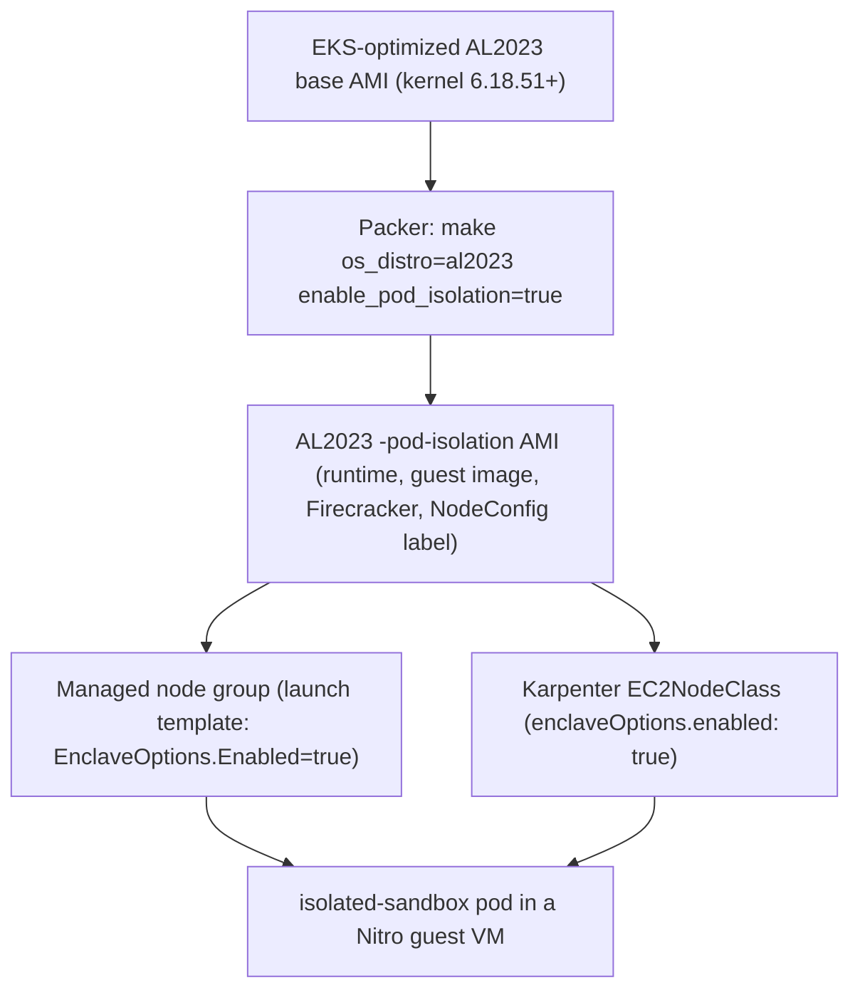

# Build an AL2023 AMI for EKS Pod Isolation and run it with Karpenter or a node group

Build a custom Amazon Linux 2023 node AMI for Amazon EKS Pod Isolation with the upstream
`amazon-eks-ami` Packer flow, add it to an **existing standard (non-Auto-Mode) cluster** two
ways, with **Karpenter** and with a **managed node group**, and run a hello-world pod in a
Nitro sandbox on the result. AL2023 is the **node operating system**; application containers
use their own images.

This blueprint serves readers who run a standard cluster and manage their own node AMI, rather
than relying on the managed AMI that [Getting started](../../getting-started/hello-sandbox/README.md)
uses (EKS Auto Mode provisions sandbox-capable nodes with no AMI build). It adds compute to a
cluster you already have; it never creates or reconfigures the cluster.



*Figure 1: The same AL2023 Nitro Sandbox AMI feeds two node consumers. The upstream amazon-eks-ami Packer build produces an AL2023 -pod-isolation AMI with kernel 6.18.51+. Both a managed node group (via launch template with EnclaveOptions.Enabled=true) and a Karpenter EC2NodeClass (via enclaveOptions.enabled: true) consume this AMI to provision EKS nodes labelled eks.amazonaws.com/nitro-sandbox=true. The resulting node runs an isolated-sandbox pod inside a Nitro sandbox, which is a lightweight VM with its own guest kernel and virtio disks nested within the EKS node.*

![Architecture diagram showing the upstream amazon-eks-ami Packer build on the left producing an AL2023 -pod-isolation AMI with kernel 6.18.51+. The AMI feeds two consumers inside the AWS Cloud frame: a managed node group with launch template at the top, and a Karpenter EC2NodeClass at the bottom. Both enable Nitro via the enclave option and produce an EKS node labelled eks.amazonaws.com/nitro-sandbox=true. Inside the EKS cluster frame, the EKS node (EC2 instance) contains a Nitro sandbox frame, which contains a Nitro sandbox pod box with runtimeClassName: isolated-sandbox and two container icons inside.](images/architecture.png)

## Prerequisites and clone

The [shared prerequisites](../../README.md#prerequisites) (an AWS account, the AWS CLI,
`kubectl`, Git), plus:

- **A standard (non-Auto-Mode) EKS cluster**, Kubernetes 1.36 or 1.37, with the managed
  `vpc-cni` add-on `ACTIVE` and the `isolated-sandbox` and `confidential-sandbox` RuntimeClass
  objects installed. Auto Mode already ships sandbox support, so this blueprint is for the
  standard-cluster case. See the Amazon EKS User Guide, [*Create and update a Nitro Sandbox AMI*](https://docs.aws.amazon.com/eks/latest/userguide/sandboxing-ami-create-update.html).
- **An enclave-capable build instance type** (for example `m8i.4xlarge`). The build must run
  with Nitro Enclaves enabled; on `amazon-eks-ami` v20261112 and later the Packer template sets
  that on the builder for you when `enable_pod_isolation=true`, so an enclave-capable
  `instance_type` is enough. The Makefile default (`m5.xlarge`/`m6g.xlarge`) is not
  enclave-capable, so pass one.
- [`eksctl`](https://eksctl.io/), [`packer`](https://developer.hashicorp.com/packer), `git`,
  `jq`, and (for the Karpenter path) [`helm`](https://helm.sh/).

```bash
git clone https://github.com/aws-samples/sample-eks-nitro-sandbox.git
cd sample-eks-nitro-sandbox/examples/setup/al2023-ami
cp config.env.example config.env
# Set CLUSTER_NAME, AWS_REGION, KUBE_CONTEXT, KUBERNETES_VERSION, EKS_AMI_REF,
# BUILD_SUBNET_ID / NODE_SUBNET_IDS (PRIVATE subnets), JOIN_MODE, and the node IAM role:
# NODE_ROLE_ARN for the managed node group, NODE_ROLE (its name) for Karpenter.
$EDITOR config.env
```

Cost beyond the cluster: one short-lived enclave-capable build instance, the AMI and its
snapshot, and the node-group / Karpenter node instances for the duration of a run. No model
tokens or API credit.

## Overview

- **The AMI is built by the upstream flow, not by this blueprint.** `make os_distro=al2023
  enable_pod_isolation=true` installs the Nitro Sandboxes runtime and guest image from the
  public EKS S3 bundle (unsigned fetch, no instance profile), Firecracker ≥ v1.18.0, asserts
  the AL2023 kernel is ≥ 6.18.51, reserves the enclave memory pool, registers the
  `isolated-sandbox` and `confidential-sandbox` containerd handlers and the CRI proxy, and
  labels the node `eks.amazonaws.com/nitro-sandbox=true`. The AMI name gets a `-pod-isolation`
  suffix.
- **The same AMI, two consumers.** A managed node group (launch template with
  `EnclaveOptions.Enabled=true`) and a Karpenter `EC2NodeClass`
  (`spec.enclaveOptions.enabled: true`) each produce a node labelled
  `eks.amazonaws.com/nitro-sandbox=true`. Both enable Nitro the same way, via the enclave option
  on the launch template.
- **The limit this blueprint enforces is the Nitro Sandbox VM boundary** and IMDSv2 with a hop
  limit of 1 on every node it launches (so an ordinary pod cannot read the node role's
  credentials from the metadata service). The hello-world pod boots with
  `sandbox.amazonaws.com/network-isolated: "true"`, so it has no network at all. This blueprint
  ships no network policy; to restrict where a sandbox pod can connect, see the
  [network policy](../../isolation/network-policy/README.md) blueprint. It gives the pod no AWS
  permissions and creates no Pod Identity association.

## Architecture: x86_64 and arm64

The upstream build supports both **x86_64** and **arm64 (Graviton)**. The pod-isolation
provisioner keys on `uname -m` and fetches the matching runtime and guest image from the EKS S3
bundle (`.../linux/amd64/...` or `.../linux/arm64/...`), so **the AMI's architecture follows the
instance the Packer build runs on**: build on an x86_64 enclave instance for an x86_64 AMI, on a
Graviton enclave instance for an arm64 AMI. There is no separate build flag.

This blueprint defaults to **x86_64** (`NODE_ARCH=amd64`, `m8i` instance types), and the
walkthrough output below is from an x86_64 run. To run **arm64**, set in `config.env`:

- `NODE_ARCH=arm64`.

The build and node instance types then default to `m8g` (Graviton, enclave-capable), and a type
of the other architecture is refused. The AMI is built on the Graviton builder. The managed node
group follows `NODE_INSTANCE_TYPE`;
the Karpenter `NodePool`'s `kubernetes.io/arch` requirement is rendered from `NODE_ARCH`, and its
`amiSelectorTerms` must point at the arm64 AMI. Everything else is identical.

### arm64 run

The arm64 path was run end to end on a Graviton builder (`m8g.4xlarge`) and node (`m8g.xlarge`).
The build produced an `arm64` AMI, the node joined with the sandbox capacity, and an
`isolated-sandbox` pod reached `Running` with its own guest kernel — the same evidence the x86_64
walkthrough below shows, on `aarch64`:

```text
$ kubectl get nodes -o wide
NAME                       STATUS   VERSION               OS-IMAGE                        KERNEL-VERSION                             ARCH
ip-10-0-0-1.ec2.internal   Ready    v1.37.1-eks-9adbfea   Amazon Linux 2023.12.20261112   6.18.62-127.179.amzn2023.aarch64           arm64

$ kubectl get node ip-10-0-0-1.ec2.internal \
    -o jsonpath='{.status.allocatable.eks\.amazonaws\.com/nitro-sandbox}'
20

# isolated-sandbox pod (guest VM)             # ordinary pod (host)
$ uname -r && uname -m                         $ uname -r && uname -m
6.18.56                                        6.18.62-127.179.amzn2023.aarch64
aarch64                                        aarch64

$ ls /sys/block                                $ ls /sys/block
vda  vdb  vdc   (virtio)                        nvme0n1  loop0..  (host NVMe)
```

As on x86_64, the isolated pod boots its own guest kernel (`6.18.56`) distinct from the host
(`6.18.62-127.179.amzn2023.aarch64`) and gets virtio disks rather than the node's NVMe. (Captured
from a live arm64 run on a standard EKS 1.37 cluster; those arm64 resources were then torn down.)

## Files

| File | What it is |
|---|---|
| [`setup.sh`](setup.sh) | Build the AMI, join (node group / Karpenter / both), run the pods |
| [`test.sh`](test.sh) | Read live node and guest evidence |
| [`clean.sh`](clean.sh) | Remove everything a run created, and only that |
| [`scripts/10-build-ami-packer.sh`](scripts/10-build-ami-packer.sh) | Drive the upstream Packer build |
| [`scripts/join-nodegroup.sh`](scripts/join-nodegroup.sh) | Launch template + managed node group |
| [`scripts/join-karpenter.sh`](scripts/join-karpenter.sh) | Apply the EC2NodeClass / NodePool |
| [`scripts/ib-prereqs.sh`](scripts/ib-prereqs.sh) | Optional Image Builder path: the enclave-enabled build group, roles and security group (`up`, `down`) |
| [`scripts/10-build-ami-imagebuilder.sh`](scripts/10-build-ami-imagebuilder.sh) | Optional Image Builder path: create the pipeline, build, record and tag the AMI |
| `deploy/` | The launch-template MIME user data, Karpenter manifests, and the two pods |

## Versions

| Component | Pin |
|---|---|
| `amazon-eks-ami` ([repo](https://github.com/awslabs/amazon-eks-ami)) | a tag ≥ `v20261112` (pod isolation) |
| Kubernetes / EKS | 1.36 or 1.37 |
| AL2023 kernel | `kernel6.18 >= 1:6.18.51` (asserted by the build) |
| Firecracker ([releases](https://github.com/firecracker-microvm/firecracker/releases)) | ≥ `v1.18.0` |
| Karpenter ([docs](https://karpenter.sh/)) | ≥ `v1.15.2` (v1 API + NodeOverlay; see the Karpenter section) |

## Step 1: Build the AL2023 Nitro Sandbox AMI

`scripts/10-build-ami-packer.sh` clones `amazon-eks-ami` at `EKS_AMI_REF` and runs the upstream
build on an enclave-capable instance. It does not reimplement the install; `enable_pod_isolation=true`
does the work.

```bash
./setup.sh --ami-only     # build and tag the AMI; no cluster change
```

```text
Note: this walkthrough reused a pre-built AMI (built earlier with `./setup.sh --ami-only`
from amazon-eks-ami v20261115 for EKS 1.37) rather than rebuilding. `<AMI_ID>` is the
`-pod-isolation` image `./setup.sh --ami-only` produced; your build prints its own id.

$ aws ec2 describe-images --region <AWS_REGION> --image-ids <AMI_ID> \
    --query 'Images[0].[ImageId,Name,State]' --output table
-------------------------------------------------------------------
|                         DescribeImages                          |
+-----------------------------------------------------------------+
|  <AMI_ID>                                                       |
|  amazon-eks-al2023-pod-isolation-node-1.37-v20261115            |
|  available                                                      |
+-----------------------------------------------------------------+
```

## Step 2: Join the AMI to the cluster

`./setup.sh` checks the cluster prerequisites (read only), then joins by `JOIN_MODE`.

### Managed node group

A custom AMI forces a launch template, which carries the AL2023 **NodeConfig MIME** user data
([`deploy/nodegroup-user-data.mime.tmpl`](deploy/nodegroup-user-data.mime.tmpl)) and
`EnclaveOptions.Enabled=true` with IMDSv2 hop-limit-1
([`scripts/lib/launch_spec.py`](scripts/lib/launch_spec.py)). The node group lands in **private
subnets** (an EKS node gets no public IP, so a node group in a public subnet never registers).

```text
$ kubectl get nodes
NAME                              STATUS   ROLES    AGE     VERSION
ip-10-0-0-1.ec2.internal          Ready    <none>   6m24s   v1.37.1-eks-9adbfea

$ kubectl get node ip-10-0-0-1.ec2.internal \
    --show-labels | grep eks.amazonaws.com/nitro-sandbox
...,eks.amazonaws.com/nitro-sandbox=true,...

$ kubectl get node ip-10-0-0-1.ec2.internal \
    -o jsonpath='{.status.allocatable.eks\.amazonaws\.com/nitro-sandbox}'
20
```

### Karpenter

See [Karpenter: the enclave node and the #9904 limit](#karpenter-the-enclave-node-and-the-9904-limit)
below for what Karpenter can and cannot do for sandbox pods today.

## Step 3: Run a pod in the sandbox, beside an ordinary pod

`./setup.sh` applies [`deploy/pod-isolated-sandbox.yaml`](deploy/pod-isolated-sandbox.yaml)
(`runtimeClassName: isolated-sandbox`, booted `network-isolated`) and
[`deploy/pod-ordinary.yaml`](deploy/pod-ordinary.yaml) on the same node. The isolated pod runs in
its own Nitro guest VM, so its kernel, boot and disks are the guest's, not the node's:

```text
# isolated-sandbox pod                       # ordinary pod
$ uname -r                                    $ uname -r
6.18.56                                       6.18.62-127.179.amzn2023.x86_64

$ ls /sys/block                               $ ls /sys/block
vda  vdb  vdc   (virtio)                       nvme0n1  loop0..loop7   (host NVMe)
```

The isolated pod reports a **guest kernel** (`6.18.56`) distinct from the node's host kernel
(`6.18.62-127.179.amzn2023.x86_64`), and **virtio** block devices rather than the host's NVMe:
it is a separate VM with its own kernel and virtual disks. (Captured from a live run on a
standard EKS 1.37 cluster; the ordinary pod shares the node kernel.)

Because the isolated pod is booted with `sandbox.amazonaws.com/network-isolated: "true"`, it has
no network besides loopback, no route and no DNS. `./test.sh` reads this back from the guest's own
kernel tables, `/proc/net/fib_trie` and `/proc/net/route`, so it needs no tool in the image.

```text
$ ./test.sh
[2026-11-17T04:18:55Z] kube context <KUBE_CONTEXT> is cluster <CLUSTER_NAME> (<API_ENDPOINT>)
== 1/5 the sandbox node is Ready and carries eks.amazonaws.com/nitro-sandbox=true ==
  node: ip-10-0-0-1.ec2.internal  Ready: True
  PASS  the sandbox node is Ready
  PASS  the node carries eks.amazonaws.com/nitro-sandbox=true
== 2/5 the node advertises sandbox capacity ==
  eks.amazonaws.com/nitro-sandbox allocatable: 20
  PASS  allocatable eks.amazonaws.com/nitro-sandbox > 0
== 3/5 the isolated pod runs in a sandbox: its own guest kernel and virtio disks ==
  isolated pod kernel: 6.18.56
  ordinary pod kernel: 6.18.62-127.179.amzn2023.x86_64
  PASS  the isolated pod's kernel differs from the ordinary pod's (its own guest kernel)
  isolated pod /sys/block: dm-0 vda vdb vdc
  PASS  the isolated pod has virtio disks (vda, vdb, ...), not the host's nvme
== 4/5 the isolated pod has its own boot clock: a younger uptime than the ordinary pod's node ==
  isolated pod boot uptime (s): 27.84   ordinary pod (its node's) uptime (s): 137.96
  PASS  the isolated pod's uptime is shorter than the ordinary pod's (its own boot, after the node's)
== 5/5 the network-isolated pod has only loopback ==
  local IPv4 addresses: 127.0.0.1   IPv4 routes: none (header line only)
  PASS  the network-isolated pod's only IPv4 address is loopback (127.0.0.1)
  PASS  the network-isolated pod has no route

== summary: 8 passed, 0 failed ==
```

This run used the x86_64 AMI from the Image Builder section below, joined with `./setup.sh --join`
on a new standard EKS 1.37 cluster; the node name, kube context and API endpoint are replaced.

## Karpenter: the enclave node and the #9904 limit

Karpenter provisions the **sandbox-capable node** cleanly: the committed
[`deploy/karpenter-ec2nodeclass.yaml`](deploy/karpenter-ec2nodeclass.yaml) sets
`spec.enclaveOptions.enabled: true` (which Karpenter turns into `EnclaveOptions.Enabled=true` on
the launch template it generates and makes it filter to enclave-capable instance types), pinned
to the custom AMI, and [`deploy/karpenter-nodepool.yaml`](deploy/karpenter-nodepool.yaml) selects
it. This requires **Karpenter ≥ v1.15.2** (the v1 `EC2NodeClass`/`NodePool` API; `enclaveOptions`
landed in v1.15.1), installed on a cluster that already has nodes (Karpenter's controller needs a
node to run on).

> **Scheduling a sandbox pod onto a Karpenter node needs more than the node**
>
> A pod that sets `runtimeClassName: isolated-sandbox` carries a per-pod overhead of
> `eks.amazonaws.com/nitro-sandbox: "1"` from the RuntimeClass. No EC2 instance type advertises
> that resource until a node has booted, so self-managed Karpenter's scheduler reports
> `label eks.amazonaws.com/nitro-sandbox does not have known values` and does not provision a
> node for the pod. This is an open upstream limitation tracked in
> [aws/karpenter-provider-aws#9904](https://github.com/aws/karpenter-provider-aws/issues/9904).
>
> The forward path is the alpha **NodeOverlay**
> ([`deploy/karpenter-nodeoverlay.yaml`](deploy/karpenter-nodeoverlay.yaml), behind the
> `nodeOverlay` feature gate), which advertises the slot capacity to the scheduler. On the
> versions available while this blueprint was written, applying it (Ready and validated) did not
> yet make a sandbox pod schedulable, so **run sandbox pods via the managed node group**, or on
> EKS Auto Mode, which models this natively. Use Karpenter here to provision the enclave-capable
> nodes; schedule the sandbox pods through the node group until #9904 ships.

## Optional: build with EC2 Image Builder

You can build the same AMI with EC2 Image Builder instead of Packer, for x86_64 and arm64. The
Image Builder component runs the upstream `amazon-eks-ami` provisioner that the Packer build runs
(`templates/al2023/provisioners/install-pod-isolation.sh`, from the pinned release `v20261112`,
whose archive hash the component checks), so the runtime, guest image, Firecracker, kernel
arguments, CRI proxy and NodeConfig drop-in are the same. This path needs AWS CLI 2.40.4 or later:
2.38.0 refuses the `parentInstance` setting it uses.

**How the build instance gets Nitro Enclaves.** An Image Builder infrastructure configuration has
no enclave setting. Instead, Image Builder takes the build instance from an Auto Scaling group
(`parentInstance`), and that instance keeps everything the group launched it with: the AMI,
instance type, instance profile, subnet, security group and metadata options. So the group's
launch template enables enclaves, and it also decides the base image and instance type; the
recipe's parent image only has to match the architecture. Image Builder detaches the instance from
the group before it builds, and the group launches a replacement. See the EC2 Image Builder User
Guide, [Build on an instance from an Auto Scaling
group](https://docs.aws.amazon.com/imagebuilder/latest/userguide/infra-config-parent-instance.html).

[`scripts/ib-prereqs.sh`](scripts/ib-prereqs.sh) `up` creates what the build needs, each named
`al2023-ami-ib-<RUN_ID>` and tagged for the run:

- a launch template with the EKS-optimized AL2023 AMI for `NODE_ARCH`, `m8i.4xlarge` or
  `m8g.4xlarge`, `EnclaveOptions.Enabled=true` and IMDSv2 with a hop limit of 1;
- an Auto Scaling group of one instance from it, pinned to the template's version number and
  spread over the private subnets with a NAT route that you give it;
- the instance role and profile: Systems Manager, `EC2InstanceProfileForImageBuilder`, and
  `s3:GetObject` on the public `amazon-eks` bundle;
- a security group with outbound rules only;
- the pipeline's execution role: `EC2ImageBuilderExecutionPolicy`, plus describing the group,
  tagging its instances and detaching them from that one group.

It waits until the group's instance is online in Systems Manager, which Image Builder needs.
[`scripts/10-build-ami-imagebuilder.sh`](scripts/10-build-ami-imagebuilder.sh) then checks the
group's launch template, creates the component, recipe, infrastructure and distribution
configurations and pipeline, runs the build, and records and tags the AMI and its snapshots for
the run. Image tests are off, because a test instance is launched from the infrastructure
configuration and cannot have enclaves; the component checks what it installed. The
configurations are in `deploy/imagebuilder/`.

```bash
export NODE_ARCH=amd64                      # or arm64
export BUILD_SUBNET_ID="<private-subnet-id> <private-subnet-id>"  # NAT route; more than one lets the group pick a zone with capacity
export KUBERNETES_VERSION=1.37 KUBERNETES_BUNDLE_VERSION=1.37.1 KUBERNETES_BUILD_DATE=2026-11-12
export RUN_ID=<id>

./scripts/ib-prereqs.sh up
./scripts/10-build-ami-imagebuilder.sh
```

`KUBERNETES_BUNDLE_VERSION` and `KUBERNETES_BUILD_DATE` name the bundle folder
`s3://amazon-eks/<version>/<build date>`, the same values the Packer build takes.

This is the x86_64 run, abridged; IDs from the account are replaced by placeholders:

```text
$ ./scripts/ib-prereqs.sh up
[2026-11-17T00:59:13Z] security group <SG_ID>
[2026-11-17T00:59:20Z] instance profile al2023-ami-ib-ib1117x86-instance
[2026-11-17T00:59:23Z] execution role al2023-ami-ib-ib1117x86-exec
[2026-11-17T00:59:36Z] launch template al2023-ami-ib-ib1117x86 (<EKS_AMI_ID>, m8i.4xlarge, enclaves on)
[2026-11-17T00:59:39Z] waiting for the group's instance to be online in Systems Manager (up to 15 min)
[2026-11-17T01:00:03Z] instance <INSTANCE_ID> is InService and online in Systems Manager
[2026-11-17T01:00:03Z] prerequisites ready for run ib1117x86; run scripts/10-build-ami-imagebuilder.sh next

$ ./scripts/10-build-ami-imagebuilder.sh
[2026-11-17T01:00:06Z] group al2023-ami-ib-ib1117x86: m8i.4xlarge from al2023-ami-ib-ib1117x86, enclaves on; parent image <EKS_AMI_ID> (x86_64)
...
[2026-11-17T01:00:16Z] build started: arn:aws:imagebuilder:us-west-2:<ACCOUNT_ID>:image/al2023-ami-ib-ib1117x86/1.0.0/1
[2026-11-17T01:00:17Z] waiting for the build (up to 120 min)
[2026-11-17T01:10:26Z] build status: AVAILABLE
[2026-11-17T01:10:30Z] built AMI: <AMI_ID> (eks-al2023-pod-isolation-2026-11-17T01-00-16.203Z, x86_64)
```

The arm64 run built on `m8g.4xlarge` the same way, with the private subnets of three Availability
Zones in `BUILD_SUBNET_ID`:

```text
[2026-11-17T01:36:26Z] group al2023-ami-ib-ib1117arm3: m8g.4xlarge from al2023-ami-ib-ib1117arm3, enclaves on; parent image <EKS_AMI_ID> (arm64)
[2026-11-17T01:45:44Z] build status: AVAILABLE
[2026-11-17T01:45:48Z] built AMI: <AMI_ID> (eks-al2023-pod-isolation-2026-11-17T01-36-35.273Z, arm64)
```

Join the AMI exactly as in Step 2 (`RUN_ID=<id> ./setup.sh --join`); the build recorded its id for
the run. Each Image Builder AMI ran the isolated pod in its own guest. These blocks are abridged to
the node, kernel and disk lines, with the node name replaced; they come from the runs that built the
AMIs, before `test.sh` read the network from the guest's `/proc/net`. The x86_64 AMI's full run of
the current `test.sh`, network check included, is the block in Step 3:

```text
$ ./test.sh                                  # x86_64 Image Builder AMI
  node: ip-10-0-0-1.ec2.internal  Ready: True
  eks.amazonaws.com/nitro-sandbox allocatable: 20
  isolated pod kernel: 6.18.56
  ordinary pod kernel: 6.18.62-127.179.amzn2023.x86_64
  isolated pod /sys/block: dm-0 vda vdb vdc

$ ./test.sh                                  # arm64 Image Builder AMI
  node: ip-10-0-0-1.ec2.internal  Ready: True
  eks.amazonaws.com/nitro-sandbox allocatable: 20
  isolated pod kernel: 6.18.56
  ordinary pod kernel: 6.18.62-127.179.amzn2023.aarch64
  isolated pod /sys/block: dm-0 vda vdb vdc
```

To build again with the same prerequisites, `RUN_ID=<id> ./scripts/ib-prereqs.sh reset` removes
only the run's Image Builder resources. `RUN_ID=<id> ./scripts/ib-prereqs.sh down` removes the
group, roles, Image Builder resources and build log group of the run, and lists the launch
template and security group deletes for you to run, as `clean.sh` does. `./clean.sh` removes the
AMI and its snapshots with the rest of the run.

The run records its account, Region and prefix when `ib-prereqs.sh up` first runs, and the cluster
when `setup.sh --join` first runs. Every later command must match what the run recorded; one that
does not stops before it changes anything.

## Good to know

- **The build does not enable enclaves on the builder on older refs.** On `amazon-eks-ami`
  before v20261112 the Packer template did not set `EnclaveOptions` on the builder; pin a ref
  ≥ v20261112, or ensure the build instance is enclave-enabled yourself.
- **Nodes must be in private subnets with a NAT route.** A managed node group in a public subnet
  hangs in `CREATING` forever (EKS nodes get no public IP). `scripts/join-nodegroup.sh` fails
  fast if you point it at a public subnet. The Karpenter path selects subnets that carry both
  `karpenter.sh/discovery=<cluster>` and `kubernetes.io/role/internal-elb=1` (the tag EKS puts on
  private subnets); if yours are tagged another way, change `subnetSelectorTerms` in
  [`deploy/karpenter-ec2nodeclass.yaml`](deploy/karpenter-ec2nodeclass.yaml).
- **Supported Kubernetes versions are 1.36 and 1.37**, and `KUBERNETES_VERSION` must equal the
  cluster's version; `setup.sh` and the build scripts stop on anything else before they build.
- **Give the Image Builder group more than one subnet.** The group launches the build instance
  itself, and a Graviton or other large type can be out of capacity in one Availability Zone while
  another has it. With one subnet the group retries the same zone and `ib-prereqs.sh up` stops
  after 15 minutes, printing the group's latest activity (for example "We currently do not have
  sufficient m8g.4xlarge capacity in the Availability Zone you requested"). With the private
  subnets of several zones the group takes the zone that has capacity.

## Clean up

```bash
RUN_ID=<id> ./clean.sh --dry-run   # preview
RUN_ID=<id> ./clean.sh             # remove everything this run created
RUN_ID=<id> ./scripts/ib-prereqs.sh down   # if the run used the Image Builder path
```

`clean.sh` needs `KUBE_CONTEXT` set, like setup. It stops if the AWS account is not the one the run
was created in. It deletes a resource only when it carries this run's mark: the
`app.kubernetes.io/part-of=al2023-ami` and `app.kubernetes.io/instance=<id>` labels on the
namespace, `NodePool` and `EC2NodeClass`, and the `ManagedBy=al2023-ami` and `RunId=<id>` tags on
the node group, launch template, every AMI the run recorded and each of their snapshots (the build
tags the snapshots too). A resource without the mark is left alone, and a lookup that fails is reported as "could not determine", never as gone.
Either leaves the clean up incomplete and the script exits non-zero.

The launch template, AMI and snapshot deletes (`ec2 delete-*`, `deregister-image`) are written to
`tmp/al2023-ami/run/out/runs/<id>/teardown-remaining.sh` for you to run, and the script exits
non-zero until you have. It never removes the shared `vpc-cni` add-on, the RuntimeClasses, or
Karpenter itself. See the [hello-sandbox](../../getting-started/hello-sandbox/README.md) clean up for
removing the namespace and the cluster.
