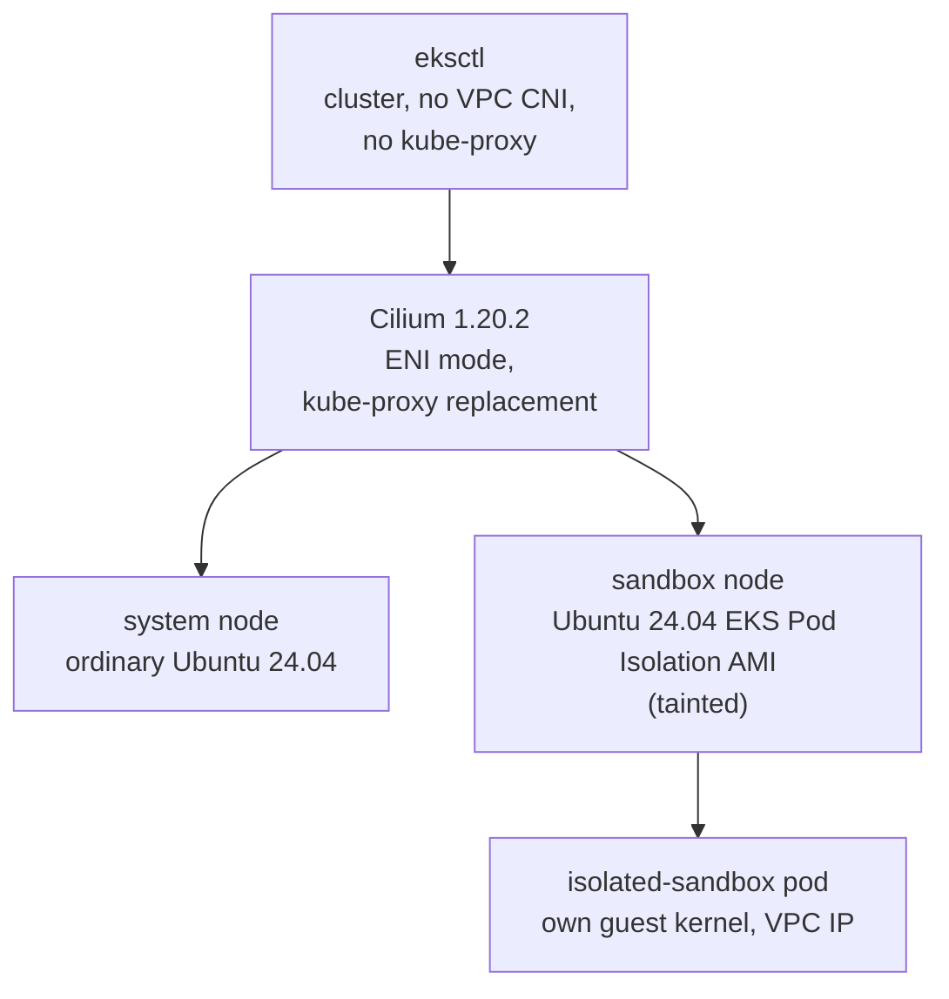

# Cilium CNI on Ubuntu EKS Pod Isolation nodes

**Create a new, dedicated EKS cluster whose only CNI is [Cilium](https://cilium.io), add one
ordinary Ubuntu 24.04 node and one dedicated, tainted Ubuntu 24.04 EKS Pod Isolation sandbox
node, and run an `isolated-sandbox` pod on it.** The Amazon VPC CNI and kube-proxy are never
installed: Cilium gives every pod, the sandbox pod included, a real VPC address, implements
every Service in eBPF, and is proved to enforce the same network policy on the sandbox pod as
on an ordinary pod.

> **Status: cluster scaffold and Cilium install path.** This page currently covers stages 1
> through 4 below: the cluster, the Cilium operator's AWS permissions, the Cilium install
> itself, and the two Ubuntu node groups joining it healthy. The evidence sections this
> sample's issue describes (sandbox networking and policy proofs, the BTF negative control,
> the `socketLB.hostNamespaceOnly` positive/negative controls, cost and duration) and the
> `test.sh` / `clean.sh` scripts are tracked separately and are **not** in this change; they
> are marked below wherever this page anticipates them.



!!! note "Kube-proxy replacement needs a node kernel with BTF"

    Cilium's kube-proxy replacement includes a socket-level load balancer whose eBPF programs
    load against the kernel's BTF type information, so every node kernel must be built with
    `CONFIG_DEBUG_INFO_BTF=y`. The Ubuntu EKS Pod Isolation AMI this sample consumes is the
    output of [#10](https://github.com/aws-samples/sample-eks-nitro-sandbox/issues/10),
    rebuilt with kernel BTF enabled; this sample refuses an AMI that is not tagged as such
    (`setup.sh`'s AMI preflight, stage 0 below) rather than discovering the missing BTF only
    after a node joins. `setup.sh` also gates on both running node kernels showing valid BTF
    (`/sys/kernel/btf/vmlinux`) before treating their Cilium agents as ready (stage 6).

## This sample depends on #10

The sandbox node's AMI is **not** built here. It is the output of
[#10, Build an Ubuntu AMI for EKS Pod Isolation](https://github.com/aws-samples/sample-eks-nitro-sandbox/issues/10),
rebuilt with kernel BTF enabled for Cilium's kube-proxy replacement. This sample never
guesses, publishes or hard-codes that AMI's id: `setup.sh` reads it from your own
`config.local.env` (`SANDBOX_AMI_ID`, gitignored) and verifies its architecture, owner and a
`BtfValidated=true` tag before using it — see [Stage 0](#0-prerequisites-and-the-ami-preflight).

## Run it

You need the Ubuntu Pod Isolation AMI built and BTF-validated by
[#10](https://github.com/aws-samples/sample-eks-nitro-sandbox/issues/10), an AWS account, and
`aws`, `eksctl` 0.230.0 or newer, `helm`, `kubectl`, and `python3` with PyYAML. From
`examples/setup/cilium-ubuntu/`:

```bash
cp config.env.example config.local.env   # then set AWS_ACCOUNT_ID, SANDBOX_AMI_ID and SYSTEM_AMI_ID in it
./setup.sh
```

The script writes its own kubeconfig to `out/kubeconfig`, so your default kubeconfig and its
current context are not touched. To use `kubectl` yourself:

```bash
export KUBECONFIG=$PWD/out/kubeconfig
```

Once the cluster is up, prove the sample's claims and then tear it down:

```bash
./test.sh              # apply the workloads and policy, then prove networking, BTF and policy
./clean.sh --dry-run   # list only the run-owned resources a full clean would delete
./clean.sh             # delete the cluster, its VPC, the Cilium ENIs and the IAM resources
```

`test.sh` applies `deploy/workloads.yaml` and `deploy/policy.yaml`, waits for the seven pods
to be Ready, and runs the read-only proofs in [Evidence](#evidence-testsh). See
[What stays running, and cleaning up](#what-stays-running-and-cleaning-up) for what `clean.sh`
removes and the cost this cluster accrues while it exists.

## Versions

Starting pins from the validated Cilium path (issue #11's Versions table). **Re-check every
pin together on a fresh Ubuntu cluster before trusting a result; a version string alone is
not sufficient evidence that Cilium health, BTF loading, ENI allocation, Service translation
and the policy controls still hold.**

| Component | Pin | Latest checked (2026-10-16) |
|---|---|---|
| [Amazon EKS Kubernetes](https://docs.aws.amazon.com/eks/latest/userguide/kubernetes-versions.html) | 1.36 | 1.36 |
| Ubuntu system and sandbox nodes | Ubuntu 24.04 LTS; record the exact point release and regional base AMI you resolved `SYSTEM_AMI_ID` from | 24.04.5 LTS |
| Ubuntu EKS Pod Isolation AMI | Output of [#10](https://github.com/aws-samples/sample-eks-nitro-sandbox/issues/10), rebuilt with kernel BTF enabled | Revalidate after #10 merges |
| [Cilium](https://github.com/cilium/cilium) Helm chart | 1.20.2 | 1.20.2 |
| [eksctl](https://github.com/eksctl-io/eksctl) | 0.230.0 or newer; record the exact release you ran | 0.230.0 |
| [Helm](https://github.com/helm/helm) | Record the exact client release you ran | re-check when implementing |
| EKS Pod Isolation runtime and guest image | Same exact public release validated by #10 | re-check when implementing |

## The stages

| Stage | What you configure | What you see |
|---|---|---|
| [0. Prerequisites and the AMI preflight](#0-prerequisites-and-the-ami-preflight) | `config.local.env`: account, Region, both AMI ids | The sandbox AMI's architecture, owner and `BtfValidated` tag confirmed before anything is created |
| [1. Create the cluster without the VPC CNI or kube-proxy](#1-create-the-cluster-without-the-vpc-cni-or-kube-proxy) | eksctl `addonsConfig` | No `aws-node` and no `kube-proxy` |
| [2. Give the Cilium operator its own AWS role](#2-give-the-cilium-operator-its-own-aws-role) | One Pod Identity association | Node roles without ENI permissions |
| [3. Install Cilium before any node](#3-install-cilium-before-any-node) | Helm values: ENI mode, kube-proxy replacement, `socketLB.hostNamespaceOnly` | Cilium waiting for nodes |
| [4. Add the two Ubuntu node groups](#4-add-the-two-ubuntu-node-groups) | Two launch templates | Both nodes Ready on Cilium |
| [5. Gate on BTF before either agent counts as ready](#5-gate-on-btf-before-either-agent-counts-as-ready) | A running-kernel check, not a config-file guess | Both nodes' Cilium agents confirmed against `/sys/kernel/btf/vmlinux` |
| 6. The sandbox pod, Service boundary and policy evidence | *(separate item; not in this change)* | *(separate item; not in this change)* |

### 0. Prerequisites and the AMI preflight

`setup.sh` checks its tools and the caller's AWS account first, then the two AMI ids in
`config.local.env`, **before any billable AWS resource exists**:

- `SANDBOX_AMI_ID`: must be owned by `AWS_ACCOUNT_ID`, `available`, `x86_64`/`hvm`, named like
  an Ubuntu build, and carry the `BtfValidated=true` tag [#10](https://github.com/aws-samples/sample-eks-nitro-sandbox/issues/10)'s
  build sets. A stale id, a mistyped id, or an AMI from before #10's BTF fix is refused here,
  not discovered later as a Cilium agent that never goes ready.
- `SYSTEM_AMI_ID`: a public Ubuntu 24.04 EKS-optimized AMI id you resolved and pinned
  yourself (this sample does not resolve `latest` at runtime, so a re-run always boots the
  AMI you validated against). Only existence, state and architecture are checked; this sample
  does not second-guess a published Canonical/AWS image.

Neither check ever substitutes a guessed or published id when the one you gave fails: it
stops and tells you what did not match.

### 1. Create the cluster without the VPC CNI or kube-proxy

eksctl creates a new VPC and an EKS 1.36 control plane, dedicated to this sample.
`disableDefaultAddons` stops EKS from installing its default networking add-ons, and the
cluster lists the ones it wants back: CoreDNS, plus the Pod Identity agent for stage 2. The
VPC CNI and kube-proxy are not among them; Cilium does both of their jobs. No node group is
created yet, so the first node that ever joins already has a CNI.

This sample only ever creates its **own** dedicated cluster (tagged
`Demo=setup-cilium-ubuntu`); it never attaches to, modifies the CNI on, or removes
kube-proxy from an existing cluster, because that would be unsafe on a cluster something else
depends on.

From [`eksctl/cluster.yaml`](eksctl/cluster.yaml):

```yaml
addonsConfig:
  disableDefaultAddons: true
addons:
  - name: coredns
  - name: eks-pod-identity-agent
```

What you see: the cluster has no `aws-node` or `kube-proxy` DaemonSet and no `vpc-cni` or
`kube-proxy` add-on, now or later.

```bash
kubectl -n kube-system get daemonset aws-node kube-proxy
# Error from server (NotFound): daemonsets.apps "aws-node" not found
# Error from server (NotFound): daemonsets.apps "kube-proxy" not found
```

### 2. Give the Cilium operator its own AWS role

In ENI mode the Cilium operator is the one component that calls the EC2 API: it creates
network interfaces for the nodes and assigns their secondary IPs to pods. It gets exactly the
EC2 actions [Cilium's ENI IPAM guidance](https://docs.cilium.io/en/stable/network/concepts/ipam/eni/)
documents, through a dedicated [EKS Pod Identity](https://docs.aws.amazon.com/eks/latest/userguide/pod-identities.html)
association bound to its own service account — not through either node role. eksctl does not
accept a Pod Identity association while it creates a cluster without the VPC CNI, so
`setup.sh` adds it right after the cluster exists, and before Cilium is installed, because EKS
injects the credentials when the operator pod is created.

From [`eksctl/pod-identity.yaml`](eksctl/pod-identity.yaml) (the exact action list; nothing
wider, no wildcard):

```yaml
iam:
  podIdentityAssociations:
    - namespace: kube-system
      serviceAccountName: cilium-operator
      permissionPolicy:
        Statement:
          - Sid: CiliumEniIpamDescribe
            Effect: Allow
            Action:
              - ec2:DescribeNetworkInterfaces
              - ec2:DescribeSubnets
              - ec2:DescribeVpcs
              - ec2:DescribeVpcPeeringConnections
              - ec2:DescribeRouteTables
              - ec2:DescribeSecurityGroups
              - ec2:DescribeInstances
              - ec2:DescribeInstanceTypes
              - ec2:DescribeTags
            Resource: "*"
          - Sid: CiliumEniIpamWrite
            Effect: Allow
            Action:
              - ec2:CreateNetworkInterface
              - ec2:AttachNetworkInterface
              - ec2:DetachNetworkInterface
              - ec2:ModifyNetworkInterfaceAttribute
              - ec2:AssignPrivateIpAddresses
              - ec2:UnassignPrivateIpAddresses
              - ec2:DeleteNetworkInterface
              - ec2:CreateTags
            Resource: "*"
```

**Why a separate Describe and Write statement, and why this set and no other.** The Describe
actions are what the operator reads before it changes anything (existing ENIs, the VPC,
subnets, route tables, security groups, the instance-type limits its IP-per-ENI math depends
on, and existing tags); the Write actions are the lifecycle of an ENI the operator manages
(create, attach, detach when a node leaves, assign/unassign secondary IPs, tag what it
created, delete it when no longer needed). Nothing here can terminate an instance, change a
security group's rules, modify route tables, or touch any resource type besides network
interfaces, tags and the describe-only reads — because the operator's job in ENI mode is
exactly network-interface lifecycle and nothing else. `scripts/cilium_ubuntu.py`'s
`validate_pod_identity_config` enforces this exact action set (no wildcard, no extra action)
every time `setup.sh` renders this file, so a hand-edit that widens it fails before `eksctl`
ever sees it.

The node groups in stage 4 get the usual node policies minus `AmazonEKS_CNI_Policy`, so
nothing on a node, system or sandbox, can create interfaces with the node's own credentials.

What you see: the operator pod carries `AWS_CONTAINER_CREDENTIALS_FULL_URI` (the variable Pod
Identity sets), and neither node role has `AmazonEKS_CNI_Policy` attached.

### 3. Install Cilium before any node

Helm installs Cilium 1.20.2 while the cluster still has no nodes, so the first node that joins
already has a CNI. In ENI mode the operator attaches interfaces to each node and hands their
secondary IPs to pods: every pod IP, on the ordinary Ubuntu node or the Ubuntu sandbox node
alike, is a routable VPC address, with no overlay. Cilium also replaces kube-proxy: its eBPF
programs implement every Service, and no Service rule is ever written to a node's iptables.

From [`cilium-values.yaml`](cilium-values.yaml) (every non-default value carries its own
comment in the file explaining why it is set):

```yaml
eni:
  enabled: true
ipam:
  mode: eni
routingMode: native
kubeProxyReplacement: true
k8sServicePort: 443
socketLB:
  hostNamespaceOnly: true
operator:
  nodeSelector:
    eks.amazonaws.com/nodegroup: system
```

`setup.sh` passes two values on the command line: the cluster name and the API server
endpoint (`k8sServiceHost`). With no kube-proxy, nothing programs the `kubernetes` Service
before Cilium does, so the agents reach the API server at its endpoint directly.

**Why `socketLB.hostNamespaceOnly: true` matters for an EKS Pod Isolation sandbox.** Cilium
translates a Service address in one of two places: in the socket layer, when a process calls
`connect()`, through eBPF hooks in the *node's* kernel; or per packet, at the pod's network
interface. A sandbox pod's processes call `connect()` in their own guest kernel, which the
Ubuntu host's socket hooks never see. With `hostNamespaceOnly: true`, the socket load
balancer serves only the node's own network namespace, and every pod — sandboxed and
ordinary alike — gets the per-packet load balancer instead, which does see the guest's
packets at the pod's interface. Without this setting, a sandbox pod still reaches pod IPs
directly, but a ClusterIP Service and Service-based DNS both fail, because Cilium's own
policy drops the sandbox's still-untranslated packets as unrecognized traffic.

**TODO (separate item): the positive/negative Service-boundary proof** (`test.sh` capturing
each agent's `cilium-dbg status --verbose` and the before/after Service and DNS reachability
from the sandbox pod, with and without `hostNamespaceOnly`) belongs to the evidence item, not
this one.

### 4. Add the two Ubuntu node groups

Both node groups are EKS managed node groups created by eksctl, each from a launch template
`setup.sh` creates first, so the templates and everything launched from them carry this
sample's tags from the start.

- **`system`**: the ordinary Ubuntu 24.04 node (`SYSTEM_AMI_ID`, `SYSTEM_INSTANCE_TYPE`,
  default `m7i.large`). CoreDNS, the Cilium operator, and any comparison workloads the
  follow-on evidence item runs live here.
- **`sandbox`**: the dedicated, tainted Ubuntu 24.04 EKS Pod Isolation node
  (`SANDBOX_AMI_ID`, `SANDBOX_INSTANCE_TYPE`, default `m8i.xlarge`), with Nitro Enclaves
  enabled on its launch template. Its AMI's own `nodeadm` user data (built by
  [#10](https://github.com/aws-samples/sample-eks-nitro-sandbox/issues/10)) wires kubelet to
  the sandbox CRI proxy and registers the `isolated-sandbox` runtime handler; this sample's
  launch template only turns on the Nitro Enclaves device and sets the instance type and
  disk. A taint keeps every ordinary pod off this node; only a pod that tolerates
  `sandbox.eks-nitro-sandbox.amazonaws.com/dedicated=true:NoSchedule` schedules here.

From [`eksctl/nodegroups.yaml`](eksctl/nodegroups.yaml):

```yaml
  - name: sandbox
    launchTemplate:
      id: ${SANDBOX_LAUNCH_TEMPLATE_ID}   # created by setup.sh
      version: "1"
    labels:
      sandbox.eks-nitro-sandbox.amazonaws.com/dedicated: "true"
    taints:
      - key: sandbox.eks-nitro-sandbox.amazonaws.com/dedicated
        value: "true"
        effect: NoSchedule
```

What you see: both nodes `Ready`, and a Cilium agent running on each, including the tainted
sandbox node.

```bash
kubectl -n kube-system get pods -l k8s-app=cilium -o wide
```

Before the sandbox node group is created, `setup.sh` also checks that the Cilium agent
DaemonSet's own selector and tolerations would actually schedule onto a node carrying this
taint and these labels (`scripts/cilium_ubuntu.py check-sandbox-ami`'s sibling,
`preflight-daemonset`), and prints `cilium DaemonSet tolerates the sandbox node's taint and
selects its labels` — so a Helm-values regression that narrowed the agent's tolerations is
caught before a node is created from a launch template that bills.

### 5. Gate on BTF before either agent counts as ready

Both Ubuntu node kernels must expose valid BTF (`/sys/kernel/btf/vmlinux`, non-empty) before
`setup.sh` calls their Cilium agents ready. This is read from the **running** kernel through a
`kubectl exec` into the Cilium agent pod already scheduled on each node — not inferred from a
kernel config file, and not read from the `cilium-config` ConfigMap — so the check reflects
what the kernel actually booted with.

```bash
kubectl -n kube-system exec ds/cilium -c cilium-agent -- sh -c 'test -s /sys/kernel/btf/vmlinux && echo PRESENT || echo MISSING'
```

**TODO (separate item): the documented negative control.** Issue #11's acceptance criteria
call for a captured failure showing a missing-BTF kernel rejected before node acceptance.
This item's `check-btf` command refuses with a clear message when BTF is absent (proved
against the real command with a stub `kubectl` returning `MISSING`, not a copy of the check);
capturing that failure from an actual non-BTF Ubuntu build, and the accompanying README
evidence block, belongs to the evidence item together with the rest of stage 6.

## Evidence (`./test.sh`)

`test.sh` is read-only against the cluster's configuration: it applies the sample's own
workloads (`deploy/workloads.yaml`) and the egress network policy (`deploy/policy.yaml`),
waits for the seven pods to be Ready, and then proves each claim by reading the **running
Cilium agents** rather than the Helm values or the `cilium-config` ConfigMap. It compares the
Nitro sandbox pod (`nitro`, `runtimeClassName: isolated-sandbox`, on the Ubuntu sandbox node)
against an ordinary pod on the same sandbox node (`neighbor`) and an ordinary pod on the
system node (`control`), so every result is shown for the sandbox lane beside the two ordinary
lanes.

What it checks, in order:

1. **No VPC CNI, no kube-proxy, Cilium up on both Ubuntu nodes.** `aws-node` and `kube-proxy`
   DaemonSets are absent; the EKS add-on list has no `vpc-cni`/`kube-proxy`; both agents report
   `cilium-dbg status --brief` OK, `KubeProxyReplacement: True` with the socket load balancer
   **host-namespace-only** (read from the agent, since the ConfigMap cannot tell host-only from
   full), no `KUBE-` chain in either node's iptables, and a fully loaded eBPF datapath (which a
   missing-BTF kernel would prevent).
2. **The operator's credentials.** The operator pod gets its AWS credentials from EKS Pod
   Identity, its role allows exactly Cilium's documented ENI actions, and neither node role
   carries `AmazonEKS_CNI_Policy`.
3. **The sandbox pod has its own guest.** Its guest kernel differs from the node kernel, it
   sees virtio disks (no node `nvme`), and its boot uptime is its own — while `neighbor`, an
   ordinary pod on the same node, shares the node kernel and sees the node's `nvme`.
4. **Normal pod networking across the guest boundary.** The sandbox pod gets a VPC address on
   a secondary ENI of its own instance with a ready `CiliumEndpoint`, reaches and is reached by
   ordinary pods, and resolves and reaches the ClusterIP Service by DNS — the same as the two
   ordinary lanes, and the node itself (host-network `node-probe`) reaches the Service through
   the socket load balancer.
5. **L3/L4 policy, both ways.** Each client is ALLOWED to `server:8080` and DENIED to
   `other:8080` (dropped). The unselected `server` pod still reaches `other`, proving the deny
   is the policy, not an unavailable destination.
6. **L7 HTTP policy, both ways.** Each client may `GET /` on `api:8080` (proxy verdict
   `Forwarded`, 200) but not `GET /admin` (proxy verdict `Denied`, 403). The verdict is read
   from the node-local Envoy proxy's own `cilium-dbg monitor --type l7` output, so an
   app-issued 403 cannot be mistaken for a policy deny.
7. **FQDN policy, both ways.** Each client may reach `checkip.amazonaws.com` (recorded as a
   `lookup` in the agent's FQDN cache) but not `example.net`, which is dropped while it still
   resolves — and the unselected `server` pod still reaches it, so the deny is the policy, not
   the network.
8. **Ownership tags.** Every ENI in the VPC and every resource the cluster owns carries
   `auto-delete=no`, and no tracked file holds an account id, AMI id or other account-specific
   value.

> The output blocks for a real run are captured by the coordinated evidence/page item; until
> that run, treat the command lines above as the shape of the proof, not as recorded output.

The both-ways negative controls for the L7 and FQDN denies prove the drop is each rule and
not an unrelated timeout: an unselected control pod reaches the denied destination, and the
denied name still resolves. The `socketLB.hostNamespaceOnly` negative control (a sandbox pod
cannot reach a ClusterIP Service or Service-based DNS with the setting off) is a documented
control run captured by the evidence item; `test.sh` stays read-only and does not flip the
live Helm value.

## What stays running, and cleaning up

Every AWS resource `setup.sh` creates carries `auto-delete=no` and `Demo=setup-cilium-ubuntu`:
eksctl's CloudFormation stacks tag the VPC, subnets, gateways, security groups and IAM roles;
the two launch templates tag the instances, volumes and network interfaces; Cilium tags the
ENIs it creates (`cilium-values.yaml`'s `eni.eniTags`).

While it is up, this sample keeps billing: the EKS control plane, one `m7i.large` and one
`m8i.xlarge` instance with their gp3 volumes, one NAT gateway and its Elastic IP. Use the
[AWS Pricing Calculator](https://calculator.aws/) for an estimate; the evidence item will add
a measured duration and cost here from a real run.

Run `./clean.sh` when you finish. `./clean.sh --dry-run` lists only the run-owned resources it
would delete and changes nothing; `./clean.sh` deletes the two node groups, the ENIs Cilium
created that their instances left behind, the cluster with everything in its eksctl stacks
(VPC, subnets, gateways, security groups, IAM roles), and the two node launch templates, then
reads back that the cluster, the launch templates and the eksctl stacks are gone. It refuses a
cluster not tagged `Demo=setup-cilium-ubuntu`, deletes ENIs and launch templates only when
they carry that tag, and exits non-zero if anything it was asked to delete is still there — a
lookup that fails is recorded as a failure, never read as "gone". Deleting the cluster removes
the sample's namespace and its pods with it.

??? note "Files"

    | File | Role |
    |---|---|
    | [`config.env.example`](config.env.example) | Settings, placeholders only; copy to `config.local.env` |
    | [`eksctl/cluster.yaml`](eksctl/cluster.yaml) | Stage 1: the cluster and its add-ons |
    | [`eksctl/pod-identity.yaml`](eksctl/pod-identity.yaml) | Stage 2: the operator's role |
    | [`cilium-values.yaml`](cilium-values.yaml) | Stage 3: Cilium's Helm values |
    | [`eksctl/nodegroups.yaml`](eksctl/nodegroups.yaml) | Stage 4: the node groups |
    | [`setup.sh`](setup.sh) | Stages 0 through 5: create, render, gate |
    | [`scripts/common.sh`](scripts/common.sh) | Shared config loading and helpers |
    | [`scripts/cilium_ubuntu.py`](scripts/cilium_ubuntu.py) | Rendering, AMI preflight, launch templates, the DaemonSet and BTF gates, and the agent-output proofs `test.sh` / `clean.sh` read |
    | [`deploy/workloads.yaml`](deploy/workloads.yaml) | The sandbox pod, the comparison pods, and the `server` ClusterIP Service |
    | [`deploy/policy.yaml`](deploy/policy.yaml) | The egress `CiliumNetworkPolicy`: L3/L4, L7 HTTP and FQDN rules |
    | [`test.sh`](test.sh) | Apply the workloads and policy, then prove networking, BTF and policy (see [Evidence](#evidence-testsh)) |
    | [`clean.sh`](clean.sh) | Dry-run and full teardown of the cluster, ENIs, launch templates and IAM |
