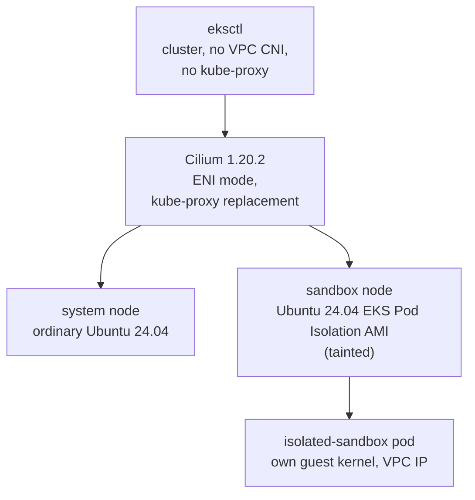

# Cilium CNI on Ubuntu EKS Pod Isolation nodes

**Create a new, dedicated EKS cluster whose only CNI is [Cilium](https://cilium.io), add one
ordinary Ubuntu 24.04 node and one dedicated, tainted Ubuntu 24.04 EKS Pod Isolation sandbox
node, and run an `isolated-sandbox` pod on it.** The Amazon VPC CNI and kube-proxy are never
installed: Cilium gives every pod, the sandbox pod included, a real VPC address, implements
every Service in eBPF, and is proved to enforce the same network policy on the sandbox pod as
on an ordinary pod.

> **Status: complete as authored, unvalidated against a live cluster.** This page covers every
> stage below: the cluster, the Cilium operator's AWS permissions, the Cilium install itself,
> the two Ubuntu node groups, the BTF gate, the isolated-sandbox RuntimeClass, and the sandbox
> pod / Service boundary / policy evidence (`test.sh`, `clean.sh`, `deploy/workloads.yaml`,
> `deploy/policy.yaml`). The pins follow the GA node-build bundle `nitro-sandbox-ga-20261028`.
> What is **not** yet done is the live run: every output block below reads
> `TODO: output from the fresh run`, and the BTF and `socketLB.hostNamespaceOnly` negative
> controls remain to be captured on a real cluster.

!!! danger "Before this sample is merged to `main` or marked available: a gate, not a suggestion"

    This sample is a draft. It waits on a fresh, verified Issue #10 AMI built from the GA
    node-build bundle: its host kernel is now built from public inputs (kernel.org 6.18.56
    plus AWS's public commit amazonlinux/linux 1e66c960), and its runtime archive is an
    operator-supplied input whose SHA-256 is recorded in the Versions table. Every box below
    MUST be ticked, in order, before this page is merged to `main` or its roadmap entry is
    changed to `(available now)`. None of them can be ticked from a static read of the
    manifests; each needs the live run this draft has not done.

    - [ ] **Re-check every version pin on a fresh cluster.** Confirm the Versions table
          against the run: the host kernel (`6.18.56-nitro-ga`) on the sandbox node, the guest
          kernel (`6.18.54`) in the sandbox pod, the runtime archive the #10 AMI was built
          from (its recorded SHA-256), containerd and erofs-utils on that AMI, and Cilium,
          EKS/Kubernetes, Ubuntu, eksctl and Helm together. The runtime archive has no public
          download; it is never committed, embedded or fetched by this sample.
    - [ ] **Consume a fresh, verified Issue #10 AMI.** `SANDBOX_AMI_ID` must be an AMI that
          carries both `ManagedBy=ubuntu-ami-sample` (Issue #10's own ownership tag) and
          `BtfValidated=true`, produced by a fresh Issue #10 build. Never an ordinary Ubuntu
          AMI, never an AMI from before Issue #10's BTF fix, and never a guessed or published
          id.
    - [ ] **Run every live Cilium control on a real cluster.** No VPC CNI and no kube-proxy;
          ENI mode with native routing and kube-proxy replacement; the least-privilege
          operator role through EKS Pod Identity; the BTF gate proven both ways, including the
          captured missing-BTF rejection; `socketLB.hostNamespaceOnly` proven with the setting
          both `true` and `false`, read from `cilium-dbg status --verbose`; the
          isolated-sandbox RuntimeClass and both of its node labels on the sandbox node only;
          the sandbox pod starting with AppArmor `Unconfined`; the sandbox, ordinary and system
          lanes for pod IP, DNS and ClusterIP reachability; L3/L4 allow, deny and the
          unselected control; L7 allow and deny with the deny-row resolved against real
          `cilium-dbg monitor --type l7` output; and FQDN allow, deny and the agent
          fqdn-cache evidence.
    - [ ] **Replace every `TODO: output from the fresh run` block with real captured output.**
          Save each run's output under the repository's `tmp/` and copy the blocks from there;
          never hand-written output.
    - [ ] **Run `clean.sh` and prove full teardown.** `./clean.sh` must remove the cluster,
          its VPC, the Cilium ENIs, the launch templates and the IAM resources, then read back
          that they are gone and exit zero.
    - [ ] **Only then** change this sample's `docs/ROADMAP.md` entry to `(available now)`.



!!! note "Kube-proxy replacement needs a node kernel with BTF"

    Cilium's kube-proxy replacement includes a socket-level load balancer whose eBPF programs
    load against the kernel's BTF type information, so every node kernel must be built with
    `CONFIG_DEBUG_INFO_BTF=y`. The Ubuntu EKS Pod Isolation AMI this sample consumes is the
    output of [#10](https://github.com/aws-samples/sample-eks-nitro-sandbox/issues/10),
    rebuilt with kernel BTF enabled; this sample refuses an AMI that is not tagged as such
    (`setup.sh`'s AMI preflight, stage 0 below) rather than discovering the missing BTF only
    after a node joins. `setup.sh` also gates on both running node kernels showing valid BTF
    (`/sys/kernel/btf/vmlinux`) before treating their Cilium agents as ready (stage 5).

## This sample depends on #10

The sandbox node's AMI is **not** built here. It is the output of
[#10, Build an Ubuntu AMI for EKS Pod Isolation](https://github.com/aws-samples/sample-eks-nitro-sandbox/issues/10),
rebuilt with kernel BTF enabled for Cilium's kube-proxy replacement. This sample never
guesses, publishes or hard-codes that AMI's id: `setup.sh` reads it from your own
`config.local.env` (`SANDBOX_AMI_ID`, gitignored) and verifies its architecture, owner, a
`ManagedBy` tag matching #10's own ownership tag, and a `BtfValidated=true` tag before using
it: see [Stage 0](#0-prerequisites-and-the-ami-preflight). `BtfValidated=true` is #10's
contract: its `btf-tag.sh` only ever writes that tag, alongside `ManagedBy`, to an AMI that
has already passed #10's own fresh-instance BTF verification and that #10's run itself owns;
an AMI that failed verification, or that is not #10's own, never receives it. Checking
`ManagedBy` too (not just the AWS account that owns the AMI resource) matches that contract:
the account-owner check says who can use the AMI, `ManagedBy` says which build produced it.

#10's AMI follows the GA node-build bundle `nitro-sandbox-ga-20261028`, and this sample builds
none of it. The AMI's host kernel is `6.18.56-nitro-ga`: kernel.org Linux 6.18.56 plus AWS's
public commit [amazonlinux/linux 1e66c960](https://github.com/amazonlinux/linux/commit/1e66c960b982c94bda76ebd0129eaecf0a68b46e),
with BTF on. The runtime binaries and the guest image (guest kernel 6.18.54) come in one
archive, `nitro-sandbox-binaries-2026-10-28.zip`, which the operator supplies to #10's build:
it has no public download, and #10's build checks its SHA-256 (in the Versions table below)
before installing anything. This sample never fetches, embeds or commits that archive; it
reaches the sample only inside the AMI. See #10's README for the full dependency chain.

## Run it

You need the Ubuntu Pod Isolation AMI built and BTF-validated by
[#10](https://github.com/aws-samples/sample-eks-nitro-sandbox/issues/10), an AWS account, and
`aws`, `eksctl` 0.230.0 or newer, `helm`, `kubectl`, and `python3` with PyYAML. From
`examples/setup/cilium-ubuntu/`:

```bash
cp config.env.example config.local.env   # then set AWS_ACCOUNT_ID, SANDBOX_AMI_ID and SYSTEM_AMI_ID in it
./setup.sh
```

The script writes its own kubeconfig under the repository's gitignored `tmp/` directory, at
`tmp/issue11/run/kubeconfig` (never beneath this sample folder, and never your default
kubeconfig), so your default kubeconfig and its current context are not touched. `setup.sh`
prints the exact path; to use `kubectl` yourself, point `KUBECONFIG` at it, for example from
the repository root:

```bash
export KUBECONFIG="$(git rev-parse --show-toplevel)/tmp/issue11/run/kubeconfig"
```

Once the cluster is up, prove the sample's claims and then tear it down:

```bash
./test.sh              # apply the workloads and policy, then prove networking, BTF and policy
./clean.sh --dry-run   # list only the run-owned resources a full clean would delete
./clean.sh             # delete the cluster, its VPC, the Cilium ENIs and the IAM resources
```

`test.sh` applies `deploy/workloads.yaml` and `deploy/policy.yaml`, waits for the seven pods
to be Ready, and runs the read-only proofs in [Evidence](#evidence-testsh). See
[What stays running, and cleaning up](#what-stays-running-and-cleaning-up) for what `clean.sh`
removes and the cost this cluster accrues while it exists.

## Versions

Pins from the GA node-build bundle `nitro-sandbox-ga-20261028` and issue #11's validated
Cilium path. `scripts/common.sh` holds the same values, and `test.sh` asserts the two kernel
releases on the live node and pod. **Re-check every pin together on a fresh Ubuntu cluster
before trusting a result; a version string alone is not sufficient evidence that Cilium
health, BTF loading, ENI allocation, Service translation and the policy controls still hold.**

| Component | Pin | Latest checked (2026-10-28) |
|---|---|---|
| [Amazon EKS Kubernetes](https://docs.aws.amazon.com/eks/latest/userguide/kubernetes-versions.html) | 1.36 | 1.36 |
| Ubuntu system and sandbox nodes | Ubuntu 24.04 LTS (Canonical's EKS 1.36 AMI); record the exact point release and the serial you resolved `SYSTEM_AMI_ID` from | 24.04.5 LTS |
| Ubuntu EKS Pod Isolation AMI | Output of [#10](https://github.com/aws-samples/sample-eks-nitro-sandbox/issues/10), built from the GA bundle and BTF-validated (`ManagedBy` and `BtfValidated=true` tags) | Revalidate with a fresh #10 build |
| Host kernel on the sandbox node | `6.18.56-nitro-ga`: kernel.org Linux 6.18.56 plus the public commit [amazonlinux/linux 1e66c960](https://github.com/amazonlinux/linux/commit/1e66c960b982c94bda76ebd0129eaecf0a68b46e), built by #10 (this sample builds no kernel) | 6.18.56 |
| Guest kernel in the sandbox pod | 6.18.54, inside the bundle's guest image `latest.eif` | 6.18.54 |
| EKS Pod Isolation runtime and guest image | `nitro-sandbox-binaries-2026-10-28.zip`, SHA-256 `6830dc8d0acb356b06753fed609ebb9f03a182e340eaa27cd9ed171f7667ba40`: operator-supplied to #10's build, which verifies it; no public download, never committed or embedded | 2026-10-28 |
| containerd on the sandbox AMI | 2.2.1, as Canonical's EKS 1.36 Ubuntu AMI ships it; the runtime supports 2.1, 2.2 and 2.3, and its installer refuses 2.4 or later | 2.2.1 |
| erofs-utils on the sandbox AMI | 1.8.10 with zstd, built by #10 | 1.8.10 |
| [Cilium](https://github.com/cilium/cilium) Helm chart | 1.20.2 | 1.20.2 |
| [eksctl](https://github.com/eksctl-io/eksctl) | 0.230.0 or newer; record the exact release you ran. eksctl takes the list of EKS versions from the EKS API (since [0.202.0](https://github.com/eksctl-io/eksctl/releases/tag/v0.202.0)), so 0.230.0 is the release this path was first validated with, not a 1.36-specific minimum | 0.231.0 |
| [Helm](https://github.com/helm/helm) | Record the exact client release you ran | record on the run |

## The stages

| Stage | What you configure | What you see |
|---|---|---|
| [0. Prerequisites and the AMI preflight](#0-prerequisites-and-the-ami-preflight) | `config.local.env`: account, Region, both AMI ids | The sandbox AMI's architecture, owner and `BtfValidated` tag confirmed before anything is created |
| [1. Create the cluster without the VPC CNI or kube-proxy](#1-create-the-cluster-without-the-vpc-cni-or-kube-proxy) | eksctl `addonsConfig` | No `aws-node` and no `kube-proxy` |
| [2. Give the Cilium operator its own AWS role](#2-give-the-cilium-operator-its-own-aws-role) | One Pod Identity association | Node roles without ENI permissions |
| [3. Install Cilium before any node](#3-install-cilium-before-any-node) | Helm values: ENI mode, kube-proxy replacement, `socketLB.hostNamespaceOnly` | Cilium waiting for nodes |
| [4. Add the two Ubuntu node groups](#4-add-the-two-ubuntu-node-groups) | Two launch templates | Both nodes Ready on Cilium |
| [5. Gate on BTF before either agent counts as ready](#5-gate-on-btf-before-either-agent-counts-as-ready) | A check of the node's own kernel, not of Cilium's status | Both nodes confirmed against `/sys/kernel/btf/vmlinux` |
| [6. Create the isolated-sandbox RuntimeClass](#6-create-the-isolated-sandbox-runtimeclass) | The GA bundle's RuntimeClass, created only when absent | A RuntimeClass whose two labels only the sandbox node carries |
| [7. Tag what AWS created for the cluster](#7-tag-what-aws-created-for-the-cluster) | Nothing: the resources AWS creates with no tag at creation | One line per resource tagged, then the tag audit passing |
| [8. The sandbox pod, Service boundary and policy evidence](#evidence-testsh) | `test.sh`, `deploy/workloads.yaml`, `deploy/policy.yaml` | The seven pods Ready and the networking, BTF and policy proofs (output blocks are `TODO` until a live run) |

### 0. Prerequisites and the AMI preflight

`setup.sh` checks its tools and the caller's AWS account first, then the two AMI ids in
`config.local.env`, **before any billable AWS resource exists**:

- `SANDBOX_AMI_ID`: must be owned by `AWS_ACCOUNT_ID`, `available`, `x86_64`/`hvm`, named like
  an Ubuntu build, and carry both the `ManagedBy` tag [#10](https://github.com/aws-samples/sample-eks-nitro-sandbox/issues/10)'s
  own build writes (`SANDBOX_AMI_MANAGED_BY_VALUE` in `config.local.env`; defaults to
  `ubuntu-ami-sample`, #10's own default) and the `BtfValidated=true` tag #10 only ever writes
  alongside it. A stale id, a mistyped id, an AMI from before #10's BTF fix, or an AMI that
  merely copies the `BtfValidated=true` tag value without #10's own `ManagedBy` tag, is
  refused here, not discovered later as a Cilium agent that never goes ready.
- `SYSTEM_AMI_ID`: a public Ubuntu 24.04 EKS-optimized AMI id you resolved and pinned
  yourself (this sample does not resolve `latest` at runtime, so a re-run always boots the
  AMI you validated against). Canonical publishes each build under a public SSM parameter of
  the form `/aws/service/canonical/ubuntu/eks/24.04/1.36/stable/<serial>/amd64/hvm/ebs-gp3/ami-id`;
  pick a serial, read its id with `aws ssm get-parameter --name <that path>`, and record both.
  Only existence, state and architecture are checked; this sample does not second-guess a
  published Canonical/AWS image.

Neither check ever substitutes a guessed or published id when the one you gave fails: it
stops and tells you what did not match. `setup.sh` also checks `cilium-values.yaml` here
(`check-cilium-values`): kube-proxy replacement on, the socket load balancer in the host
namespace only, ENI IPAM and native routing.

```text
TODO: output from the fresh run
```

### 1. Create the cluster without the VPC CNI or kube-proxy

eksctl creates a new VPC and an EKS 1.36 control plane, dedicated to this sample.
`disableDefaultAddons` stops EKS from installing its default networking add-ons, and the
cluster lists the ones it wants back: CoreDNS, plus the Pod Identity agent for stage 2. The
VPC CNI and kube-proxy are not among them; Cilium does both of their jobs. No node group is
created yet, so the first node that ever joins already has a CNI.

This sample only ever creates its **own** dedicated cluster (tagged
`Demo=setup-cilium-ubuntu`); it never attaches to, modifies the CNI on, or removes
kube-proxy from an existing cluster, because that would be unsafe on a cluster something else
depends on.

From [`eksctl/cluster.yaml`](eksctl/cluster.yaml):

```yaml
addonsConfig:
  disableDefaultAddons: true
addons:
  - name: coredns
  - name: eks-pod-identity-agent
```

What you see: the cluster has no `aws-node` or `kube-proxy` DaemonSet and no `vpc-cni` or
`kube-proxy` add-on, now or later.

```bash
kubectl -n kube-system get daemonset aws-node kube-proxy
```

```text
TODO: output from the fresh run
```

### 2. Give the Cilium operator its own AWS role

In ENI mode the Cilium operator is the one component that calls the EC2 API: it creates
network interfaces for the nodes and assigns their secondary IPs to pods. It gets exactly the
EC2 actions [Cilium's ENI IPAM guidance](https://docs.cilium.io/en/stable/network/concepts/ipam/eni/)
documents, through a dedicated [EKS Pod Identity](https://docs.aws.amazon.com/eks/latest/userguide/pod-identities.html)
association bound to its own service account, not through either node role. eksctl does not
accept a Pod Identity association while it creates a cluster without the VPC CNI, so
`setup.sh` adds it right after the cluster exists, and before Cilium is installed, because EKS
injects the credentials when the operator pod is created.

From [`eksctl/pod-identity.yaml`](eksctl/pod-identity.yaml) (the exact action list; nothing
wider, no wildcard):

```yaml
iam:
  podIdentityAssociations:
    - namespace: kube-system
      serviceAccountName: cilium-operator
      permissionPolicy:
        Statement:
          - Sid: CiliumEniIpamDescribe
            Effect: Allow
            Action:
              - ec2:DescribeNetworkInterfaces
              - ec2:DescribeSubnets
              - ec2:DescribeVpcs
              - ec2:DescribeVpcPeeringConnections
              - ec2:DescribeRouteTables
              - ec2:DescribeSecurityGroups
              - ec2:DescribeInstances
              - ec2:DescribeInstanceTypes
              - ec2:DescribeTags
            Resource: "*"
          - Sid: CiliumEniIpamWrite
            Effect: Allow
            Action:
              - ec2:CreateNetworkInterface
              - ec2:AttachNetworkInterface
              - ec2:DetachNetworkInterface
              - ec2:ModifyNetworkInterfaceAttribute
              - ec2:AssignPrivateIpAddresses
              - ec2:UnassignPrivateIpAddresses
              - ec2:DeleteNetworkInterface
              - ec2:CreateTags
            Resource: "*"
```

**Why a separate Describe and Write statement, and why this set and no other.** The Describe
actions are what the operator reads before it changes anything (existing ENIs, the VPC,
subnets, route tables, security groups, the instance-type limits its IP-per-ENI math depends
on, and existing tags); the Write actions are the lifecycle of an ENI the operator manages
(create, attach, detach when a node leaves, assign/unassign secondary IPs, tag what it
created, delete it when no longer needed). Nothing here can terminate an instance, change a
security group's rules, modify route tables, or touch any resource type besides network
interfaces, tags and the describe-only reads, because the operator's job in ENI mode is
exactly network-interface lifecycle and nothing else. `scripts/cilium_ubuntu.py`'s
`validate_pod_identity_config` enforces this exact action set (no wildcard, no extra action)
every time `setup.sh` renders this file, so a hand-edit that widens it fails before `eksctl`
ever sees it.

The node groups in stage 4 get the usual node policies minus `AmazonEKS_CNI_Policy`, so
nothing on a node, system or sandbox, can create interfaces with the node's own credentials.

What you see: the operator pod carries `AWS_CONTAINER_CREDENTIALS_FULL_URI` (the variable Pod
Identity sets), and neither node role has `AmazonEKS_CNI_Policy` attached.

### 3. Install Cilium before any node

Helm installs Cilium 1.20.2 while the cluster still has no nodes, so the first node that joins
already has a CNI. In ENI mode the operator attaches interfaces to each node and hands their
secondary IPs to pods: every pod IP, on the ordinary Ubuntu node or the Ubuntu sandbox node
alike, is a routable VPC address, with no overlay. Cilium also replaces kube-proxy: its eBPF
programs implement every Service, and no Service rule is ever written to a node's iptables.

From [`cilium-values.yaml`](cilium-values.yaml) (every non-default value carries its own
comment in the file explaining why it is set):

```yaml
eni:
  enabled: true
ipam:
  mode: eni
routingMode: native
kubeProxyReplacement: true
k8sServicePort: 443
socketLB:
  hostNamespaceOnly: true
operator:
  nodeSelector:
    eks.amazonaws.com/nodegroup: system
```

`setup.sh` passes two values on the command line: the cluster name and the API server
endpoint (`k8sServiceHost`). With no kube-proxy, nothing programs the `kubernetes` Service
before Cilium does, so the agents reach the API server at its endpoint directly.

**Why `socketLB.hostNamespaceOnly: true` matters for an EKS Pod Isolation sandbox.** Cilium
translates a Service address in one of two places: in the socket layer, when a process calls
`connect()`, through eBPF hooks in the *node's* kernel; or per packet, at the pod's network
interface. A sandbox pod's processes call `connect()` in their own guest kernel, which the
Ubuntu host's socket hooks never see. With `hostNamespaceOnly: true`, the socket load
balancer serves only the node's own network namespace, and every pod (sandboxed and
ordinary alike) gets the per-packet load balancer instead, which does see the guest's
packets at the pod's interface. Without this setting, a sandbox pod still reaches pod IPs
directly, but neither a ClusterIP Service nor DNS through the `kube-dns` Service answers it:
its packets leave the pod still addressed to the ClusterIP. That is what the GA node-build
bundle measured with Cilium 1.20.2 on Amazon Linux 2023 nodes; on Ubuntu nodes this sample's
run is the first measurement.

Read the mode from a running Cilium agent, not from the `cilium-config` ConfigMap, which says
`bpf-lb-sock: "false"` under both settings. `test.sh` reads each agent's
`cilium-dbg status --verbose` and requires `KubeProxyReplacement: True` and, under
`KubeProxyReplacement Details:`, `Status: True`, `Socket LB: Enabled` and
`Socket LB Coverage: Hostns-only` (`cilium_ubuntu.py kpr-status`; `Full` coverage, a missing
line or ConfigMap text is refused):

```bash
kubectl -n kube-system exec ds/cilium -c cilium-agent -- cilium-dbg status --verbose
```

```text
TODO: output from the fresh run
```

The negative control, the sandbox pod's Service and DNS reachability with
`hostNamespaceOnly: false`, is a separate documented control run: `test.sh` stays read-only
and never flips the live Helm value. Its output goes here:

```text
TODO: output from the fresh run
```

### 4. Add the two Ubuntu node groups

Both node groups are EKS managed node groups created by eksctl, each from a launch template
`setup.sh` creates first, so the templates and everything launched from them carry this
sample's tags from the start.

- **`system`**: the ordinary Ubuntu 24.04 node (`SYSTEM_AMI_ID`, `SYSTEM_INSTANCE_TYPE`,
  default `m7i.large`). CoreDNS, the Cilium operator and the ordinary comparison workloads
  run here. It carries neither of the RuntimeClass labels below, so no sandbox pod is ever
  scheduled on it.
- **`sandbox`**: the dedicated, tainted Ubuntu 24.04 EKS Pod Isolation node
  (`SANDBOX_AMI_ID`, `SANDBOX_INSTANCE_TYPE`, default `m8i.xlarge`), with Nitro Enclaves
  enabled on its launch template, which is how each sandbox pod gets its own microVM. So
  `SANDBOX_INSTANCE_TYPE` must be a type that supports Nitro Enclaves: if `m8i.xlarge` has
  no capacity, use another enclave-capable type such as `m8i.2xlarge` or `m7i.xlarge`, not a
  `.large` size (`m8i.large` and `m7i.large` do not support Nitro Enclaves). The ordinary
  system node has no such constraint. #10's AMI already holds the runtime, the guest image,
  and Canonical's `bootstrap.sh` pointed at the sandbox CRI proxy. A taint keeps every
  ordinary pod off this node; only a pod that tolerates
  `sandbox.eks-nitro-sandbox.amazonaws.com/dedicated=true:NoSchedule` schedules here.

**How each node joins, and with which labels.** Both launch templates name an AMI, and
Amazon EKS adds no user data to a launch template that names one (Amazon EKS User Guide,
*Customize managed nodes with launch templates*), so each template carries its own: one
`/etc/eks/bootstrap.sh` line, as the GA node-build bundle's Ubuntu guide has it, with the
new cluster's API endpoint, CA and DNS address and the node's labels in
`--kubelet-extra-args '--node-labels=...'`. The labels come from `eksctl/nodegroups.yaml`
itself, so eksctl and kubelet agree on every label the node group lists. The sandbox node
carries the two labels the `isolated-sandbox` RuntimeClass (stage 6) schedules on,
`eks.amazonaws.com/nitro-sandbox=true` and `sandbox.preview/nitro=true`; a node without both
runs no sandbox pod. Only the second is a node group label: the EKS node group API refuses a
label key that contains
`eks.amazonaws.com/` (as it does `kubernetes.io/` and `k8s.io/`), so kubelet sets
`eks.amazonaws.com/nitro-sandbox=true` and `eks.amazonaws.com/nodegroup=<name>` on its own
node from the user data, as the GA bundle's guide does. Before it creates a node group,
`setup.sh` reads each rendered template back and requires its user data to be, byte for byte,
the script it renders for the cluster (`check-user-data`), naming any difference in the
cluster name, endpoint, CA, DNS address, labels or extra lines; and `render-nodegroups`
refuses a sandbox group missing `sandbox.preview/nitro`, a system group carrying either
RuntimeClass label, and any node group label with one of those three prefixes.

From [`eksctl/nodegroups.yaml`](eksctl/nodegroups.yaml):

```yaml
  - name: sandbox
    launchTemplate:
      id: ${SANDBOX_LAUNCH_TEMPLATE_ID}   # created by setup.sh
      version: "1"
    labels:
      sandbox.eks-nitro-sandbox.amazonaws.com/dedicated: "true"
      sandbox.preview/nitro: "true"   # eks.amazonaws.com/nitro-sandbox comes from kubelet
    taints:
      - key: sandbox.eks-nitro-sandbox.amazonaws.com/dedicated
        value: "true"
        effect: NoSchedule
```

What you see: both nodes `Ready` with their labels, and a Cilium agent running on each,
including the tainted sandbox node.

```bash
kubectl get nodes -L eks.amazonaws.com/nodegroup,eks.amazonaws.com/nitro-sandbox,sandbox.preview/nitro
kubectl -n kube-system get pods -l k8s-app=cilium -o wide
```

```text
TODO: output from the fresh run
```

Before the sandbox node group is created, `setup.sh` also checks that the Cilium agent
DaemonSet's own selector and tolerations would actually schedule onto a node carrying this
taint and these labels (`scripts/cilium_ubuntu.py check-sandbox-ami`'s sibling,
`preflight-daemonset`), and prints `cilium DaemonSet tolerates the sandbox node's taint and
selects its labels`, so a Helm-values regression that narrowed the agent's tolerations is
caught before a node is created from a launch template that bills.

### 5. Gate on BTF before either agent counts as ready

Both Ubuntu node kernels must expose valid BTF (`/sys/kernel/btf/vmlinux`, non-empty) before
`setup.sh` calls their Cilium agents ready. **The gate checks the node's BTF, not Cilium's
status**, because Cilium's status does not show it: on a node whose kernel has no BTF, the GA
node-build bundle reports that the Cilium agent still reads Ready, `cilium-dbg status --brief`
says `OK` and kube-proxy replacement reads `True`, yet its datapath never loads. Its log
repeats `Failed to initialize datapath` with `no BTF found`, and pods there that need a pod
address, sandbox and ordinary alike, stay `ContainerCreating` with
`cilium-cni ... unable to create endpoint: Cilium API client timeout exceeded`.

So `check-btf` runs the bundle's own test in the Cilium agent pod on each node. The agent
container shares its node's kernel, so this reads the node's running kernel, not a kernel
config file and not the `cilium-config` ConfigMap. Anything but exactly `PRESENT` is refused.

```bash
kubectl -n kube-system exec ds/cilium -c cilium-agent -- sh -c 'test -s /sys/kernel/btf/vmlinux && echo PRESENT || echo MISSING'
```

```text
TODO: output from the fresh run
```

`test.sh` then reads each agent's own log for those two failure strings
(`cilium_ubuntu.py datapath-failures`). It reads both formats the agent logs in, its
`time=... level=...` text and JSON, with one rule: a warn-or-worse line whose message starts
with `Failed to initialize datapath` or that carries `no BTF found` is a failure, and an info
line that only quotes them is not. A line in neither format that carries either string cannot
be judged, so the check reports that it checked nothing instead of passing; a log with no line
in either format is refused the same way.

**The missing-BTF rejection.** Issue #11 asks for a failing control or a captured preflight
failure that shows a missing-BTF kernel rejected before the node is accepted. Unless a real
node without BTF is cheaply available, the fresh run captures it as a **stub-driven** run of
the real `cilium_ubuntu.py check-btf` command: a stub `kubectl` first on `PATH` answers the
agent-pod lookup and returns `MISSING` for the BTF read, so the gate under test is the shipped
one and only the node is simulated. The block below will say which of the two it is.

```text
TODO: output from the fresh run
```

### 6. Create the isolated-sandbox RuntimeClass

A pod selects `runtimeClassName: isolated-sandbox`, which must exist as a Kubernetes
RuntimeClass whose scheduling labels match the sandbox node's. The GA node-build bundle's
Ubuntu guide has the cluster's operator apply it once per cluster; this cluster is new, so
`setup.sh` creates it, only when it is absent. A RuntimeClass is cluster-scoped, so the
namespace's label does not mark it as the sample's: it carries the same
`app.kubernetes.io/part-of: setup-cilium-ubuntu` label itself, and that label is the only
thing it adds to the bundle's object. `setup.sh` then requires that whatever is there carries
the label and is otherwise exactly the bundle's (`check-runtimeclass`): the same handler, the
same per-pod overhead, a nodeSelector on exactly the two labels only the sandbox node carries,
and no tolerations or other fields; it stops, changing nothing, on an unmarked or different
object. It also confirms the sandbox node carries both labels and the system node neither
(`check-node-labels`).

```yaml
apiVersion: node.k8s.io/v1
kind: RuntimeClass
metadata:
  name: isolated-sandbox
  labels:
    app.kubernetes.io/part-of: setup-cilium-ubuntu   # the sample's mark; not in the bundle
handler: isolated-sandbox
overhead:
  podFixed:
    eks.amazonaws.com/nitro-sandbox: "1"
    memory: 256Mi
scheduling:
  nodeSelector:
    eks.amazonaws.com/nitro-sandbox: "true"
    sandbox.preview/nitro: "true"
```

```bash
kubectl get runtimeclass isolated-sandbox -o yaml
```

```text
TODO: output from the fresh run
```

**AppArmor on the sandbox pod.** On an Ubuntu node, every `isolated-sandbox` pod sets
`securityContext.appArmorProfile.type: Unconfined`, and `deploy/workloads.yaml` sets it on the
`nitro` pod and on no other. The Ubuntu node kernel keeps AppArmor on, so without the setting
kubelet asks for the `RuntimeDefault` profile, the runtime passes that request into the pod's
guest microVM, and the pod fails to start with `apparmor failed to apply profile`. This is a
requirement of the platform on an Ubuntu host, not a weakening of the pod's isolation: the
profile request is handled by runc inside the guest, so `Unconfined` changes nothing on the
host, and the microVM, with its own guest kernel, stays that pod's boundary. The ordinary pods
run directly on the node's kernel, so they keep their default profile, and
`cilium_ubuntu.py check-workloads` refuses `Unconfined` on any of them. On the sandbox pod it
accepts the pod-level field only, and refuses a container, init container, ephemeral container
or legacy annotation setting AppArmor beside it. `test.sh` runs the same check on the pods the
API server returns. That strict rule relies on Kubernetes 1.34 or later, which this sample's
EKS 1.36 is: from 1.34 the API server no longer copies the pod-level field into the legacy
per-container annotation. The GA bundle lists this as an open item it tracks with the service
team, and Amazon Linux 2023 hosts, which have no AppArmor, need no such setting.

```yaml
spec:
  runtimeClassName: isolated-sandbox
  securityContext:
    appArmorProfile:
      type: Unconfined
```

### 7. Tag what AWS created for the cluster

Everything this run creates by name carries the sample's tags from the start (see
[What stays running, and cleaning up](#what-stays-running-and-cleaning-up)). AWS also creates
some resources for the cluster, its VPC and its node groups that have no way to be tagged at
creation. `setup.sh`'s last step (`cilium_ubuntu.py tag-sweep`) tags exactly these, each found
through one exact relation from a resource that carries `Demo=setup-cilium-ubuntu`:

- the Amazon EC2 Auto Scaling group each of the two node groups names (EKS does not copy the
  node group's tags to it);
- the copy EKS makes of each node launch template: the one that Auto Scaling group launches
  from;
- the instance profile each node instance uses, and no other profile that holds its role;
- the cluster security group, by the id `describe-cluster` returns (EKS gives it only its own
  `kubernetes.io/cluster/...`, `aws:eks:cluster-name` and `Name` tags);
- the VPC's main route table, its default security group and its default network ACL;
- the control plane's network interfaces (described `Amazon EKS <cluster name>`, in the cluster
  security group) and the network interface the NAT gateway reports as its own.

They are this cluster's: each exists because of this run and goes when `clean.sh` deletes the
node groups and the cluster. Issue #11 asks for ownership tags that cover the node groups and
the interfaces, and `test.sh` stage 8 checks every one, so the sweep gives each of them that
lacks `auto-delete=no` the same tags as the rest: `auto-delete=no`, `Demo=setup-cilium-ubuntu`,
and `Owner` when `OWNER_TAG` is set. It writes to nothing else: no subnet, instance, volume,
role, stack, other network interface or other instance profile, even one in the VPC without
the tag. The caller needs `ec2:CreateTags`, `autoscaling:CreateOrUpdateTags` and
`iam:TagInstanceProfile`.

Before its first write, the sweep stops and tags nothing when:

- the cluster or its VPC does not carry `Demo=setup-cilium-ubuntu` (exit 1);
- the read came up short (exit 2). It must find every kind the audit counts and every member of
  the list above at least as often as a fresh run leaves it. The cluster's eksctl stacks count
  only when they carry eksctl's `alpha.eksctl.io/cluster-name` tag with this cluster's exact
  name and the sample's `Demo` tag. An empty list from AWS is a short read, never "nothing to
  tag";
- a member of the list above carries another `Demo` value (exit 1), which the sweep never
  overwrites.

Then `setup.sh` runs the same tag audit as `test.sh` stage 8 and stops unless every resource the
cluster owns carries `auto-delete=no`. The audit covers more than the sweep writes: every object
in the cluster's VPC, the sweep's or not, because the VPC is this run's and goes with it. An
object there that lacks the tag and that the sweep may not write is reported with the reason,
for example `(Demo=another-demo; not in the set tag-sweep writes, ...)`, and `setup.sh` stops.
Running `setup.sh` again repeats the sweep, which tags only what is still untagged.

What you see: one `tagged <kind> <id>` line for each resource the sweep tagged, its count, and
the audit's summary.

```text
TODO: output from the fresh run
```

## Evidence (`./test.sh`)

`test.sh` is read-only against the cluster's configuration: it applies the sample's own
workloads (`deploy/workloads.yaml`) and the egress network policy (`deploy/policy.yaml`),
waits for the seven pods to be Ready, and then proves each claim by reading the **running
Cilium agents** rather than the Helm values or the `cilium-config` ConfigMap. It compares the
Nitro sandbox pod (`nitro`, `runtimeClassName: isolated-sandbox`, on the Ubuntu sandbox node)
against an ordinary pod on the same sandbox node (`neighbor`) and an ordinary pod on the
system node (`control`), so every result is shown for the sandbox lane beside the two ordinary
lanes.

What it checks, in order:

1. **No VPC CNI, no kube-proxy, Cilium up on both Ubuntu nodes.** `aws-node` and `kube-proxy`
   DaemonSets are absent; the EKS add-on list has no `vpc-cni`/`kube-proxy`; both agents report
   `cilium-dbg status --brief` OK, `KubeProxyReplacement: True` with the socket load balancer
   **host-namespace-only** (read from the agent, since the ConfigMap cannot tell host-only from
   full), no `KUBE-` chain in either node's iptables, and a fully loaded eBPF datapath (which a
   missing-BTF kernel would prevent).
2. **The operator's credentials.** The operator pod gets its AWS credentials from EKS Pod
   Identity, its role allows exactly Cilium's documented ENI actions, and neither node role
   carries `AmazonEKS_CNI_Policy`.
3. **The sandbox pod has its own guest.** The `isolated-sandbox` RuntimeClass carries the
   sample's mark and otherwise matches the GA bundle's, the sandbox node carries both of its
   labels and the system node neither, and of the pods the API server returns, the sandbox pod
   alone runs with AppArmor `Unconfined`. The sandbox node runs the pinned host
   kernel `6.18.56-nitro-ga` and the sandbox pod the pinned guest kernel `6.18.54`. Its guest
   kernel differs from the node kernel, it sees virtio disks (no node `nvme`), and its boot
   uptime is its own, while `neighbor`, an ordinary pod on the same node, shares the node
   kernel and sees the node's `nvme`. The
   sandbox node itself advertises a positive allocatable `eks.amazonaws.com/nitro-sandbox`
   quantity (the same key and both-ways accept/reject proof as
   [#10](https://github.com/aws-samples/sample-eks-nitro-sandbox/issues/10)'s own `test.sh`),
   evidence the device plugin that key names is actually running on this build's node, not
   only that the `isolated-sandbox` RuntimeClass object exists.
4. **Normal pod networking across the guest boundary.** The sandbox pod gets a VPC address on
   a secondary ENI of its own instance with a ready `CiliumEndpoint`, reaches and is reached by
   ordinary pods, and resolves and reaches the ClusterIP Service by DNS, the same as the two
   ordinary lanes, and the node itself (host-network `node-probe`) reaches the Service through
   the socket load balancer.
5. **L3/L4 policy, both ways.** Each client is ALLOWED to `server:8080` and DENIED to
   `other:8080` (dropped). The unselected `server` pod still reaches `other`, proving the deny
   is the policy, not an unavailable destination.
6. **L7 HTTP policy, both ways.** Each client may `GET /` on `api:8080` (proxy verdict
   `Forwarded`, 200) but not `GET /admin` (proxy verdict `Denied`, 403). The verdict is read
   from the node-local Envoy proxy's own `cilium-dbg monitor --type l7` output, so an
   app-issued 403 cannot be mistaken for a policy deny.
7. **FQDN policy, both ways.** Each client may reach `checkip.amazonaws.com` (recorded as a
   `lookup` in the agent's FQDN cache) but not `example.net`, which is dropped while it still
   resolves, and the unselected `server` pod still reaches it, so the deny is the policy, not
   the network.
8. **Ownership tags.** Every ENI in the VPC and every resource the cluster owns carries
   `auto-delete=no` (the ones AWS creates untagged got it in
   [stage 7](#7-tag-what-aws-created-for-the-cluster); `test.sh` only reads), and no tracked
   file holds an account id, AMI id or other account-specific value.

```bash
./test.sh
```

```text
TODO: output from the fresh run
```

The both-ways negative controls for the L7 and FQDN denies prove the drop is each rule and
not an unrelated timeout: an unselected control pod reaches the denied destination, and the
denied name still resolves. The `socketLB.hostNamespaceOnly` negative control (a sandbox pod
cannot reach a ClusterIP Service or Service-based DNS with the setting off) is the documented
control run in [stage 3](#3-install-cilium-before-any-node); `test.sh` stays read-only and
does not flip the live Helm value.

## What stays running, and cleaning up

Every AWS resource `setup.sh` creates carries `auto-delete=no` and `Demo=setup-cilium-ubuntu`:
eksctl's CloudFormation stacks tag the VPC, subnets, gateways, security groups and IAM roles;
the two launch templates tag the instances, volumes and network interfaces; Cilium tags the
ENIs it creates (`cilium-values.yaml`'s `eni.eniTags`). The resources AWS creates for the
cluster with no tag at creation (the node groups' Auto Scaling groups, EKS's launch template
copies, the instance profiles the nodes use, the VPC's main route table, default security group
and default network ACL, the cluster security group, and the control plane's and NAT gateway's
interfaces) get the same tags in [stage 7](#7-tag-what-aws-created-for-the-cluster).

While it is up, this sample keeps billing: the EKS control plane, one `m7i.large` and one
`m8i.xlarge` instance with their gp3 volumes, one NAT gateway and its Elastic IP. Use the
[AWS Pricing Calculator](https://calculator.aws/) for an estimate; the fresh run will add a
measured duration and cost here.

Run `./clean.sh` when you finish. `./clean.sh --dry-run` lists only the run-owned resources it
would delete and changes nothing; `./clean.sh` deletes the two node groups, the ENIs Cilium
created that their instances left behind, the cluster with everything in its eksctl stacks
(VPC, subnets, gateways, security groups, IAM roles), and the two node launch templates, then
reads back that the cluster, the launch templates and the eksctl stacks are gone (the stacks
eksctl tagged with this cluster's exact name, so another cluster's stacks, such as one named
`<cluster name>-2`, never count). It refuses a cluster not tagged `Demo=setup-cilium-ubuntu`,
deletes ENIs and launch templates only when they carry that tag, and exits non-zero if
anything it was asked to delete is still there: a
lookup that fails is recorded as a failure, never read as "gone". Deleting the cluster removes
the sample's namespace, its pods and the `isolated-sandbox` RuntimeClass with it.

```bash
./clean.sh --dry-run
```

```text
TODO: output from the fresh run
```

```bash
./clean.sh
```

```text
TODO: output from the fresh run
```

??? note "Files"

    | File | Role |
    |---|---|
    | [`config.env.example`](config.env.example) | Settings, placeholders only; copy to `config.local.env` |
    | [`eksctl/cluster.yaml`](eksctl/cluster.yaml) | Stage 1: the cluster and its add-ons |
    | [`eksctl/pod-identity.yaml`](eksctl/pod-identity.yaml) | Stage 2: the operator's role |
    | [`cilium-values.yaml`](cilium-values.yaml) | Stage 3: Cilium's Helm values |
    | [`eksctl/nodegroups.yaml`](eksctl/nodegroups.yaml) | Stage 4: the node groups |
    | [`setup.sh`](setup.sh) | Stages 0 through 7: create, render, gate, RuntimeClass, tag sweep |
    | [`scripts/common.sh`](scripts/common.sh) | Shared config loading, version pins and helpers |
    | [`scripts/cilium_ubuntu.py`](scripts/cilium_ubuntu.py) | Rendering, AMI preflight, launch templates and their bootstrap user data, the DaemonSet, BTF, RuntimeClass, node-label, AppArmor and Helm-values checks, the tag sweep and audit, and the agent-output proofs `test.sh` / `clean.sh` read |
    | [`deploy/workloads.yaml`](deploy/workloads.yaml) | The sandbox pod (AppArmor `Unconfined`), the comparison pods, and the `server` ClusterIP Service |
    | [`deploy/policy.yaml`](deploy/policy.yaml) | The egress `CiliumNetworkPolicy`: L3/L4, L7 HTTP and FQDN rules |
    | [`test.sh`](test.sh) | Apply the workloads and policy, then prove networking, BTF and policy (see [Evidence](#evidence-testsh)) |
    | [`clean.sh`](clean.sh) | Dry-run and full teardown of the cluster, ENIs, launch templates and IAM |
