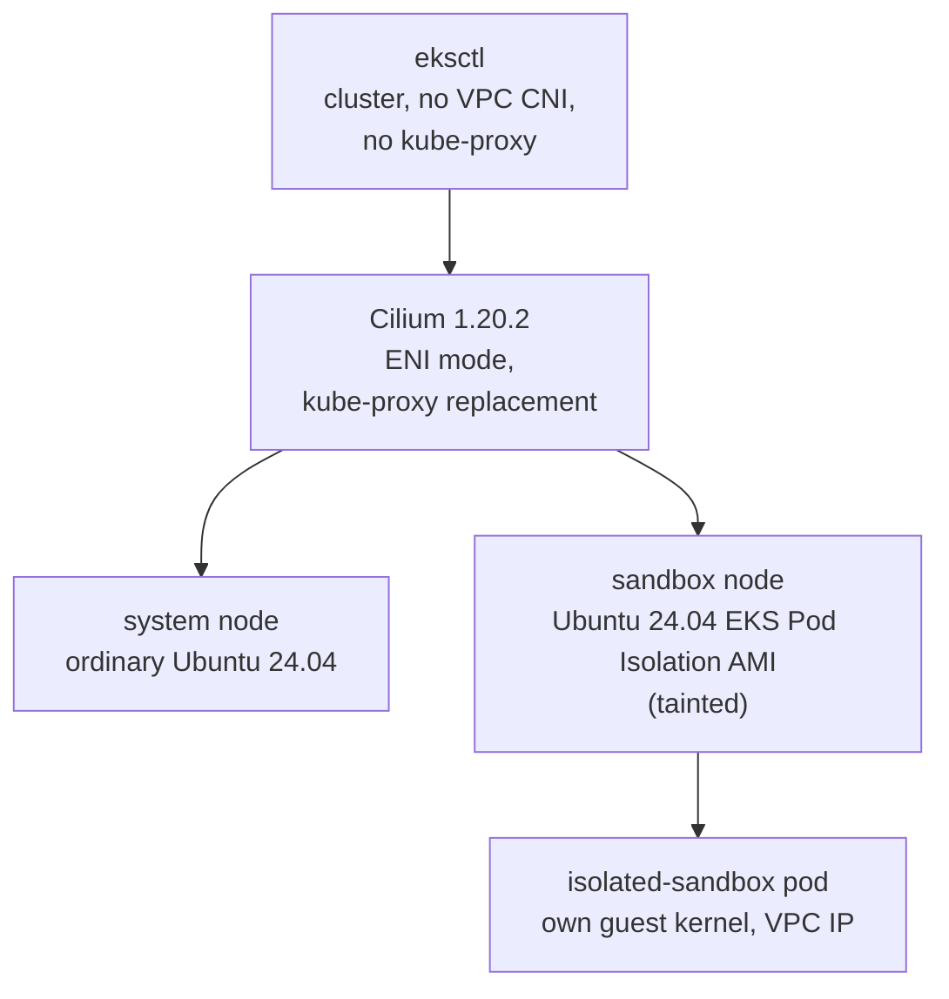

# Cilium CNI on Ubuntu EKS Pod Isolation nodes

**Create a new, dedicated EKS cluster whose only CNI is [Cilium](https://cilium.io), add one
ordinary Ubuntu 24.04 node and one dedicated, tainted Ubuntu 24.04 EKS Pod Isolation sandbox
node, and run an `isolated-sandbox` pod on it.** The Amazon VPC CNI and kube-proxy are never
installed: Cilium gives every pod, the sandbox pod included, a real VPC address, implements
every Service in eBPF, and is proved to enforce the same network policy on the sandbox pod as
on an ordinary pod.

> **Status: setup, evidence and clean-up run live.** This page covers every stage below: the
> cluster, the Cilium operator's AWS permissions, the Cilium install itself, the two Ubuntu node
> groups, the BTF gate, the isolated-sandbox RuntimeClass, and the sandbox pod / Service
> boundary / policy evidence (`test.sh`, `clean.sh`, `deploy/workloads.yaml`,
> `deploy/policy.yaml`). The pins follow the public Nitro Sandbox releases listed under
> [Versions](#versions). Every output block on this page comes from one fresh run that
> followed this page from a clean checkout, on a new cluster and a sandbox AMI built from those
> releases (see [Where the output blocks come from](#where-the-output-blocks-come-from)).



!!! note "Kube-proxy replacement needs a node kernel with BTF"

    Cilium's kube-proxy replacement includes a socket-level load balancer whose eBPF programs
    load against the kernel's BTF type information, so every node kernel must be built with
    `CONFIG_DEBUG_INFO_BTF=y`. The Ubuntu EKS Pod Isolation AMI this blueprint consumes is the
    output of [#10](https://github.com/aws-samples/sample-eks-nitro-sandbox/issues/10),
    rebuilt with kernel BTF enabled; this blueprint refuses an AMI that is not tagged as such
    (`setup.sh`'s AMI preflight, stage 0 below) rather than discovering the missing BTF only
    after a node joins. `setup.sh` also gates on both running node kernels showing valid BTF
    (`/sys/kernel/btf/vmlinux`) before treating their Cilium agents as ready (stage 5).

## This blueprint depends on #10

The sandbox node's AMI is **not** built here. It is the output of
[#10, Build an Ubuntu AMI for EKS Pod Isolation](https://github.com/aws-samples/sample-eks-nitro-sandbox/issues/10),
rebuilt with kernel BTF enabled for Cilium's kube-proxy replacement. This blueprint never
guesses, publishes or hard-codes that AMI's id: `setup.sh` reads it from your own
`config.local.env` (`SANDBOX_AMI_ID`, gitignored) and verifies its architecture, owner, a
`ManagedBy` tag matching #10's own ownership tag, and a `BtfValidated=true` tag before using
it: see [Stage 0](#0-prerequisites-and-the-ami-preflight). `BtfValidated=true` is #10's
contract: its `btf-tag.sh` only ever writes that tag, alongside `ManagedBy`, to an AMI that
has already passed #10's own fresh-instance BTF verification and that #10's run itself owns;
an AMI that failed verification, or that is not #10's own, never receives it. Checking
`ManagedBy` too (not just the AWS account that owns the AMI resource) matches that contract:
the account-owner check says who can use the AMI, `ManagedBy` says which build produced it.

#10's build from the public releases ([#218](https://github.com/aws-samples/sample-eks-nitro-sandbox/issues/218))
also tags the AMI with the releases it was built from: `RuntimeRelease`, `GuestImageRelease`,
`FirecrackerVersion`, `HostKernelPatch` and `GuestKernelRelease`. The preflight requires each
one to equal its pin in `scripts/common.sh` exactly (the [Versions](#versions) table gives the
values). An AMI that #10 built from the earlier preview runtime archive carries `ManagedBy` and
`BtfValidated=true` but none of these tags, so it is refused.

#10's AMI is built from the public Nitro Sandbox releases that the Amazon EKS User Guide page
[Create and update a Nitro Sandbox AMI](https://docs.aws.amazon.com/eks/latest/userguide/sandboxing-ami-create-update.html)
names, and this blueprint builds none of them. The AMI's host kernel is `6.18.56-nitro-ga`:
kernel.org Linux 6.18.56 plus the patch at AWS's public commit
[amazonlinux/linux 4ae89f6e](https://github.com/amazonlinux/linux/commit/4ae89f6e09f949848123407602b4e5a8bb8d8631),
with BTF on. The node also carries the shim from the signed Nitro Sandboxes runtime release
`0.1.4274.0`, Firecracker and jailer `v1.18.0`, and the guest image pair AWS publishes in
Amazon S3 as release `1.36.5/2026-11-06` (an EIF holding the guest kernel and agent, and its
guest disk image). The Versions table below gives each pin, and #10's README says how its build
downloads and verifies them. This blueprint never fetches, embeds or commits any of them; they
reach the blueprint only inside the AMI. See #10's README for the full dependency chain.

## Run it

You need the Ubuntu Pod Isolation AMI built and BTF-validated by
[#10](https://github.com/aws-samples/sample-eks-nitro-sandbox/issues/10), an AWS account, and
`aws`, `eksctl` 0.230.0 or newer, `helm`, `kubectl`, and `python3` with PyYAML. From
`examples/setup/cilium-ubuntu/`:

```bash
cp config.env.example config.local.env   # then set AWS_ACCOUNT_ID, SANDBOX_AMI_ID and SYSTEM_AMI_ID in it
./setup.sh
```

The script writes its own kubeconfig under the repository's gitignored `tmp/` directory, at
`tmp/issue11/run/kubeconfig` (never beneath this blueprint folder, and never your default
kubeconfig), so your default kubeconfig and its current context are not touched. `setup.sh`
prints the exact path; to use `kubectl` yourself, point `KUBECONFIG` at it, for example from
the repository root:

```bash
export KUBECONFIG="$(git rev-parse --show-toplevel)/tmp/issue11/run/kubeconfig"
```

Once the cluster is up, prove the blueprint's claims and then tear it down:

```bash
./test.sh              # apply the workloads and policy, then prove networking, BTF and policy
./clean.sh --dry-run   # list only the run-owned resources a full clean would delete
./clean.sh             # delete the cluster, its VPC, the Cilium ENIs and the IAM resources
```

`test.sh` applies `deploy/workloads.yaml` and `deploy/policy.yaml`, waits for the seven pods
to be Ready, and runs the read-only proofs in [Evidence](#evidence-testsh). See
[What stays running, and cleaning up](#what-stays-running-and-cleaning-up) for what `clean.sh`
removes and the cost this cluster accrues while it exists.

## Versions

Pins from the public Nitro Sandbox releases that the Amazon EKS User Guide pages
[Create and update a Nitro Sandbox AMI](https://docs.aws.amazon.com/eks/latest/userguide/sandboxing-ami-create-update.html)
and [Download and verify the runtime binaries](https://docs.aws.amazon.com/eks/latest/userguide/sandboxing-download-binaries.html)
name, and from issue #11's validated Cilium path. `scripts/common.sh` holds the same values,
and `test.sh` asserts the two kernel releases on the live node and pod. **Re-check every pin
together on a fresh Ubuntu cluster before trusting a result; a version string alone is not
sufficient evidence that Cilium health, BTF loading, ENI allocation, Service translation and
the policy controls still hold.**

| Component | Pin | Latest checked (on 2026-10-28 unless the row gives a date) |
|---|---|---|
| [Amazon EKS Kubernetes](https://docs.aws.amazon.com/eks/latest/userguide/kubernetes-versions.html) | 1.36 | 1.36 |
| Ubuntu system and sandbox nodes | Ubuntu 24.04 LTS (Canonical's EKS 1.36 AMI). The fresh run's `SYSTEM_AMI_ID` was Canonical's serial `20261027`, and #10's build of its sandbox AMI ran on 24.04.5 LTS | 24.04.5 LTS |
| Ubuntu EKS Pod Isolation AMI | Output of [#10](https://github.com/aws-samples/sample-eks-nitro-sandbox/issues/10), built from the public releases in this table and BTF-validated (`ManagedBy` and `BtfValidated=true` tags, and the five release tags [stage 0](#0-prerequisites-and-the-ami-preflight) checks) | Built from these releases and run on 2026-11-13 |
| Host kernel on the sandbox node | `6.18.56-nitro-ga`: kernel.org Linux 6.18.56 plus the patch at the public commit [amazonlinux/linux 4ae89f6e](https://github.com/amazonlinux/linux/commit/4ae89f6e09f949848123407602b4e5a8bb8d8631), whose `.patch` file (494,711 bytes) has SHA-256 `5f9c52ae83e20403846e7c10aed6ed6fcabbd4069b76f50b1a2a42577b95f1a0`, built by #10 (this blueprint builds no kernel) | 6.18.56 |
| Guest kernel in the sandbox pod | 6.18.56, inside the guest image's `nitro-sandbox-guest.eif`; the fresh run's sandbox pod showed `6.18.56` with `uname -r` | 6.18.56 (2026-11-13) |
| Nitro Sandboxes runtime release | `0.1.4274.0`, signed by AWS; its x86_64 `nitro-sandboxes-runtime.tar.gz` has SHA-256 `abc1d0032014f763715c2829ef1a104d768c3e0a76fa91cd2668d87678db3c57` in the release's signed `SHA256SUM`. The node runs its shim, `containerd-shim-nitro-sandbox-v2` | 0.1.4274.0 (2026-11-13) |
| Guest image | Release `1.36.5/2026-11-06`, amd64, in Amazon S3: `nitro-sandbox-guest.eif` SHA-256 `bcbf2e9da531ffaee6691db5661c75b3564f151cb411227c5a7f9a530db72182` and `nitro-sandbox-guest-disk.img` SHA-256 `08f8e6d2d032829bff9c4c4907cd44242f46bcf6b1bbc2e6aea691c82bee902c`, as each file's `.sha256` file gives them | 1.36.5/2026-11-06 (2026-11-13) |
| [Firecracker](https://github.com/firecracker-microvm/firecracker) and jailer | [v1.18.0](https://github.com/firecracker-microvm/firecracker/releases/tag/v1.18.0); `firecracker-v1.18.0-x86_64.tgz` SHA-256 `1ac8eec866dd5eea14efecf6323e22b23eea24054545338a5b34bc5bca6623cd`, as the release's `.sha256.txt` file gives it | v1.18.0 (2026-11-13) |
| containerd on the sandbox AMI | 2.2.1, as Canonical's EKS 1.36 Ubuntu AMI ships it; the Amazon EKS User Guide asks for 2.0 or later, and #10's build accepts 2.1, 2.2 and 2.3, the range it was proved on | 2.2.1 |
| erofs-utils on the sandbox AMI | 1.8.10 with zstd, built by #10 | 1.8.10 |
| [Cilium](https://github.com/cilium/cilium) Helm chart | 1.20.2 | 1.20.2 |
| [eksctl](https://github.com/eksctl-io/eksctl) | 0.230.0 or newer; the fresh run used 0.230.0. eksctl takes the list of EKS versions from the EKS API (since [0.202.0](https://github.com/eksctl-io/eksctl/releases/tag/v0.202.0)), so 0.230.0 is the release this path was first validated with, not a 1.36-specific minimum | 0.231.0 |
| [Helm](https://github.com/helm/helm) | The fresh run used the Helm client v3.19.0 | not checked |

Where those run values come from:

- **From the fresh run's own output:** the system AMI's serial (the AMI name `setup.sh` prints
  in step 1/8, in the stage 0 block below) and eksctl's release (eksctl's first line in step
  2/8).
- **From the tool on the run's host:** the Helm client release, read with `helm version` before
  the run. The run's own output does not print it.
- **From #10's build of the sandbox AMI:** the Ubuntu point release its build host reported.

## The stages

| Stage | What you configure | What you see |
|---|---|---|
| [0. Prerequisites and the AMI preflight](#0-prerequisites-and-the-ami-preflight) | `config.local.env`: account, Region, both AMI ids | The sandbox AMI's architecture, owner, `BtfValidated` tag and release tags confirmed before anything is created |
| [1. Create the cluster without the VPC CNI or kube-proxy](#1-create-the-cluster-without-the-vpc-cni-or-kube-proxy) | eksctl `addonsConfig` | No `aws-node` and no `kube-proxy` |
| [2. Give the Cilium operator its own AWS role](#2-give-the-cilium-operator-its-own-aws-role) | One Pod Identity association | Node roles without ENI permissions |
| [3. Install Cilium before any node](#3-install-cilium-before-any-node) | Helm values: ENI mode, kube-proxy replacement, `socketLB.hostNamespaceOnly` | Cilium waiting for nodes |
| [4. Add the two Ubuntu node groups](#4-add-the-two-ubuntu-node-groups) | Two launch templates | Both nodes Ready on Cilium |
| [5. Gate on BTF before either agent counts as ready](#5-gate-on-btf-before-either-agent-counts-as-ready) | A check of the node's own kernel, not of Cilium's status | Both nodes confirmed against `/sys/kernel/btf/vmlinux` |
| [6. Create the isolated-sandbox RuntimeClass](#6-create-the-isolated-sandbox-runtimeclass) | The GA bundle's RuntimeClass, created only when absent | A RuntimeClass whose two labels only the sandbox node carries |
| [7. Tag what AWS created for the cluster](#7-tag-what-aws-created-for-the-cluster) | Nothing: the resources AWS creates with no tag at creation | One line per resource tagged, then the tag audit passing |
| [8. The sandbox pod, Service boundary and policy evidence](#evidence-testsh) | `test.sh`, `deploy/workloads.yaml`, `deploy/policy.yaml` | The seven pods Ready and the networking, BTF and policy proofs |

### Where the output blocks come from

Every block is from one fresh run, on a new cluster in `us-west-2` with the default names in
`config.env.example`.

- **The run:** a reviewer followed this page from a clean checkout of this branch, ran each
  command in page order, and saved each command's output to a file. The cluster and every
  run-owned resource were absent before `setup.sh` started, and gone after `clean.sh`.
- **What each block is:** the output of the command above it, copied from that file. Each block
  says what it masks, cuts or leaves out.
- **Masking:** values from the run's account and environment are replaced with placeholders
  such as `<ACCOUNT_ID>` and `<SANDBOX_NODE>`. A placeholder names the same value in every block,
  except `<RESOLVED_IPS>`, which stands for each FQDN cache row's own resolved addresses.
- **Run-specific, not masked:** timestamps, ages, durations, TTLs, Helm revisions, file sizes
  and counts. Yours will differ.

### 0. Prerequisites and the AMI preflight

`setup.sh` checks its tools and the caller's AWS account first, then the two AMI ids in
`config.local.env`, **before any billable AWS resource exists**:

- `SANDBOX_AMI_ID`: must be owned by `AWS_ACCOUNT_ID`, `available`, `x86_64`/`hvm`, named like
  an Ubuntu build, and carry both the `ManagedBy` tag [#10](https://github.com/aws-samples/sample-eks-nitro-sandbox/issues/10)'s
  own build writes (`SANDBOX_AMI_MANAGED_BY_VALUE` in `config.local.env`; defaults to
  `ubuntu-ami-sample`, #10's own default) and the `BtfValidated=true` tag #10 only ever writes
  alongside it. A stale id, a mistyped id, an AMI from before #10's BTF fix, or an AMI that
  merely copies the `BtfValidated=true` tag value without #10's own `ManagedBy` tag, is
  refused here, not discovered later as a Cilium agent that never goes ready.
  It must also carry the five release tags, each equal to its pin in `scripts/common.sh`
  with no prefix or suffix tolerance: `RuntimeRelease` (`NITRO_SANDBOX_RUNTIME_VERSION`),
  `GuestImageRelease` (`GUEST_IMAGE_RELEASE`), `FirecrackerVersion` (`FIRECRACKER_VERSION`),
  `HostKernelPatch` (`HOST_KERNEL_PATCH_COMMIT`) and `GuestKernelRelease`
  (`GUEST_KERNEL_RELEASE`). An AMI built from the earlier preview runtime archive has none
  of them and is refused, as is one whose `GuestKernelRelease` holds the host kernel's
  release (`6.18.56-nitro-ga`) instead of the guest's. The refusal names the tag and the
  value it expected.
- `SYSTEM_AMI_ID`: a public Ubuntu 24.04 EKS-optimized AMI id you resolved and pinned
  yourself (this blueprint does not resolve `latest` at runtime, so a re-run always boots the
  AMI you validated against). Canonical publishes each build under a public SSM parameter of
  the form `/aws/service/canonical/ubuntu/eks/24.04/1.36/stable/<serial>/amd64/hvm/ebs-gp3/ami-id`;
  pick a serial, read its id with `aws ssm get-parameter --name <that path>`, and record both.
  Only existence, state and architecture are checked; this blueprint does not second-guess a
  published Canonical/AWS image.

Neither check ever substitutes a guessed or published id when the one you gave fails: it
stops and tells you what did not match. `setup.sh` also checks `cilium-values.yaml` here
(`check-cilium-values`): kube-proxy replacement on, the socket load balancer in the host
namespace only, ENI IPAM and native routing.

From the fresh run's `setup.sh`, step 1/8.

- **Masked:** the caller ARN, the account id, both AMI ids, and the sandbox AMI's name, which is
  specific to its build.
- **Not masked:** the system AMI's name. It is Canonical's public name, and its last field is
  the serial the run pinned.

```text
=== 1/8 prerequisites ===
Caller: <CALLER_ARN>
cilium-values.yaml: 0 problem(s) with kubeProxyReplacement, socketLB.hostNamespaceOnly, eni.enabled, ipam.mode, routingMode
AMI <SANDBOX_AMI_ID>: <SANDBOX_AMI_NAME>
  architecture=x86_64 virtualization=hvm owner=<ACCOUNT_ID> ManagedBy=ubuntu-ami-sample BtfValidated=true
  RuntimeRelease=0.1.4274.0 GuestImageRelease=1.36.5/2026-11-06 FirecrackerVersion=v1.18.0 HostKernelPatch=4ae89f6e09f949848123407602b4e5a8bb8d8631 GuestKernelRelease=6.18.56
sandbox AMI preflight passed
AMI <SYSTEM_AMI_ID>: ubuntu-eks/k8s_1.36/images/hvm-ssd-gp3/ubuntu-noble-24.04-amd64-server-20261027
system AMI preflight passed
```

### 1. Create the cluster without the VPC CNI or kube-proxy

eksctl creates a new VPC and an EKS 1.36 control plane, dedicated to this blueprint.
`disableDefaultAddons` stops EKS from installing its default networking add-ons, and the
cluster lists the ones it wants back: CoreDNS, plus the Pod Identity agent for stage 2. The
VPC CNI and kube-proxy are not among them; Cilium does both of their jobs. No node group is
created yet, so the first node that ever joins already has a CNI.

This blueprint only ever creates its **own** dedicated cluster (tagged
`Demo=setup-cilium-ubuntu`); it never attaches to, modifies the CNI on, or removes
kube-proxy from an existing cluster, because that would be unsafe on a cluster something else
depends on.

From [`eksctl/cluster.yaml`](eksctl/cluster.yaml):

```yaml
addonsConfig:
  disableDefaultAddons: true
addons:
  - name: coredns
  - name: eks-pod-identity-agent
```

What you see: the cluster has no `aws-node` or `kube-proxy` DaemonSet and no `vpc-cni` or
`kube-proxy` add-on, now or later.

```bash
kubectl -n kube-system get daemonset aws-node kube-proxy
```

The command above, run after `setup.sh` with `KUBECONFIG` pointed at its kubeconfig. Nothing is
masked. `setup.sh` step 2/8 runs the same read once the control plane is up and prints the same
two `NotFound` lines.

```text
Error from server (NotFound): daemonsets.apps "aws-node" not found
Error from server (NotFound): daemonsets.apps "kube-proxy" not found
```

### 2. Give the Cilium operator its own AWS role

In ENI mode the Cilium operator is the one component that calls the EC2 API: it creates
network interfaces for the nodes and assigns their secondary IPs to pods. It gets exactly the
EC2 actions [Cilium's ENI IPAM guidance](https://docs.cilium.io/en/stable/network/concepts/ipam/eni/)
documents, through a dedicated [EKS Pod Identity](https://docs.aws.amazon.com/eks/latest/userguide/pod-identities.html)
association bound to its own service account, not through either node role. eksctl does not
accept a Pod Identity association while it creates a cluster without the VPC CNI, so
`setup.sh` adds it right after the cluster exists, and before Cilium is installed, because EKS
injects the credentials when the operator pod is created.

From [`eksctl/pod-identity.yaml`](eksctl/pod-identity.yaml) (the exact action list; nothing
wider, no wildcard):

```yaml
iam:
  podIdentityAssociations:
    - namespace: kube-system
      serviceAccountName: cilium-operator
      permissionPolicy:
        Statement:
          - Sid: CiliumEniIpamDescribe
            Effect: Allow
            Action:
              - ec2:DescribeNetworkInterfaces
              - ec2:DescribeSubnets
              - ec2:DescribeVpcs
              - ec2:DescribeVpcPeeringConnections
              - ec2:DescribeRouteTables
              - ec2:DescribeSecurityGroups
              - ec2:DescribeInstances
              - ec2:DescribeInstanceTypes
              - ec2:DescribeTags
            Resource: "*"
          - Sid: CiliumEniIpamWrite
            Effect: Allow
            Action:
              - ec2:CreateNetworkInterface
              - ec2:AttachNetworkInterface
              - ec2:DetachNetworkInterface
              - ec2:ModifyNetworkInterfaceAttribute
              - ec2:AssignPrivateIpAddresses
              - ec2:UnassignPrivateIpAddresses
              - ec2:DeleteNetworkInterface
              - ec2:CreateTags
            Resource: "*"
```

**Why a separate Describe and Write statement, and why this set and no other.** The Describe
actions are what the operator reads before it changes anything (existing ENIs, the VPC,
subnets, route tables, security groups, the instance-type limits its IP-per-ENI math depends
on, and existing tags); the Write actions are the lifecycle of an ENI the operator manages
(create, attach, detach when a node leaves, assign/unassign secondary IPs, tag what it
created, delete it when no longer needed). Nothing here can terminate an instance, change a
security group's rules, modify route tables, or touch any resource type besides network
interfaces, tags and the describe-only reads, because the operator's job in ENI mode is
exactly network-interface lifecycle and nothing else. `scripts/cilium_ubuntu.py`'s
`validate_pod_identity_config` enforces this exact action set (no wildcard, no extra action)
every time `setup.sh` renders this file, so a hand-edit that widens it fails before `eksctl`
ever sees it.

The node groups in stage 4 get the usual node policies minus `AmazonEKS_CNI_Policy`, so
nothing on a node, system or sandbox, can create interfaces with the node's own credentials.

What you see: the operator pod carries `AWS_CONTAINER_CREDENTIALS_FULL_URI` (the variable Pod
Identity sets), and neither node role has `AmazonEKS_CNI_Policy` attached.

### 3. Install Cilium before any node

Helm installs Cilium 1.20.2 while the cluster still has no nodes, so the first node that joins
already has a CNI. In ENI mode the operator attaches interfaces to each node and hands their
secondary IPs to pods: every pod IP, on the ordinary Ubuntu node or the Ubuntu sandbox node
alike, is a routable VPC address, with no overlay. Cilium also replaces kube-proxy: its eBPF
programs implement every Service, and no Service rule is ever written to a node's iptables.

From [`cilium-values.yaml`](cilium-values.yaml) (every non-default value carries its own
comment in the file explaining why it is set):

```yaml
eni:
  enabled: true
ipam:
  mode: eni
routingMode: native
kubeProxyReplacement: true
k8sServicePort: 443
socketLB:
  hostNamespaceOnly: true
operator:
  nodeSelector:
    eks.amazonaws.com/nodegroup: system
```

`setup.sh` passes two values on the command line: the cluster name and the API server
endpoint (`k8sServiceHost`). With no kube-proxy, nothing programs the `kubernetes` Service
before Cilium does, so the agents reach the API server at its endpoint directly.

**Why `socketLB.hostNamespaceOnly: true` matters for an EKS Pod Isolation sandbox.** Cilium
translates a Service address in one of two places: in the socket layer, when a process calls
`connect()`, through eBPF hooks in the *node's* kernel; or per packet, at the pod's network
interface. A sandbox pod's processes call `connect()` in their own guest kernel, which the
Ubuntu host's socket hooks never see. With `hostNamespaceOnly: true`, the socket load
balancer serves only the node's own network namespace, and every pod (sandboxed and
ordinary alike) gets the per-packet load balancer instead, which does see the guest's
packets at the pod's interface. Without this setting, a sandbox pod still reaches pod IPs
directly, but neither a ClusterIP Service nor DNS through the `kube-dns` Service answers it:
its packets leave the pod still addressed to the ClusterIP. That is what the GA node-build
bundle measured with Cilium 1.20.2 on Amazon Linux 2023 nodes; on Ubuntu nodes this blueprint's
run is the first measurement.

Read the mode from a running Cilium agent, not from the `cilium-config` ConfigMap, which says
`bpf-lb-sock: "false"` under both settings. `test.sh` reads each agent's
`cilium-dbg status --verbose` and requires `KubeProxyReplacement: True` and, under
`KubeProxyReplacement Details:`, `Status: True`, `Socket LB: Enabled` and
`Socket LB Coverage: Hostns-only` (`cilium_ubuntu.py kpr-status`; `Full` coverage, a missing
line or ConfigMap text is refused):

```bash
kubectl -n kube-system exec ds/cilium -c cilium-agent -- cilium-dbg status --verbose
```

This command, run after `setup.sh`, with the values `setup.sh` installed (Helm revision 1).
`ds/cilium` picked the sandbox node's agent.

- **Abridged:** 6 of the command's 253 output lines, the kube-proxy replacement lines. The interface
  list on the first line is cut to `[...]`.

```text
KubeProxyReplacement:   True   [...]
KubeProxyReplacement Details:
  Status:               True
  Socket LB:            Enabled
  Socket LB Tracing:    Enabled
  Socket LB Coverage:   Hostns-only
```

The negative control, the sandbox pod's Service and DNS reachability with
`hostNamespaceOnly: false`, needs the pods `test.sh` creates, so it is a reader step after the
first `./test.sh`: see [The socketLB negative control](#the-socketlb-negative-control). It briefly
changes this one Helm value on the blueprint's own cluster and puts it back; `test.sh` stays
read-only and never flips it.

### 4. Add the two Ubuntu node groups

Both node groups are EKS managed node groups created by eksctl, each from a launch template
`setup.sh` creates first, so the templates and everything launched from them carry this
blueprint's tags from the start.

- **`system`**: the ordinary Ubuntu 24.04 node (`SYSTEM_AMI_ID`, `SYSTEM_INSTANCE_TYPE`,
  default `m7i.large`). CoreDNS, the Cilium operator and the ordinary comparison workloads
  run here. It carries neither of the RuntimeClass labels below, so no sandbox pod is ever
  scheduled on it.
- **`sandbox`**: the dedicated, tainted Ubuntu 24.04 EKS Pod Isolation node
  (`SANDBOX_AMI_ID`, `SANDBOX_INSTANCE_TYPE`, default `m8i.xlarge`), with Nitro Enclaves
  enabled on its launch template, which is how each sandbox pod gets its own microVM. So
  `SANDBOX_INSTANCE_TYPE` must be a type that supports Nitro Enclaves: if `m8i.xlarge` has
  no capacity, use another enclave-capable type such as `m8i.2xlarge` or `m7i.xlarge`, not a
  `.large` size (`m8i.large` and `m7i.large` do not support Nitro Enclaves). The ordinary
  system node has no such constraint. #10's AMI already holds the runtime, the guest image,
  and Canonical's `bootstrap.sh` pointed at the sandbox CRI proxy. A taint keeps every
  ordinary pod off this node; only a pod that tolerates
  `sandbox.eks-nitro-sandbox.amazonaws.com/dedicated=true:NoSchedule` schedules here.

**How each node joins, and with which labels.** Both launch templates name an AMI, and
Amazon EKS adds no user data to a launch template that names one (Amazon EKS User Guide,
*Customize managed nodes with launch templates*), so each template carries its own: one
`/etc/eks/bootstrap.sh` call, as the GA node-build bundle's Ubuntu guide has it, with the
new cluster's API endpoint and CA (`--apiserver-endpoint` and `--b64-cluster-ca`, which the
script accepts only as a pair), its DNS address (`--dns-cluster-ip`) and the node's labels in
`--kubelet-extra-args '--node-labels=...'`, and the cluster name last. That is the order
Canonical's EKS bootstrap script prints as its usage, `bootstrap.sh [options] <cluster-name>`.
The call passes no container runtime option: the system node keeps the image's containerd,
and #10's build already points the sandbox node's kubelet at the sandbox CRI proxy. The
labels come from `eksctl/nodegroups.yaml` itself, so eksctl and kubelet agree on every label
the node group lists. The sandbox node carries the two labels the `isolated-sandbox`
RuntimeClass (stage 6) schedules on, `eks.amazonaws.com/nitro-sandbox=true` and
`sandbox.preview/nitro=true`; a node without both runs no sandbox pod. Only the second is a
node group label: the EKS node group API refuses a label key that contains
`eks.amazonaws.com/` (as it does `kubernetes.io/` and `k8s.io/`), so kubelet sets
`eks.amazonaws.com/nitro-sandbox=true` and `eks.amazonaws.com/nodegroup=<name>` on its own
node from the user data, as the GA bundle's guide does. Before it creates a node group,
`setup.sh` reads each rendered template back and requires its user data to be, byte for byte,
the script it renders for the cluster (`check-user-data`), naming any difference in the
cluster name or its position, endpoint, CA (or one of the pair without the other), DNS
address, labels or extra lines; and `render-nodegroups`
refuses a sandbox group missing `sandbox.preview/nitro`, a system group carrying either
RuntimeClass label, and any node group label with one of those three prefixes.

From [`eksctl/nodegroups.yaml`](eksctl/nodegroups.yaml):

```yaml
  - name: sandbox
    launchTemplate:
      id: ${SANDBOX_LAUNCH_TEMPLATE_ID}   # created by setup.sh
      version: "1"
    labels:
      sandbox.eks-nitro-sandbox.amazonaws.com/dedicated: "true"
      sandbox.preview/nitro: "true"   # eks.amazonaws.com/nitro-sandbox comes from kubelet
    taints:
      - key: sandbox.eks-nitro-sandbox.amazonaws.com/dedicated
        value: "true"
        effect: NoSchedule
```

What you see: both nodes `Ready` with their labels, and a Cilium agent running on each,
including the tainted sandbox node.

```bash
kubectl get nodes -L eks.amazonaws.com/nodegroup,eks.amazonaws.com/nitro-sandbox,sandbox.preview/nitro
kubectl -n kube-system get pods -l k8s-app=cilium -o wide
```

The two reads above, one after the other, run after `setup.sh`.

- **Masked:** the node names, the agent pod names and the node addresses, which shifts the
  columns.
- **Run-specific:** the ages and the row order.

```text
NAME                                         STATUS   ROLES    AGE     VERSION   NODEGROUP   NITRO-SANDBOX   NITRO
<SYSTEM_NODE>    Ready    <none>   3m31s   v1.36.4   system
<SANDBOX_NODE>   Ready    <none>   3m33s   v1.36.4   sandbox     true            true
NAME           READY   STATUS    RESTARTS   AGE     IP             NODE                                         NOMINATED NODE   READINESS GATES
<CILIUM_AGENT_SANDBOX>   1/1     Running   0          3m34s   <SANDBOX_NODE_IP>   <SANDBOX_NODE>   <none>           <none>
<CILIUM_AGENT_SYSTEM>   1/1     Running   0          3m32s   <SYSTEM_NODE_IP>    <SYSTEM_NODE>    <none>           <none>
```

Before the sandbox node group is created, `setup.sh` also checks that the Cilium agent
DaemonSet's own selector and tolerations would actually schedule onto a node carrying this
taint and these labels (`scripts/cilium_ubuntu.py check-sandbox-ami`'s sibling,
`preflight-daemonset`), and prints `cilium DaemonSet tolerates the sandbox node's taint and
selects its labels`, so a Helm-values regression that narrowed the agent's tolerations is
caught before a node is created from a launch template that bills.

### 5. Gate on BTF before either agent counts as ready

Both Ubuntu node kernels must expose valid BTF (`/sys/kernel/btf/vmlinux`, non-empty) before
`setup.sh` calls their Cilium agents ready. **The gate checks the node's BTF, not Cilium's
status**, because Cilium's status does not show it: on a node whose kernel has no BTF, the GA
node-build bundle reports that the Cilium agent still reads Ready, `cilium-dbg status --brief`
says `OK` and kube-proxy replacement reads `True`, yet its datapath never loads. Its log
repeats `Failed to initialize datapath` with `no BTF found`, and pods there that need a pod
address, sandbox and ordinary alike, stay `ContainerCreating` with
`cilium-cni ... unable to create endpoint: Cilium API client timeout exceeded`.

So `check-btf` runs the bundle's own test in the Cilium agent pod on each node. The agent
container shares its node's kernel, so this reads the node's running kernel, not a kernel
config file and not the `cilium-config` ConfigMap. Anything but exactly `PRESENT` is refused.

To read it yourself, run the same test in each node's agent, named by its node rather than
through `ds/cilium`, which picks one agent. The command also lists the file and prints each
read's exit code:

```bash
for group in sandbox system; do
  node="$(kubectl get nodes -l eks.amazonaws.com/nodegroup=$group -o jsonpath='{.items[0].metadata.name}')"
  agent="$(kubectl -n kube-system get pods -l k8s-app=cilium --field-selector spec.nodeName=$node -o jsonpath='{.items[0].metadata.name}')"
  echo "== $(date -u +%FT%TZ) $agent ($group node) raw BTF read"
  kubectl -n kube-system exec "$agent" -c cilium-agent -- sh -c 'test -s /sys/kernel/btf/vmlinux && echo PRESENT || echo MISSING; ls -l /sys/kernel/btf/vmlinux'
  echo "rc=$?"
done
```

What you see: for each node, `PRESENT`, the file's `ls -l` line and `rc=0`. `setup.sh`'s own
gate prints `BTF present on node ...` for both nodes (step 6/8).

- **Masked:** the agent pod names.
- **Run-specific:** the times and the BTF file sizes, which differ between the two kernels.

```text
== 2026-11-13T23:21:36Z <CILIUM_AGENT_SANDBOX> (sandbox node) raw BTF read
PRESENT
-r--r--r-- 1 root root 6818090 Nov 13 23:18 /sys/kernel/btf/vmlinux
rc=0
== 2026-11-13T23:21:39Z <CILIUM_AGENT_SYSTEM> (system node) raw BTF read
PRESENT
-r--r--r-- 1 root root 7160284 Nov 13 23:18 /sys/kernel/btf/vmlinux
rc=0
```

`test.sh` then reads each agent's own log for those two failure strings
(`cilium_ubuntu.py datapath-failures`). It reads both formats the agent logs in, its
`time=... level=...` text and JSON, with one rule: a warn-or-worse line whose message starts
with `Failed to initialize datapath` or that carries `no BTF found` is a failure, and an info
line that only quotes them is not. A line in neither format that carries either string cannot
be judged, so the check reports that it checked nothing instead of passing; a log with no line
in either format is refused the same way.

**The missing-BTF rejection.** Issue #11 asks for a failing control or a captured preflight
failure that shows a missing-BTF kernel rejected before the node is accepted. No node without
BTF was cheaply available: there is no Ubuntu EKS AMI without `CONFIG_DEBUG_INFO_BTF` to launch
one from. So `scripts/missing-btf-control.sh` makes it a **stub-driven** run of the real
`cilium_ubuntu.py check-btf` command against the real sandbox node, then the same command
without the stub. It changes nothing on the cluster.

- **What the stub does:** the script writes a stub `kubectl` under the repository's gitignored
  `tmp/`, never in the blueprint folder, and puts it first on `PATH`. The stub replaces only the
  BTF read, answering `MISSING`. It passes every other call to the real `kubectl`, so the
  agent-pod lookup runs against the live cluster.
- **What is real:** the node, its Cilium agent and the gate under test.
- **What it prints:** the stub's sha256, what `kubectl` resolves to, the refusal with `rc=1`
  and how many calls the stub answered and passed on; then the run without the stub, with
  `rc=0`.
- **When it passes:** only when the stub-driven run is refused with the no-BTF message and the
  real run is accepted. If `check-btf` accepted the stub's `MISSING`, or the real run failed,
  the script exits 1. It removes its stub folder at the end, however it ends, and says so; if
  the folder cannot be removed, it says where it is and exits 3 instead of 0.

```bash
./scripts/missing-btf-control.sh
```

- **Masked:** the node name, the repository's absolute path (`<REPO_ROOT>`), the stub folder's
  random suffix, the stub's checksum and the path the real `kubectl` resolves to.
- **Run-specific:** the times.

```text
== 2026-11-13T23:21:43Z STUB-DRIVEN: real scripts/cilium_ubuntu.py check-btf sandbox <SANDBOX_NODE>, with <REPO_ROOT>/tmp/issue11/run/missing-btf-stub.<RANDOM_SUFFIX> first on PATH
stub sha256 <STUB_SHA256>
kubectl resolves to: <REPO_ROOT>/tmp/issue11/run/missing-btf-stub.<RANDOM_SUFFIX>/kubectl
error: node <SANDBOX_NODE> (nodegroup sandbox) has no BTF at /sys/kernel/btf/vmlinux (read: 'MISSING'); its Cilium agent cannot load the kube-proxy-replacement datapath, even though the agent may still report Ready. This node's kernel was not built with CONFIG_DEBUG_INFO_BTF=y; see ../ubuntu-ami for the BTF-enabled build this sample depends on.
rc=1
the stub answered 1 BTF read(s) with MISSING and passed 1 other call(s) to <REAL_KUBECTL>
== 2026-11-13T23:21:44Z real check-btf sandbox <SANDBOX_NODE>, no stub (accept half, beside the reject)
kubectl resolves to: <REAL_KUBECTL>
BTF present on node <SANDBOX_NODE> (nodegroup sandbox)
rc=0
missing-btf-control: PASS: check-btf refused the node when its BTF read answered MISSING (rc=1) and accepted it as it is (rc=0)
removed the stub folder <REPO_ROOT>/tmp/issue11/run/missing-btf-stub.<RANDOM_SUFFIX>
```

### 6. Create the isolated-sandbox RuntimeClass

A pod selects `runtimeClassName: isolated-sandbox`, which must exist as a Kubernetes
RuntimeClass whose scheduling labels match the sandbox node's. The GA node-build bundle's
Ubuntu guide has the cluster's operator apply it once per cluster; this cluster is new, so
`setup.sh` creates it, only when it is absent. A RuntimeClass is cluster-scoped, so the
namespace's label does not mark it as the blueprint's: it carries the same
`app.kubernetes.io/part-of: setup-cilium-ubuntu` label itself, and that label is the only
thing it adds to the bundle's object. `setup.sh` then requires that whatever is there carries
the label and is otherwise exactly the bundle's (`check-runtimeclass`): the same handler, the
same per-pod overhead, a nodeSelector on exactly the two labels only the sandbox node carries,
and no tolerations or other fields; it stops, changing nothing, on an unmarked or different
object. It also confirms the sandbox node carries both labels and the system node neither
(`check-node-labels`).

```yaml
apiVersion: node.k8s.io/v1
kind: RuntimeClass
metadata:
  name: isolated-sandbox
  labels:
    app.kubernetes.io/part-of: setup-cilium-ubuntu   # the sample's mark; not in the bundle
handler: isolated-sandbox
overhead:
  podFixed:
    eks.amazonaws.com/nitro-sandbox: "1"
    memory: 256Mi
scheduling:
  nodeSelector:
    eks.amazonaws.com/nitro-sandbox: "true"
    sandbox.preview/nitro: "true"
```

```bash
kubectl get runtimeclass isolated-sandbox -o yaml
```

`setup.sh` step 7/8 creates the RuntimeClass and checks it, and prints
`runtimeclass.node.k8s.io/isolated-sandbox created`, then
`RuntimeClass isolated-sandbox: marked app.kubernetes.io/part-of=setup-cilium-ubuntu, handler isolated-sandbox, nodeSelector eks.amazonaws.com/nitro-sandbox=true,sandbox.preview/nitro=true, overhead eks.amazonaws.com/nitro-sandbox=1,memory=256Mi`.
It also confirms that the sandbox node carries both labels and the system node neither.

The block is the read above, run after `setup.sh`.

- **Masked:** the object's `uid`.
- **Run-specific:** `creationTimestamp` and `resourceVersion`.

```text
apiVersion: node.k8s.io/v1
handler: isolated-sandbox
kind: RuntimeClass
metadata:
  creationTimestamp: "2026-11-13T23:20:06Z"
  labels:
    app.kubernetes.io/part-of: setup-cilium-ubuntu
  name: isolated-sandbox
  resourceVersion: "2566"
  uid: <RUNTIMECLASS_UID>
overhead:
  podFixed:
    eks.amazonaws.com/nitro-sandbox: "1"
    memory: 256Mi
scheduling:
  nodeSelector:
    eks.amazonaws.com/nitro-sandbox: "true"
    sandbox.preview/nitro: "true"
```

**AppArmor on the sandbox pod.** On an Ubuntu node, every `isolated-sandbox` pod sets
`securityContext.appArmorProfile.type: Unconfined`, and `deploy/workloads.yaml` sets it on the
`nitro` pod and on no other. The Ubuntu node kernel keeps AppArmor on, so without the setting
kubelet asks for the `RuntimeDefault` profile, the runtime passes that request into the pod's
guest microVM, and the pod fails to start with `apparmor failed to apply profile`. This is a
requirement of the platform on an Ubuntu host, not a weakening of the pod's isolation: the
profile request is handled by runc inside the guest, so `Unconfined` changes nothing on the
host, and the microVM, with its own guest kernel, stays that pod's boundary. The ordinary pods
run directly on the node's kernel, so they keep their default profile, and
`cilium_ubuntu.py check-workloads` refuses `Unconfined` on any of them. On the sandbox pod it
accepts the pod-level field only, and refuses a container, init container, ephemeral container
or legacy annotation setting AppArmor beside it. `test.sh` runs the same check on the pods the
API server returns. That strict rule relies on Kubernetes 1.34 or later, which this blueprint's
EKS 1.36 is: from 1.34 the API server no longer copies the pod-level field into the legacy
per-container annotation. The GA bundle lists this as an open item it tracks with the service
team, and Amazon Linux 2023 hosts, which have no AppArmor, need no such setting.

```yaml
spec:
  runtimeClassName: isolated-sandbox
  securityContext:
    appArmorProfile:
      type: Unconfined
    runAsNonRoot: true
    runAsUser: 65534
    runAsGroup: 65534
    seccompProfile: { type: RuntimeDefault }
```

The user and seccomp settings beside it are the same on every pod in `deploy/workloads.yaml`:
each runs as `nobody` with no privilege escalation, no capabilities and a read-only root
filesystem, and the six `httpd` pods serve their pages from a small `emptyDir` at `/www`, with
HTTP readiness and liveness probes on port 8080.

### 7. Tag what AWS created for the cluster

Everything this run creates by name carries the blueprint's tags from the start (see
[What stays running, and cleaning up](#what-stays-running-and-cleaning-up)). AWS also creates
some resources for the cluster, its VPC and its node groups that have no way to be tagged at
creation. `setup.sh`'s last step (`cilium_ubuntu.py tag-sweep`) tags exactly these, each found
through one exact relation from a resource that carries `Demo=setup-cilium-ubuntu`:

- the Amazon EC2 Auto Scaling group each of the two node groups names (EKS does not copy the
  node group's tags to it);
- the copy EKS makes of each node launch template: the one that Auto Scaling group launches
  from;
- the instance profile each node instance uses, and no other profile that holds its role;
- the cluster security group, by the id `describe-cluster` returns (EKS gives it only its own
  `kubernetes.io/cluster/...`, `aws:eks:cluster-name` and `Name` tags);
- the VPC's main route table, its default security group and its default network ACL;
- the control plane's network interfaces (described `Amazon EKS <cluster name>`, in the cluster
  security group) and the network interface the NAT gateway reports as its own.

They are this cluster's: each exists because of this run and goes when `clean.sh` deletes the
node groups and the cluster. Issue #11 asks for ownership tags that cover the node groups and
the interfaces, and `test.sh` stage 8 checks every one, so the sweep gives each of them that
lacks `auto-delete=no` the same tags as the rest: `auto-delete=no`, `Demo=setup-cilium-ubuntu`,
and `Owner` when `OWNER_TAG` is set. It writes to nothing else: no subnet, instance, volume,
role, stack, other network interface or other instance profile, even one in the VPC without
the tag. The caller needs `ec2:CreateTags`, `autoscaling:CreateOrUpdateTags` and
`iam:TagInstanceProfile`.

Before its first write, the sweep stops and tags nothing when:

- the cluster or its VPC does not carry `Demo=setup-cilium-ubuntu` (exit 1);
- the read came up short (exit 2). It must find every kind the audit counts and every member of
  the list above at least as often as a fresh run leaves it. The cluster's eksctl stacks count
  only when they carry eksctl's `alpha.eksctl.io/cluster-name` tag with this cluster's exact
  name and the blueprint's `Demo` tag. An empty list from AWS is a short read, never "nothing to
  tag";
- a member of the list above carries another `Demo` value (exit 1), which the sweep never
  overwrites.

Then `setup.sh` runs the same tag audit as `test.sh` stage 8 and stops unless every resource the
cluster owns carries `auto-delete=no`. The audit covers more than the sweep writes: every object
in the cluster's VPC, the sweep's or not, because the VPC is this run's and goes with it. An
object there that lacks the tag and that the sweep may not write is reported with the reason,
for example `(Demo=another-demo; not in the set tag-sweep writes, ...)`, and `setup.sh` stops.
Running `setup.sh` again repeats the sweep, which tags only what is still untagged.

**EKS can replace the control plane's interfaces later, without tags.** On an earlier run of
this blueprint, `setup.sh` tagged the control plane's two network interfaces (07:40Z to 07:59Z).
At 09:05Z, about an hour and a half after that run started, EKS replaced both. The new
interfaces carried no tags, so the tag audit that `test.sh` stage 8 runs, read again at 14:05Z,
reported both as `MISSING network-interface <id>` (`49 resources, 2 without auto-delete=no`)
and failed. They are
EKS's own, for this cluster's control plane, and they went with the cluster: none was left
after `clean.sh`, which never deletes them itself. Running `./setup.sh` again tags them: its step
8 finds the control plane's interfaces by their description and the cluster security group,
whichever ones exist when it runs. That re-tag was proved with a stub-driven run of the real
step 8, not on a live cluster.

What you see: one `tagged <kind> <id>` line for each resource the sweep tagged, its count, and
the audit's summary.

From the fresh run's `setup.sh`, step 8/8, and the line that opens its closing summary.

- **Masked:** every resource id and generated name. Ids of one kind are numbered in the order
  the `clean.sh --dry-run` block below lists them, so each id has the same placeholder in both
  blocks. The Auto Scaling groups and instance profiles keep EKS's name pattern around the node
  group's id.
- **The two security groups:** the cluster security group and the VPC's default security group.
- **The three network interfaces:** the control plane's two and the NAT gateway's.
- **The two launch templates:** EKS's copies of the two `setup.sh` created.

```text
=== 8/8 tag what AWS created for this cluster without a tag ===
tagged instance-profile eks-<SYSTEM_NODEGROUP_UUID>
tagged instance-profile eks-<SANDBOX_NODEGROUP_UUID>
tagged asg eks-sandbox-<SANDBOX_NODEGROUP_UUID> (PropagateAtLaunch)
tagged asg eks-system-<SYSTEM_NODEGROUP_UUID> (PropagateAtLaunch)
tagged security-group <SECURITY_GROUP_ID_2>
tagged security-group <SECURITY_GROUP_ID_4>
tagged route-table <ROUTE_TABLE_ID_1>
tagged network-acl <NETWORK_ACL_ID>
tagged network-interface <NETWORK_INTERFACE_ID_5>
tagged network-interface <NETWORK_INTERFACE_ID_4>
tagged network-interface <NETWORK_INTERFACE_ID_6>
tagged launch-template <EKS_LAUNCH_TEMPLATE_COPY_ID_1>
tagged launch-template <EKS_LAUNCH_TEMPLATE_COPY_ID_2>
tag-sweep: tagged 13 of the 13 resources in its set for cluster nitro-cilium-ubuntu and VPC <VPC_ID>; 0 already carried auto-delete=no, and nothing outside the set was written
49 resources, 0 without auto-delete=no, 0 coverage gaps

Cluster nitro-cilium-ubuntu is up: Cilium is the only CNI, kube-proxy replacement is active, and both Ubuntu node groups are Ready with valid BTF.
```

The rest of the closing summary, from the same `setup.sh` run, is below. `setup.sh` exited 0
after it. Running `setup.sh` again finds every resource in place; its sweep then reads
`tagged 0 of the 13 resources in its set ...; 13 already carried auto-delete=no`.

- **Masked:** the node names.

```text
What exists now:
  - cluster:        nitro-cilium-ubuntu (us-west-2)
  - system node:    <SYSTEM_NODE>  (m7i.large, ordinary Ubuntu 24.04)
  - sandbox node:   <SANDBOX_NODE>  (m8i.xlarge, Ubuntu Pod Isolation, tainted sandbox.eks-nitro-sandbox.amazonaws.com/dedicated=true:NoSchedule)
  - Cilium:         1.20.2, ENI IPAM, native routing, kube-proxy replacement, socketLB.hostNamespaceOnly=true
  - RuntimeClass:   isolated-sandbox (schedules on eks.amazonaws.com/nitro-sandbox=true, sandbox.preview/nitro=true)

Next: run ./test.sh to apply the workloads and policy and prove the networking, BTF and
policy claims (see the README's Evidence section). This cluster bills while it exists (EKS
control plane, two EC2 instances, one NAT gateway); see the README for cleanup.
```

## Evidence (`./test.sh`)

`test.sh` is read-only against the cluster's configuration: it applies the blueprint's own
workloads (`deploy/workloads.yaml`) and the egress network policy (`deploy/policy.yaml`),
waits for the seven pods to be Ready, and then proves each claim by reading the **running
Cilium agents** rather than the Helm values or the `cilium-config` ConfigMap. It compares the
Nitro sandbox pod (`nitro`, `runtimeClassName: isolated-sandbox`, on the Ubuntu sandbox node)
against an ordinary pod on the same sandbox node (`neighbor`) and an ordinary pod on the
system node (`control`), so every result is shown for the sandbox lane beside the two ordinary
lanes.

This page is about Cilium enforcing one policy on a Nitro sandbox pod as on an ordinary pod. For
the general mechanism, restricting a sandbox's egress with a network policy, see the
[Network policy](../../isolation/network-policy/README.md) blueprint.

The policy `test.sh` applies is one `CiliumNetworkPolicy`, `clients-egress`. It selects the
three client pods alike, so each L3/L4, L7 and FQDN verdict below is the same rule, enforced by
Cilium on the sandbox pod and on the two ordinary pods. This is all of
[`deploy/policy.yaml`](deploy/policy.yaml), line for line. Its comments name each rule's allowed
and refused destination, which `test.sh` stages 5 to 7 prove both ways.

```yaml
# One CiliumNetworkPolicy, applied to all three clients alike (the Nitro sandbox pod and the
# ordinary neighbor and control pods), proving L3/L4, L7 HTTP and FQDN enforcement crosses the
# Nitro guest boundary exactly as it does for an ordinary container.
#
# It selects every pod labelled role=client and turns on egress enforcement for them. With
# egress enforcement on, a client may make ONLY the connections an egress rule below allows,
# and nothing else is reachable. Cilium enforces this at the pod's network interface on the
# Ubuntu host, so it applies to the Nitro pod's guest VM exactly as to an ordinary container.
#
# The rules, with their positive and negative controls (test.sh proves each both ways):
#
#   L3/L4  -- ALLOW: reach the "server" pods on TCP 8080. DENY (negative control): the "other"
#             pod, an identical server the selector does not name, is DROPPED. The unselected
#             "server" pod can still reach "other", which proves the deny is the policy and not
#             an unavailable destination.
#
#   L7     -- ALLOW: GET "/" on "api":8080. DENY (negative control): GET "/admin" is rejected
#             by the node-local Envoy proxy with an HTTP 403 (verdict Denied), not dropped.
#             "api" is a SEPARATE toEndpoints target from "server": an L7 HTTP rule on the SAME
#             toEndpoints/port as an existing L4-only rule would widen that rule to allow-all
#             (Cilium only drops the L7 portion when it duplicates a plain L4 rule for the
#             identical selector and port), so the L7 check needs its own target or the deny
#             would never show. test.sh reads the Request verdict from the proxy, not just the
#             client's HTTP status, so an app-issued 403 cannot masquerade as a policy deny.
#
#   FQDN   -- ALLOW: reach checkip.amazonaws.com on TCP 80, wherever it currently resolves.
#             DENY (negative control): a resolved name no rule names (example.net) is DROPPED
#             while it still RESOLVES, which proves the deny is the egress policy and not a
#             broken lookup. The unselected "server" pod still reaches example.net, which
#             proves it is not the NAT gateway or the name being down. test.sh reads the Cilium
#             agent's own fqdn cache as evidence the DNS proxy saw the allowed lookup.
#
#   DNS    -- reach CoreDNS (kube-dns) on 53. Cilium's DNS proxy only sees a lookup when a
#             toEndpoints rule with an L7 DNS rule covers the client's DNS traffic, so the
#             kube-dns rule carries rules.dns with matchPattern "*": every lookup is visible to
#             the proxy (and so can seed the toFQDNs allowlist), while the policy still
#             constrains where the answer may be used.
apiVersion: cilium.io/v2
kind: CiliumNetworkPolicy
metadata:
  name: clients-egress
  namespace: cilium-ubuntu-demo
spec:
  endpointSelector:
    matchLabels:
      role: client
  egress:
    - toEndpoints:
        - matchLabels:
            app: server
      toPorts:
        - ports:
            - port: "8080"
              protocol: TCP
    - toEndpoints:
        - matchLabels:
            app: api
      toPorts:
        - ports:
            - port: "8080"
              protocol: TCP
          rules:
            http:
              - method: "GET"
                path: "/"
    - toFQDNs:
        - matchName: "checkip.amazonaws.com"
      toPorts:
        - ports:
            - port: "80"
              protocol: TCP
    - toEndpoints:
        - matchLabels:
            k8s:io.kubernetes.pod.namespace: kube-system
            k8s-app: kube-dns
      toPorts:
        - ports:
            - port: "53"
              protocol: ANY
          rules:
            dns:
              - matchPattern: "*"
```

What it checks, in order:

1. **No VPC CNI, no kube-proxy, Cilium up on both Ubuntu nodes.** `aws-node` and `kube-proxy`
   DaemonSets are absent; the EKS add-on list has no `vpc-cni`/`kube-proxy`; both agents report
   `cilium-dbg status --brief` OK, `KubeProxyReplacement: True` with the socket load balancer
   **host-namespace-only** (read from the agent, since the ConfigMap cannot tell host-only from
   full), no `KUBE-` chain in either node's iptables, and a fully loaded eBPF datapath (which a
   missing-BTF kernel would prevent).
2. **The operator's credentials.** The operator pod gets its AWS credentials from EKS Pod
   Identity, its role allows exactly Cilium's documented ENI actions, and neither node role
   carries `AmazonEKS_CNI_Policy`.
3. **The sandbox pod has its own guest.** The `isolated-sandbox` RuntimeClass carries the
   blueprint's mark and otherwise matches the GA bundle's, the sandbox node carries both of its
   labels and the system node neither, and of the pods the API server returns, the sandbox pod
   alone runs with AppArmor `Unconfined`. The sandbox node runs the pinned host
   kernel `6.18.56-nitro-ga` and the sandbox pod exactly the pinned guest kernel `6.18.56`. Its guest
   kernel differs from the node kernel, it sees virtio disks (no node `nvme`), and its boot
   uptime is its own, while `neighbor`, an ordinary pod on the same node, shares the node
   kernel and sees the node's `nvme`. The
   sandbox node itself advertises a positive allocatable `eks.amazonaws.com/nitro-sandbox`
   quantity (the same key and both-ways accept/reject proof as
   [#10](https://github.com/aws-samples/sample-eks-nitro-sandbox/issues/10)'s own `test.sh`),
   evidence the device plugin that key names is actually running on this build's node, not
   only that the `isolated-sandbox` RuntimeClass object exists.
4. **Normal pod networking across the guest boundary.** The sandbox pod gets a VPC address on
   a secondary ENI of its own instance with a ready `CiliumEndpoint`, reaches and is reached by
   ordinary pods, and resolves and reaches the ClusterIP Service by DNS, the same as the two
   ordinary lanes, and the node itself (host-network `node-probe`) reaches the Service through
   the socket load balancer.
5. **L3/L4 policy, both ways.** Each client is ALLOWED to `server:8080` and DENIED to
   `other:8080` (dropped). The unselected `server` pod still reaches `other`, proving the deny
   is the policy, not an unavailable destination.
6. **L7 HTTP policy, both ways.** Each client may `GET /` on `api:8080` (proxy verdict
   `Forwarded`, 200) but not `GET /admin` (proxy verdict `Denied`, 403). The verdict is read
   from the node-local Envoy proxy's own `cilium-dbg monitor --type l7` output, so an
   app-issued 403 cannot be mistaken for a policy deny. `test.sh` sends the two requests only
   after the monitor prints its ready lines (`Listening for events on ...`, then
   `Press Ctrl-C to quit`), waiting up to 20 seconds, and keeps the capture open for about 6
   seconds from then and at least a second after the last request. If the lines never come, it
   sends no request, and that lane's two L7 checks fail with "nothing was checked". An earlier
   `test.sh` waited a fixed second instead. On an earlier walk of this page, the sandbox
   lane's allow request was missing from its capture, most likely because it came before the
   monitor was listening, so that one check failed with "nothing was checked". The unchanged
   rerun passed all 94.
7. **FQDN policy, both ways.** Each client may reach `checkip.amazonaws.com` (recorded as a
   `lookup` in the agent's FQDN cache) but not `example.net`, which is dropped while it still
   resolves, and the unselected `server` pod still reaches it, so the deny is the policy, not
   the network.
8. **Ownership tags.** Every ENI in the VPC and every resource the cluster owns carries
   `auto-delete=no` (the ones AWS creates untagged got it in
   [stage 7](#7-tag-what-aws-created-for-the-cluster); `test.sh` only reads), and no tracked
   file holds an account id, AMI id or other account-specific value.

```bash
./test.sh
```

From the fresh run's first `./test.sh`, against the cluster `setup.sh` had just created.

- **Stage 0 on a fresh cluster:** the cluster was new for this run. Before `setup.sh` started,
  no cluster, eksctl stack or other run-owned resource of this blueprint existed, and `setup.sh`
  applies neither the namespace nor the workloads. The seven pods' ages begin with this
  `test.sh`. No separate read of the namespace before stage 0 was kept.
- **Masked:** the caller ARN, the node names, the generated pod and role names, the instance and
  VPC ids, every pod, node, Service and DNS address, and the Cilium endpoint ids.
- **Run-specific:** the agent log line counts, the sandbox pod's uptime and the resource counts.
- **Cut:** the start, end and exit-code lines that the capture added around `test.sh` (exit
  code 0).

```text
Caller: <CALLER_ARN>

=== 0. Apply the sample's workloads and the egress network policy ===
7 pods in workloads.yaml: 0 AppArmor problem(s)
waiting for the seven pods to be Ready (the sandbox pod boots a guest VM, so this can take a few minutes)...
all seven pods Ready; the egress policy clients-egress is applied.

=== 1. No VPC CNI and no kube-proxy: Cilium is the only CNI and replaces kube-proxy on both Ubuntu nodes ===
  [PASS] no aws-node DaemonSet (the VPC CNI was never installed)
  [PASS] no kube-proxy DaemonSet (kube-proxy was never installed)
  [PASS] EKS add-ons: no vpc-cni and no kube-proxy; CoreDNS and the Pod Identity agent added back (coredns eks-pod-identity-agent )
  [PASS] Cilium agent Ready on exactly the system and sandbox Ubuntu nodes (sandbox system)
  [PASS] cilium-dbg status --brief is OK on both agents (2/2)
  [PASS] both agents replace kube-proxy, socket load balancer in the host namespace only (sandbox: KubeProxyReplacement True, Socket LB Enabled, coverage Hostns-only; system: KubeProxyReplacement True, Socket LB Enabled, coverage Hostns-only)
  [PASS] neither Ubuntu node's iptables holds a kube-proxy chain (sandbox: 0 kube-proxy chains in iptables-nft (mangle raw filter nat), ip6tables-nft (mangle filter nat), iptables-legacy (no tables), ip6tables-legacy (no tables); system: 0 kube-proxy chains in iptables-nft (mangle raw filter nat), ip6tables-nft (mangle filter nat), iptables-legacy (no tables), ip6tables-legacy (no tables))
  [PASS] both Ubuntu node kernels expose valid BTF: both agents loaded their full eBPF datapath (sandbox: 0 'Failed to initialize datapath' / 'no BTF found' lines in 862 agent log lines and 0 other line(s); system: 0 'Failed to initialize datapath' / 'no BTF found' lines in 1066 agent log lines and 0 other line(s))
  [PASS] Cilium on the sandbox node holds the server ClusterIP in its own load balancer (<SERVER_CLUSTER_IP>:80 -> <SERVER_POD_IP>:8080, active)

=== 1b. The Cilium operator's AWS credentials ===
  [PASS] the operator pod (<CILIUM_OPERATOR_POD>) gets its credentials from EKS Pod Identity
operator role nitro-cilium-ubuntu-cilium-operator: 17 actions, exactly Cilium's documented ENI set
node role <SANDBOX_NODE_ROLE> (sandbox): AmazonEC2ContainerRegistryPullOnly, AmazonEKSWorkerNodePolicy, AmazonSSMManagedInstanceCore
node role <SYSTEM_NODE_ROLE> (system): AmazonEC2ContainerRegistryPullOnly, AmazonEKSWorkerNodePolicy, AmazonSSMManagedInstanceCore
  [PASS] the operator's role allows exactly Cilium's documented ENI actions, and no node role has AmazonEKS_CNI_Policy

=== 2. The Nitro sandbox pod runs in its own guest kernel ===
  [PASS] pod nitro is Ready with runtimeClassName isolated-sandbox
  [PASS] pod nitro runs on the Ubuntu sandbox node (<SANDBOX_NODE>)
  [PASS] the isolated-sandbox RuntimeClass matches the GA bundle's (RuntimeClass isolated-sandbox: marked app.kubernetes.io/part-of=setup-cilium-ubuntu, handler isolated-sandbox, nodeSelector eks.amazonaws.com/nitro-sandbox=true,sandbox.preview/nitro=true, overhead eks.amazonaws.com/nitro-sandbox=1,memory=256Mi)
  [PASS] sandbox node <SANDBOX_NODE> carries eks.amazonaws.com/nitro-sandbox=true, sandbox.preview/nitro=true
  [PASS] system node <SYSTEM_NODE> carries neither RuntimeClass label, so no sandbox pod can be scheduled on it
  [PASS] live pods: AppArmor Unconfined at pod level on the sandbox pod only, which an Ubuntu host needs (7 pods in stdin: 0 AppArmor problem(s))
  [PASS] the sandbox node runs the pinned host kernel (kernel release 6.18.56-nitro-ga is the pinned 6.18.56-nitro-ga)
  [PASS] sandbox node <SANDBOX_NODE> advertises positive allocatable eks.amazonaws.com/nitro-sandbox (20)
  [PASS] the capacity check reads absent for a nonexistent allocatable key on <SANDBOX_NODE> (reject control)
  [PASS] sandbox pod guest kernel (6.18.56) differs from its Ubuntu node's kernel (6.18.56-nitro-ga)
  [PASS] sandbox pod runs the pinned guest kernel from the pinned guest image (kernel release 6.18.56 is the pinned 6.18.56 (exact match))
  [PASS] control: an ordinary pod shares its node's kernel (7.0.0-1014-aws), so the check above discriminates
  [PASS] neighbor: an ordinary pod on the same Ubuntu sandbox node runs on that node's kernel (6.18.56-nitro-ga)
  [PASS] sandbox pod sees its own virtio disks (dm-0 vda vdb vdc ), no node nvme, and its own boot (uptime 74.93s)
  [PASS] neighbor: the ordinary pod on the same node sees the node's nvme disks (loop0 loop1 loop2 loop3 loop4 loop5 loop6 loop7 loop8 nvme0n1 ), so the check above discriminates

=== 3. Its IP is a VPC address with a CiliumEndpoint ===
  [PASS] nitro: pod IP <NITRO_POD_IP> is in the VPC (10.43.0.0/16) and is not the node's own IP <SANDBOX_NODE_IP>
  [PASS] nitro: <NITRO_POD_IP> is a secondary address on an ENI of its own instance (<SANDBOX_INSTANCE_ID>)
  [PASS] nitro: CiliumEndpoint is ready and carries <NITRO_POD_IP>
  [PASS] neighbor: pod IP <NEIGHBOR_POD_IP> is in the VPC (10.43.0.0/16) and is not the node's own IP <SANDBOX_NODE_IP>
  [PASS] neighbor: <NEIGHBOR_POD_IP> is a secondary address on an ENI of its own instance (<SANDBOX_INSTANCE_ID>)
  [PASS] neighbor: CiliumEndpoint is ready and carries <NEIGHBOR_POD_IP>
  [PASS] control: pod IP <CONTROL_POD_IP> is in the VPC (10.43.0.0/16) and is not the node's own IP <SYSTEM_NODE_IP>
  [PASS] control: <CONTROL_POD_IP> is a secondary address on an ENI of its own instance (<SYSTEM_INSTANCE_ID>)
  [PASS] control: CiliumEndpoint is ready and carries <CONTROL_POD_IP>

=== 4. Connectivity: pod to pod both ways, ClusterIP Service, DNS; and from the node itself ===
  [PASS] nitro -> ordinary pod server (<SERVER_POD_IP>:8080)
  [PASS] ordinary pod server -> nitro (<NITRO_POD_IP>:8080)
  [PASS] nitro -> ClusterIP Service server (<SERVER_CLUSTER_IP>:80), translated by Cilium before its egress policy
  [PASS] nitro: DNS through the kube-dns Service resolves server.cilium-ubuntu-demo.svc.cluster.local to the ClusterIP (<SERVER_CLUSTER_IP>)
  [PASS] nitro: CoreDNS answers at its pod IP <COREDNS_POD_IP> too (DNS works apart from the Service)
  [PASS] nitro -> http://server.cilium-ubuntu-demo.svc.cluster.local/ (DNS name and Service together)
  [PASS] neighbor -> ordinary pod server (<SERVER_POD_IP>:8080)
  [PASS] ordinary pod server -> neighbor (<NEIGHBOR_POD_IP>:8080)
  [PASS] neighbor -> ClusterIP Service server (<SERVER_CLUSTER_IP>:80), translated by Cilium before its egress policy
  [PASS] neighbor: DNS through the kube-dns Service resolves server.cilium-ubuntu-demo.svc.cluster.local to the ClusterIP (<SERVER_CLUSTER_IP>)
  [PASS] neighbor: CoreDNS answers at its pod IP <COREDNS_POD_IP> too (DNS works apart from the Service)
  [PASS] neighbor -> http://server.cilium-ubuntu-demo.svc.cluster.local/ (DNS name and Service together)
  [PASS] control -> ordinary pod server (<SERVER_POD_IP>:8080)
  [PASS] ordinary pod server -> control (<CONTROL_POD_IP>:8080)
  [PASS] control -> ClusterIP Service server (<SERVER_CLUSTER_IP>:80), translated by Cilium before its egress policy
  [PASS] control: DNS through the kube-dns Service resolves server.cilium-ubuntu-demo.svc.cluster.local to the ClusterIP (<SERVER_CLUSTER_IP>)
  [PASS] control: CoreDNS answers at its pod IP <COREDNS_POD_IP> too (DNS works apart from the Service)
  [PASS] control -> http://server.cilium-ubuntu-demo.svc.cluster.local/ (DNS name and Service together)
  [PASS] node-probe runs in the sandbox node's own network namespace (hostNetwork, the node's IP)
  [PASS] the sandbox node itself -> ClusterIP Service server (<SERVER_CLUSTER_IP>:80), by Cilium's socket load balancer
  [PASS] the sandbox node itself: the kube-dns Service (<KUBE_DNS_IP>) resolves server.cilium-ubuntu-demo.svc.cluster.local to the ClusterIP

=== 5. L3/L4 policy: one CiliumNetworkPolicy, the same verdicts for the sandbox pod and an ordinary pod ===
  [PASS] Cilium derives the sandbox pod's identity from its labels alone, exactly as for the neighbor and control pods
  [PASS] control: pod server is not selected by the policy (enforcement: none)
  [PASS] control: pod other serves (<OTHER_POD_IP>:8080 answers a pod the policy does not select)
  [PASS] nitro: Cilium enforces egress policy on this endpoint (enforcement: egress)
  [PASS] nitro -> server:8080 ALLOWED by the policy
  [PASS] nitro -> other:8080 DENIED by the policy (connection dropped: timed out)
  [PASS] neighbor: Cilium enforces egress policy on this endpoint (enforcement: egress)
  [PASS] neighbor -> server:8080 ALLOWED by the policy
  [PASS] neighbor -> other:8080 DENIED by the policy (connection dropped: timed out)
  [PASS] control: Cilium enforces egress policy on this endpoint (enforcement: egress)
  [PASS] control -> server:8080 ALLOWED by the policy
  [PASS] control -> other:8080 DENIED by the policy (connection dropped: timed out)

=== 6. L7 HTTP policy: the same allow and deny for the sandbox pod and an ordinary pod ===
  [PASS] a cilium-envoy pod is Running on the sandbox node (<SANDBOX_NODE>), not just on the DaemonSet overall
  [PASS] nitro -> api:8080/ ALLOWED by the L7 policy, proxy forwarded (endpoint <NITRO_ENDPOINT_ID> :8080/: request verdict=Forwarded, response code=200 (wanted Forwarded/200))
  [PASS] nitro -> api:8080/admin DENIED by the L7 policy, proxy answered 403 not a timeout (endpoint <NITRO_ENDPOINT_ID> /admin: request verdict=Denied, response code=403 (wanted Denied/403))
  [PASS] neighbor -> api:8080/ ALLOWED by the L7 policy, proxy forwarded (endpoint <NEIGHBOR_ENDPOINT_ID> :8080/: request verdict=Forwarded, response code=200 (wanted Forwarded/200))
  [PASS] neighbor -> api:8080/admin DENIED by the L7 policy, proxy answered 403 not a timeout (endpoint <NEIGHBOR_ENDPOINT_ID> /admin: request verdict=Denied, response code=403 (wanted Denied/403))
  [PASS] control -> api:8080/ ALLOWED by the L7 policy, proxy forwarded (endpoint <CONTROL_ENDPOINT_ID> :8080/: request verdict=Forwarded, response code=200 (wanted Forwarded/200))
  [PASS] control -> api:8080/admin DENIED by the L7 policy, proxy answered 403 not a timeout (endpoint <CONTROL_ENDPOINT_ID> /admin: request verdict=Denied, response code=403 (wanted Denied/403))
  [PASS] nitro -> server:8080 is still ALLOWED after the L7 rules
  [PASS] nitro -> other:8080 is still DENIED after the L7 rules (stage 5's verdict is unchanged)

=== 7. FQDN (toFQDNs) policy: the same allow and deny for the sandbox pod and an ordinary pod ===
  [PASS] nitro -> checkip.amazonaws.com ALLOWED by the toFQDNs policy
  [PASS] nitro -> example.net DENIED by the policy (connection dropped: timed out, not a DNS failure)
  [PASS] nitro: example.net still RESOLVES (4 answer record(s); the deny is the egress policy, not a broken lookup)
  [PASS] nitro: this lane's node agent fqdn cache recorded a DNS lookup of checkip.amazonaws.com (endpoint <NITRO_ENDPOINT_ID>)
  [PASS] neighbor -> checkip.amazonaws.com ALLOWED by the toFQDNs policy
  [PASS] neighbor -> example.net DENIED by the policy (connection dropped: timed out, not a DNS failure)
  [PASS] neighbor: example.net still RESOLVES (4 answer record(s); the deny is the egress policy, not a broken lookup)
  [PASS] neighbor: this lane's node agent fqdn cache recorded a DNS lookup of checkip.amazonaws.com (endpoint <NEIGHBOR_ENDPOINT_ID>)
  [PASS] control -> checkip.amazonaws.com ALLOWED by the toFQDNs policy
  [PASS] control -> example.net DENIED by the policy (connection dropped: timed out, not a DNS failure)
  [PASS] control: example.net still RESOLVES (4 answer record(s); the deny is the egress policy, not a broken lookup)
  [PASS] control: this lane's node agent fqdn cache recorded a DNS lookup of checkip.amazonaws.com (endpoint <CONTROL_ENDPOINT_ID>)
  [PASS] control: pod server (not selected by the policy) still reaches example.net
  [PASS] nitro -> server:8080 is still ALLOWED (the toFQDNs and DNS rules changed nothing else)

=== 8. Every AWS resource the cluster owns is tagged auto-delete=no ===
  [PASS] ENIs in <VPC_ID> (control plane, nodes, Cilium): 6 ENIs, 0 without auto-delete=no
    49 resources, 0 without auto-delete=no, 0 coverage gaps
  [PASS] tag audit: 49 resources, 0 without auto-delete=no, 0 coverage gaps
  [PASS] tracked files under this sample carry no account-specific values: checked 19 files, 0 account-specific values

RESULT: Cilium on Ubuntu, cluster nitro-cilium-ubuntu: 94/94 assertions passed.
```

The both-ways negative controls for the L7 and FQDN denies prove the drop is each rule and
not an unrelated timeout: an unselected control pod reaches the denied destination, and the
denied name still resolves. The `socketLB.hostNamespaceOnly` negative control (a sandbox pod
cannot reach a ClusterIP Service or Service-based DNS with the setting off) is the reader step
[below](#the-socketlb-negative-control); `test.sh` stays read-only and does not flip the live
Helm value.

**The FQDN cache, read raw (criterion 13).** A `lookup` row in a Cilium agent's FQDN cache is
kept only for the DNS answer's TTL, until the agent's next clean-up of the cache, so a read
taken a few minutes after `test.sh` may hold none. On an earlier walk of this page, a read
right after `test.sh` ended held only `connection` rows. `test.sh` stage 7
reads each lane's agent right after that lane's own lookups, which is where its `lookup` check
passes. So `scripts/fqdn-cache-read.sh` makes its own lookups first: from the sandbox pod it
looks up the allowed name and the denied name, then reads the sandbox node's agent straight
away, keeping the header and the sandbox pod's `lookup` rows. Both lookups must answer, since
the policy drops the denied name's connection, not its lookup. It passes only when the cache
holds a `lookup` row for the sandbox pod's endpoint for each name. Otherwise it prints why and
exits 1 (no such row) or 2 (a read or a lookup failed), and prints no rows.

```bash
./scripts/fqdn-cache-read.sh
```

What you see: one line per lookup with `rc=0` and its answer count, a line naming the agent,
its node and the sandbox pod's endpoint, the cache's header, that endpoint's `lookup` rows for
both names, and `fqdn-cache-read: PASS` with the number of rows for each name.

- **Masked:** the agent pod and node names, the sandbox pod's endpoint id and each row's
  resolved addresses (`<RESOLVED_IPS>`), which shifts the columns.
- **Run-specific:** the times, the TTLs, the expiration times, and the answer and row counts.

```text
== 2026-11-13T23:27:09Z nslookup checkip.amazonaws.com from the sandbox pod: rc=0, 8 answer record(s)
== 2026-11-13T23:27:10Z nslookup example.net from the sandbox pod: rc=0, 4 answer record(s)
== 2026-11-13T23:27:11Z <CILIUM_AGENT_SANDBOX> (the sandbox pod's node <SANDBOX_NODE>): cilium-dbg fqdn cache list, the header and endpoint <NITRO_ENDPOINT_ID>'s lookup rows
Endpoint   Source       FQDN                                           TTL   ExpirationTime             IPs
<NITRO_ENDPOINT_ID>         lookup       checkip.amazonaws.com.                         7     2026-11-13T23:27:16.268Z   <RESOLVED_IPS>
<NITRO_ENDPOINT_ID>         lookup       example.net.                                   30    2026-11-13T23:27:40.357Z   <RESOLVED_IPS>
<NITRO_ENDPOINT_ID>         lookup       example.net.                                   30    2026-11-13T23:27:40.357Z   <RESOLVED_IPS>
fqdn-cache-read: PASS: endpoint <NITRO_ENDPOINT_ID> has lookup rows for checkip.amazonaws.com. (1) and example.net. (2)
```

What it shows, and what it does not:

- **The `lookup` rows** show that the DNS proxy saw both names resolve for the sandbox pod,
  because the DNS rule sends every lookup through the proxy. That is criterion 13's cache
  evidence, beside `test.sh` stage 7's own check of the allowed name's `lookup` row on each lane.
- **The `connection` rows,** which this step leaves out, do not show which names a pod reached:
  an earlier walk's read after `test.sh` had `connection` rows for `example.net.` too (12 of
  them across the two agents). `test.sh` asserts nothing about them.
- **The deny** is shown, as the paragraph above says, by the timeout while the name still
  resolves, and by the unselected `server` pod still reaching it.

### The socketLB negative control

**This step briefly breaks Service routing for the sandbox pod, on this blueprint's own cluster.**
It is the negative control for `socketLB.hostNamespaceOnly: true`
([stage 3](#3-install-cilium-before-any-node)): with the setting off, the sandbox pod must lose
the ClusterIP Service and DNS through the `kube-dns` Service, while it still reaches pod IPs.
Run it after the first `./test.sh`, which creates the pods it probes from, and then run
`./test.sh` again. `scripts/socketlb-control.sh` does four things:

1. **Checks ownership, and changes nothing unless every check passes:** the caller's account;
   the cluster's `Demo=setup-cilium-ubuntu` tag; that this blueprint's own kubeconfig points at that
   cluster; the Helm release (`cilium` in `kube-system`, chart `cilium-1.20.2`, deployed) and
   that its values are exactly `setup.sh`'s; both agents on `Hostns-only`; the demo namespace's
   label and pods; and that the sandbox pod reaches both Services now. It exits 1 when a check
   finds something that is not the blueprint's, and 2 when a check could not read.
2. **Off:** `setup.sh` step 3's `helm upgrade`, with only `--set socketLB.hostNamespaceOnly=false`
   added, then a wait for the agents to roll.
3. **Read and probe:** both agents must read `Socket LB Coverage: Full`, which `kpr-status`
   refuses. From the sandbox pod, both ordinary pods and the sandbox node's own network
   namespace (`node-probe`), it probes the server pod IP, the ClusterIP Service, DNS through the
   `kube-dns` Service and DNS at the CoreDNS pod IP. Only the sandbox pod's ClusterIP and
   `kube-dns` Service probes may time out; every other probe must succeed. A probe counts as
   timed out only when its output is the client's own timeout line, plus at most `kubectl`'s
   `command terminated with exit code` line; anything else in it, such as an API error, makes it
   a failure. Any other result, or an empty read, exits 3.
4. **Back on, however the script ends** (a trap on `EXIT`, `INT` and `TERM`): the same upgrade
   without the override, the roll, both agents back on `Hostns-only`, and the release's values
   back to `setup.sh`'s. The restore runs in a session of its own, so a second Ctrl-C does not
   stop it. If the restore fails or cannot be verified, the script exits 4 and prints the exact
   commands to restore by hand; running `./setup.sh` again does the same.

```bash
./scripts/socketlb-control.sh
```

Run after the first `./test.sh` and the FQDN read above.

- **A second run of the control:** this output is from the run's second `socketlb-control.sh`,
  with the command unchanged, after the first one had already switched coverage off and
  restored it. So it starts at Helm revision 3, switches to revision 4 and restores revision 5,
  where a first run reads revisions 1 to 3.
- **Masked:** the caller ARN, the kube context, the repository's absolute path (`<REPO_ROOT>`),
  the agent pod and node names, and every pod, Service and DNS address. Each roll replaces both
  agent pods, and an agent's suffix is the Helm revision whose roll created it: `_3` names the
  agents this run started with, `_4` the agents after the off upgrade, `_5` after the restore.
  The agents with no suffix in the blocks above are revision 1's.
- **Cut:** the interface lists inside the two `KubeProxyReplacement` lines, to `[...]`.
- **Run-specific:** the times and the Helm revisions.
- **Not shown:** the run's own start, end and exit-code lines around the command (exit code 0).

```text
=== 1. ownership: is this the sample's cluster, release and demo, in the state setup.sh and test.sh leave? ===
Caller: <CALLER_ARN>
cluster nitro-cilium-ubuntu: ACTIVE, tagged Demo=setup-cilium-ubuntu
kube context: <KUBE_CONTEXT>, in <REPO_ROOT>/tmp/issue11/run/kubeconfig, points at cluster nitro-cilium-ubuntu
Helm release cilium in kube-system: chart cilium-1.20.2, deployed, revision 3
the release's values are setup.sh's (socketLB.hostNamespaceOnly true)
== 2026-11-13T23:34:07Z <CILIUM_AGENT_SANDBOX_3> (sandbox node <SANDBOX_NODE>): Socket LB Coverage Hostns-only, kpr-status rc=0
   as expected: coverage Hostns-only, which kpr-status accepts
== 2026-11-13T23:34:10Z <CILIUM_AGENT_SYSTEM_3> (system node <SYSTEM_NODE>): Socket LB Coverage Hostns-only, kpr-status rc=0
   as expected: coverage Hostns-only, which kpr-status accepts
namespace cilium-ubuntu-demo carries app.kubernetes.io/part-of=setup-cilium-ubuntu
== 2026-11-13T23:34:17Z server pod <SERVER_POD_IP>, Service server ClusterIP <SERVER_CLUSTER_IP>, kube-dns <KUBE_DNS_IP>, CoreDNS pod <COREDNS_POD_IP>
nitro      -> ClusterIP <SERVER_CLUSTER_IP>:80 rc=0 want=ok got=ok out=server
nitro      nslookup server.cilium-ubuntu-demo.svc.cluster.local via kube-dns Service <KUBE_DNS_IP> rc=0 want=ok got=ok out=Server:		<KUBE_DNS_IP> Address:	<KUBE_DNS_IP>:53   Name:	server.cilium-ubuntu-demo.svc.cluster.local Address: <SERVER_CLUSTER_IP>

=== 2. off: socketLB.hostNamespaceOnly=false (this briefly breaks Service routing for the sandbox pod) ===
== 2026-11-13T23:34:20Z helm upgrade: setup.sh step 3's command, plus --set socketLB.hostNamespaceOnly=false
helm rc=0, revision 4
== 2026-11-13T23:34:30Z waiting for the agents to roll
Waiting for daemon set "cilium" rollout to finish: 0 of 2 updated pods are available...
Waiting for daemon set "cilium" rollout to finish: 1 of 2 updated pods are available...
daemon set "cilium" successfully rolled out
deployment "cilium-operator" successfully rolled out
both agents report OK

=== 3. read and probe: both agents must read Full; only the sandbox pod loses the ClusterIP and the kube-dns Service ===
== 2026-11-13T23:34:51Z <CILIUM_AGENT_SANDBOX_4> (sandbox node <SANDBOX_NODE>): Socket LB lines of cilium-dbg status --verbose
KubeProxyReplacement:   True   [...]
  Status:               True
  Socket LB:            Enabled
  Socket LB Tracing:    Enabled
  Socket LB Coverage:   Full
-- kpr-status:
Socket LB Coverage: Full
kpr-status rc=1
   as expected: coverage Full, which kpr-status refuses
== 2026-11-13T23:34:54Z <CILIUM_AGENT_SYSTEM_4> (system node <SYSTEM_NODE>): Socket LB lines of cilium-dbg status --verbose
KubeProxyReplacement:   True   [...]
  Status:               True
  Socket LB:            Enabled
  Socket LB Tracing:    Enabled
  Socket LB Coverage:   Full
-- kpr-status:
Socket LB Coverage: Full
kpr-status rc=1
   as expected: coverage Full, which kpr-status refuses
== 2026-11-13T23:34:54Z server pod <SERVER_POD_IP>, Service server ClusterIP <SERVER_CLUSTER_IP>, kube-dns <KUBE_DNS_IP>, CoreDNS pod <COREDNS_POD_IP>
nitro      -> server pod IP <SERVER_POD_IP>:8080 rc=0 want=ok got=ok out=server
nitro      -> ClusterIP <SERVER_CLUSTER_IP>:80 rc=1 want=timeout got=timeout out=wget: download timed out command terminated with exit code 1
nitro      nslookup server.cilium-ubuntu-demo.svc.cluster.local via kube-dns Service <KUBE_DNS_IP> rc=1 want=timeout got=timeout out=;; connection timed out; no servers could be reached  command terminated with exit code 1
nitro      nslookup server.cilium-ubuntu-demo.svc.cluster.local via CoreDNS pod <COREDNS_POD_IP> rc=0 want=ok got=ok out=Server:		<COREDNS_POD_IP> Address:	<COREDNS_POD_IP>:53   Name:	server.cilium-ubuntu-demo.svc.cluster.local Address: <SERVER_CLUSTER_IP>
neighbor   -> server pod IP <SERVER_POD_IP>:8080 rc=0 want=ok got=ok out=server
neighbor   -> ClusterIP <SERVER_CLUSTER_IP>:80 rc=0 want=ok got=ok out=server
neighbor   nslookup server.cilium-ubuntu-demo.svc.cluster.local via kube-dns Service <KUBE_DNS_IP> rc=0 want=ok got=ok out=Server:		<KUBE_DNS_IP> Address:	<KUBE_DNS_IP>:53   Name:	server.cilium-ubuntu-demo.svc.cluster.local Address: <SERVER_CLUSTER_IP>
neighbor   nslookup server.cilium-ubuntu-demo.svc.cluster.local via CoreDNS pod <COREDNS_POD_IP> rc=0 want=ok got=ok out=Server:		<COREDNS_POD_IP> Address:	<COREDNS_POD_IP>:53   Name:	server.cilium-ubuntu-demo.svc.cluster.local Address: <SERVER_CLUSTER_IP>
control    -> server pod IP <SERVER_POD_IP>:8080 rc=0 want=ok got=ok out=server
control    -> ClusterIP <SERVER_CLUSTER_IP>:80 rc=0 want=ok got=ok out=server
control    nslookup server.cilium-ubuntu-demo.svc.cluster.local via kube-dns Service <KUBE_DNS_IP> rc=0 want=ok got=ok out=Server:		<KUBE_DNS_IP> Address:	<KUBE_DNS_IP>:53   Name:	server.cilium-ubuntu-demo.svc.cluster.local Address: <SERVER_CLUSTER_IP>
control    nslookup server.cilium-ubuntu-demo.svc.cluster.local via CoreDNS pod <COREDNS_POD_IP> rc=0 want=ok got=ok out=Server:		<COREDNS_POD_IP> Address:	<COREDNS_POD_IP>:53  Name:	server.cilium-ubuntu-demo.svc.cluster.local Address: <SERVER_CLUSTER_IP>
node-probe -> server pod IP <SERVER_POD_IP>:8080 rc=0 want=ok got=ok out=server
node-probe -> ClusterIP <SERVER_CLUSTER_IP>:80 rc=0 want=ok got=ok out=server
node-probe nslookup server.cilium-ubuntu-demo.svc.cluster.local via kube-dns Service <KUBE_DNS_IP> rc=0 want=ok got=ok out=Server:		<KUBE_DNS_IP> Address:	<KUBE_DNS_IP>:53   Name:	server.cilium-ubuntu-demo.svc.cluster.local Address: <SERVER_CLUSTER_IP>
node-probe nslookup server.cilium-ubuntu-demo.svc.cluster.local via CoreDNS pod <COREDNS_POD_IP> rc=0 want=ok got=ok out=Server:		<COREDNS_POD_IP> Address:	<COREDNS_POD_IP>:53   Name:	server.cilium-ubuntu-demo.svc.cluster.local Address: <SERVER_CLUSTER_IP>
both agents read Full; the sandbox pod lost the ClusterIP and the kube-dns Service and kept both pod IPs; every other lane kept all four

=== back on: the same upgrade without the override, in a session of its own (Ctrl-C cannot stop it) ===
== 2026-11-13T23:35:21Z helm upgrade: setup.sh step 3's command
helm rc=0, revision 5
== 2026-11-13T23:35:30Z waiting for the agents to roll
Waiting for daemon set "cilium" rollout to finish: 0 of 2 updated pods are available...
Waiting for daemon set "cilium" rollout to finish: 1 of 2 updated pods are available...
daemon set "cilium" successfully rolled out
deployment "cilium-operator" successfully rolled out
both agents report OK
== 2026-11-13T23:35:51Z <CILIUM_AGENT_SANDBOX_5> (sandbox node <SANDBOX_NODE>): Socket LB Coverage Hostns-only, kpr-status rc=0
   as expected: coverage Hostns-only, which kpr-status accepts
== 2026-11-13T23:35:53Z <CILIUM_AGENT_SYSTEM_5> (system node <SYSTEM_NODE>): Socket LB Coverage Hostns-only, kpr-status rc=0
   as expected: coverage Hostns-only, which kpr-status accepts
the release's values are setup.sh's (socketLB.hostNamespaceOnly true)
restore verified: both agents read Hostns-only and the release's values are setup.sh's
socketlb-control: PASS: the negative control showed what it must, and the restore is verified (exit 0)
```

Then run the evidence again, to show everything is back:

```bash
./test.sh
```

On the fresh run it ended `94/94 assertions passed` again, after the restore. Its output is the
same 94 checks as the [`./test.sh` block](#evidence-testsh) and is not shown a second time.

## What stays running, and cleaning up

Every AWS resource `setup.sh` creates carries `auto-delete=no` and `Demo=setup-cilium-ubuntu`:
eksctl's CloudFormation stacks tag the VPC, subnets, gateways, security groups and IAM roles;
the two launch templates tag the instances, volumes and network interfaces; Cilium tags the
ENIs it creates (`cilium-values.yaml`'s `eni.eniTags`). The resources AWS creates for the
cluster with no tag at creation (the node groups' Auto Scaling groups, EKS's launch template
copies, the instance profiles the nodes use, the VPC's main route table, default security group
and default network ACL, the cluster security group, and the control plane's and NAT gateway's
interfaces) get the same tags in [stage 7](#7-tag-what-aws-created-for-the-cluster).

While it is up, this blueprint keeps billing: the EKS control plane, one `m7i.large` and one
`m8i.xlarge` instance with their gp3 volumes, one NAT gateway and its Elastic IP. Use the
[AWS Pricing Calculator](https://calculator.aws/) for your own estimate.

**How long it took, and what it cost, on the fresh run.** Wall times, from the run's start and
end lines around each command:

| Command | Wall time |
|---|---|
| `./setup.sh` | 19 min 22 s |
| `./scripts/missing-btf-control.sh` | 4 s |
| `./test.sh` | 4 min 46 s (the second, after the socketLB control: 4 min 25 s) |
| `./scripts/fqdn-cache-read.sh` | 6 s |
| `./scripts/socketlb-control.sh` | 1 min 57 s (the run shown above) |
| `./clean.sh --dry-run` | 36 s |
| `./clean.sh` | 9 min 52 s |

From the start of `setup.sh` to the end of `clean.sh` took 49 min 20 s, including the reads
between the commands. The run estimated its own spend at about $0.32, or about $0.73 if the whole
control-plane interval is billed at the EKS extended-support rate. It counted the control plane
and the NAT gateway as billing for that whole interval (0.822 hours), and the system and
sandbox instances for 0.536 and 0.484 hours, from each node group's stack deployment until
eksctl reported the group deleted (the sandbox node group is deleted first). It priced them at
conservative working rates: $0.10 per
control-plane hour ($0.60 for the extended-support figure), about $0.1008 an hour for the
`m7i.large`, $0.252 an hour budgeted for the `m8i.xlarge`, about $0.045 an hour for the NAT
gateway and $0.005 for its public IPv4 address, plus $0.02 for the gp3 volumes and data
processing.

Run `./clean.sh` when you finish. `./clean.sh --dry-run` lists only the run-owned resources it
would delete and changes nothing; `./clean.sh` deletes the two node groups, the ENIs Cilium
created that their instances left behind, the cluster with everything in its eksctl stacks
(VPC, subnets, gateways, security groups, IAM roles), and the two node launch templates, then
reads back that the cluster, the launch templates and the eksctl stacks are gone (the stacks
eksctl tagged with this cluster's exact name, so another cluster's stacks, such as one named
`<cluster name>-2`, never count). It refuses a cluster not tagged `Demo=setup-cilium-ubuntu`,
deletes ENIs and launch templates only when they carry that tag, and exits non-zero if
anything it was asked to delete is still there: a
lookup that fails is recorded as a failure, never read as "gone". Deleting the cluster removes
the blueprint's namespace, its pods and the `isolated-sandbox` RuntimeClass with it.

**`./clean.sh` asks you to type the cluster name before it deletes anything.** Everything it
does before that prompt only reads. `CLEAN_CONFIRM=<cluster name> ./clean.sh` answers the prompt,
for a run with no terminal. If nothing answers it, it waits: on an earlier walk of this page, a
`./clean.sh` with no terminal input waited at the prompt for 30 minutes, with nothing deleted,
until its host ended the command.

```bash
./clean.sh --dry-run
```

From the fresh run, after its second `./test.sh`.

- **What it lists:** the 49 resources the cluster owns, the cluster itself among them, no
  unattached Cilium ENIs, and the two launch templates `setup.sh` created.
- **Masked:** the caller ARN, the account id, the generated node group, add-on and Pod Identity
  ids, the generated role names, and every resource id. Ids of one kind are numbered in the order
  the list gives them. The two launch templates EKS copied from `setup.sh`'s are
  `<EKS_LAUNCH_TEMPLATE_COPY_ID_1>` and `_2`. The node roles and instances keep the names the
  `./test.sh` block gives them.
- **Not shown:** the run's own start, end and exit-code lines around the command (exit code 0).

```text
Caller: <CALLER_ARN>

=== dry run: what ./clean.sh would delete ===
Cluster nitro-cilium-ubuntu (ACTIVE) and every resource it owns:
  eks-cluster        arn:aws:eks:us-west-2:<ACCOUNT_ID>:cluster/nitro-cilium-ubuntu
  eks-nodegroup      arn:aws:eks:us-west-2:<ACCOUNT_ID>:nodegroup/nitro-cilium-ubuntu/sandbox/<SANDBOX_NODEGROUP_UUID>
  eks-nodegroup      arn:aws:eks:us-west-2:<ACCOUNT_ID>:nodegroup/nitro-cilium-ubuntu/system/<SYSTEM_NODEGROUP_UUID>
  eks-addon          arn:aws:eks:us-west-2:<ACCOUNT_ID>:addon/nitro-cilium-ubuntu/coredns/<COREDNS_ADDON_UUID>
  eks-addon          arn:aws:eks:us-west-2:<ACCOUNT_ID>:addon/nitro-cilium-ubuntu/eks-pod-identity-agent/<EKS_POD_IDENTITY_AGENT_ADDON_UUID>
  eks-pod-identity   arn:aws:eks:us-west-2:<ACCOUNT_ID>:podidentityassociation/nitro-cilium-ubuntu/<POD_IDENTITY_ASSOCIATION_ID>
  asg                eks-sandbox-<SANDBOX_NODEGROUP_UUID>
  asg                eks-system-<SYSTEM_NODEGROUP_UUID>
  cfn-stack          eksctl-nitro-cilium-ubuntu-nodegroup-system
  cfn-stack          eksctl-nitro-cilium-ubuntu-nodegroup-sandbox
  cfn-stack          eksctl-nitro-cilium-ubuntu-podidentityrole-kube-system-cilium-operator
  cfn-stack          eksctl-nitro-cilium-ubuntu-cluster
  iam-role           <CLUSTER_SERVICE_ROLE>
  iam-role           <SANDBOX_NODE_ROLE>
  iam-role           <SYSTEM_NODE_ROLE>
  iam-role           nitro-cilium-ubuntu-cilium-operator
  vpc                <VPC_ID>
  subnet             <SUBNET_ID_1>
  subnet             <SUBNET_ID_2>
  subnet             <SUBNET_ID_3>
  subnet             <SUBNET_ID_4>
  route-table        <ROUTE_TABLE_ID_1>
  route-table        <ROUTE_TABLE_ID_2>
  route-table        <ROUTE_TABLE_ID_3>
  route-table        <ROUTE_TABLE_ID_4>
  internet-gateway   <INTERNET_GATEWAY_ID>
  nat-gateway        <NAT_GATEWAY_ID>
  elastic-ip         <ELASTIC_IP_ALLOCATION_ID>
  security-group     <SECURITY_GROUP_ID_1>
  security-group     <SECURITY_GROUP_ID_2>
  security-group     <SECURITY_GROUP_ID_3>
  security-group     <SECURITY_GROUP_ID_4>
  network-acl        <NETWORK_ACL_ID>
  network-interface  <NETWORK_INTERFACE_ID_1>
  network-interface  <NETWORK_INTERFACE_ID_2>
  network-interface  <NETWORK_INTERFACE_ID_3>
  network-interface  <NETWORK_INTERFACE_ID_4>
  network-interface  <NETWORK_INTERFACE_ID_5>
  network-interface  <NETWORK_INTERFACE_ID_6>
  instance           <SYSTEM_INSTANCE_ID>
  instance           <SANDBOX_INSTANCE_ID>
  volume             <VOLUME_ID_1>
  volume             <VOLUME_ID_2>
  instance-profile   eks-<SYSTEM_NODEGROUP_UUID>
  instance-profile   eks-<SANDBOX_NODEGROUP_UUID>
  launch-template    <SANDBOX_LAUNCH_TEMPLATE_ID>
  launch-template    <EKS_LAUNCH_TEMPLATE_COPY_ID_1>
  launch-template    <SYSTEM_LAUNCH_TEMPLATE_ID>
  launch-template    <EKS_LAUNCH_TEMPLATE_COPY_ID_2>
Unattached Cilium ENIs in <VPC_ID>: none

Node launch templates (nitro-cilium-ubuntu-system,nitro-cilium-ubuntu-sandbox): <SANDBOX_LAUNCH_TEMPLATE_ID> <SYSTEM_LAUNCH_TEMPLATE_ID>

Nothing was changed. Run ./clean.sh without --dry-run to delete these.
```

```bash
./clean.sh
```

From the same run, right after the dry run. The run had no terminal, so it answered the prompt
with `CLEAN_CONFIRM=nitro-cilium-ubuntu`, as the paragraph above describes; the prompt is not in
this output.

- **Masked:** the caller ARN, the node names and the launch template ids.
- **Run-specific:** the times and the waits.
- **Not shown:** the run's own start, end and exit-code lines around the command (exit code 0,
  9 minutes 52 seconds).

```text
Caller: <CALLER_ARN>

=== 1/4 node groups ===
2026-11-13 23:41:26 [ℹ]  1 nodegroup (sandbox) was included (based on the include/exclude rules)
2026-11-13 23:41:26 [ℹ]  will drain 1 nodegroup(s) in cluster "nitro-cilium-ubuntu"
2026-11-13 23:41:26 [ℹ]  starting parallel draining, max in-flight of 1
2026-11-13 23:41:26 [ℹ]  cordon node "<SANDBOX_NODE>"
2026-11-13 23:41:26 [!]  deleting Pods not managed by ReplicationController, ReplicaSet, Job, DaemonSet or StatefulSet: cilium-ubuntu-demo/neighbor, cilium-ubuntu-demo/nitro, cilium-ubuntu-demo/node-probe
2026-11-13 23:41:27 [✔]  drained all nodes: [<SANDBOX_NODE>]
2026-11-13 23:41:27 [ℹ]  will delete 1 nodegroups from cluster "nitro-cilium-ubuntu"
2026-11-13 23:41:27 [ℹ]  1 task: { 1 task: { delete nodegroup "sandbox" } }
2026-11-13 23:41:28 [ℹ]  will delete stack "eksctl-nitro-cilium-ubuntu-nodegroup-sandbox"
2026-11-13 23:41:28 [ℹ]  waiting for stack "eksctl-nitro-cilium-ubuntu-nodegroup-sandbox" to get deleted
2026-11-13 23:41:28 [ℹ]  waiting for CloudFormation stack "eksctl-nitro-cilium-ubuntu-nodegroup-sandbox"
2026-11-13 23:41:58 [ℹ]  waiting for CloudFormation stack "eksctl-nitro-cilium-ubuntu-nodegroup-sandbox"
2026-11-13 23:42:56 [ℹ]  waiting for CloudFormation stack "eksctl-nitro-cilium-ubuntu-nodegroup-sandbox"
2026-11-13 23:44:38 [ℹ]  waiting for CloudFormation stack "eksctl-nitro-cilium-ubuntu-nodegroup-sandbox"
2026-11-13 23:44:38 [✔]  deleted 1 nodegroup(s) from cluster "nitro-cilium-ubuntu"
2026-11-13 23:44:40 [ℹ]  1 nodegroup (system) was included (based on the include/exclude rules)
2026-11-13 23:44:40 [ℹ]  will drain 1 nodegroup(s) in cluster "nitro-cilium-ubuntu"
2026-11-13 23:44:40 [ℹ]  starting parallel draining, max in-flight of 1
2026-11-13 23:44:41 [ℹ]  cordon node "<SYSTEM_NODE>"
2026-11-13 23:44:41 [!]  deleting Pods not managed by ReplicationController, ReplicaSet, Job, DaemonSet or StatefulSet: cilium-ubuntu-demo/api, cilium-ubuntu-demo/control, cilium-ubuntu-demo/other, cilium-ubuntu-demo/server
2026-11-13 23:44:53 [✔]  drained all nodes: [<SYSTEM_NODE>]
2026-11-13 23:44:53 [ℹ]  will delete 1 nodegroups from cluster "nitro-cilium-ubuntu"
2026-11-13 23:44:53 [ℹ]  1 task: { 1 task: { delete nodegroup "system" } }
2026-11-13 23:44:54 [ℹ]  will delete stack "eksctl-nitro-cilium-ubuntu-nodegroup-system"
2026-11-13 23:44:54 [ℹ]  waiting for stack "eksctl-nitro-cilium-ubuntu-nodegroup-system" to get deleted
2026-11-13 23:44:54 [ℹ]  waiting for CloudFormation stack "eksctl-nitro-cilium-ubuntu-nodegroup-system"
2026-11-13 23:45:24 [ℹ]  waiting for CloudFormation stack "eksctl-nitro-cilium-ubuntu-nodegroup-system"
2026-11-13 23:46:17 [ℹ]  waiting for CloudFormation stack "eksctl-nitro-cilium-ubuntu-nodegroup-system"
2026-11-13 23:47:46 [ℹ]  waiting for CloudFormation stack "eksctl-nitro-cilium-ubuntu-nodegroup-system"
2026-11-13 23:47:46 [✔]  deleted 1 nodegroup(s) from cluster "nitro-cilium-ubuntu"

=== 2/4 ENIs Cilium created (instances do not always take them along) ===

=== 3/4 cluster, VPC and IAM roles (eksctl stacks) ===
2026-11-13 23:47:48 [ℹ]  deleting EKS cluster "nitro-cilium-ubuntu"
2026-11-13 23:47:48 [ℹ]  deleted 0 Fargate profile(s)
2026-11-13 23:47:49 [✔]  kubeconfig has been updated
2026-11-13 23:47:49 [ℹ]  cleaning up AWS load balancers created by Kubernetes objects of Kind Service, Ingress, or Gateway
2026-11-13 23:47:51 [ℹ]
2 sequential tasks: { deleting IAM resources stack "eksctl-nitro-cilium-ubuntu-podidentityrole-kube-system-cilium-operator", delete cluster control plane "nitro-cilium-ubuntu"
}
2026-11-13 23:47:51 [ℹ]  will delete stack "eksctl-nitro-cilium-ubuntu-podidentityrole-kube-system-cilium-operator"
2026-11-13 23:47:51 [ℹ]  waiting for stack "eksctl-nitro-cilium-ubuntu-podidentityrole-kube-system-cilium-operator" to get deleted
2026-11-13 23:47:51 [ℹ]  waiting for CloudFormation stack "eksctl-nitro-cilium-ubuntu-podidentityrole-kube-system-cilium-operator"
2026-11-13 23:48:22 [ℹ]  waiting for CloudFormation stack "eksctl-nitro-cilium-ubuntu-podidentityrole-kube-system-cilium-operator"
2026-11-13 23:48:22 [ℹ]  will delete stack "eksctl-nitro-cilium-ubuntu-cluster"
2026-11-13 23:48:22 [ℹ]  waiting for stack "eksctl-nitro-cilium-ubuntu-cluster" to get deleted
2026-11-13 23:48:22 [ℹ]  waiting for CloudFormation stack "eksctl-nitro-cilium-ubuntu-cluster"
2026-11-13 23:48:52 [ℹ]  waiting for CloudFormation stack "eksctl-nitro-cilium-ubuntu-cluster"
2026-11-13 23:49:28 [ℹ]  waiting for CloudFormation stack "eksctl-nitro-cilium-ubuntu-cluster"
2026-11-13 23:50:20 [ℹ]  waiting for CloudFormation stack "eksctl-nitro-cilium-ubuntu-cluster"
2026-11-13 23:51:06 [ℹ]  waiting for CloudFormation stack "eksctl-nitro-cilium-ubuntu-cluster"
2026-11-13 23:51:06 [✔]  all cluster resources were deleted

=== 4/4 node launch templates ===
deleted <SANDBOX_LAUNCH_TEMPLATE_ID>
deleted <SYSTEM_LAUNCH_TEMPLATE_ID>

CLEAN: the Cilium-on-Ubuntu sample (nitro-cilium-ubuntu): nothing left behind.
```

??? note "Files"

    | File | Role |
    |---|---|
    | [`config.env.example`](config.env.example) | Settings, placeholders only; copy to `config.local.env` |
    | [`eksctl/cluster.yaml`](eksctl/cluster.yaml) | Stage 1: the cluster and its add-ons |
    | [`eksctl/pod-identity.yaml`](eksctl/pod-identity.yaml) | Stage 2: the operator's role |
    | [`cilium-values.yaml`](cilium-values.yaml) | Stage 3: Cilium's Helm values |
    | [`eksctl/nodegroups.yaml`](eksctl/nodegroups.yaml) | Stage 4: the node groups |
    | [`setup.sh`](setup.sh) | Stages 0 through 7: create, render, gate, RuntimeClass, tag sweep |
    | [`scripts/common.sh`](scripts/common.sh) | Shared config loading, version pins and helpers |
    | [`scripts/cilium_ubuntu.py`](scripts/cilium_ubuntu.py) | Rendering, AMI preflight, launch templates and their bootstrap user data, the DaemonSet, BTF, RuntimeClass, node-label, AppArmor and Helm-values checks, the tag sweep and audit, and the agent-output proofs `test.sh` / `clean.sh` read |
    | [`deploy/workloads.yaml`](deploy/workloads.yaml) | The sandbox pod (AppArmor `Unconfined`), the comparison pods, and the `server` ClusterIP Service |
    | [`deploy/policy.yaml`](deploy/policy.yaml) | The egress `CiliumNetworkPolicy`: L3/L4, L7 HTTP and FQDN rules |
    | [`test.sh`](test.sh) | Apply the workloads and policy, then prove networking, BTF and policy (see [Evidence](#evidence-testsh)) |
    | [`scripts/fqdn-cache-read.sh`](scripts/fqdn-cache-read.sh) | The raw FQDN cache read after `./test.sh`: both lookups from the sandbox pod, then its `lookup` rows from the agent, failing when either name has none (read-only) |
    | [`scripts/missing-btf-control.sh`](scripts/missing-btf-control.sh) | Stage 5's failing control: the real BTF gate refusing a stub-driven missing-BTF read, then accepting the node (read-only) |
    | [`scripts/socketlb-control.sh`](scripts/socketlb-control.sh) | The socketLB negative control after `./test.sh`: `hostNamespaceOnly` off, read and probe, then restored and verified |
    | [`clean.sh`](clean.sh) | Dry-run and full teardown of the cluster, ENIs, launch templates and IAM |
