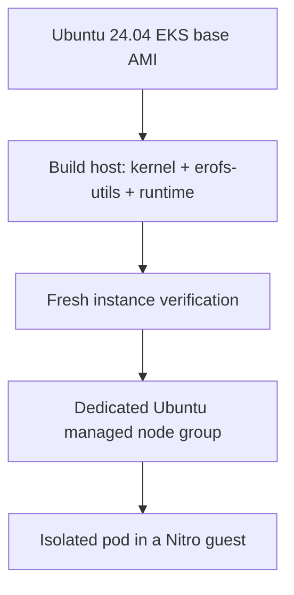
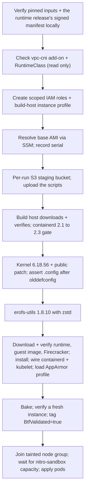

# Build an Ubuntu AMI for EKS Pod Isolation

!!! warning "Status: rebuilt on the public GA releases, fresh run pending"

    This version builds the AMI from the public Nitro Sandbox releases that the Amazon EKS User
    Guide names: the signed runtime release `0.1.4274.0`, the guest image `1.36.5/2026-11-06` and
    Firecracker `v1.18.0`. Its fresh run on a live cluster has not happened yet, so every output
    block on this page reads `TODO: output from the fresh run` until that run fills it. Every
    clusterless check is proven both ways (see [Clusterless checks](#clusterless-checks)).

Build a custom Ubuntu 24.04 node AMI for Amazon EKS Pod Isolation, add one dedicated,
tainted managed node group to an **existing cluster**, and run an isolated pod on that
node. Ubuntu is the **node operating system**; application containers can use their own
distributions.

This blueprint serves readers who manage their own node OS and cannot rely on the managed
AMI that [Getting started](../../getting-started/hello-sandbox/README.md) depends on
(EKS Auto Mode provisions sandbox-capable nodes for you, with no AMI build). It adds one
new, tainted node group; the cluster's existing node groups and workloads are untouched,
and this blueprint never replaces or reconfigures an existing node group.

Every input is public. The Nitro Sandbox runtime release, the guest image and Firecracker come
from the locations the Amazon EKS User Guide gives in
[Create and update a Nitro Sandbox AMI](https://docs.aws.amazon.com/eks/latest/userguide/sandboxing-ami-create-update.html)
and [Download and verify the runtime binaries](https://docs.aws.amazon.com/eks/latest/userguide/sandboxing-download-binaries.html);
the host kernel is kernel.org's source with the Amazon Linux sandbox patch that the first page
links. Each one is pinned and checked against its pin before it is used, and the build host
downloads the runtime inputs itself. See
[Public inputs, pinned and checksum-verified](#public-inputs-pinned-and-checksum-verified).



Allow about two hours for a fresh full `./setup.sh`. An earlier validation run of this sample took
1 h 49 min: about 25 minutes for the kernel stage on the `m8i.4xlarge` build host, and about an
hour waiting for the 120 GiB AMI to become available.

*Figure 1: The ubuntu-ami architecture, from pinned public inputs to the isolated sandbox
pod. Four public inputs, the Nitro sandbox runtime among them, are fetched and verified on the
build instance. The build host bakes the AMI, a fresh instance verifies it, then the verified
AMI joins the dedicated, tainted managed node group, leaving the cluster's existing node
groups untouched.*

![The ubuntu-ami blueprint's architecture. Outside AWS Cloud, four public inputs feed the
build instance, with the label fetch + verify: the Linux kernel source from kernel.org, pinned
and checksummed; the erofs-utils source from kernel.org cgit, pinned and checksummed; distro
packages from Ubuntu apt, with signed metadata; and the Nitro sandbox runtime from AWS and
GitHub, signed or pinned. Inside AWS Cloud, the build host (EC2, no inbound rule, reached only
over SSM) holds the build instance, which builds the kernel and erofs-utils, and SSM Session
Manager, with no SSH and no bastion. The build host bakes the AMI, and a fresh verification
instance boots from the new AMI. The verified instance joins the existing Amazon EKS cluster's
dedicated managed node group, which carries a NoSchedule taint and is separate from the
cluster's existing, untouched node groups. Inside that node group, the Ubuntu node (EC2
instance) runs an isolated sandbox pod with runtimeClassName isolated-sandbox, containing a
Nitro guest VM with its own kernel and guest virtio block devices.](images/architecture.png)

## How this differs from Getting started

[Getting started > Hello sandbox](../../getting-started/hello-sandbox/README.md) needs no
AMI: EKS Auto Mode already runs a sandbox-capable managed AMI, and the runtime classes
are there on day one. This blueprint is for the opposite case: a cluster that manages its
own node OS, where the sandbox-capable AMI does not exist yet and someone has to build
it.

- **One dedicated, tainted managed node group.** The build produces a launch template and
  a managed node group with a `NoSchedule` taint, so only a pod that explicitly tolerates
  it lands there. No existing node group is modified, relaunched or drained.
- **Starts from Getting started.** Run [hello-sandbox](../../getting-started/hello-sandbox/README.md)
  first so you have a cluster with the `isolated-sandbox` RuntimeClass; this blueprint adds
  compute to that cluster, it does not create one.
- **A build, not just a deploy.** The other blueprints apply manifests to compute that
  already exists. This one also builds the node image: resolve the base AMI, build a
  kernel, build `erofs-utils`, install the runtime, bake and verify a fresh instance,
  then join it.

## Prerequisites

- A cluster that has finished [Getting started > Hello sandbox](../../getting-started/hello-sandbox/README.md):
  EKS 1.36 or later with the `isolated-sandbox` RuntimeClass present. The blueprint reuses
  that RuntimeClass as it is and never creates or changes it; it checks that every label
  the RuntimeClass selects (`eks.amazonaws.com/nitro-sandbox=true`) is one the blueprint's
  node registers with, and stops if not.
- **The managed `vpc-cni` add-on.** A managed node group node gets its pod network from
  this add-on's `aws-node` DaemonSet; EKS Auto Mode nodes do not need it, so a cluster that
  only ran Getting started can lack it, and then the blueprint's node never becomes `Ready`.
  Its network policy setting can be on or off: the blueprint ships no network policy, and its
  validation sandbox boots with no network. This is a cluster-wide install, so you install
  it yourself, at a version you pin; the blueprint only checks that it is `ACTIVE`
  ([`scripts/00c-check-cluster.sh`](scripts/00c-check-cluster.sh)) and stops with this
  command when it is missing:

  ```bash
  aws eks describe-addon-versions --region <AWS_REGION> --addon-name vpc-cni \
    --kubernetes-version 1.36 --query 'addons[0].addonVersions[].addonVersion'
  aws eks create-addon --region <AWS_REGION> --cluster-name <CLUSTER_NAME> \
    --addon-name vpc-cni --addon-version <VPC_CNI_ADDON_VERSION> \
    --resolve-conflicts NONE
  ```

  `--resolve-conflicts NONE` makes the create fail only when the add-on would have to
  overwrite a value that is already set; it does not leave an existing `amazon-vpc-cni`
  ConfigMap alone. If the cluster already has that
  ConfigMap and nothing owns it, as the cluster this blueprint was validated on did, the add-on
  adopts it: it adds its chart's default keys and its Helm labels, and keeps
  `enable-network-policy-controller` as it was. Record the version you chose as
  `VPC_CNI_ADDON_VERSION` in `config.env`; each run records the version it found.

  If some of the cluster's nodes run another CNI, keep `aws-node` off them with the add-on's
  `affinity` configuration value. Keep the chart's default requirements and append a `NotIn`
  requirement for those nodes' label to the same term's `matchExpressions`: the requirements in
  one term must all hold, while separate `nodeSelectorTerms` are alternatives, so a term of its
  own would not keep `aws-node` off those nodes. This is the value the validation cluster's
  add-on used, with its node label key shown as `<OTHER_CNI_NODE_LABEL>` (that install also
  set `enableNetworkPolicy`, which this blueprint does not need). Save it to a file and add
  `--configuration-values file://<file>` to the `create-addon` command:

  ```json
  {
    "affinity": {
      "nodeAffinity": {
        "requiredDuringSchedulingIgnoredDuringExecution": {
          "nodeSelectorTerms": [
            {
              "matchExpressions": [
                {"key": "kubernetes.io/os", "operator": "In", "values": ["linux"]},
                {"key": "kubernetes.io/arch", "operator": "In", "values": ["amd64", "arm64"]},
                {"key": "eks.amazonaws.com/compute-type", "operator": "NotIn", "values": ["fargate", "hybrid", "auto"]},
                {"key": "<OTHER_CNI_NODE_LABEL>", "operator": "NotIn", "values": ["true"]}
              ]
            }
          ]
        }
      }
    }
  }
  ```

- **A kubectl context for the same cluster, named in `KUBE_CONTEXT`.** Every `kubectl` call
  the scripts make passes `--context "$KUBE_CONTEXT"`; there is no fallback to the current
  context, and nothing runs `kubectl config use-context`. Before the first change,
  `./setup.sh`, `./test.sh` and `./clean.sh` compare that context's server URL with the API
  endpoint `aws eks describe-cluster` reports for `CLUSTER_NAME`, and stop on a mismatch or
  an unreadable context, so the kubectl side and the AWS side are always the same cluster.
- Private subnets in the cluster's VPC with egress to Ubuntu's `apt` mirrors, kernel.org,
  git.kernel.org, github.com and its release downloads, the runtime release's CloudFront host
  (`d1uvmbvklg8rt.cloudfront.net`), Amazon S3 (the guest image is in `us-west-2`), and the EKS,
  EC2 and SSM APIs. This blueprint creates no network infrastructure.
- [`aws`](https://github.com/aws/aws-cli) CLI v2, [`kubectl`](https://github.com/kubernetes/kubectl),
  Python 3, `curl`, `tar` and `openssl` (it verifies the runtime release's signature). Optional: the
  [AWS Session Manager plugin](https://github.com/aws/session-manager-plugin), for an
  interactive shell on the build host while you debug; `./setup.sh` warns when it is missing.
- Operator IAM permissions to create and remove EC2 instances, images, snapshots, a
  security group, a launch template, IAM roles, inline role policies and instance profiles,
  an S3 bucket (create, tag, Block Public Access, default encryption, bucket policy, put and
  delete objects, delete), and an EKS managed node group; to list and delete the cluster's
  access entries (the clean up removes the one EKS creates for the node role); to read the
  cluster, its add-ons and the Canonical SSM parameter; plus SSM Run Command access to the build and
  verification instances. These are the credentials you run `./setup.sh` with; the blueprint
  then creates two **scoped** roles of its own (below).
- **The two scoped roles the blueprint creates for the resources it launches.**
  [`scripts/00a-iam.sh`](scripts/00a-iam.sh) (run for you by `./setup.sh`) creates:
  - a **build-host instance role** with `AmazonSSMManagedInstanceCore` (SSM, no inbound
    rule) and nothing else standing. For the few minutes the build host downloads its
    staged files, `./setup.sh` adds
    [`deploy/iam-build-host-policy.json`](deploy/iam-build-host-policy.json), rendered for
    this run: `s3:GetObject` on `<staging-bucket>/<run-id>/*` and `s3:ListBucket` limited to
    that prefix (the Systems Manager document `AWS-RunRemoteScript` that downloads the
    objects needs both), then deletes it again;
  - an **EKS node role** with the standard worker policies
    ([`deploy/iam-node-trust-policy.json`](deploy/iam-node-trust-policy.json)'s trust plus
    `AmazonEKSWorkerNodePolicy`, `AmazonEC2ContainerRegistryReadOnly`, `AmazonEKS_CNI_Policy`
    and `AmazonSSMManagedInstanceCore`).

  Both are named for the run (`<RESOURCE_PREFIX>-<RUN_ID>-build` and `-node`) and tagged
  `ManagedBy=<RESOURCE_PREFIX>` and `RunId=<RUN_ID>`, so `./clean.sh --delete-aws-resources`
  removes them and nothing else. A same-named role is reused only when it carries both tags,
  the trust policy above, exactly the managed policies above and no inline policy; anything
  else stops the run. Neither is an admin role.
- **IMDSv2 only, hop limit 1, on every instance the blueprint launches.** The build host, the
  verification instance and the node group's nodes (through the launch template) all require
  IMDSv2 tokens with a response hop limit of 1. That stops an ordinary pod, one that does not
  use the host's network, from getting a token, so it cannot read the node role's credentials
  through the metadata service. It is not a boundary for a pod that runs with
  `hostNetwork: true`, or for a privileged pod, which can enter the host's network: such a pod
  reaches the metadata service as the node does. The VPC CNI's own `aws-node` pods run on the
  host network and use the node role, which is why that role carries `AmazonEKS_CNI_Policy`.
  Any other pod that needs AWS access should use EKS Pod Identity, not the node's role. Each
  launch spec is rendered, checked
  ([`scripts/lib/launch_spec.py`](scripts/lib/launch_spec.py)) and sent to EC2 as that same
  file.
- **SSM-based build-host access, no inbound rule.** The build security group opens no
  inbound port (`./setup.sh` checks it has none); you reach the build and verification
  instances over SSM, which needs no bastion, no SSH key and no open port.
- **A build instance type with room for the kernel compile.** The default build host is
  `m8i.4xlarge`, the type this blueprint's kernel build was validated on; on `m8i.xlarge`
  the compile takes about four times as long. Nitro Enclaves must be enabled on it (the
  script does that) and Secure Boot off (Canonical's EKS AMI boots with it off; the build
  checks).

### Public inputs, pinned and checksum-verified

Every input in this list is public, and the build verifies each one against the pin
below before using it; a mismatch aborts the build with no override flag. The lock file,
[`packages/sources.lock`](packages/sources.lock), is the one tracked place all of these
pins live, with a note on how each was obtained and verified. The plain-text
[`packages/SOURCES.txt`](packages/SOURCES.txt) gives the same provenance in prose.

| Input | Pin | SHA-256 | Source |
|---|---|---|---|
| Ubuntu 24.04 EKS base AMI | Kubernetes 1.36 | n/a (signed AMI) | Canonical's public EKS AMI SSM parameter path, resolved per Region at build time |
| Linux kernel source | `6.18.56` | `4633bbda2ab95eaf2a7af4041236451d6759c72e6946265531af4b3aacefbf89` | [`linux-6.18.56.tar.xz`](https://cdn.kernel.org/pub/linux/kernel/v6.x/linux-6.18.56.tar.xz) on kernel.org |
| Host-kernel patch | commit `4ae89f6e09f949848123407602b4e5a8bb8d8631` | `5f9c52ae83e20403846e7c10aed6ed6fcabbd4069b76f50b1a2a42577b95f1a0` | [amazonlinux/linux 4ae89f6e as a patch](https://github.com/amazonlinux/linux/commit/4ae89f6e09f949848123407602b4e5a8bb8d8631.patch) on GitHub |
| erofs-utils source | `1.8.10` | `05eb4edebe11decce6ecb34e98d2f80c8cd283c2f2967d8ba7efd58418570514` | kernel.org cgit snapshot `erofs-utils-1.8.10.tar.gz` |
| Nitro Sandbox runtime release, x86_64 | `0.1.4274.0` | `abc1d0032014f763715c2829ef1a104d768c3e0a76fa91cd2668d87678db3c57` | [`nitro-sandboxes-runtime.tar.gz`](https://d1uvmbvklg8rt.cloudfront.net/0.1.4274.0/x86_64/nitro-sandboxes-runtime.tar.gz), with its signed [`SHA256SUM`](https://d1uvmbvklg8rt.cloudfront.net/0.1.4274.0/x86_64/SHA256SUM) (`33df467673f08654c611c0820bd7c6449a7bd5280c3a0690e36dbb475ceed972`) and [`SHA256SUM.sig`](https://d1uvmbvklg8rt.cloudfront.net/0.1.4274.0/x86_64/SHA256SUM.sig) |
| Its signing key | `nitro-sandboxes-runtime-v1` | `8b61298c0cb361b352063eb4ae8c89d38270d6f8e96131ef93f238aba6137256` | [`packages/nitro-sandboxes-runtime-v1.pub`](packages/nitro-sandboxes-runtime-v1.pub), the key the User Guide prints |
| Guest image EIF, amd64 | `1.36.5/2026-11-06` | `bcbf2e9da531ffaee6691db5661c75b3564f151cb411227c5a7f9a530db72182` | [`nitro-sandbox-guest.eif`](https://amazon-eks.s3.us-west-2.amazonaws.com/1.36.5/2026-11-06/nitro-sandbox-guest/linux/amd64/nitro-sandbox-guest.eif) in Amazon S3, with its `.sha256` sidecar |
| Guest image disk, amd64 | `1.36.5/2026-11-06` | `08f8e6d2d032829bff9c4c4907cd44242f46bcf6b1bbc2e6aea691c82bee902c` | [`nitro-sandbox-guest-disk.img`](https://amazon-eks.s3.us-west-2.amazonaws.com/1.36.5/2026-11-06/nitro-sandbox-guest/linux/amd64/nitro-sandbox-guest-disk.img) in Amazon S3, with its `.sha256` sidecar |
| Firecracker and jailer | `v1.18.0` | `1ac8eec866dd5eea14efecf6323e22b23eea24054545338a5b34bc5bca6623cd` | [`firecracker-v1.18.0-x86_64.tgz`](https://github.com/firecracker-microvm/firecracker/releases/download/v1.18.0/firecracker-v1.18.0-x86_64.tgz) on GitHub, with its `.sha256.txt` |
| Distro packages | capability-asserted, versions recorded from the run | verified by `apt`'s signed repository metadata | Ubuntu `apt` repositories |

How each pin was checked:

- **Kernel.** The SHA-256 is the `linux-6.18.56.tar.xz` line of kernel.org's
  [`sha256sums.asc`](https://cdn.kernel.org/pub/linux/kernel/v6.x/sha256sums.asc), whose
  signature verifies with the Kernel.org checksum autosigner key
  (`B8868C80BA62A1FFFAF5FDA9632D3A06589DA6B1`, from kernel.org's `pgpkeys` repository); the
  tarball also verifies against its stable-release signature `linux-6.18.56.tar.sign`
  (`647F28654894E3BD457199BE38DBBDC86092693E`).
- **Host-kernel patch.** The Amazon Linux sandbox patch that *Create and update a Nitro Sandbox
  AMI* links for operating systems other than Amazon Linux: one squashed commit on Amazon Linux's
  kernel tree, `nitro_enclaves: Amazon Nitro Enclaves extension (port onto 6.18.48)`, which applies
  cleanly to kernel.org 6.18.56. GitHub serves any commit as a patch at its commit URL plus
  `.patch`; [`packages/fetch-kernel-patch.sh`](packages/fetch-kernel-patch.sh) checks the
  SHA-256 and the commit id in the patch's first line before the file takes its final name,
  and the kernel build applies it with `git am` and checks it landed as exactly one commit
  with that subject.
- **erofs-utils.** A cgit snapshot of a tag has no upstream-published checksum, so the
  SHA-256 is pinned by this blueprint itself (confirmed identical across independent fetches).
- **Runtime release.** AWS signs the release's `SHA256SUM` (ECDSA P-384 over SHA-384), and the
  build verifies that signature with `openssl dgst -sha384 -verify` and the committed public key,
  whose own SHA-256 is pinned, as *Download and verify the runtime binaries* describes. The
  manifest's SHA-256, the archive's and the shim's are pinned too, so another release signed with
  the same key is still refused. The downloaded `SHA256SUM` is the one AWS signs, not the copy
  inside the archive.
- **Guest image.** Each file's `.sha256` sidecar is served from the same unauthenticated place as
  the file, so it gives integrity, not authenticity. This blueprint pins both SHA-256s itself,
  from full downloads that matched their sidecars, and the build checks the sidecar and the file
  against the pin. The EIF and the disk come from the same release: the disk's dm-verity root
  hash is in the EIF's measured kernel command line.
- **Firecracker.** The release's `.sha256.txt` and the pin must agree, and the two binaries the
  build reads out of the tarball are pinned by their own SHA-256 (the values the tarball's own
  `SHA256SUMS` lists).
- **Base AMI.** No SHA-256 to pin: it is a signed image resolved from a Parameter Store
  value Canonical's own AWS account owns. Canonical republishes it under new serials (the
  image name ends in the serial), so the build records the image ID, name and serial it
  resolved rather than hard-coding a Region-specific AMI ID, and checks that image's
  containerd before it builds anything.

No bare `latest` or moving tag is used anywhere in the build. A version bump re-records the
pin and SHA-256 here, in the lock file and in `packages/SOURCES.txt`, and the build
re-asserts the kernel config and re-runs the live checks. Checking a version string alone is
not sufficient.

To produce one offline-consumable archive of the pinned public file inputs (kernel,
host-kernel patch, erofs-utils) with its SBOM, license summary and provenance record, run
[`packages/make-bundle.sh build`](packages/make-bundle.sh); consume a pre-built bundle on
a restricted-network host with `packages/make-bundle.sh consume <bundle-dir>`. The runtime
release, the guest image and Firecracker are never bundled: the build host downloads them.

### The runtime inputs, and what lands on the node

The node gets what *Create and update a Nitro Sandbox AMI* puts on it: the shim, which also runs
as the CRI proxy, Firecracker and its jailer, the guest image pair with its shim config, the
`cri-proxy` unit and the two containerd runtime handlers. The rest of the runtime release is not
installed: the guest agent runs inside the guest image, and `eks-nitro-sandbox-genpolicy` runs on
a workstation or in a build pipeline.

| File | SHA-256 | Installed on the node as |
|---|---|---|
| `containerd-shim-nitro-sandbox-v2`, from the runtime release | `fe86bb80bdd69443135300105ce20bc2d1e6f24ef97591f9a5da7ab56a3c67c3` | `/usr/sbin/containerd-shim-nitro-sandbox-v2`, mode 0755 (also the CRI proxy) |
| `firecracker-v1.18.0-x86_64`, from the Firecracker release | `b33f46cd6d88834cf6a4f8d184f08f219809c636236bffd286d233a60602a2ba` | `/usr/bin/firecracker`, mode 0755 |
| `jailer-v1.18.0-x86_64`, from the Firecracker release | `ddadbaa15b5c942271a83b7040ca7259c8ccf92a9e08d44cce0b86fa407ba460` | `/usr/bin/jailer`, mode 0755 |
| `nitro-sandbox-guest.eif` | `bcbf2e9da531ffaee6691db5661c75b3564f151cb411227c5a7f9a530db72182` | `/var/lib/nitro-sandbox-images/latest.eif`, mode 0644 (guest boot image, guest kernel 6.18.56) |
| `nitro-sandbox-guest-disk.img` | `08f8e6d2d032829bff9c4c4907cd44242f46bcf6b1bbc2e6aea691c82bee902c` | `/var/lib/nitro-sandbox-images/latest-disk.img`, mode 0644, with `rootfs.ext4` linked to it |
| `SHA256SUM` and `SHA256SUM.sig`, the runtime release's signed manifest | `33df467673f08654c611c0820bd7c6449a7bd5280c3a0690e36dbb475ceed972` (the manifest) | `/usr/local/share/ubuntu-ami-sample/runtime/`, so the image's own check can verify the signature again |
| The runtime release's other files (`nitro-sandbox-agent`, `eks-nitro-sandbox-genpolicy`, `ecs-nitro-sandbox-genpolicy`, `nitro-sandbox-keyprovider`, `nitro-sandbox-policy-eval`, `nitro-sandbox-shim-logger-wrapper`), and the two archives | | not installed; the downloads are removed before baking |

The runtime stages also write the node's wiring. A *modified* file is Canonical's own, changed in
place, with an unchanged copy kept beside it as `.orig`; every other row is a new file.
[`scripts/30-runtime-install.sh`](scripts/30-runtime-install.sh) writes the first six rows and
[`scripts/31-wire-containerd.sh`](scripts/31-wire-containerd.sh) the rest.

| Path on the node | New or modified | What it holds |
|---|---|---|
| `/usr/local/share/ubuntu-ami-sample/runtime/runtime-release.SHA256SUM` | new, mode 0644 | the runtime release's signed manifest, as downloaded |
| `/usr/local/share/ubuntu-ami-sample/runtime/runtime-release.SHA256SUM.sig` | new, mode 0644 | its detached signature |
| `/var/lib/nitro-sandbox-images/rootfs.ext4` | new symbolic link | `latest-disk.img`, the name the shim attaches the guest disk by |
| `/etc/containerd/nitro-sandbox.toml` | new, mode 0644 | the shim config: `kernel_path` (`latest.eif`), `kubeconfig_path`, `format_overlay = true`, `cpu_overcommit = true`, `pcie_slots = 110`, `data_base_dir = "/var/lib/nitro-sandbox"`, `debug = false` |
| `/etc/systemd/system/cri-proxy.service` | new, mode 0644, enabled, not started | the shim's `cri-proxy` on `/run/nitro-sandbox/cri-proxy.sock`, in front of containerd's socket |
| `/etc/modules-load.d/nitro-sandbox-tun.conf` | new | `tun`, loaded at boot (the shim makes one TAP device per sandbox) |
| `/usr/local/share/eks/containerd-config.toml` | modified (copy in `containerd-config.toml.orig`) | `discard_unpacked_layers = false` in the cri containerd table, and the `isolated-sandbox` and `confidential-sandbox` handlers: `runtime_type = "io.containerd.nitro-sandbox.v2"`, `sandboxer = "shim"`, `privileged_without_host_devices = true` |
| `/usr/local/share/eks/bootstrap.sh` | modified (copy in `bootstrap.sh.orig`) | the `snap set kubelet-eks container-runtime-endpoint=` value changed to `unix:///run/nitro-sandbox/cri-proxy.sock` |
| `/etc/systemd/system/snap.kubelet-eks.daemon.service.d/50-cri-proxy.conf` | new | `[Unit]` `Wants=`, `After=` and `PartOf=cri-proxy.service`, so kubelet starts after the proxy and is restarted when the proxy restarts |
| `/etc/ubuntu-ami-sample-manifest` | new | the provenance manifest the build stages append to, including every installed runtime file's path, mode and SHA-256 |

The host kernel, `mkfs.erofs`, the AppArmor profile and the package holds are described with their
own build steps below.

[`packages/fetch-runtime-artifacts.sh`](packages/fetch-runtime-artifacts.sh) does the downloads and
the checks, on the build host, from
[`scripts/30-runtime-install.sh`](scripts/30-runtime-install.sh). It checks the public key and the
signed manifest first, then every download against its pin. Before it reads anything out of an
archive, it checks every member: the runtime archive must hold only regular files with flat names,
and nothing in either archive may be absolute, hold `..`, be a link or a device, or appear twice.
Then it checks each file it reads out against its pin, and refuses on the first mismatch, with no
override flag. Everything it fetches stays under `RUNTIME_ARTIFACTS_DIR`: on the build host
`/var/lib/ubuntu-ami-sample/run/runtime`, which bake-prep removes; on your workstation, for
`./setup.sh --prepare`, the repository's gitignored `tmp/issue10/run/runtime` (all of this
blueprint's local state lives under `tmp/issue10/run`, in `logs/`, `out/` and `runtime/`).

## Build

```bash
git clone https://github.com/aws-samples/sample-eks-nitro-sandbox.git
cd sample-eks-nitro-sandbox/examples/setup/ubuntu-ami
cp config.env.example config.env
# Set KUBE_CONTEXT (the kubectl context of CLUSTER_NAME), BUILD_SUBNET_ID, NODE_SUBNET_IDS and
# VPC_CNI_ADDON_VERSION. Your usual CLUSTER_NAME, AWS_REGION and AWS_PROFILE remain in effect.
# The scripts pass --context "$KUBE_CONTEXT" to every kubectl call and never change the
# current context.
$EDITOR config.env

./setup.sh --prepare   # local only: verify every pinned input this workstation can reach
./setup.sh             # check the cluster, build, bake, verify, join, and run the pods
# or in two stages:
#   ./setup.sh --ami-only              # build, verify and tag the AMI; no cluster needed
#   RUN_ID=<id> ./setup.sh --join      # later: join that run's AMI and run the pods
./test.sh              # read live node and guest evidence again
./clean.sh --dry-run   # preview what a full clean up would remove
```

The blueprint uses its own namespace, `ubuntu-ami-sample` (`NAMESPACE` in `config.env`), not the
home page's `nitro-sandboxes-demo`: `./clean.sh` deletes the namespace the run created, so it
must be one no other blueprint uses.



**Every run has its own id.** `./setup.sh` picks a run id (a UTC timestamp plus four random hex
digits, such as `20261028t221500z3f9a`, or the `RUN_ID` you pass to resume a run), reserves the
run's folder so no other start can share it, and records the id as the current run in
`tmp/issue10/run/out/run-state.env` just before its first AWS change, so a run that stops on a
read-only check leaves the previous run as the current one; the run's private evidence goes under
`tmp/issue10/run/out/runs/<run-id>/evidence/`. Every name the run creates is derived from it
(`<RESOURCE_PREFIX>-<RUN_ID>-build` for the build role and instance profile, `-node` for the
node role, `-build-sg`, `-lt`, `-ng`, `-verify`, `-stage-read` for the staging policy, and
`<RESOURCE_PREFIX>-stage-<RUN_ID>-<6 hex>` for the bucket), checked against the IAM, EKS and
S3 name limits, and every AWS resource it creates carries both `ManagedBy=<RESOURCE_PREFIX>`
and `RunId=<RUN_ID>`, including the verification instance and, through the launch template,
every node instance and volume. A resource with the run's name is reused only when it carries
both tags; a mismatch or a failed lookup stops the run. The namespace carries
`app.kubernetes.io/part-of=<RESOURCE_PREFIX>` and `app.kubernetes.io/instance=<RUN_ID>`. The
run's record (`tmp/issue10/run/out/runs/<run-id>/run-state.env`) also names the
`CLUSTER_NAME` and `AWS_REGION` it started with: a resume, `--join`, `./test.sh` or
`./clean.sh` of that run with another cluster or Region stops before any call. Within one
checkout, one process at a time acts on a run: `./setup.sh`, `./test.sh` and `./clean.sh` each
take the run's lock (a file in the run's folder) first, and refuse the run while another holds
it. The lock cannot be seen from another checkout or another machine, so it does not stop two
checkouts acting on the same run; see *A lost run id* under [Clean up](#clean-up).
`./clean.sh --list-runs` needs no run and no lock.

**Build the AMI now, join it later.** `./setup.sh --ami-only` checks the inputs, runs steps 2
to 7 below through the `BtfValidated=true` tag, records the AMI ID in the run's
`tmp/issue10/run/out/runs/<run-id>/run-state.env`, and stops. It never reads or changes the
cluster, so it needs no `KUBE_CONTEXT`, no `vpc-cni` add-on and no `NODE_SUBNET_IDS`; set
`CLUSTER_NAME` to the cluster you will join, because the run's record keeps it. The
`cilium-ubuntu` blueprint (issue #11) needs only this AMI. `RUN_ID=<id> ./setup.sh --join` does
step 8 for that run: before it changes anything, it checks that the run's AMI carries
`ManagedBy`, the run's `RunId` and `BtfValidated=true`, that `KUBE_CONTEXT` is
`CLUSTER_NAME`, and that the cluster prerequisites in step 1 hold; then it joins the node group
and applies the pods. It never builds an AMI. Without either flag, `./setup.sh` does both in
one run and checks the cluster first, before anything is created.

**Every wait has a deadline.** The AWS CLI waiters give up after about 100 seconds for an SSM
command and 600 seconds for an AMI, which is less than the kernel build and a large snapshot
can take, so [`scripts/lib/aws-wait.sh`](scripts/lib/aws-wait.sh) polls instead. An SSM
command is read about every 15 seconds until it ends, for up to its own `executionTimeout`
plus 300 seconds, and `Failed`, `Cancelled`, `TimedOut`, `Undeliverable` or `Terminated`
stops the run. A new AMI is read until it is `available`, for up to `AMI_WAIT_SECONDS`
(default 7200, in `config.env`; this blueprint's 120 GiB AMI took about 55 minutes); `failed`,
`error` or the deadline stops the run and names the
AMI. After the reboot onto the new kernel, the build host must answer with a new boot ID and
`uname -r` equal to `6.18.56-nitro-ga` within `REBOOT_WAIT_SECONDS` (default 1200) before the
next stage runs, and the run's evidence records both boot IDs. A read that keeps failing ends
in "could not determine", which stops the run.

**1. Check the inputs and the cluster.** `./setup.sh --prepare` verifies, on your workstation, every
pinned input it can reach without the large runtime downloads (the kernel, the patch, erofs-utils,
the runtime release's signed manifest and the guest image and Firecracker sidecars), and creates
nothing. A full `./setup.sh` then
reads two cluster-wide prerequisites before it creates anything: the `vpc-cni` add-on is
`ACTIVE`, and the shared `isolated-sandbox` RuntimeClass selects only labels the blueprint's
node will carry. It stops with the command to run if either is not so.

**2. Resolve the base AMI.** The build resolves the Canonical EKS Ubuntu 24.04 AMI for
Kubernetes 1.36 from the public SSM parameter path for your Region at run time, and records
the image ID, name and serial it got in the run's private evidence (under
`tmp/issue10/run/out/runs/<run-id>/evidence/`), not on the image. It never hard-codes an AMI
ID or serial.

**3. Stage the scripts through a private, per-run S3 bucket.** Nothing is pushed through an SSM
shell, and the build host downloads the runtime inputs from their public locations itself (step 6).
[`scripts/00b-stage-bucket.sh`](scripts/00b-stage-bucket.sh) creates a bucket for this run,
tagged `ManagedBy=<RESOURCE_PREFIX>` and `RunId=<run-id>`, with S3 Block Public Access on,
default encryption (SSE-S3) and the TLS-only policy in
[`deploy/s3-stage-bucket-policy.json`](deploy/s3-stage-bucket-policy.json); it uploads the
blueprint's scripts with their SHA-256 (S3 checks it on receipt) and grants the
build-host role read on this run's prefix only. The build host downloads them with its
instance profile and checks the SHA-256 against the value `./setup.sh` sends over SSM, not
one read from the bucket. If any staging step fails after the bucket exists, the helper removes
what it created before it stops. Then the staged objects and the build role's read are deleted,
but only after the bucket and the role are confirmed to carry this run's two tags and the role's
staging policy is confirmed to be exactly this run's read; the revocation then confirms both
are gone: if either is still there, it records what is left in the run's state and the run
stops. The empty bucket stays until
`./clean.sh --delete-aws-resources` removes it.

**4. Check containerd, then build the host kernel.** The build host's first preflight reads
the booted base image's containerd: this blueprint is validated on containerd 2.1.x, 2.2.x and
2.3.x (the User Guide asks for 2.0 or later), and the build stops before anything is compiled on
2.4 or later, or anything older than 2.1 (a new Canonical serial can ship a newer containerd). The
same preflight checks the runtime release's signed manifest and the guest image and Firecracker
sidecars against their pins, so a moved pin stops the build before the compile.
[`scripts/10-kernel.sh`](scripts/10-kernel.sh)
then fetches and verifies kernel.org `linux-6.18.56.tar.xz` and the public patch, applies the
patch in a throwaway git repository and checks it is the expected single commit, and starts
`.config` from the running node's own config. It asserts on the result of `olddefconfig`,
because `olddefconfig` silently drops a symbol whose menu gate is off:

- `CONFIG_NITRO_ENCLAVES=y`, built in and never a module: the `nitro_enclaves.mempool=` boot
  argument reserves the enclave memory pool early in boot, and does nothing when the driver
  is a module;
- `CONFIG_CMA=y`, `CONFIG_DEBUG_INFO_BTF=y` and `CONFIG_DEBUG_INFO_BTF_MODULES=y` (kernel and
  module BTF for eBPF, which Cilium's datapath needs);
- `CONFIG_VHOST_VSOCK`, `CONFIG_EROFS_FS` and `CONFIG_TUN`, built in or modules;
- the menu gates `CONFIG_VIRT_DRIVERS`, `CONFIG_VSOCKETS` and `CONFIG_VHOST_MENU`;
- `CONFIG_EXT4_FS`, built in or a module. The build sets it built in (`y`), which needs no
  module at boot; if `olddefconfig` leaves it a module, the build requires `ext4.ko` in the
  new initramfs.

It installs `dwarves` (pahole, which builds BTF from DWARF), `gawk` (Ubuntu ships `mawk`,
and the link step needs `gawk`) and `libdw-dev` (Canonical's config sets
`CONFIG_GENDWARFKSYMS=y`), compiles with DWARF 4, installs the modules with
`INSTALL_MOD_STRIP=1` (their DWARF is stripped, their BTF stays), checks the kernel release
is `6.18.56-nitro-ga`, adds the `nitro_enclaves.mempool` and `nitro_enclaves.ne_cpus` boot
arguments, and pins the new kernel as the GRUB default (the stock kernel sorts newer).

The assertion is the one `scripts/10-kernel.sh --assert-config <file>` runs on a file: the
build applies it to `.config` right after `make olddefconfig`, prints one `ok:` line per
symbol, and stops before anything is compiled if a required symbol is missing or has the wrong
value. SSM Run Command returns only the first 24,000 characters of a command's output, and
the kernel stage prints far more than that, so those `ok:` lines do not reach the run's
evidence. A build that passes the gate goes on to compile the kernel and reboots the build host
onto `6.18.56-nitro-ga`. Once the runtime is installed, `verify-image.py` checks on the build
host, running that kernel, what those symbols provide (the end of its result, from `./setup.sh`
step 7):

```text
TODO: output from the fresh run
```

Step 9 repeats the same checks on a second, fresh instance before `BtfValidated=true` is tagged
(that block is under [Evidence](#evidence)).

On the node that joined from the AMI, `./test.sh` section 2/7 reads the same host requirements
again, each device and feature probe next to the same probe of something that does not exist
(the `_bogus` lines):

```text
TODO: output from the fresh run
```

**5. Build erofs-utils with zstd.** The containerd shim builds each container's EROFS
filesystem with zstd and has no fallback, and Ubuntu 24.04's erofs-utils 1.7.1 has no zstd.
The build fetches the `1.8.10` snapshot, verifies it, builds it with
`--enable-lz4 --with-libzstd` into `/usr/local`, purges Ubuntu's package, and checks that
`mkfs.erofs` reports 1.8.10 and compresses with zstd when run as a systemd service, which is
how containerd runs it.

**6. Install and wire the runtime.** [`scripts/30-runtime-install.sh`](scripts/30-runtime-install.sh)
downloads the runtime release, the guest image pair and Firecracker and verifies them (see
[The runtime inputs, and what lands on the node](#the-runtime-inputs-and-what-lands-on-the-node)),
installs each file at the path and mode in that table, keeps the signed manifest on the image,
links `rootfs.ext4`, and writes `/etc/containerd/nitro-sandbox.toml` with the keys the User
Guide's shim config sets (`kernel_path` at the staged EIF, `kubeconfig_path`,
`format_overlay = true`), `cpu_overcommit = true`, `pcie_slots = 110` and `data_base_dir`, and
`debug = false` (the production setting; `SHIM_DEBUG=true` gives debug-mode enclaves for
troubleshooting only). It installs and enables, but does not start, `cri-proxy.service`.
[`scripts/31-wire-containerd.sh`](scripts/31-wire-containerd.sh) adds the `isolated-sandbox`
and `confidential-sandbox` handlers to Canonical's containerd template
`/usr/local/share/eks/containerd-config.toml` (config version 2, with
`discard_unpacked_layers = false` inside its existing cri containerd table) and checks
containerd's own `config migrate` and `config dump` show both, points kubelet's endpoint at
`unix:///run/nitro-sandbox/cri-proxy.sock` in `/usr/local/share/eks/bootstrap.sh`, and adds
the `snap.kubelet-eks.daemon.service.d/50-cri-proxy.conf` ordering drop-in. Both files are
templates because Canonical's bootstrap regenerates the live ones at join.
[`scripts/35-apparmor.sh`](scripts/35-apparmor.sh) loads the blueprint's scoped AppArmor profile
and stops unless the kernel reports it in enforce mode and its load service is enabled
(`systemctl enable` and `is-enabled` both checked).
[`scripts/36-hold-packages.sh`](scripts/36-hold-packages.sh) finds the package that owns the
`containerd` binary with `dpkg -S` and holds what it finds (on Canonical's serial `20261027`
that was `containerd`), together with the installed Ubuntu kernel meta-packages, with
`apt-mark hold` and in `Unattended-Upgrade::Package-Blacklist`, so an
unattended upgrade can neither move containerd past the range this blueprint is validated on nor
pull a stock kernel that GRUB could boot instead of `6.18.56-nitro-ga`. Everything else keeps the base
AMI's update policy: package-list refresh and unattended security upgrades stay on.

> **Trade-off: held packages get updates only through a new AMI build.** containerd and the
> held kernel meta-packages receive no security fix on a running node. Rebuild the AMI to
> pick them up, and replace the node group's nodes with it.

**Observe:** a completed `./setup.sh` writes a plain-text manifest on the image,
`/etc/ubuntu-ami-sample-manifest`, recording the kernel release and the SHA-256 of its
tarball and patch, the erofs-utils version and installed binary hash, each installed runtime
file's path, mode, SHA-256 and `sources.lock` block, the runtime release, guest image and
Firecracker versions, the observed containerd version and the shim's debug setting, so a later
reader can audit the image without the build host. The runtime release's signed `SHA256SUM` and
its signature stay on the image too, in `/usr/local/share/ubuntu-ami-sample/runtime/`.

**7. Verify a fresh instance, then tag the AMI `BtfValidated=true`.** Before baking,
[`scripts/50-bake-prep.sh`](scripts/50-bake-prep.sh) removes the kernel tree, the downloaded
kernel tarball and patch, the runtime release, guest image and Firecracker downloads, the staged
scripts, the build toolchain, SSH host keys and the machine ID, and refuses to continue if any of
them is still there, or if its scan for them fails ("could not determine" is a failure, never a
pass). It does not change the base AMI's apt update policy. After the AMI
is registered, `./setup.sh` launches a SECOND, fresh instance from it
([`scripts/verify-fresh-instance.sh`](scripts/verify-fresh-instance.sh)) and runs
[`scripts/verify-image.py`](scripts/verify-image.py) and `40-smoke.sh` on that instance, never
on the build host's own run. `verify-image.py` checks the kernel release
`6.18.56-nitro-ga`, `/dev/nitro_enclaves`, BTF, a CMA reservation, vsock, TUN, EROFS,
AppArmor with the scoped profile loaded, containerd 2.1.x to 2.3.x, both handlers, the kubelet
endpoint, the shim config (only the keys the shim reads), the guest image layout, the guest
kernel release inside `latest.eif` (read from its kernel's header and compared whole with the pin,
`6.18.56`, so the host's `6.18.56-nitro-ga` is refused), `mkfs.erofs` 1.8.10 with zstd as a
service sees it, every installed runtime file against its pin, the runtime release's signed
manifest (its signature verified again with the committed key), and the package holds: 16 checks.
Each check raises its own failure (no Python `assert`, which `python3 -O` would
remove). Only once both checks pass does the script tag the AMI
`BtfValidated=true` ([`scripts/lib/btf-tag.sh`](scripts/lib/btf-tag.sh)), alongside the
`ManagedBy=<RESOURCE_PREFIX>` ownership tag and the build-metadata tags below.
If verification fails, the AMI never receives `BtfValidated=true` or those tags,
and the tagging step refuses any AMI that does not already carry both of this run's tags
(`ManagedBy` and `RunId`). The verification instance is terminated however the script ends. This tag is the contract the `cilium-ubuntu` blueprint's (issue #11) AMI preflight checks:
`BtfValidated=true` means "a fresh instance booted from this AMI passed this blueprint's
host-readiness and BTF checks," never "an AMI was merely created."

The tags the AMI carries once it is verified, each value read from `packages/sources.lock`, the
run or its configuration, never typed twice:

| Tag | Value | Set when |
|---|---|---|
| `Name` | `<RESOURCE_PREFIX>-<RUN_ID>` | `create-image` (`./setup.sh` step 8/10) |
| `ManagedBy` | `ubuntu-ami-sample` (`RESOURCE_PREFIX`) | `create-image`; kept by the verification |
| `RunId` | `<RUN_ID>` | `create-image` |
| `BaseAmiSerial` | the Canonical base AMI serial the run resolved | `create-image` |
| `BtfValidated` | `true` | only after the fresh instance passes `verify-image.py` and `40-smoke.sh` |
| `KernelVersion` | `6.18.56` (`KERNEL_VERSION`) | with `BtfValidated` |
| `ErofsUtilsVersion` | `1.8.10` (`EROFS_UTILS_VERSION`) | with `BtfValidated` |
| `RuntimeRelease` | `0.1.4274.0` (`runtime-release` `ref`) | with `BtfValidated` |
| `GuestImageRelease` | `1.36.5/2026-11-06` (`guest-image-eif` `ref`) | with `BtfValidated` |
| `FirecrackerVersion` | `v1.18.0` (`firecracker-release` `ref`) | with `BtfValidated` |
| `HostKernelPatch` | `4ae89f6e09f949848123407602b4e5a8bb8d8631` (`host-kernel-patch` `ref`) | with `BtfValidated` |
| `GuestKernelRelease` | `6.18.56` (`guest-image-eif` `guest_kernel`, the release `verify-image.py` read out of `latest.eif`) | with `BtfValidated` |
| `BtfValidatedBuildId` | `<RESOURCE_PREFIX>-<RUN_ID>-verify`, the verification instance's name | with `BtfValidated` |

The snapshot behind the AMI carries `Name`, `ManagedBy` and `RunId`. `GuestKernelRelease` is the
pin because the build cannot run a sandbox pod before the AMI exists: `./test.sh` section 5/7 then
checks, on the node, that the sandbox pod's `uname -r` is that tag's value.

**8. Join the dedicated node group, then wait for sandbox capacity.**
[`scripts/join-nodegroup.sh`](scripts/join-nodegroup.sh) creates the launch template and the
tainted managed node group. With a custom AMI, EKS does not merge its own user data and
applies the node group's labels and taints only after the node registers, so the node sets
them itself through Canonical's `bootstrap.sh --kubelet-extra-args`:
`--node-labels=eks.amazonaws.com/nodegroup=<NODEGROUP_NAME>,eks.amazonaws.com/nitro-sandbox=true,sandbox.preview/nitro=true`
and `--register-with-taints=sandbox.preview/ubuntu-ami=true:NoSchedule`, checked in the
rendered user data before the launch template is created: with comments and blank lines
stripped, the script must hold exactly one `/etc/eks/bootstrap.sh` command for this cluster,
with nothing after it and the cluster name as its last argument, after every option (the
script's usage is `bootstrap.sh [options] <cluster-name>`), and the labels and taint are read
from that command's own `--kubelet-extra-args`. The launch template data (IMDSv2 required, hop limit 1, enclaves on,
both run tags on every node instance and volume) is checked the same way, and the template
and the node group are named and tagged for the run. Before any pod is applied,
[`scripts/wait-node-ready.sh`](scripts/wait-node-ready.sh) waits until the node is `Ready`
and advertises allocatable `eks.amazonaws.com/nitro-sandbox` greater than zero (the extended
resource the RuntimeClass's overhead requests), and stops with a clear message if it does not.

> **containerd is a gate, not an install.** The build checks that the base image's
> containerd is in the range this blueprint is validated on; it never upgrades or downgrades the
> containerd already on the base AMI.

## Evidence

> **Every output block on this page will come from one fresh run** of this version: a full
> `./setup.sh` (with the fresh-instance verification), then `./test.sh`. Until that run, each
> block reads `TODO: output from the fresh run`. Lines will be copied whole and in order, values
> from the test account shown as placeholders, and the note under each block will say which
> ones, and whether lines were left out.

**Node vs guest kernel, and host vs guest block devices.** The same shape Getting started
uses: the ordinary pod shares the node's kernel, `6.18.56-nitro-ga`, and sees the
instance's `nvme*` disks; the isolated-sandbox pod reports its own guest kernel, `6.18.56`
(the kernel inside `latest.eif`, compared whole, since it shares its base release with the
host's), and sees only virtio `vd*` disks, no `nvme*`. `./test.sh` also reads the AMI's
`GuestKernelRelease` tag, from the AMI the run recorded, and checks that the sandbox pod reports
exactly that release.

```text
TODO: output from the fresh run
```

**Boot uptime matches the pod's age**, because the VM boots with the pod, while the ordinary
pod reads the host's much longer uptime:

```text
TODO: output from the fresh run
```

**Host-requirement accept/reject controls.** Each control below is proven both ways: one
input that has the requirement and passes, one that is missing it and is refused, per this
repository's rule that a check proven only on good input cannot be told apart from one
that accepts everything.

| Control | Accepts | Refuses |
|---|---|---|
| Kernel config assertion | every required symbol present after `olddefconfig` | `CONFIG_NITRO_ENCLAVES=m`, BTF off or missing, module BTF off, CMA off, `VHOST_VSOCK` or `TUN` dropped, the `VIRT_DRIVERS` gate off |
| Root filesystem at boot | `CONFIG_EXT4_FS=y` with or without `ext4.ko`; `=m` with `ext4.ko` (plain or compressed) in the initramfs | `=m` with no `ext4.ko`, a file that only starts with `ext4.ko`, EXT4 not set |
| Host kernel | the node reports `6.18.56-nitro-ga` | any other release |
| Guest kernel | `6.18.56` inside `latest.eif` (its kernel's header), and the same from `uname -r` in the sandbox pod, which also equals the AMI's `GuestKernelRelease` tag | the host's `6.18.56-nitro-ga`, a suffixed release, `6.18.54`, a file that is not an EIF, a tag that is wrong, empty or unreadable, a run with no recorded AMI |
| BTF presence | `/sys/kernel/btf/vmlinux` present and non-empty | the same probe on a path that does not exist |
| Nitro Enclaves device | `/dev/nitro_enclaves` present after reboot | the same probe on a device that does not exist |
| CMA pool | a non-zero `CmaTotal` | the same probe on a key that does not exist |
| `vsock` and TUN | `/dev/vhost-vsock` and `/dev/net/tun` present | the same probes on devices that do not exist |
| EROFS + zstd | `mkfs.erofs` 1.8.10 builds a zstd image as a systemd service | erofs-utils without zstd |
| containerd | 2.1.x, 2.2.x, 2.3.x | 2.4.0 and later, 2.0.x and earlier, unreadable versions |
| Runtime release, guest image, Firecracker | the pinned public key, a manifest that verifies with it and lists the archive and the shim at their pins, every sidecar (one line: the SHA-256, then at most the file's own name) and download at its pin, archives whose members are all safe | another key, a bad signature, a manifest changed after signing or not the pinned one, a manifest without the shim or with a malformed line, a sidecar that disagrees, is not a hash, has a second line or names another file, a swapped or non-tar archive, a member with a path, `..`, an absolute name or a link, two members of one name, a missing or tampered shim or jailer, a failed download |
| Runtime download folder | a new or empty folder, a folder it made before (it carries the script's marker), the run folder `RUNTIME_ARTIFACTS_DIR`; only the folders the script made there are replaced | a symbolic link, a folder that is not empty and that it did not make, one of its folder names there that it did not make (or a link to one), a forged marker; each refusal changes nothing |
| Guest image and data folders | `/var/lib/nitro-sandbox-images` and `/var/lib/nitro-sandbox`, which are apart | the image folder inside the data folder, the data folder inside the image folder, one folder for both, also when spelled with `..`; refused by the install stage and by the shim config check |
| Runtime install stage | the full install in a fixture tree: the five files at their paths, modes and pins, the `rootfs.ext4` link, the kept manifest, the shim config, `cri-proxy.service` enabled, the `tun` module file | an `install=` line that is relative, holds `..` or has a mode that is not octal, a block with no verified file, a runtime input that does not verify, an installed copy that is not its pin, a failed `systemctl enable`, no `/dev/nitro_enclaves` or `/dev/net/tun` |
| Smoke boot stage | against a stand-in for Firecracker v1.18.0's API: the eight API calls in the shim's order, the exact `/enclave` body, the EIF as the boot source, the agent's `OK` handshake, the stage's own clean up | a call answered with an error, a field the v1.18.0 API does not define (such as the preview-era `pcie_mode`), Firecracker exiting early, a garbled, empty or unreachable agent, a missing EIF |
| Installed runtime files | every file at its pinned path, mode and SHA-256; the kept manifest verifies again | a wrong mode, a tampered shim or EIF, a missing disk, a bad signature, a changed or missing kept manifest |
| Runtime wiring | both handlers in containerd's migrated config dump, the endpoint at the CRI proxy, the shim config with only the keys the shim reads | a handler name that is not registered, a key the shim does not read (such as `rootfs_path`) |
| Node labels and taint | one active `bootstrap.sh` command for this cluster, its name last after every option, whose `--kubelet-extra-args` carry all three labels and the taint | any one missing, the strings only in a comment, an `exit` before the command, two commands, a command for another cluster, the cluster name first or before an option |
| Launch specs | IMDSv2 required, hop limit 1, enclaves on, `ManagedBy` and `RunId` on instance and volume | IMDSv1 allowed, hop limit 2, no metadata options, IMDS off, enclaves off, a volume without `RunId`, another run's `RunId` |
| Kube context | the context's server is `CLUSTER_NAME`'s API endpoint | another cluster's server, an unknown context, no `KUBE_CONTEXT` |
| AppArmor stage | the profile loaded in enforce mode, its service enabled | complain mode, a failed `systemctl enable`, a service that is not enabled |
| AppArmor profile rules | `signal (receive)` from `runc` and `unconfined`, `signal (send,receive)` with itself, `audit deny /etc/shadow* w,`, no plain `deny` | a `signal` rule missing or only in a comment, a plain `deny`, no `/etc/shadow` rule, another profile name |
| Package holds | the containerd owner and the kernel meta-packages held and blacklisted | a hold missing from `apt-mark showhold` or from the blacklist |
| Bake residue | no build residue left | residue present (a kernel or erofs-utils archive, a runtime download under its download name, a partial download), or a scan that fails |
| Sandbox capacity | the node advertises `eks.amazonaws.com/nitro-sandbox` > 0 | zero, absent, or a node that is not `Ready` |
| No network in the validation sandbox | the `network-isolated` annotation read back; only loopback has an address; no route; every interface but `lo` down (a `dummy0` that is down passes); the connect fails with `Network is unreachable` while the ordinary pod's connects | an extra IPv4 or IPv6 address, a route, an interface other than `lo` that is up, a refused or timed-out connect, an unreadable file or an incomplete read |

**`BtfValidated=true` applied only after fresh-instance verification passes.** The AMI tag
`cilium-ubuntu`'s (issue #11) AMI preflight requires before it will use an AMI from this
blueprint. Written by `scripts/verify-fresh-instance.sh` via `scripts/lib/btf-tag.sh`, never at
`create-image` time, and never when verification fails or the AMI is not this run's own
(`ManagedBy=<RESOURCE_PREFIX>` and `RunId=<RUN_ID>` checked first).

```text
TODO: output from the fresh run
```

**AppArmor.** AppArmor stays enabled on the host, and the node loads one scoped profile,
[`manifests/ubuntu-ami-sample-profile`](manifests/ubuntu-ami-sample-profile), installed onto
the AMI by [`scripts/35-apparmor.sh`](scripts/35-apparmor.sh). The profile refuses writes to
`/etc/shadow` and a few other paths inside the confined container with `audit deny` rules, so
each refusal is logged; the pod mounts no host filesystem, so these are the container's own
files, not the node's. It lets runc, crun and the host signal the container, as containerd's
own default container profile
does (containerd `contrib/apparmor/template.go`): without those `signal` rules, a pod under
the profile could never be stopped. `./test.sh` shows four things on the blueprint's node, each
next to its control.

**1. AppArmor is on and enforcing on the host.** The kernel reports AppArmor enabled, the
scoped profile is loaded in enforce mode, and the node's copy of the profile is this blueprint's
file (same sha256). The same probe reads absent for a profile the node never loaded.

```text
TODO: output from the fresh run
```

**2. The scoped profile working, on an ordinary pod.**
[`deploy/pod-apparmor-scoped.yaml`](deploy/pod-apparmor-scoped.yaml) is an ordinary (runc)
pod on the same node that selects the profile with `securityContext.appArmorProfile`
(`type: Localhost`). `./test.sh` checks that its process runs under
`ubuntu-ami-sample-profile (enforce)` (`/proc/self/attr/current`), while the ordinary pod's
label does not name the profile. It checks that the pod's write to `/etc/shadow` is refused
with `Permission denied` and the node's kernel logs the profile's `DENIED` line for it, read
from the node's clock just before the write, while the same pod's write to another file in
`/etc` succeeds. Then it deletes the pod by its exact name and checks that the pod is gone
within its 15 s grace period, with no `DENIED` signal logged under the profile. A profile
the node never loaded has no `DENIED` lines, as the control for both counts.

```text
TODO: output from the fresh run
```

**Why the profile has `signal` rules and `audit deny`.** The first version of the profile had
neither, and a validation run of this blueprint on its own AMI showed what that costs. On Ubuntu
24.04, runc runs under its own AppArmor profile, `runc`, so the stop signals a pod receives
come from the peer `runc`. With no `signal` rule, AppArmor refused them: a pod under the
profile could not be stopped, and kubelet kept logging
`runc did not terminate successfully: exit status 1: unable to signal init: permission denied`
(the end of the message). And a plain `deny` rule refuses without logging, so the refused
`/etc/shadow` write left no `DENIED` line. The profile now has the `signal` rules of
containerd's default container profile, and every deny rule is `audit deny`. The 8b block shows
both on a run: the pod is gone within its 15 s grace period with no signal denials, and the
refused write leaves the profile's `DENIED` lines.

**3. A pod naming a profile the node never loaded is refused.** The reject control,
[`deploy/pod-apparmor-reject.yaml`](deploy/pod-apparmor-reject.yaml), is an ordinary pod on
the same node that asks for `profile-that-does-not-exist`. `./test.sh` checks that it is
scheduled on the blueprint's node, is not running, and waits with reason `CreateContainerError`
and containerd's message for a missing profile, matched whole:
`failed to get container spec opts: failed to generate apparmor spec opts: apparmor profile not found profile-that-does-not-exist`.

```text
TODO: output from the fresh run
```

**4. Why the sandbox pod runs `Unconfined`.** The isolated-sandbox pod,
[`deploy/pod-isolated-sandbox.yaml`](deploy/pod-isolated-sandbox.yaml), sets
`appArmorProfile` `type: Unconfined`. A sandbox pod's profile is not applied on the host: the
shim passes it into the guest microVM, where runc applies it. On an AppArmor host every sandbox
pod therefore needs `Unconfined`; otherwise kubelet requests the `RuntimeDefault` profile, the shim
forwards it into the guest, and runc fails with `apparmor failed to apply profile`. A validation
run of this blueprint on its own AMI showed exactly that. With `type: Localhost` and the scoped
profile, the sandbox pod stopped in `StartError` with
`apparmor failed to apply profile: write fsmount:fscontext:proc/thread-self/attr/exec: invalid argument`
(the end of the message), because the guest runs SELinux and has no AppArmor: its process
label is `system_u:system_r:runtime_t:s0:c0.c1023`. The microVM is the sandbox pod's boundary.
`./test.sh` prints the sandbox's own label and checks that the pod runs with `Unconfined`.

```text
TODO: output from the fresh run
```

### The validation sandbox has no network

The isolated-sandbox pod is booted with no network. It needs none: it runs `sleep infinity`,
and every check `./test.sh` makes reaches it through `kubectl exec`. One annotation in
[`deploy/pod-isolated-sandbox.yaml`](deploy/pod-isolated-sandbox.yaml) does it, the same one
[Getting started](../../getting-started/hello-sandbox/README.md) uses. Here is the part of the
manifest that matters:

```yaml
metadata:
  annotations:
    sandbox.amazonaws.com/network-isolated: "true"   # <-- boot the VM with no network besides loopback
```

`./test.sh` section 7/7 reads the annotation back from the API, then reads what the guest
itself reports: only loopback has an address, the sandbox has no route, and every interface
other than `lo` is down. The guest also has a `dummy0` interface, from its image, which is
down and has no address. A TCP connect from the sandbox to the cluster's `kubernetes` Service on port
443 fails with `Network is unreachable`, while the same connect from the ordinary pod on the
same node succeeds, so the failure is the sandbox's and not the Service's. The API still
reports a `podIP` for the sandbox pod: the host side allocates it, and no interface in the
guest carries it.

```text
TODO: output from the fresh run
```

The blueprint ships no network policy, and creates no Ingress, LoadBalancer or NodePort. For
how a network policy restricts where a sandboxed pod can connect, see the
[network policy](../../isolation/network-policy/README.md) blueprint.

### Clusterless checks

These run with no AWS account and no cluster, against the real scripts with stub commands
first on `PATH` where a live input cannot be made. The fake AWS CLI applies `--query` with the
`jmespath` package, pinned in
[`scripts/testlib/requirements-test.txt`](scripts/testlib/requirements-test.txt); without it,
every fake call stops with exit 98 and an "install jmespath" message, so the suites fail rather
than pass. Install it into a virtual environment under the repository's `tmp/`, and put that
environment first on `PATH` while the suites run (from this blueprint's folder):

```bash
python3 -m venv ../../../tmp/ubuntu-ami-tests
../../../tmp/ubuntu-ami-tests/bin/pip install -r scripts/testlib/requirements-test.txt
export PATH="$(cd ../../../tmp/ubuntu-ami-tests/bin && pwd):$PATH"
```

```bash
bash packages/test-bundle.sh          # bundle built and consumed against sources.lock; tampered, unlisted and unsafe members refused
bash packages/test-inputs.sh          # runtime release signature and pins, guest image and Firecracker, unsafe archive members, the download folder, host-kernel patch, both ways
bash scripts/test-host-gates.sh       # containerd gate, .config assertion, root filesystem at boot, IMDS token never on argv
bash scripts/test-runtime-install.sh  # the full runtime install stage in a fixture tree, and every refusal, including nested guest image and data folders (Python 3.11+)
bash scripts/test-smoke.sh            # the Firecracker smoke stage against a stand-in for the v1.18.0 API: the exact calls and bodies, the handshake, every refusal, the clean up
bash scripts/test-cluster-gates.sh    # kube context, vpc-cni ACTIVE (network policy on or off), RuntimeClass, user data, node capacity, namespace, pod wait
bash scripts/test-launch-specs.sh     # IMDSv2 hop limit 1, enclaves and run tags on the node template, verification instance and build host; strict bootstrap.sh user data
bash scripts/test-run-scope.sh        # per-run IAM, run-scoped clean up, the run's lock and record, IAM by name, the node role's access entry, --keep-ami, every failed lookup, --list-runs, staging revocation
bash scripts/test-image-checks.sh     # containerd wiring, the shim config's keys and folders, AppArmor stage, package holds, bake residue, verify-image.py with the guest kernel in the EIF and the signed manifest (Python 3.11+)
bash scripts/test-apparmor-checks.sh  # test.sh's AppArmor checks (its node probe run on a fake journal), the Unconfined sandbox, the guest kernel against its pin and the AMI's tag, the no-network checks and their control, the run's lock and record; the profile's structure, signal and audit-deny rules
bash scripts/test-btf-tag.sh          # BtfValidated=true and the build-metadata tags only after both fresh-instance checks pass, only on this run's AMI
bash scripts/test-setup-flow.sh       # bounded SSM, AMI, status and reboot waits; --ami-only and --join, the run's record (cluster and Region) and lock, both ways
bash scripts/test-local-paths.sh      # local state only under the repository's tmp/; the cluster, Region and namespace defaults
```

## Cost note

Measured on an earlier validation run of this blueprint, in `us-west-2` at on-demand prices:
the `m8i.4xlarge` build host ran about 1.5 h, the `m8i.xlarge` verification instance about
0.2 h and the `m8i.xlarge` node about 0.4 h, which comes to about $1.50 for the run with its
EBS volumes, the AMI snapshot, S3 staging and NAT data transfer. That excludes the existing
cluster and its NAT gateway's hourly charge, which you pay anyway. A slow first build costs
more: with the build host running 3 h, the run still comes to under $3. Resources
that keep billing if a build fails partway: the build EC2 instance and its 120 GiB root
volume, any EBS snapshots already taken, the verification instance (if the build reached
that stage), the empty staging bucket, and, once a node group exists, its EC2 instances.
`Clean up` below removes all of these; run it promptly after a failed or abandoned run so
nothing keeps billing unattended.

## Clean up

Run clean up right after you finish validating, before moving on:

```bash
./clean.sh --dry-run                           # list this run's resources; nothing is removed
./clean.sh                                     # remove this run's Kubernetes workload
./clean.sh --delete-aws-resources              # also remove this run's AWS resources and AMI
./clean.sh --delete-aws-resources --keep-ami   # the same, but keep the AMI and its snapshot
```

`./clean.sh` acts on one run: the one `./setup.sh` recorded in
`tmp/issue10/run/out/run-state.env`, or the one you name with `--run-id <id>`. With neither it
deletes nothing. It lists and deletes only resources that carry both `ManagedBy=<RESOURCE_PREFIX>`
and that run's `RunId`, and re-reads both tags of each resource right before deleting it, so
another run of this blueprint in the same account is never touched. The IAM roles and the
instance profile are found by their per-run names through IAM itself (the Resource Groups
Tagging API does not list IAM roles). `--dry-run` changes nothing.

A bare `./clean.sh` removes only the Kubernetes validation workload (after confirming the
blueprint's namespace carries both of the run's labels: the scoped AppArmor pod by its exact
name, then the namespace), leaving the node group and AMI in place
for a longer investigation. `./clean.sh --delete-aws-resources` does the full teardown: it
removes, in order, the Kubernetes workload, the managed node group, the build and
verification EC2 instances, then any of the run's EBS volumes left unattached (an attached one
is left in place and reported), the AMIs and their snapshots, the launch template, the build
security group, the S3 staging bucket (emptied first, every call naming your account as the
expected bucket owner), the build host's instance profile and the build role, then the access
entry EKS created for the node role, and last the node role (both tags of each role read again
right before every change to it). EKS does not delete that access entry with the node group or
the role (Amazon EKS User Guide, *Create access entries*), and it has no tags, so `./clean.sh`
finds it by the node role's ARN and deletes it only after the node group is gone and while the
node role still carries both tags. The node role goes only after a fresh listing shows the
entry gone; when the entry could not be deleted or shown gone, the node role stays, so a re-run
can still show the entry is this run's. An entry whose role is already gone is left, with the
command that removes it. It then
reads each category
again to confirm nothing of the run remains, and exits non-zero if anything is still there,
if anything was skipped as not the run's, or if any lookup failed: a failed lookup is
"could not determine", never "gone". Before the first delete it checks `KUBE_CONTEXT` against
the cluster, as setup does.

**`--keep-ami`** keeps the run's AMI and the snapshot behind it, and lists them as
"left in place (kept on request)" in `--dry-run` and at the end. The `cilium-ubuntu` blueprint
(issue #11) builds on that AMI; remove it later with `./clean.sh --run-id <id>
--delete-aws-resources`.

**A lost run id.** `./clean.sh --list-runs` lists every resource marked
`ManagedBy=<RESOURCE_PREFIX>` in the Region (instances, volumes, AMIs, snapshots, security
groups, launch templates, buckets, IAM roles, instance profiles, and the cluster's node groups;
each shown only when its own tags were read and carry that mark), grouped by `RunId`, and
deletes nothing. A tag it could not read makes the list incomplete and the command exits 1. A run
you find this way usually has no folder in your checkout, so `./clean.sh` cannot take its lock:
`./clean.sh --run-id <id> --dry-run` still lists what it would remove, and anything that removes
something stops before any call unless you add `--lost-run`. Before you add it, make sure no
`./setup.sh` or `./test.sh` is acting on that run in any checkout or on any machine; with
`--lost-run`, `./clean.sh --run-id <id> --delete-aws-resources --lost-run` warns that it cannot
check this and proceeds on the run's tags.

**What stays.** The clean up never removes a shared install. The `isolated-sandbox`
RuntimeClass stays (Getting started created it). The `vpc-cni` add-on you installed as a
prerequisite stays, and `./clean.sh` says so. If you installed it only for this blueprint, you
can remove it from EKS management yourself:

```bash
aws eks delete-addon --region <AWS_REGION> --cluster-name <CLUSTER_NAME> --addon-name vpc-cni --preserve
```

`--preserve` leaves the add-on's software on the cluster as a self-managed install. Do not
leave it out: without it, EKS deletes the add-on's software, which can include the
`amazon-vpc-cni` ConfigMap the add-on adopted and gave its Helm labels. Where that ConfigMap
was there before the add-on, as on an EKS Auto Mode cluster with network policy turned on, it
holds `enable-network-policy-controller`, the setting that turns network policy enforcement on,
so deleting it can turn enforcement off for the workloads whose network policy enforcement
depends on that VPC CNI setting.
Removing the software also takes pod networking away from every node that gets it from
`aws-node`, managed node group nodes included; nodes kept off `aws-node` for another CNI are
not affected.

## Troubleshooting

<details>
<summary>A runtime input is refused: a signature, sidecar or SHA-256 failure</summary>

`./setup.sh --prepare`, the build host's preflight and `scripts/30-runtime-install.sh` stop on the
first input that does not match `packages/sources.lock`, and name it on a `FATAL` line. A
signature that does not verify, or a download whose SHA-256 is not the pin, means the file is not
the one this blueprint pins: do not use it. If AWS has published a newer release, the pinned one
stays where it is (each URL names its version), so the pin still verifies; move to the new release
deliberately, by re-pinning it in `packages/sources.lock`, `packages/SOURCES.txt` and the tables on
this page together, and re-running the build. A `could not download` failure usually means the
build subnet has no egress to one of the hosts in [Prerequisites](#prerequisites).

</details>

<details>
<summary>The build host stops on containerd</summary>

The base image's containerd is outside 2.1.x to 2.3.x, the range this blueprint is validated on.
Canonical republishes the base AMI under new serials, and a new serial can ship a newer
containerd. The run evidence records the serial and the version it found; build from a
serial whose containerd is in range. The blueprint never changes containerd.

</details>

<details>
<summary>Kernel config assertion fails after <code>olddefconfig</code></summary>

A required symbol was present in the merged config but got dropped once `olddefconfig`
resolved dependencies, usually because the symbol's gating menu was off. Check the symbol it
reports against its Kconfig entry's `depends on` line. A missing BTF usually means `pahole`
(`dwarves`) is missing or too old; `CONFIG_NITRO_ENCLAVES=m` must be `=y`.

</details>

<details>
<summary>Build host unreachable over SSM, or the staged download fails</summary>

Confirm the instance has the SSM agent and the blueprint's instance profile, and that the
subnet has egress to the SSM endpoints and to Amazon S3. There is no SSH fallback: the build
security group opens no inbound rule by design. A download refused with `AccessDenied` means
the build role's per-run staging read was not in place; it is added right before the
download and removed right after.

</details>

<details>
<summary>The node never becomes <code>Ready</code>, or sandbox pods stay <code>Pending</code></summary>

A node that is never `Ready` usually has no pod network: check the `vpc-cni` add-on
([Prerequisites](#prerequisites)). Pods `Pending` on a node selector mean the node lacks a
label: check `kubectl --context <your-context> get node --show-labels` for `eks.amazonaws.com/nodegroup`,
`eks.amazonaws.com/nitro-sandbox=true` and `sandbox.preview/nitro=true`. Pods `Pending` with
`Insufficient eks.amazonaws.com/nitro-sandbox` mean the node advertises no sandbox capacity:
check `cri-proxy.service` and `/dev/nitro_enclaves` on the node. A pod stuck
`ContainerCreating` usually means the CRI proxy socket does not match the kubelet endpoint.

</details>

<details>
<summary>erofs-utils build fails, or images build without zstd</summary>

Confirm `libzstd-dev` is installed before `./configure`, and that the snapshot's SHA-256
still matches the pinned value: cgit can regenerate a snapshot archive's bytes without
changing the tag it names, and this blueprint's own pin tracks the bytes, not just the tag.

</details>

<details>
<summary>Origin and source layout</summary>

Ported from the maintainers' internal demo for this node, following this repository's rule to
leave behind internal source trees, hosts and URLs, and moved to the public releases when Nitro
Sandbox became generally available. The host kernel is built from public, pinned inputs
(kernel.org and the Amazon Linux sandbox patch), and the runtime release, the guest image and
Firecracker are the public, pinned downloads the Amazon EKS User Guide names. See
[Public inputs, pinned and checksum-verified](#public-inputs-pinned-and-checksum-verified)
and [`packages/SOURCES.txt`](packages/SOURCES.txt) for the full provenance record.

The implementation entry points are `setup.sh`, `test.sh` and `clean.sh`. The build
stages live under `scripts/`; `deploy/` holds the validation pods, the node-group taint and
the IAM and bucket policies; `manifests/` holds the containerd handler reference and the
AppArmor profile; `packages/sources.lock` records every pin and checksum this page
summarizes, and `packages/SOURCES.txt` records how each input was obtained and verified.

</details>
