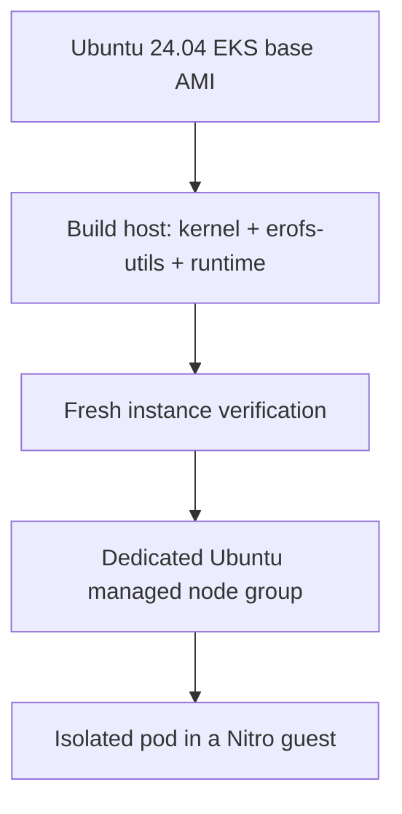
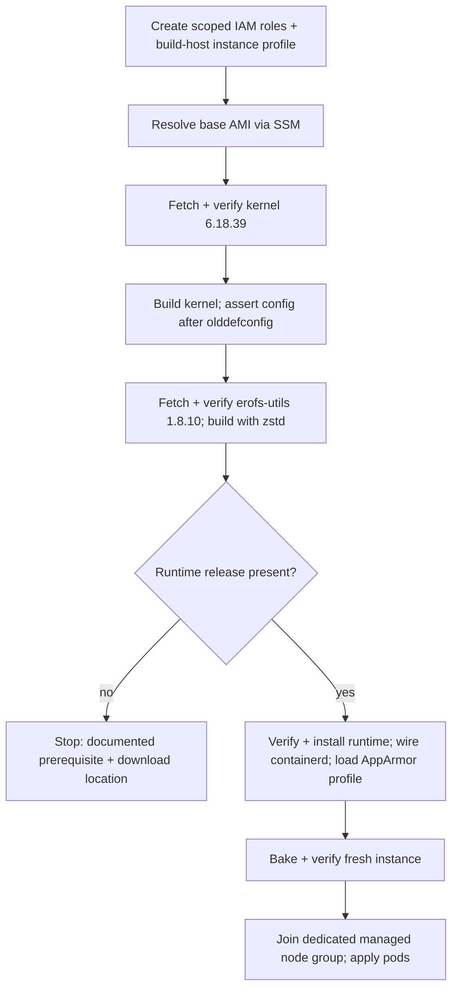

# Build an Ubuntu AMI for EKS Pod Isolation

Build a custom Ubuntu 24.04 node AMI for Amazon EKS Pod Isolation, add one dedicated,
tainted managed node group to an **existing cluster**, and run an isolated pod on that
node. Ubuntu is the **node operating system**; application containers can use their own
distributions.

This sample serves readers who manage their own node OS and cannot rely on the managed
AMI that [Getting started](../../getting-started/hello-sandbox/README.md) depends on
(EKS Auto Mode provisions sandbox-capable nodes for you, with no AMI build). It adds one
new, tainted node group; the cluster's existing node groups and workloads are untouched,
and this sample never replaces or reconfigures an existing node group.

!!! warning "Stops on a documented prerequisite"

    The EKS Pod Isolation runtime (the containerd shim and CRI proxy, the sandbox
    hypervisor and its guest microVM image, and the host-kernel patch series) has **no
    public release yet**. Every other input this sample uses is public, pinned and
    checksum-verified today, and the whole build method is written against that release
    the moment it exists. Until then, the build stops cleanly at a documented
    prerequisite rather than substituting an internal or private artifact. See
    [Prerequisites](#prerequisites) and [Build](#build) for exactly where it stops and
    what unblocks it.



Allow a few hours for a fresh build: most of it is the kernel compile on the build host.
This is a planning estimate, not a timing measurement from a live run.

*Figure 1: The ubuntu-ami architecture, from pinned public inputs to the isolated sandbox
pod. Pinned public inputs feed the build host; the user-supplied EKS Pod Isolation runtime
installs once present. The build host bakes the AMI, a fresh instance verifies it, then the
verified AMI joins the dedicated, tainted managed node group, leaving the cluster's existing
node groups untouched.*

![The ubuntu-ami sample's architecture. Outside AWS Cloud: three pinned public inputs
(Linux kernel source, erofs-utils source, distro packages) feed into the build host, and a
dashed box for the EKS Pod Isolation runtime, marked user-supplied and pending public
release, feeds the build host's SSM Session Manager once installed. Inside AWS Cloud: the
build host (EC2, no inbound rule, reached only over SSM) builds the AMI and bakes it into a
fresh instance for verification. The verified instance joins the existing Amazon EKS
cluster's dedicated managed node group, which carries a NoSchedule taint and is separate
from the cluster's existing, untouched node groups. Inside that node group, the Ubuntu node
(EC2 instance) runs an isolated sandbox pod with runtimeClassName isolated-sandbox,
containing a Nitro guest VM with its own kernel and guest virtio block
devices.](images/architecture.png)

## How this differs from Getting started

[Getting started > Hello sandbox](../../getting-started/hello-sandbox/README.md) needs no
AMI: EKS Auto Mode already runs a sandbox-capable managed AMI, and the runtime classes
are there on day one. This sample is for the opposite case: a cluster that manages its
own node OS, where the sandbox-capable AMI does not exist yet and someone has to build
it.

- **One dedicated, tainted managed node group.** The build produces a launch template and
  a managed node group with a `NoSchedule` taint, so only a pod that explicitly tolerates
  it lands there. No existing node group is modified, relaunched or drained.
- **Starts from Getting started.** Run [hello-sandbox](../../getting-started/hello-sandbox/README.md)
  first so you have a cluster with the `isolated-sandbox` RuntimeClass and a working
  CNI; this sample adds compute to that cluster, it does not create one.
- **A build, not just a deploy.** The other samples apply manifests to compute that
  already exists. This one also builds the node image: resolve the base AMI, build a
  kernel, build `erofs-utils`, install the runtime, bake and verify a fresh instance,
  then join it.

## Prerequisites

- A cluster that has finished [Getting started > Hello sandbox](../../getting-started/hello-sandbox/README.md):
  EKS 1.36 or later, a working VPC CNI (or a compatible Cilium installation), and the
  `isolated-sandbox` RuntimeClass present.
- Private subnets in the cluster's VPC with egress to `apt`, kernel.org, the Canonical EKS
  SSM parameter path and the EKS/EC2/SSM APIs. This sample creates no network
  infrastructure.
- [`aws`](https://github.com/aws/aws-cli) CLI v2, [`kubectl`](https://github.com/kubernetes/kubectl),
  the [AWS Session Manager plugin](https://github.com/aws/session-manager-plugin), and
  `git`, `curl`/`wget` and `tar` to fetch and verify the public source archives below.
- Operator IAM permissions to create and remove EC2 instances, images, snapshots, a
  security group, a launch template, IAM roles and instance profiles, and an EKS managed
  node group, plus SSM Session Manager and Run Command access to the build and
  verification instances. These are the credentials you run `./setup.sh` with; the sample
  then creates two **scoped** roles of its own (below) from those credentials.
- **The two scoped roles the sample creates for the resources it launches.**
  [`scripts/00a-iam.sh`](scripts/00a-iam.sh) (run for you by `./setup.sh`) creates a
  build-host instance role (`AmazonSSMManagedInstanceCore` plus the scoped inline policy in
  [`deploy/iam-build-host-policy.json`](deploy/iam-build-host-policy.json): resolve the base
  AMI SSM parameter and read instance identity for the manifest, nothing more) and an EKS
  node role (the standard EKS worker policies in
  [`deploy/iam-node-trust-policy.json`](deploy/iam-node-trust-policy.json)'s trust plus
  `AmazonEKSWorkerNodePolicy`, `AmazonEC2ContainerRegistryReadOnly`, `AmazonEKS_CNI_Policy`
  and `AmazonSSMManagedInstanceCore`). Both are tagged `ManagedBy=<RESOURCE_PREFIX>` so
  `./clean.sh --delete-aws-resources` removes them. Neither is an admin role: each is
  limited to the build, EKS join and cleanup actions the sample needs.
- **SSM-based build-host access, no inbound rule.** The build security group opens no
  inbound port; you reach the build and verification instances over SSM Session Manager,
  which needs no bastion, no SSH key and no open port.

### Public inputs, pinned and checksum-verified

Every input in this list is public, and the build verifies each one against the pin
below before using it; a mismatch aborts the build with no override flag. The lock file,
[`packages/sources.lock`](packages/sources.lock), is the one tracked place all of these
pins live, with a note on how each was obtained and verified. The plain-text
[`packages/SOURCES.txt`](packages/SOURCES.txt) gives the same provenance in prose, for a
reader who wants the "why" without parsing the lock file's key/value blocks.

| Input | Pin | SHA-256 | Source |
|---|---|---|---|
| Ubuntu 24.04 EKS base AMI | Kubernetes 1.36 | n/a (signed AMI) | Canonical's public EKS AMI SSM parameter path, resolved per Region at build time |
| Linux kernel source | `6.18.39` | `a7a7e3d2ae9d95e74197223a8d4eb5f6be7aac21b6e6de27e9685d001c1f8cb0` | `https://cdn.kernel.org/pub/linux/kernel/v6.x/linux-6.18.39.tar.xz` |
| erofs-utils source | `1.8.10` | `05eb4edebe11decce6ecb34e98d2f80c8cd283c2f2967d8ba7efd58418570514` | kernel.org cgit snapshot `erofs-utils-1.8.10.tar.gz` |
| Distro packages | capability-asserted, versions recorded from the run | verified by `apt`'s signed repository metadata | Ubuntu `apt` repositories |

No bare `latest` or moving tag is used anywhere in the build: the kernel and erofs-utils
versions above are exact, and the base AMI is pinned to a Kubernetes version, not a
floating "newest" alias. A version bump re-records the pin and SHA-256 here, in the lock
file and in `packages/SOURCES.txt`, and the build re-asserts the kernel config and re-runs
the live checks. Checking a version string alone is not sufficient.

The erofs-utils snapshot is a cgit-generated archive of a tag, not an upstream release
tarball with its own published checksum, so that SHA-256 is pinned by this sample itself
(confirmed identical across two independent fetches), not quoted from upstream. The base
AMI has no separate SHA-256 to pin: it is a signed image resolved from a Parameter Store
value Canonical's own AWS account owns, and the build records the resolved image name and
ID it actually used rather than hard-coding a Region-specific AMI ID.

To produce one offline-consumable archive of the pinned public source inputs (kernel,
erofs-utils) with its SBOM, license summary and provenance record, run
[`packages/make-bundle.sh build`](packages/make-bundle.sh); consume a pre-built bundle on
a restricted-network host with `packages/make-bundle.sh consume <bundle-dir>`. See
[`packages/test-bundle.sh`](packages/test-bundle.sh) for the fail-closed proof (a tampered
or missing bundle is rejected, a good one verifies and extracts offline).

### The documented prerequisite: the EKS Pod Isolation runtime release

The build also needs two artifacts that AWS has not yet published through a public
channel: the **EKS Pod Isolation runtime binaries and guest image** (the containerd shim,
the sandbox hypervisor and its guest microVM boot image and root disk, the Cedar policy
generator and the KMS key provider), and the **host-kernel patch series** that adds the
sandbox's host-kernel support (enclave driver, CMA pool, virtio/vsock) to the pinned
kernel.org 6.18.39 tree above.

At the time of writing, there is no public release for either artifact: there is no public
GitHub repository or release for the runtime, the hypervisor fork or the guest image, and
the public Amazon EKS User Guide has no page for the feature yet, so there is no documented
public download location to cite. This is a property of the feature's pre-GA release stage,
not a gap in this sample. The pre-GA distribution channels that exist today hand the two
archives to a customer through Amazon-authenticated channels gated to a named recipient,
not something an anonymous repository reader can fetch; pointing the sample at them would
violate the acceptance criterion against requiring a private artifact, and those links are
neither public nor durable. So this sample cannot name a download URL for them without
pointing at something gated or private, which would violate this repository's rule against
private or internal artifacts. Instead:

- **The public channel this will ship through** is the Amazon EKS User Guide's download
  location for EKS Pod Isolation, once that page exists. This page cites it by title,
  *Amazon EKS User Guide: Building your AMI for Nitro Sandboxes*, not a link, because the
  page does not exist publicly yet. Check the [Amazon EKS User
  Guide](https://docs.aws.amazon.com/eks/latest/userguide/) for that page before you run
  this sample; once it is live, download the released runtime archive and the patch
  series archive from there.
- **Where the released archives go.** Place the downloaded archives at the paths
  `config.env` names: `RUNTIME_ARTIFACTS_DIR` for the directory, with the runtime archive
  and patch-series archive filenames the release publishes. `setup.sh`'s preflight checks
  for them at those paths.
- Until the release exists, `./setup.sh --prepare` reports this prerequisite and stops
  cleanly, rather than building a partial image. See [Build](#build) for exactly what the
  preflight checks and what it does when the archives are present.

## Build

```bash
cd examples/setup/ubuntu-ami
cp config.env.example config.env
# Set BUILD_SUBNET_ID, NODE_SUBNET_IDS and RUNTIME_ARTIFACTS_DIR.
# Your usual CLUSTER_NAME, AWS_REGION and AWS_PROFILE remain in effect.
$EDITOR config.env

./setup.sh --prepare   # preflight only: resolves pins, checks the runtime prerequisite
./setup.sh             # build, bake, verify, join, and run the pod
./test.sh              # read live node and guest evidence again
./clean.sh --dry-run    # preview what a full clean up would remove
```



**1. Resolve the base AMI.** `./setup.sh --prepare` resolves the Canonical EKS Ubuntu
24.04 AMI ID for Kubernetes 1.36 from the public SSM parameter path for your Region, and
records the resolved image name and ID; it does not hard-code an AMI ID, which is
Region-specific and rotates as Canonical republishes.

**2. Build the host kernel.** The build host fetches `linux-6.18.39.tar.xz` from
kernel.org, verifies it against the pinned SHA-256 above (kernel.org's own
`sha256sums.asc` confirms the same value), and builds it. The config is generated from
the running base AMI's own config plus the sandbox symbols the patch series needs, then
passed through `olddefconfig`. The build asserts that every required symbol (BTF, the
Nitro Enclaves device, CMA, `vsock`, TUN, EROFS) **survived** `olddefconfig`, because
`olddefconfig` silently drops a symbol whose gating menu is off (checking the symbol
list beforehand is not sufficient, only the result after is).

**3. Build erofs-utils with zstd.** The containerd shim builds each container's EROFS
filesystem with zstd compression and has no fallback. Ubuntu 24.04's distro erofs-utils
(1.7.1) ships without zstd, so the build fetches the `1.8.10` cgit snapshot, verifies it
against the pinned SHA-256 above, and builds it with `--enable-lz4 --with-libzstd`. Since
`mkfs.erofs` has no stable `--version` flag, the build records the installed binary's own
SHA-256 in the on-image manifest.

**4. Preflight-check the runtime release, then install it.** Before touching the runtime
step, the build checks for the two released archives at the paths `RUNTIME_ARTIFACTS_DIR`
names. If they are absent, `setup.sh` **stops with the prerequisite and the download
location** from [Prerequisites](#prerequisites); it never falls back to an internal
source or a private URL. If present, each archive is checksum-verified before anything is
unpacked: the release ships SHA-256 files for the large binary artifacts, and the build
records a SHA-256 for the smaller components the release ships without one, into both the
lock file and the on-image manifest, so the installed set stays auditable either way.

**Observe:** `./setup.sh --prepare` reports `Preflight OK` for every public input and,
once the runtime release exists, also for the runtime archives; until then it reports the
prerequisite and stops. A completed `./setup.sh` writes a plain-text manifest on the image
(for example `/etc/nip-custom-ami-manifest`) recording the base AMI, the kernel release
string and its source SHA-256, the applied patch count, the erofs-utils version and
installed binary hash, each runtime artifact's SHA-256, and the observed containerd
version, so a later reader can audit the image's full provenance without the build host.

> **containerd is a gate, not an install.** The build checks that the node's containerd
> is a version the runtime's shim bootstrap protocol supports; it never upgrades or
> downgrades the shared containerd already on the base AMI.

## Evidence

> **No live run has happened yet.** The blocks below are clearly labeled EXAMPLE output,
> shaped the way this sample's own checks produce it, so a reader knows what to expect.
> They are a design input, not acceptance evidence. The implementation PR that lands the
> runtime release replaces every block below with a fresh end-to-end run and says so in
> the PR description.

**Node vs guest kernel, and host vs guest block devices.** The same shape Getting started
uses: the node reports the host instance's own view, the guest pod reports its VM's.

```text
# EXAMPLE -- node (host)
$ ssh-via-ssm <build-host> -- uname -r; ls -1 /sys/block
6.18.39
nvme0n1
nvme1n1

# EXAMPLE -- guest (isolated pod)
$ kubectl exec ubuntu-sandbox -- sh -c 'uname -r; ls -1 /sys/block'
6.18.39
vda
vdb
```

**Boot uptime matches the pod's age**, because the VM boots with the pod:

```text
# EXAMPLE
$ kubectl exec ubuntu-sandbox -- cat /proc/uptime
24.1 21.8
$ kubectl get pod ubuntu-sandbox
NAME             READY   STATUS    RESTARTS   AGE
ubuntu-sandbox   1/1     Running   0          28s
```

**Host-requirement accept/reject controls.** Each control below is proven both ways: one
run that has the requirement and passes, one that is missing it and is refused, per this
repository's rule that a check proven only on good input cannot be told apart from one
that accepts everything.

| Control | Accepts | Refuses |
|---|---|---|
| Kernel config assertion | every required symbol present after `olddefconfig` | a config missing a required symbol (for example BTF or CMA dropped by its gating menu) |
| BTF presence | `/sys/kernel/btf/vmlinux` present, module BTF resolvable | a kernel built without `CONFIG_DEBUG_INFO_BTF` |
| Nitro Enclaves device | the enclave device node present after reboot on enclave-enabled placement | the same check on a non-enclave-enabled instance type |
| CMA pool | the configured CMA size reserved and reported at boot | a kernel command line with no `cma=` reservation |
| `vsock` | the guest agent's `vsock` handshake completes | the handshake attempted before the module loads |
| TUN | `/dev/net/tun` present and usable by the runtime | the device node absent |
| EROFS + zstd | `mkfs.erofs` builds a zstd-compressed image | the distro's stock erofs-utils (no zstd) attempting the same build |
| Runtime wiring | the containerd runtime handler for `isolated-sandbox` resolves and a pod schedules | the handler absent, or the socket path wrong, and the pod stuck `ContainerCreating` |

**AppArmor: a working profile vs a refused control.** Unlike the AL2023 path, Ubuntu's
kernel in this build carries full AppArmor support (there is no AL2023-style sidecar
kernel import here, so no LSM is disabled). The node enforces a working AppArmor profile
for one control and shows the same control refused when the profile denies it:

The profile ([`manifests/ubuntu-ami-sample-profile`](manifests/ubuntu-ami-sample-profile))
is installed and loaded onto the AMI by [`scripts/35-apparmor.sh`](scripts/35-apparmor.sh),
so the node already carries it when the pod requests it; without that step the kubelet
would refuse the pod and the accept control would be indistinguishable from the reject
control below. The reject control
([`deploy/pod-apparmor-reject.yaml`](deploy/pod-apparmor-reject.yaml)) asks for a profile
the node never loaded and is refused.

```text
# EXAMPLE -- AppArmor profile loaded and enforcing
$ ssh-via-ssm <build-host> -- aa-status --json | python3 -c \
  'import json,sys; d=json.load(sys.stdin); print(d["profiles"].get("ubuntu-ami-sample-profile", "absent"))'
enforce

# EXAMPLE -- a denied action under that profile
$ kubectl exec isolated-sandbox-pod -n ubuntu-ami-sample -- sh -c 'echo test > /etc/shadow' 2>&1
sh: can't create /etc/shadow: Permission denied
```

## Cost note

Allow a few hours for a fresh build; most of the time is the kernel compile on the build
host. Resources that keep billing if a build fails partway: the build EC2 instance and its
120 GiB+ root volume, any EBS snapshots already taken, the verification instance (if the
build reached that stage), and, once a node group exists, its EC2 instances. `Cleanup`
below removes all of these; run it promptly after a failed or abandoned run so nothing
keeps billing unattended.

## Clean up

Run clean up right after you finish validating, before moving on:

```bash
./clean.sh --dry-run                # list only this run's owned resources; nothing is removed
./clean.sh                          # remove the demo's Kubernetes workload
./clean.sh --delete-aws-resources   # also remove the owned AWS infrastructure and AMI
```

`./clean.sh --dry-run` lists only resources this run created and tagged as its own; it
changes nothing. A bare `./clean.sh` removes only the Kubernetes validation workload (the
sample's namespace, after confirming its ownership label), leaving the node group and AMI
in place for a longer investigation. `./clean.sh --delete-aws-resources` does the full
teardown: it removes, in order, the Kubernetes workload, the managed node group, the
launch template, the build and verification EC2 instances, the build security group, the
instance profile and the IAM roles the sample created ([`scripts/00a-iam.sh`](scripts/00a-iam.sh),
found by their `ManagedBy=<RESOURCE_PREFIX>` tag), and the AMI and its backing snapshots.
It then re-lists each category to verify nothing it owns remains, and exits non-zero if
anything it expected to remove is still there, rather than reporting success on an
incomplete clean up.

## Troubleshooting

<details>
<summary>Preflight stops with the runtime-release prerequisite</summary>

Expected until AWS publishes a public release for the EKS Pod Isolation runtime and the
host-kernel patch series; see
[The documented prerequisite](#the-documented-prerequisite-the-eks-pod-isolation-runtime-release).
Check the Amazon EKS User Guide for the feature's download page, and once it is live, set
`RUNTIME_ARTIFACTS_DIR` in `config.env` to the directory holding the released archives.

</details>

<details>
<summary>Kernel config assertion fails after <code>olddefconfig</code></summary>

A required symbol was present in the merged config but got dropped once
`olddefconfig` resolved dependencies, usually because the symbol's gating menu
(`CONFIG_EXPERT`, a bus or device class) was off. Check the specific symbol
`olddefconfig` reports missing against its Kconfig entry's `depends on` line, enable the
gating option, and rebuild; the assertion is deliberately on the post-`olddefconfig`
result, not the pre-merge request.

</details>

<details>
<summary>Build host unreachable over SSM</summary>

Confirm the instance has the SSM agent and an instance profile with
`AmazonSSMManagedInstanceCore` (or an equivalent scoped policy), and that the subnet has
egress to the SSM endpoints. There is no SSH fallback: the build security group opens no
inbound rule by design.

</details>

<details>
<summary>Node group never reaches <code>ACTIVE</code>, or the pod stays <code>ContainerCreating</code></summary>

Check that the launch template's AMI is the one `./setup.sh` baked (not a base Canonical
AMI), that the node's containerd config registers the `isolated-sandbox` runtime handler,
and that the runtime's CRI proxy socket exists and is reachable. A pod stuck
`ContainerCreating` with no further event usually means the socket path in the containerd
template does not match where the installed runtime actually listens.

</details>

<details>
<summary>erofs-utils build fails, or images build without zstd</summary>

Confirm `libzstd-dev` is installed before `./configure`, and that the snapshot's SHA-256
still matches the pinned value: cgit can regenerate a snapshot archive's bytes without
changing the tag it names, and this sample's own pin tracks the bytes, not just the tag.

</details>

<details>
<summary>Origin and source layout</summary>

Ported from the maintainers' internal demo for this node, following this repository's
rule to leave behind internal source trees, hosts and URLs, and to use only public, pinned
inputs for the kernel and erofs-utils, with the EKS Pod Isolation runtime consumed as
released artifacts rather than internal source. See
[Public inputs, pinned and checksum-verified](#public-inputs-pinned-and-checksum-verified)
and [`packages/SOURCES.txt`](packages/SOURCES.txt) for the full provenance record.

The implementation entry points are `setup.sh`, `test.sh` and `clean.sh`. The build
stages live under `scripts/`; `deploy/` holds the validation pods and node-group inputs;
`manifests/` holds the containerd and launch-template fragments; `packages/sources.lock`
records every pin and checksum this page summarizes, and `packages/SOURCES.txt` records
how each input was obtained and verified, in prose.

</details>

</content>
</file></parameter>
</invoke>
