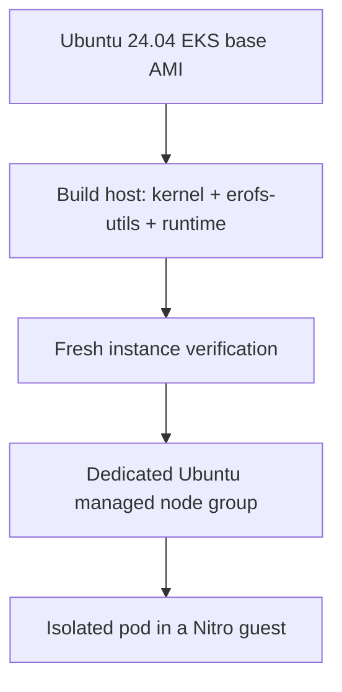
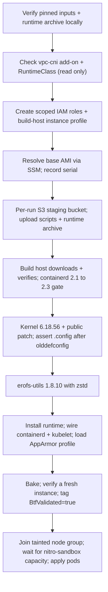

# Build an Ubuntu AMI for EKS Pod Isolation

!!! danger "Not ready to merge to `main` as an available sample"

    This sample is **not ready to be merged to `main` and marked available**. It is
    authored against the Nitro sandbox GA node-build bundle dated 2026-10-28 and
    static-verified (every clusterless check below passes both ways), but the fresh
    end-to-end run this page needs has not happened yet. Before this sample can merge to
    `main` as available, all of the
    following MUST happen:

    1. **Settle how a reader gets the runtime archive.** The runtime binaries and guest
       image ship as one operator-supplied preview archive, checksum-pinned, with no public
       download: a reader obtains it from their AWS account team. Its exact name and every
       SHA-256 are pinned below. The maintainers decide whether that meets the Issue #10
       criterion that every required input is available to an external reader, or the
       sample waits for a public channel; its license and redistribution terms are recorded
       with that decision.
    2. **Run the whole thing live.** Run a fresh AMI build, a fresh second-instance
       verification, and the node-join and sandbox-pod tests on a live cluster.
    3. **Show the AppArmor result on that run.** A sandbox pod cannot take a host AppArmor
       profile: its profile is applied by runc inside the guest, which has no AppArmor, as
       the GA bundle says and a validation run of this sample showed (see
       [Evidence](#evidence)). So the sandbox pod runs `Unconfined`, and the scoped
       `Localhost` profile Issue #10 asks for is proven on an ordinary pod on the same node,
       next to a refused control. The fresh run must fill all four AppArmor blocks under
       [Evidence](#evidence).
    4. **Replace every placeholder with real captured output.** Every
       `TODO: output from the fresh run` block below must hold real captured output from
       that run, nothing written by hand.
    5. **Run the cleanup and confirm absence.** Run
       `./clean.sh --delete-aws-resources --keep-ami` after the last run (issue #11 builds
       on the AMI), confirm it reports every other resource of the run gone, and say what is
       left.

    Until all five are done, this sample stays a draft and is not marked `(available now)`.

!!! warning "Status: authored and static-verified against the GA bundle; no live run yet"

    Every script parses, every pinned input checksum-verifies, and every clusterless check
    is proven both ways (see [Clusterless checks](#clusterless-checks)), but **the fresh
    end-to-end AWS run has not been performed**. See [Evidence](#evidence) for what is still a
    `TODO: output from the fresh run` placeholder.

Build a custom Ubuntu 24.04 node AMI for Amazon EKS Pod Isolation, add one dedicated,
tainted managed node group to an **existing cluster**, and run an isolated pod on that
node. Ubuntu is the **node operating system**; application containers can use their own
distributions.

This sample serves readers who manage their own node OS and cannot rely on the managed
AMI that [Getting started](../../getting-started/hello-sandbox/README.md) depends on
(EKS Auto Mode provisions sandbox-capable nodes for you, with no AMI build). It adds one
new, tainted node group; the cluster's existing node groups and workloads are untouched,
and this sample never replaces or reconfigures an existing node group.

!!! warning "Stops on a documented prerequisite"

    The Nitro sandbox runtime archive (`nitro-sandbox-binaries-2026-10-28.zip`: the
    containerd shim and CRI proxy, Firecracker and its jailer, the guest boot image and root
    disk, the policy generator and the key provider) is an **operator-supplied preview
    archive, checksum-pinned, with no public download**. Every other input is public, pinned
    and checksum-verified, including the
    host-kernel change, which is AWS's public kernel commit on GitHub. Until you place the
    archive where `config.env` says, `./setup.sh --prepare` stops cleanly at that
    prerequisite rather than substituting an internal or private artifact. See
    [The runtime archive](#the-runtime-archive).



Allow a few hours for a fresh build: most of it is the kernel compile on the build host.
This is a planning estimate, not a timing measurement from a live run.

*Figure 1: The ubuntu-ami architecture, from pinned public inputs to the isolated sandbox
pod. Pinned public inputs feed the build host; the user-supplied runtime archive installs
once present. The build host bakes the AMI, a fresh instance verifies it, then the verified
AMI joins the dedicated, tainted managed node group, leaving the cluster's existing node
groups untouched.*

![The ubuntu-ami sample's architecture. Outside AWS Cloud: three pinned public inputs
(Linux kernel source, erofs-utils source, distro packages) feed into the build host, and a
dashed box for the EKS Pod Isolation runtime, marked user-supplied and pending public
release, feeds the build host's SSM Session Manager once installed. Inside AWS Cloud: the
build host (EC2, no inbound rule, reached only over SSM) builds the AMI and bakes it into a
fresh instance for verification. The verified instance joins the existing Amazon EKS
cluster's dedicated managed node group, which carries a NoSchedule taint and is separate
from the cluster's existing, untouched node groups. Inside that node group, the Ubuntu node
(EC2 instance) runs an isolated sandbox pod with runtimeClassName isolated-sandbox,
containing a Nitro guest VM with its own kernel and guest virtio block
devices.](images/architecture.png)

## How this differs from Getting started

[Getting started > Hello sandbox](../../getting-started/hello-sandbox/README.md) needs no
AMI: EKS Auto Mode already runs a sandbox-capable managed AMI, and the runtime classes
are there on day one. This sample is for the opposite case: a cluster that manages its
own node OS, where the sandbox-capable AMI does not exist yet and someone has to build
it.

- **One dedicated, tainted managed node group.** The build produces a launch template and
  a managed node group with a `NoSchedule` taint, so only a pod that explicitly tolerates
  it lands there. No existing node group is modified, relaunched or drained.
- **Starts from Getting started.** Run [hello-sandbox](../../getting-started/hello-sandbox/README.md)
  first so you have a cluster with the `isolated-sandbox` RuntimeClass; this sample adds
  compute to that cluster, it does not create one.
- **A build, not just a deploy.** The other samples apply manifests to compute that
  already exists. This one also builds the node image: resolve the base AMI, build a
  kernel, build `erofs-utils`, install the runtime, bake and verify a fresh instance,
  then join it.

## Prerequisites

- A cluster that has finished [Getting started > Hello sandbox](../../getting-started/hello-sandbox/README.md):
  EKS 1.36 or later with the `isolated-sandbox` RuntimeClass present. The sample reuses
  that RuntimeClass as it is and never creates or changes it; it checks that every label
  the RuntimeClass selects (`eks.amazonaws.com/nitro-sandbox=true`) is one the sample's
  node registers with, and stops if not.
- **The managed `vpc-cni` add-on, with network policy on.** A managed node group node gets
  its pod network from this add-on's `aws-node` DaemonSet; EKS Auto Mode nodes do not need
  it, so a cluster that only ran Getting started can lack it, and then the sample's node
  never becomes `Ready`. Network policy on is what enforces
  [`deploy/network-policy.yaml`](deploy/network-policy.yaml) on that node. This is a
  cluster-wide setting, so you install it yourself, at a version you pin; the sample only
  checks it ([`scripts/00c-check-cluster.sh`](scripts/00c-check-cluster.sh)) and stops with
  this command when it is missing:

  ```bash
  aws eks describe-addon-versions --region <AWS_REGION> --addon-name vpc-cni \
    --kubernetes-version 1.36 --query 'addons[0].addonVersions[].addonVersion'
  aws eks create-addon --region <AWS_REGION> --cluster-name <CLUSTER_NAME> \
    --addon-name vpc-cni --addon-version <VPC_CNI_ADDON_VERSION> \
    --resolve-conflicts NONE \
    --configuration-values '{"enableNetworkPolicy":"true"}'
  ```

  `--resolve-conflicts NONE` makes the install fail rather than overwrite an existing
  `amazon-vpc-cni` ConfigMap. Record the version you chose as `VPC_CNI_ADDON_VERSION` in
  `config.env`; each run records the version it found.

  **Network policy enforcement is cluster-wide.** Turning it on makes every NetworkPolicy
  object already on the cluster start being enforced, for every workload, not only this
  sample's, so a policy that was written but never enforced can then cut traffic another team
  relies on. Review them first
  (`kubectl --context <your-context> get networkpolicy --all-namespaces`) and test the change
  on a cluster that is not production before you make it on a shared one. The sample never
  installs or changes the add-on: it checks it and stops with the command above.

- **A kubectl context for the same cluster, named in `KUBE_CONTEXT`.** Every `kubectl` call
  the scripts make passes `--context "$KUBE_CONTEXT"`; there is no fallback to the current
  context, and nothing runs `kubectl config use-context`. Before the first change,
  `./setup.sh`, `./test.sh` and `./clean.sh` compare that context's server URL with the API
  endpoint `aws eks describe-cluster` reports for `CLUSTER_NAME`, and stop on a mismatch or
  an unreadable context, so the kubectl side and the AWS side are always the same cluster.
- Private subnets in the cluster's VPC with egress to Ubuntu's `apt` mirrors, kernel.org,
  git.kernel.org, github.com, Amazon S3, and the EKS, EC2 and SSM APIs. This sample creates
  no network infrastructure.
- [`aws`](https://github.com/aws/aws-cli) CLI v2, [`kubectl`](https://github.com/kubernetes/kubectl),
  the [AWS Session Manager plugin](https://github.com/aws/session-manager-plugin), Python 3,
  `curl` and `tar`.
- Operator IAM permissions to create and remove EC2 instances, images, snapshots, a
  security group, a launch template, IAM roles, inline role policies and instance profiles,
  an S3 bucket (create, tag, Block Public Access, default encryption, bucket policy, put and
  delete objects, delete), and an EKS managed node group; to list and delete the cluster's
  access entries (the clean up removes the one EKS creates for the node role); to read the
  cluster, its add-ons and the Canonical SSM parameter; plus SSM Run Command access to the build and
  verification instances. These are the credentials you run `./setup.sh` with; the sample
  then creates two **scoped** roles of its own (below).
- **The two scoped roles the sample creates for the resources it launches.**
  [`scripts/00a-iam.sh`](scripts/00a-iam.sh) (run for you by `./setup.sh`) creates:
  - a **build-host instance role** with `AmazonSSMManagedInstanceCore` (SSM, no inbound
    rule) and nothing else standing. For the few minutes the build host downloads its
    staged files, `./setup.sh` adds
    [`deploy/iam-build-host-policy.json`](deploy/iam-build-host-policy.json), rendered for
    this run: `s3:GetObject` on `<staging-bucket>/<run-id>/*` and `s3:ListBucket` limited to
    that prefix (the Systems Manager document `AWS-RunRemoteScript` that downloads the
    objects needs both), then deletes it again;
  - an **EKS node role** with the standard worker policies
    ([`deploy/iam-node-trust-policy.json`](deploy/iam-node-trust-policy.json)'s trust plus
    `AmazonEKSWorkerNodePolicy`, `AmazonEC2ContainerRegistryReadOnly`, `AmazonEKS_CNI_Policy`
    and `AmazonSSMManagedInstanceCore`).

  Both are named for the run (`<RESOURCE_PREFIX>-<RUN_ID>-build` and `-node`) and tagged
  `ManagedBy=<RESOURCE_PREFIX>` and `RunId=<RUN_ID>`, so `./clean.sh --delete-aws-resources`
  removes them and nothing else. A same-named role is reused only when it carries both tags,
  the trust policy above, exactly the managed policies above and no inline policy; anything
  else stops the run. Neither is an admin role.
- **IMDSv2 only, hop limit 1, on every instance the sample launches.** The build host, the
  verification instance and the node group's nodes (through the launch template) all require
  IMDSv2 tokens with a response hop limit of 1, so a container cannot reach the instance's
  credentials through the metadata service. A pod that needs AWS access uses
  EKS Pod Identity, never the node's role. Each launch spec is rendered, checked
  ([`scripts/lib/launch_spec.py`](scripts/lib/launch_spec.py)) and sent to EC2 as that same
  file.
- **SSM-based build-host access, no inbound rule.** The build security group opens no
  inbound port (`./setup.sh` checks it has none); you reach the build and verification
  instances over SSM, which needs no bastion, no SSH key and no open port.
- **A build instance type with room for the kernel compile.** The default build host is
  `m8i.4xlarge`, the type the GA bundle's kernel build was validated on; on `m8i.xlarge`
  the compile takes about four times as long. Nitro Enclaves must be enabled on it (the
  script does that) and Secure Boot off (Canonical's EKS AMI boots with it off; the build
  checks).

### Public inputs, pinned and checksum-verified

Every input in this list is public, and the build verifies each one against the pin
below before using it; a mismatch aborts the build with no override flag. The lock file,
[`packages/sources.lock`](packages/sources.lock), is the one tracked place all of these
pins live, with a note on how each was obtained and verified. The plain-text
[`packages/SOURCES.txt`](packages/SOURCES.txt) gives the same provenance in prose.

| Input | Pin | SHA-256 | Source |
|---|---|---|---|
| Ubuntu 24.04 EKS base AMI | Kubernetes 1.36 | n/a (signed AMI) | Canonical's public EKS AMI SSM parameter path, resolved per Region at build time |
| Linux kernel source | `6.18.56` | `4633bbda2ab95eaf2a7af4041236451d6759c72e6946265531af4b3aacefbf89` | [`linux-6.18.56.tar.xz`](https://cdn.kernel.org/pub/linux/kernel/v6.x/linux-6.18.56.tar.xz) on kernel.org |
| Host-kernel patch | commit `1e66c960b982c94bda76ebd0129eaecf0a68b46e` | `051ede9dff52d24fb7ff47dd783a9eb2f6b18c742dbf151926cb48304d72924b` | [amazonlinux/linux 1e66c960 as a patch](https://github.com/amazonlinux/linux/commit/1e66c960b982c94bda76ebd0129eaecf0a68b46e.patch) on GitHub |
| erofs-utils source | `1.8.10` | `05eb4edebe11decce6ecb34e98d2f80c8cd283c2f2967d8ba7efd58418570514` | kernel.org cgit snapshot `erofs-utils-1.8.10.tar.gz` |
| Distro packages | capability-asserted, versions recorded from the run | verified by `apt`'s signed repository metadata | Ubuntu `apt` repositories |

How each pin was checked:

- **Kernel.** The SHA-256 is the `linux-6.18.56.tar.xz` line of kernel.org's
  [`sha256sums.asc`](https://cdn.kernel.org/pub/linux/kernel/v6.x/sha256sums.asc), whose
  signature verifies with the Kernel.org checksum autosigner key
  (`B8868C80BA62A1FFFAF5FDA9632D3A06589DA6B1`, from kernel.org's `pgpkeys` repository); the
  tarball also verifies against its stable-release signature `linux-6.18.56.tar.sign`
  (`647F28654894E3BD457199BE38DBBDC86092693E`).
- **Host-kernel patch.** One squashed public commit on Amazon Linux's kernel tree,
  `nitro_enclaves: Amazon Nitro Enclaves extension (port onto 6.18.48)`, which applies
  cleanly to kernel.org 6.18.56. GitHub serves any commit as a patch at its commit URL plus
  `.patch`; [`packages/fetch-kernel-patch.sh`](packages/fetch-kernel-patch.sh) checks the
  SHA-256 and the commit id in the patch's first line before the file takes its final name,
  and the kernel build applies it with `git am` and checks it landed as exactly one commit
  with that subject.
- **erofs-utils.** A cgit snapshot of a tag has no upstream-published checksum, so the
  SHA-256 is pinned by this sample itself (confirmed identical across independent fetches).
- **Base AMI.** No SHA-256 to pin: it is a signed image resolved from a Parameter Store
  value Canonical's own AWS account owns. Canonical republishes it under new serials (the
  image name ends in the serial), so the build records the image ID, name and serial it
  resolved rather than hard-coding a Region-specific AMI ID, and checks that image's
  containerd before it builds anything.

No bare `latest` or moving tag is used anywhere in the build. A version bump re-records the
pin and SHA-256 here, in the lock file and in `packages/SOURCES.txt`, and the build
re-asserts the kernel config and re-runs the live checks. Checking a version string alone is
not sufficient.

To produce one offline-consumable archive of the pinned public file inputs (kernel,
host-kernel patch, erofs-utils) with its SBOM, license summary and provenance record, run
[`packages/make-bundle.sh build`](packages/make-bundle.sh); consume a pre-built bundle on
a restricted-network host with `packages/make-bundle.sh consume <bundle-dir>`. The runtime
archive is never bundled.

### The runtime archive

The runtime ships as one flat zip, `nitro-sandbox-binaries-2026-10-28.zip`, with a
`SHA256SUMS` inside that covers all eight files. It is an operator-supplied preview archive, checksum-pinned, with no public download: **ask your AWS account team for it**. Never commit it, and never put
it in this sample folder.

| File | SHA-256 | Installed on the node as |
|---|---|---|
| `nitro-sandbox-binaries-2026-10-28.zip` (the archive) | `6830dc8d0acb356b06753fed609ebb9f03a182e340eaa27cd9ed171f7667ba40` | not installed; verified, unpacked, then removed before baking |
| `containerd-shim-nitro-sandbox-v2` | `991a3786577d19ec3ee5005c90530cc1b2464c052af0218b1064f54c3c2aa7c9` | `/usr/sbin/containerd-shim-nitro-sandbox-v2`, mode 0755 (also the CRI proxy) |
| `firecracker` | `13a369b76af5f87039944f52dd6c4ef292cfdfc818a9b6e87d174b86920f5a31` | `/usr/bin/firecracker`, mode 0755 |
| `jailer` | `b7067964a02a0f6a35244a54a763f8bc420dac8c5ff4d471b2102845357293a3` | `/usr/bin/jailer`, mode 0755 (it unpacks as 0644) |
| `eks-nitro-sandbox-genpolicy` | `8bb076d5f4c631f9a0a91c58f249876f49d1c4f794b7241fbbbb2398da3fbad2` | `/usr/local/bin/eks-nitro-sandbox-genpolicy`, mode 0755 |
| `nitro-sandbox-keyprovider` | `57407a2f47e56ee46736bcdce73d48a6a10af25c613dfa08370cd0c081814c3f` | `/usr/local/bin/nitro-sandbox-keyprovider`, mode 0755 |
| `latest.eif` | `31f21cf805e193710295a1dbee2e98847c4d8a0cc040597cb6abc39d3aad5105` | `/var/lib/nitro-sandbox-images/latest.eif`, mode 0644 (guest boot image, guest kernel 6.18.54) |
| `latest-disk.img` | `932a251aab211785c10620ab17ac314f5c09da3c2b61f7917acdf2208b6c3eb7` | `/var/lib/nitro-sandbox-images/latest-disk.img`, mode 0644, with `rootfs.ext4` linked to it |
| `nitro-sandbox-agent` | `df85d0ea5b5021004110b2322283e2bd35b01c668ffd838573bc8f28bc8b6b8c` | not installed on the host: the copy inside `latest-disk.img` runs in the guest |

Place the archive in `RUNTIME_ARTIFACTS_DIR`, which defaults to the repository's gitignored
`tmp/issue10/run/runtime` (all of this sample's local state lives under `tmp/issue10/run`, in
`logs/`, `out/` and `runtime/`). [`packages/fetch-runtime-artifacts.sh`](packages/fetch-runtime-artifacts.sh)
checks the archive's SHA-256, refuses any member that is not a plain file with a flat name,
unpacks it, and then fails closed unless `SHA256SUMS` lists every unpacked file exactly once,
every hash matches, and every file matches its pin in `packages/sources.lock`, so a
re-packed archive whose `SHA256SUMS` was edited to match is still refused.

## Build

```bash
cd examples/setup/ubuntu-ami
cp config.env.example config.env
# Set KUBE_CONTEXT (the kubectl context of CLUSTER_NAME), BUILD_SUBNET_ID, NODE_SUBNET_IDS and
# VPC_CNI_ADDON_VERSION. Your usual CLUSTER_NAME, AWS_REGION and AWS_PROFILE remain in effect.
# The scripts pass --context "$KUBE_CONTEXT" to every kubectl call and never change the
# current context.
$EDITOR config.env

./setup.sh --prepare   # local only: verify every pinned input and the runtime archive
./setup.sh             # check the cluster, build, bake, verify, join, and run the pods
# or in two stages:
#   ./setup.sh --ami-only              # build, verify and tag the AMI; no cluster needed
#   RUN_ID=<id> ./setup.sh --join      # later: join that run's AMI and run the pods
./test.sh              # read live node and guest evidence again
./clean.sh --dry-run   # preview what a full clean up would remove
```



**Every run has its own id.** `./setup.sh` picks a run id (a UTC timestamp plus four random hex
digits, such as `20261028t221500z3f9a`, or the `RUN_ID` you pass to resume a run), reserves the
run's folder so no other start can share it, and records the id as the current run in
`tmp/issue10/run/out/run-state.env` just before its first AWS change, so a run that stops on a
read-only check leaves the previous run as the current one; the run's private evidence goes under
`tmp/issue10/run/out/runs/<run-id>/evidence/`. Every name the run creates is derived from it
(`<RESOURCE_PREFIX>-<RUN_ID>-build` for the build role and instance profile, `-node` for the
node role, `-build-sg`, `-lt`, `-ng`, `-verify`, `-stage-read` for the staging policy, and
`<RESOURCE_PREFIX>-stage-<RUN_ID>-<6 hex>` for the bucket), checked against the IAM, EKS and
S3 name limits, and every AWS resource it creates carries both `ManagedBy=<RESOURCE_PREFIX>`
and `RunId=<RUN_ID>`, including the verification instance and, through the launch template,
every node instance and volume. A resource with the run's name is reused only when it carries
both tags; a mismatch or a failed lookup stops the run. The namespace carries
`app.kubernetes.io/part-of=<RESOURCE_PREFIX>` and `app.kubernetes.io/instance=<RUN_ID>`.

**Build the AMI now, join it later.** `./setup.sh --ami-only` checks the inputs, runs steps 2
to 7 below through the `BtfValidated=true` tag, records the AMI ID in the run's
`tmp/issue10/run/out/runs/<run-id>/run-state.env`, and stops. It never reads or changes the
cluster, so it needs no `KUBE_CONTEXT`, no `vpc-cni` add-on and no `NODE_SUBNET_IDS`. The
`cilium-ubuntu` sample (issue #11) needs only this AMI. `RUN_ID=<id> ./setup.sh --join` does
step 8 for that run: before it changes anything, it checks that the run's AMI carries
`ManagedBy`, the run's `RunId` and `BtfValidated=true`, that `KUBE_CONTEXT` is
`CLUSTER_NAME`, and that the cluster prerequisites in step 1 hold; then it joins the node group
and applies the pods. It never builds an AMI. Without either flag, `./setup.sh` does both in
one run and checks the cluster first, before anything is created.

**Every wait has a deadline.** The AWS CLI waiters give up after about 100 seconds for an SSM
command and 600 seconds for an AMI, which is less than the kernel build and a large snapshot
can take, so [`scripts/lib/aws-wait.sh`](scripts/lib/aws-wait.sh) polls instead. An SSM
command is read about every 15 seconds until it ends, for up to its own `executionTimeout`
plus 300 seconds, and `Failed`, `Cancelled`, `TimedOut`, `Undeliverable` or `Terminated`
stops the run. A new AMI is read until it is `available`, for up to `AMI_WAIT_SECONDS`
(default 7200, in `config.env`; this sample's 120 GiB AMI took about 55 minutes); `failed`,
`error` or the deadline stops the run and names the
AMI. After the reboot onto the new kernel, the build host must answer with a new boot ID and
`uname -r` equal to `6.18.56-nitro-ga` within `REBOOT_WAIT_SECONDS` (default 1200) before the
next stage runs, and the run's evidence records both boot IDs. A read that keeps failing ends
in "could not determine", which stops the run.

**1. Check the inputs and the cluster.** `./setup.sh --prepare` verifies every pinned input
and the runtime archive on your workstation and creates nothing. A full `./setup.sh` then
reads two cluster-wide prerequisites before it creates anything: the `vpc-cni` add-on is
`ACTIVE` with network policy on, and the shared `isolated-sandbox` RuntimeClass selects only
labels the sample's node will carry. It stops with the command to run if either is not so.
It also checks that the cluster's DNS pods in `kube-system` carry `k8s-app=kube-dns`, the
label the sandbox's network policy allows DNS to.

**2. Resolve the base AMI.** The build resolves the Canonical EKS Ubuntu 24.04 AMI for
Kubernetes 1.36 from the public SSM parameter path for your Region at run time, and records
the image ID, name and serial it got in the run's private evidence (under
`tmp/issue10/run/out/runs/<run-id>/evidence/`), not on the image. It never hard-codes an AMI
ID or serial.

**3. Stage the files through a private, per-run S3 bucket.** The runtime archive is about
150 MB and its guest disk unpacks to 2 GiB, so nothing large is pushed through an SSM shell.
[`scripts/00b-stage-bucket.sh`](scripts/00b-stage-bucket.sh) creates a bucket for this run,
tagged `ManagedBy=<RESOURCE_PREFIX>` and `RunId=<run-id>`, with S3 Block Public Access on,
default encryption (SSE-S3) and the TLS-only policy in
[`deploy/s3-stage-bucket-policy.json`](deploy/s3-stage-bucket-policy.json); it uploads the
sample's scripts and the archive with their SHA-256 (S3 checks it on receipt) and grants the
build-host role read on this run's prefix only. The build host downloads them with its
instance profile and checks each SHA-256 against the value `./setup.sh` sends over SSM, not
one read from the bucket. If any staging step fails after the bucket exists, the helper removes
what it created before it stops. Then the staged objects and the build role's read are deleted,
but only after the bucket and the role are confirmed to carry this run's two tags and the role's
staging policy is confirmed to be exactly this run's read; the revocation then confirms both
are gone: if either is still there, it records what is left in the run's state and the run
stops. The empty bucket stays until
`./clean.sh --delete-aws-resources` removes it.

**4. Check containerd, then build the host kernel.** The build host's first preflight reads
the booted base image's containerd: the GA shim runs on containerd 2.1.x, 2.2.x and 2.3.x,
and the build stops before anything is compiled on 2.4 or later, or anything older than 2.1
(a new Canonical serial can ship a newer containerd). [`scripts/10-kernel.sh`](scripts/10-kernel.sh)
then fetches and verifies kernel.org `linux-6.18.56.tar.xz` and the public patch, applies the
patch in a throwaway git repository and checks it is the expected single commit, and starts
`.config` from the running node's own config. It asserts on the result of `olddefconfig`,
because `olddefconfig` silently drops a symbol whose menu gate is off:

- `CONFIG_NITRO_ENCLAVES=y`, built in and never a module: the `nitro_enclaves.mempool=` boot
  argument reserves the enclave memory pool early in boot, and does nothing when the driver
  is a module;
- `CONFIG_CMA=y`, `CONFIG_DEBUG_INFO_BTF=y` and `CONFIG_DEBUG_INFO_BTF_MODULES=y` (kernel and
  module BTF for eBPF, which Cilium's datapath needs);
- `CONFIG_VHOST_VSOCK`, `CONFIG_EROFS_FS` and `CONFIG_TUN`, built in or modules;
- the menu gates `CONFIG_VIRT_DRIVERS`, `CONFIG_VSOCKETS` and `CONFIG_VHOST_MENU`;
- `CONFIG_EXT4_FS`, built in or a module. The build sets it built in (`y`), which needs no
  module at boot; if `olddefconfig` leaves it a module, the build requires `ext4.ko` in the
  new initramfs.

It installs `dwarves` (pahole, which builds BTF from DWARF), `gawk` (Ubuntu ships `mawk`,
and the link step needs `gawk`) and `libdw-dev` (Canonical's config sets
`CONFIG_GENDWARFKSYMS=y`), compiles with DWARF 4, installs the modules with
`INSTALL_MOD_STRIP=1` (their DWARF is stripped, their BTF stays), checks the kernel release
is `6.18.56-nitro-ga`, adds the `nitro_enclaves.mempool` and `nitro_enclaves.ne_cpus` boot
arguments, and pins the new kernel as the GRUB default (the stock kernel sorts newer).

SSM Run Command returns only the first 24,000 characters of a command's output, and the kernel
stage prints far more than that, so its `.config` assertion lines do not reach the run's
evidence. The kernel configuration on this page is therefore read from
`/boot/config-6.18.56-nitro-ga` on a node launched from the AMI:

```text
TODO: output from the fresh run
```

**5. Build erofs-utils with zstd.** The containerd shim builds each container's EROFS
filesystem with zstd and has no fallback, and Ubuntu 24.04's erofs-utils 1.7.1 has no zstd.
The build fetches the `1.8.10` snapshot, verifies it, builds it with
`--enable-lz4 --with-libzstd` into `/usr/local`, purges Ubuntu's package, and checks that
`mkfs.erofs` reports 1.8.10 and compresses with zstd when run as a systemd service, which is
how containerd runs it.

**6. Install and wire the runtime.** [`scripts/30-runtime-install.sh`](scripts/30-runtime-install.sh)
re-verifies the archive, installs each file at the path and mode in the table above, links
`rootfs.ext4`, writes `/etc/containerd/nitro-sandbox.toml` with `debug = false` (the
production setting; `SHIM_DEBUG=true` gives debug-mode enclaves for troubleshooting only), and
installs and enables, but does not start, `cri-proxy.service`.
[`scripts/31-wire-containerd.sh`](scripts/31-wire-containerd.sh) adds the `isolated-sandbox`
and `confidential-sandbox` handlers to Canonical's containerd template
`/usr/local/share/eks/containerd-config.toml` (config version 2, with
`discard_unpacked_layers = false` inside its existing cri containerd table) and checks
containerd's own `config migrate` and `config dump` show both, points kubelet's endpoint at
`unix:///run/nitro-sandbox/cri-proxy.sock` in `/usr/local/share/eks/bootstrap.sh`, and adds
the `snap.kubelet-eks.daemon.service.d/50-cri-proxy.conf` ordering drop-in. Both files are
templates because Canonical's bootstrap regenerates the live ones at join.
[`scripts/35-apparmor.sh`](scripts/35-apparmor.sh) loads the sample's scoped AppArmor profile
and stops unless the kernel reports it in enforce mode and its load service is enabled
(`systemctl enable` and `is-enabled` both checked).
[`scripts/36-hold-packages.sh`](scripts/36-hold-packages.sh) finds the package that owns the
`containerd` binary with `dpkg -S` and holds what it finds (on Canonical's serial `20261027`
that was `containerd`), together with the installed Ubuntu kernel meta-packages, with
`apt-mark hold` and in `Unattended-Upgrade::Package-Blacklist`, so an
unattended upgrade can neither move containerd past the GA shim's range nor pull a stock
kernel that GRUB could boot instead of `6.18.56-nitro-ga`. Everything else keeps the base
AMI's update policy: package-list refresh and unattended security upgrades stay on.

> **Trade-off: held packages get updates only through a new AMI build.** containerd and the
> held kernel meta-packages receive no security fix on a running node. Rebuild the AMI to
> pick them up, and replace the node group's nodes with it.

**Observe:** a completed `./setup.sh` writes a plain-text manifest on the image,
`/etc/ubuntu-ami-sample-manifest`, recording the kernel release and the SHA-256 of its
tarball and patch, the erofs-utils version and installed binary hash, each installed runtime
file's path, mode and SHA-256, the observed containerd version and the shim's debug setting,
so a later reader can audit the image without the build host.

**7. Verify a fresh instance, then tag the AMI `BtfValidated=true`.** Before baking,
[`scripts/50-bake-prep.sh`](scripts/50-bake-prep.sh) removes the kernel tree, the downloaded
kernel tarball and patch, the archives, the staged downloads, the build toolchain, SSH host
keys and the machine ID, and refuses to continue if any of them is still there, or if its scan
for them fails ("could not determine" is a failure, never a pass). It does not change the
base AMI's apt update policy. After the AMI
is registered, `./setup.sh` launches a SECOND, fresh instance from it
([`scripts/verify-fresh-instance.sh`](scripts/verify-fresh-instance.sh)) and runs
[`scripts/verify-image.py`](scripts/verify-image.py) and `40-smoke.sh` on that instance, never
on the build host's own run. `verify-image.py` checks the kernel release
`6.18.56-nitro-ga`, `/dev/nitro_enclaves`, BTF, a CMA reservation, vsock, TUN, EROFS,
AppArmor with the scoped profile loaded, containerd 2.1.x to 2.3.x, both handlers, the kubelet
endpoint, `mkfs.erofs` 1.8.10 with zstd as a service sees it, and every installed runtime file
against `SHA256SUMS` and its pin, the AppArmor profile in enforce mode, and the package
holds. Each check raises its own failure (no Python `assert`, which `python3 -O` would
remove). Only once both checks pass does the script tag the AMI
`BtfValidated=true` ([`scripts/lib/btf-tag.sh`](scripts/lib/btf-tag.sh)), alongside the
`ManagedBy=<RESOURCE_PREFIX>` ownership tag, the pinned kernel and erofs-utils versions and
the verification run's id. If verification fails, the AMI never receives `BtfValidated=true`,
and the tagging step refuses any AMI that does not already carry both of this run's tags
(`ManagedBy` and `RunId`). The verification instance is terminated however the script ends. This tag is the contract the `cilium-ubuntu` sample's (issue #11) AMI preflight checks:
`BtfValidated=true` means "a fresh instance booted from this AMI passed this sample's
host-readiness and BTF checks," never "an AMI was merely created."

**8. Join the dedicated node group, then wait for sandbox capacity.**
[`scripts/join-nodegroup.sh`](scripts/join-nodegroup.sh) creates the launch template and the
tainted managed node group. With a custom AMI, EKS does not merge its own user data and
applies the node group's labels and taints only after the node registers, so the node sets
them itself through Canonical's `bootstrap.sh --kubelet-extra-args`:
`--node-labels=eks.amazonaws.com/nodegroup=<NODEGROUP_NAME>,eks.amazonaws.com/nitro-sandbox=true,sandbox.preview/nitro=true`
and `--register-with-taints=sandbox.preview/ubuntu-ami=true:NoSchedule`, checked in the
rendered user data before the launch template is created: with comments and blank lines
stripped, the script must hold exactly one `/etc/eks/bootstrap.sh` command for this cluster,
with nothing after it and the cluster name as its last argument, after every option (the
script's usage is `bootstrap.sh [options] <cluster-name>`), and the labels and taint are read
from that command's own `--kubelet-extra-args`. The launch template data (IMDSv2 required, hop limit 1, enclaves on,
both run tags on every node instance and volume) is checked the same way, and the template
and the node group are named and tagged for the run. Before any pod is applied,
[`scripts/wait-node-ready.sh`](scripts/wait-node-ready.sh) waits until the node is `Ready`
and advertises allocatable `eks.amazonaws.com/nitro-sandbox` greater than zero (the extended
resource the RuntimeClass's overhead requests), and stops with a clear message if it does not.

> **containerd is a gate, not an install.** The build checks that the base image's
> containerd is one the GA shim runs on; it never upgrades or downgrades the containerd
> already on the base AMI.

## Evidence

> **The fresh run has not happened yet.** The blocks below are not yet acceptance evidence. The
> implementation PR replaces every block below with a fresh end-to-end run and says so in
> the PR description.

**Node vs guest kernel, and host vs guest block devices.** The same shape Getting started
uses: the ordinary pod shares the node's kernel, `6.18.56-nitro-ga`, and sees the
instance's `nvme*` disks; the isolated-sandbox pod reports its own guest kernel, `6.18.54`
(the kernel inside `latest.eif`), and sees only virtio `vd*` disks, no `nvme*`.

```text
TODO: output from the fresh run
```

**Boot uptime matches the pod's age**, because the VM boots with the pod, while the ordinary
pod reads the host's much longer uptime:

```text
TODO: output from the fresh run
```

**Host-requirement accept/reject controls.** Each control below is proven both ways: one
input that has the requirement and passes, one that is missing it and is refused, per this
repository's rule that a check proven only on good input cannot be told apart from one
that accepts everything.

| Control | Accepts | Refuses |
|---|---|---|
| Kernel config assertion | every required symbol present after `olddefconfig` | `CONFIG_NITRO_ENCLAVES=m`, BTF off or missing, module BTF off, CMA off, `VHOST_VSOCK` or `TUN` dropped, the `VIRT_DRIVERS` gate off |
| Root filesystem at boot | `CONFIG_EXT4_FS=y` with or without `ext4.ko`; `=m` with `ext4.ko` (plain or compressed) in the initramfs | `=m` with no `ext4.ko`, a file that only starts with `ext4.ko`, EXT4 not set |
| Host kernel | the node reports `6.18.56-nitro-ga` | any other release |
| BTF presence | `/sys/kernel/btf/vmlinux` present and non-empty | the same probe on a path that does not exist |
| Nitro Enclaves device | `/dev/nitro_enclaves` present after reboot | the same probe on a device that does not exist |
| CMA pool | a non-zero `CmaTotal` | the same probe on a key that does not exist |
| `vsock` and TUN | `/dev/vhost-vsock` and `/dev/net/tun` present | the same probes on devices that do not exist |
| EROFS + zstd | `mkfs.erofs` 1.8.10 builds a zstd image as a systemd service | erofs-utils without zstd |
| containerd | 2.1.x, 2.2.x, 2.3.x | 2.4.0 and later, 2.0.x and earlier, unreadable versions |
| Runtime archive | the pinned archive, every payload listed once and matching | a wrong archive hash, a tampered payload, a payload missing from `SHA256SUMS`, an unlisted extra file, a duplicate entry, a re-packed payload |
| Runtime wiring | both handlers in containerd's migrated config dump, the endpoint at the CRI proxy | a handler name that is not registered |
| Node labels and taint | one active `bootstrap.sh` command for this cluster, its name last after every option, whose `--kubelet-extra-args` carry all three labels and the taint | any one missing, the strings only in a comment, an `exit` before the command, two commands, a command for another cluster, the cluster name first or before an option |
| Launch specs | IMDSv2 required, hop limit 1, enclaves on, `ManagedBy` and `RunId` on instance and volume | IMDSv1 allowed, hop limit 2, no metadata options, IMDS off, enclaves off, a volume without `RunId`, another run's `RunId` |
| Kube context | the context's server is `CLUSTER_NAME`'s API endpoint | another cluster's server, an unknown context, no `KUBE_CONTEXT` |
| AppArmor stage | the profile loaded in enforce mode, its service enabled | complain mode, a failed `systemctl enable`, a service that is not enabled |
| AppArmor profile rules | `signal (receive)` from `runc` and `unconfined`, `signal (send,receive)` with itself, `audit deny /etc/shadow* w,`, no plain `deny` | a `signal` rule missing or only in a comment, a plain `deny`, no `/etc/shadow` rule, another profile name |
| Package holds | the containerd owner and the kernel meta-packages held and blacklisted | a hold missing from `apt-mark showhold` or from the blacklist |
| Bake residue | no build residue left | residue present, or a scan that fails |
| Sandbox capacity | the node advertises `eks.amazonaws.com/nitro-sandbox` > 0 | zero, absent, or a node that is not `Ready` |

**`BtfValidated=true` applied only after fresh-instance verification passes.** The AMI tag
`cilium-ubuntu`'s (issue #11) AMI preflight requires before it will use an AMI from this
sample. Written by `scripts/verify-fresh-instance.sh` via `scripts/lib/btf-tag.sh`, never at
`create-image` time, and never when verification fails or the AMI is not this run's own
(`ManagedBy=<RESOURCE_PREFIX>` and `RunId=<RUN_ID>` checked first).

```text
TODO: output from the fresh run
```

**AppArmor.** AppArmor stays enabled on the host, and the node loads one scoped profile,
[`manifests/ubuntu-ami-sample-profile`](manifests/ubuntu-ami-sample-profile), installed onto
the AMI by [`scripts/35-apparmor.sh`](scripts/35-apparmor.sh). The profile refuses writes to
`/etc/shadow` and a few other host paths with `audit deny` rules, so each refusal is logged.
It lets runc and the host signal the container, as containerd's own default container profile
does (containerd `contrib/apparmor/template.go`): without those `signal` rules, a pod under
the profile could never be stopped. `./test.sh` shows four things on the sample's node, each
next to its control.

**1. AppArmor is on and enforcing on the host.** The kernel reports AppArmor enabled, the
scoped profile is loaded in enforce mode, and the node's copy of the profile is this sample's
file (same sha256). The same probe reads absent for a profile the node never loaded.

```text
TODO: output from the fresh run
```

**2. The scoped profile working, on an ordinary pod.**
[`deploy/pod-apparmor-scoped.yaml`](deploy/pod-apparmor-scoped.yaml) is an ordinary (runc)
pod on the same node that selects the profile with `securityContext.appArmorProfile`
(`type: Localhost`). `./test.sh` checks that its process runs under
`ubuntu-ami-sample-profile (enforce)` (`/proc/self/attr/current`), while the ordinary pod's
label does not name the profile. It checks that the pod's write to `/etc/shadow` is refused
with `Permission denied` and the node's kernel logs the profile's `DENIED` line for it, read
from the node's clock just before the write, while the same pod's write to another file in
`/etc` succeeds. Then it deletes the pod by its exact name and checks that the pod is gone
within its 15 s grace period, with no `DENIED` signal logged under the profile. A profile
the node never loaded has no `DENIED` lines, as the control for both counts.

```text
TODO: output from the fresh run
```

**3. A pod naming a profile the node never loaded is refused.** The reject control,
[`deploy/pod-apparmor-reject.yaml`](deploy/pod-apparmor-reject.yaml), is an ordinary pod on
the same node that asks for `profile-that-does-not-exist`. `./test.sh` checks that it is
scheduled on the sample's node, is not running, and waits with reason `CreateContainerError`
and containerd's message for a missing profile, matched whole:
`failed to get container spec opts: failed to generate apparmor spec opts: apparmor profile not found profile-that-does-not-exist`.

```text
TODO: output from the fresh run
```

**4. Why the sandbox pod runs `Unconfined`.** The isolated-sandbox pod,
[`deploy/pod-isolated-sandbox.yaml`](deploy/pod-isolated-sandbox.yaml), sets
`appArmorProfile` `type: Unconfined`. A sandbox pod's profile is not applied on the host: the
shim passes it into the guest microVM, where runc applies it. The runtime's Ubuntu build notes
(`UBUNTU.md` in the GA node-build bundle) say that on an AppArmor host "every sandbox pod
needs `Unconfined`, or kubelet requests the `RuntimeDefault` profile, the shim forwards it
into the guest, and runc fails with `apparmor failed to apply profile`". A validation run of
this sample on its own AMI showed exactly that. With `type: Localhost` and the scoped
profile, the sandbox pod stopped in `StartError` with
`apparmor failed to apply profile: write fsmount:fscontext:proc/thread-self/attr/exec: invalid argument`
(the end of the message), because the guest runs SELinux and has no AppArmor: its process
label is `system_u:system_r:runtime_t:s0:c0.c1023`. The microVM is the sandbox pod's boundary.
`./test.sh` prints the sandbox's own label and checks that the pod runs with `Unconfined`.

```text
TODO: output from the fresh run
```

### The validation sandbox's network policy

The isolated-sandbox pod has a network, so its egress is restricted by this policy,
[`deploy/network-policy.yaml`](deploy/network-policy.yaml), shown here in full. It denies all
ingress, and allows egress only on UDP and TCP port 53, and only to pods labelled
`k8s-app=kube-dns` in the `kube-system` namespace: the namespace selector and the pod selector
are in the same `to` entry, so a destination must match both. Port 53 to any other pod is
refused. The `vpc-cni` add-on's network policy support, a prerequisite above, enforces it on
the sample's node. `./setup.sh` checks that the cluster's DNS pods carry `k8s-app=kube-dns`
before it applies the policy, and `./test.sh` reads the live object back and checks it
([`scripts/check-network-policy.py`](scripts/check-network-policy.py)). The sample creates no
Ingress, LoadBalancer or NodePort.

```yaml
apiVersion: networking.k8s.io/v1
kind: NetworkPolicy
metadata:
  name: isolated-sandbox-pod-policy
  namespace: ubuntu-ami-sample
spec:
  podSelector:
    matchLabels:
      app: isolated-sandbox-pod
  policyTypes:
    - Ingress
    - Egress
  ingress: []
  egress:
    - to:
        - namespaceSelector:
            matchLabels:
              kubernetes.io/metadata.name: kube-system
          podSelector:
            matchLabels:
              k8s-app: kube-dns
      ports:
        - protocol: UDP
          port: 53
        - protocol: TCP
          port: 53
```

**The policy at work.** The sandbox's interfaces are listed first, from `/sys/class/net`. DNS
answers, and the API server on 443 is refused, while the same connect from the ordinary pod,
which no policy selects, succeeds. Port 53 to a pod that is not DNS is refused too. That pod is
the ordinary pod, which listens on TCP 53 with a plain HTTP listener; the ordinary pod's own
connection to it succeeds, which shows the listener is up and the refusal is the policy's.

```text
TODO: output from the fresh run
```

### Clusterless checks

These run with no AWS account and no cluster, against the real scripts with stub commands
first on `PATH` where a live input cannot be made:

```bash
bash packages/test-bundle.sh          # bundle built and consumed against sources.lock; tampered, unlisted and unsafe members refused
bash packages/test-inputs.sh          # runtime archive and host-kernel patch (cached or downloaded), both ways
bash scripts/test-host-gates.sh       # containerd gate, .config assertion, root filesystem at boot, IMDS token never on argv
bash scripts/test-cluster-gates.sh    # kube context, vpc-cni, RuntimeClass, DNS pods, user data, node capacity, namespace, pod wait, egress policy
bash scripts/test-launch-specs.sh     # IMDSv2 hop limit 1, enclaves and run tags on the node template, verification instance and build host
bash scripts/test-run-scope.sh        # per-run IAM, run-scoped clean up, IAM by name, the node role's access entry, every failed lookup, --list-runs, staging revocation
bash scripts/test-image-checks.sh     # containerd wiring, AppArmor stage, package holds, bake residue, verify-image.py (Python 3.11+)
bash scripts/test-apparmor-checks.sh  # test.sh's AppArmor checks, the Unconfined sandbox and the 443 control; the profile's signal and audit-deny rules
bash scripts/test-btf-tag.sh          # BtfValidated=true only after both fresh-instance checks pass, only on this run's AMI
bash scripts/test-setup-flow.sh       # bounded SSM, AMI, status and reboot waits; --ami-only and --join, both ways
bash scripts/test-local-paths.sh      # local state only under the repository's tmp/
```

## Cost note

A planning estimate, not a measured run: one clean run in `us-west-2` at on-demand prices
is about $6 (the `m8i.4xlarge` build host for about five hours is most of it; the verification
instance, the node, EBS, the AMI snapshot, S3 staging and NAT data are the rest). Resources
that keep billing if a build fails partway: the build EC2 instance and its 120 GiB root
volume, any EBS snapshots already taken, the verification instance (if the build reached
that stage), the empty staging bucket, and, once a node group exists, its EC2 instances.
`Clean up` below removes all of these; run it promptly after a failed or abandoned run so
nothing keeps billing unattended.

## Clean up

Run clean up right after you finish validating, before moving on:

```bash
./clean.sh --dry-run                           # list this run's resources; nothing is removed
./clean.sh                                     # remove this run's Kubernetes workload
./clean.sh --delete-aws-resources              # also remove this run's AWS resources and AMI
./clean.sh --delete-aws-resources --keep-ami   # the same, but keep the AMI and its snapshot
```

`./clean.sh` acts on one run: the one `./setup.sh` recorded in
`tmp/issue10/run/out/run-state.env`, or the one you name with `--run-id <id>`. With neither it
deletes nothing. It lists and deletes only resources that carry both `ManagedBy=<RESOURCE_PREFIX>`
and that run's `RunId`, and re-reads both tags of each resource right before deleting it, so
another run of this sample in the same account is never touched. The IAM roles and the
instance profile are found by their per-run names through IAM itself (the Resource Groups
Tagging API does not list IAM roles). `--dry-run` changes nothing.

A bare `./clean.sh` removes only the Kubernetes validation workload (after confirming the
sample's namespace carries both of the run's labels: the scoped AppArmor pod by its exact
name, then the namespace), leaving the node group and AMI in place
for a longer investigation. `./clean.sh --delete-aws-resources` does the full teardown: it
removes, in order, the Kubernetes workload, the managed node group, the build and
verification EC2 instances, then any of the run's EBS volumes left unattached (an attached one
is left in place and reported), the AMIs and their snapshots, the launch template, the build
security group, the S3 staging bucket (emptied first, every call naming your account as the
expected bucket owner), the access entry EKS created for the node role, and the instance
profile and IAM roles (both tags read again right before the first change to each role). EKS
does not delete that access entry with the node group or the role (Amazon EKS User Guide,
*Create access entries*), and it has no tags, so `./clean.sh` finds it by the node role's
ARN and deletes it only after the node group is gone and while the role still carries both
tags; an entry whose role is already gone is left, with the command that removes it. It then
reads each category
again to confirm nothing of the run remains, and exits non-zero if anything is still there,
if anything was skipped as not the run's, or if any lookup failed: a failed lookup is
"could not determine", never "gone". Before the first delete it checks `KUBE_CONTEXT` against
the cluster, as setup does.

**`--keep-ami`** keeps the run's AMI and the snapshot behind it, and lists them as
"left in place (kept on request)" in `--dry-run` and at the end. The `cilium-ubuntu` sample
(issue #11) builds on that AMI; remove it later with `./clean.sh --run-id <id>
--delete-aws-resources`.

**A lost run id.** `./clean.sh --list-runs` lists every resource marked
`ManagedBy=<RESOURCE_PREFIX>` in the Region (instances, volumes, AMIs, snapshots, security
groups, launch templates, buckets, IAM roles, instance profiles, and the cluster's node groups;
each shown only when its own tags were read and carry that mark), grouped by `RunId`, and
deletes nothing. A tag it could not read makes the list incomplete and the command exits 1. Then
clean each run you find with `./clean.sh --run-id <id> --delete-aws-resources`.

**What stays.** The clean up never removes a shared install. The `isolated-sandbox`
RuntimeClass stays (Getting started created it). The `vpc-cni` add-on you installed as a
prerequisite stays, and `./clean.sh` says so. If you installed it only for this sample, you
can remove it yourself:

```bash
aws eks delete-addon --region <AWS_REGION> --cluster-name <CLUSTER_NAME> --addon-name vpc-cni
```

Check first that nothing else on the cluster uses it: removing it takes pod networking away
from every managed node group node.

## Troubleshooting

<details>
<summary>Preflight stops with the runtime-archive prerequisite</summary>

Expected until you place `nitro-sandbox-binaries-2026-10-28.zip`, an operator-supplied
preview archive, checksum-pinned, with no public download, which you obtain from your AWS
account team; see
[The runtime archive](#the-runtime-archive). Put it in
`RUNTIME_ARTIFACTS_DIR` (default `tmp/issue10/run/runtime` at the repository root) and re-run
`./setup.sh --prepare`. A SHA-256 or `SHA256SUMS` failure means the file is not the pinned
archive: do not use it.

</details>

<details>
<summary>The build host stops on containerd</summary>

The base image's containerd is outside 2.1.x to 2.3.x, the range the GA shim runs on.
Canonical republishes the base AMI under new serials, and a new serial can ship a newer
containerd. The run evidence records the serial and the version it found; build from a
serial whose containerd is in range. The sample never changes containerd.

</details>

<details>
<summary>Kernel config assertion fails after <code>olddefconfig</code></summary>

A required symbol was present in the merged config but got dropped once `olddefconfig`
resolved dependencies, usually because the symbol's gating menu was off. Check the symbol it
reports against its Kconfig entry's `depends on` line. A missing BTF usually means `pahole`
(`dwarves`) is missing or too old; `CONFIG_NITRO_ENCLAVES=m` must be `=y`.

</details>

<details>
<summary>Build host unreachable over SSM, or the staged download fails</summary>

Confirm the instance has the SSM agent and the sample's instance profile, and that the
subnet has egress to the SSM endpoints and to Amazon S3. There is no SSH fallback: the build
security group opens no inbound rule by design. A download refused with `AccessDenied` means
the build role's per-run staging read was not in place; it is added right before the
download and removed right after.

</details>

<details>
<summary>The node never becomes <code>Ready</code>, or sandbox pods stay <code>Pending</code></summary>

A node that is never `Ready` usually has no pod network: check the `vpc-cni` add-on
([Prerequisites](#prerequisites)). Pods `Pending` on a node selector mean the node lacks a
label: check `kubectl --context <your-context> get node --show-labels` for `eks.amazonaws.com/nodegroup`,
`eks.amazonaws.com/nitro-sandbox=true` and `sandbox.preview/nitro=true`. Pods `Pending` with
`Insufficient eks.amazonaws.com/nitro-sandbox` mean the node advertises no sandbox capacity:
check `cri-proxy.service` and `/dev/nitro_enclaves` on the node. A pod stuck
`ContainerCreating` usually means the CRI proxy socket does not match the kubelet endpoint.

</details>

<details>
<summary>erofs-utils build fails, or images build without zstd</summary>

Confirm `libzstd-dev` is installed before `./configure`, and that the snapshot's SHA-256
still matches the pinned value: cgit can regenerate a snapshot archive's bytes without
changing the tag it names, and this sample's own pin tracks the bytes, not just the tag.

</details>

<details>
<summary>Origin and source layout</summary>

Ported from the maintainers' internal demo for this node and reconciled with the Nitro
sandbox GA node-build bundle dated 2026-10-28, following this repository's rule to leave
behind internal source trees, hosts and URLs. The host kernel is built from public, pinned
inputs (kernel.org and AWS's public kernel commit), and the runtime is consumed as an
operator-supplied preview archive, checksum-pinned, with no public download. See
[Public inputs, pinned and checksum-verified](#public-inputs-pinned-and-checksum-verified)
and [`packages/SOURCES.txt`](packages/SOURCES.txt) for the full provenance record.

The implementation entry points are `setup.sh`, `test.sh` and `clean.sh`. The build
stages live under `scripts/`; `deploy/` holds the validation pods, the node-group taint and
the IAM and bucket policies; `manifests/` holds the containerd handler reference and the
AppArmor profile; `packages/sources.lock` records every pin and checksum this page
summarizes, and `packages/SOURCES.txt` records how each input was obtained and verified.

</details>
